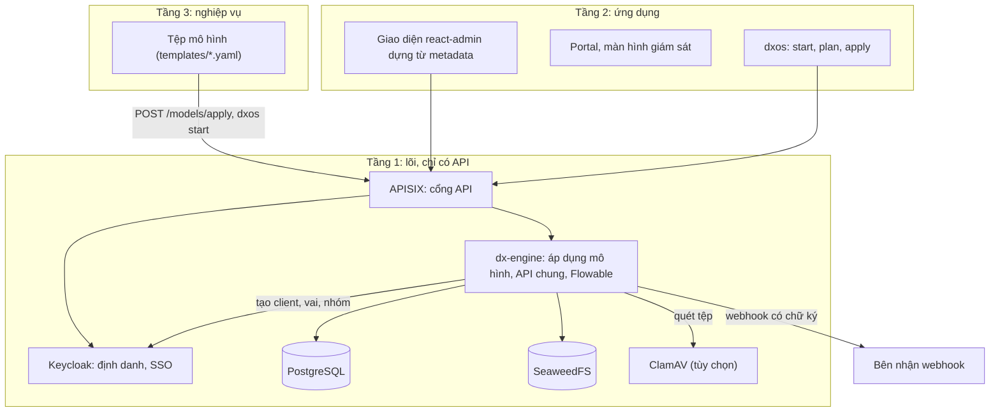

# Kiến trúc

Lõi nhận một tệp mô hình và phục vụ nghiệp vụ mà tệp đó khai báo.
Hướng thiết kế và phạm vi đầy đủ ở [`docs/dynamic-core/README.md`](./docs/dynamic-core/README.md); tài liệu này mô tả phần đã chạy.

## 1. Ba tầng

- **Tầng 1, lõi:** không có trang nào do đội viết; mọi thứ qua API.
- **Tầng 2:** giao diện đọc metadata của lõi; portal, màn hình giám sát và lệnh `dxos`.
  Bảng điều khiển (`frontend/src/console`) và trang lịch (`frontend/src/admin/CalendarPage.tsx`) là mã nạp chậm của ứng dụng web.
  Chữ người dùng đọc do frontend quyết định: backend trả thông báo tiếng Anh kèm `errorCode`, frontend dịch theo `frontend/src/shell/backendMessages.ts`.
- **Tầng 3:** chỉ là tệp mô hình, không có mã.

## 2. Module backend

| Module | Vai trò |
|---|---|
| `dx-model` | Định dạng tệp mô hình: đọc YAML, kiểm tra, báo lỗi theo dòng và cột; không phụ thuộc Spring |
| `dx-core` | Thư viện dùng chung: bảo mật, audit, lưu trữ và quét tệp, trạng thái hệ thống, client Keycloak |
| `dx-engine` | Dịch vụ chạy được, gồm phần điều khiển, API chung và Flowable nhúng |
| `dx-monitor` | Dịch vụ giám sát chạy riêng, không phụ thuộc module nào ở trên |

`dx-model` không phụ thuộc module nào; `dx-core` không phụ thuộc `dx-engine`; mã lõi không chứa tên thực thể, vai hay luồng của một lĩnh vực.

## 3. Định danh và token

Keycloak giữ tài khoản, mật khẩu và vai; realm `dxos` được nhập một lần từ [`sso/realm-dxos.json`](./sso/realm-dxos.json).

| Client | Dùng cho |
|---|---|
| `dxos-web` | Người dùng đăng nhập vào ứng dụng web |
| `dxos-monitor` | Đăng nhập vào màn hình giám sát |
| `dxos-cli` | Lệnh `dxos plan` và `dxos apply`; tài khoản dịch vụ giữ vai `ADMIN` |
| `dxos-backend-admin` | Tài khoản dịch vụ của backend gọi Admin API: tạo client, vai, nhóm và quản trị người dùng |
| `dxos-m-<mô hình>` | Chỉ để chứa vai của mô hình, không cho ai đăng nhập |
| `dxos-app-<tên>` | Một ứng dụng ngoài gọi API bằng token máy; tài khoản dịch vụ giữ đúng một vai của một mô hình |

- Vai `ADMIN` của nền tảng nằm ở `realm_access`, vai của mô hình ở `resource_access.dxos-m-<mô hình>.roles`, đơn vị ở claim `groups`.
- APISIX kiểm token ở biên; backend kiểm lại chữ ký, thời hạn và audience `dxos-api` (do scope `dxos-api` thêm vào).
- Vai và đơn vị đọc từ token đã ký, nên đổi vai hay đơn vị có hiệu lực sau tối đa khoảng 5 phút (token sống 300 giây).
- Admin API của Keycloak 26.8 chỉ nhận token có audience của chính nó, nên `dxos-backend-admin` mang scope `kc-admin-api`; xem [`sso/README.md`](./sso/README.md).

## 4. Áp dụng một mô hình

Mô hình đi qua một đường duy nhất, từ hệ thống rỗng hay từ phiên bản đang chạy.

### Xem trước và áp dụng

`POST /api/v1/models/plan` không đổi bảng hay bản ghi nào, chỉ trả về:

- Thay đổi theo ba mức, do `ModelDiff` so sánh hai phiên bản mô hình: `SAFE`, `MIGRATION`, `LOSS`; đổi kiểu trường và đổi họ mẫu quy trình bị từ chối.
- Dòng đang vi phạm quy tắc mới, kèm một phần id.
  Siết hoặc thêm `min`, `max`, `pattern` hay danh sách lựa chọn của trường `multiple` trên bảng có dòng vi phạm là `MIGRATION` kèm số dòng (quy tắc `MIN`, `MAX`, `PATTERN`, `ELEMENTS`) và bị từ chối cho đến khi dữ liệu được sửa; nới hoặc bỏ là `SAFE`.
- Đổi `required_when` hay khối `ui:` là thay đổi `SAFE`, không đụng dữ liệu; `ui:` không thuộc luật quy trình nên không bị chặn khi còn hồ sơ đang xử lý.
- Số hồ sơ đang xử lý của các quy trình bị ảnh hưởng.
- Các câu lệnh sẽ chạy, do pgschema lập từ trạng thái đích mà `DdlGenerator` sinh ra.

`POST /api/v1/models/apply?base=N&accept=<mức>` (ADMIN) chạy khi `base` đúng phiên bản đang chạy, mức rủi ro không vượt `accept` và không có dòng vi phạm, rồi ghi từng bước vào `engine.apply_step`:

1. `RENAME_FIELD`: đổi tên cột theo `renamed_from`, cùng ràng buộc và chỉ mục mang tên trường.
2. `CHANGE_SCHEMA`: pgschema đưa schema `m_<tên mô hình>` về trạng thái đích, gồm bảng, cột hệ thống, ràng buộc, chỉ mục và quyền đọc của `report_ro`.
   Kiểu `boolean`, `date` và `choice` nhiều lựa chọn thành cột `BOOLEAN`, `DATE` và `TEXT[]` (`default` của trường nhiều lựa chọn thành `DEFAULT ARRAY[...]`); `min`, `max`, `pattern` và các phần tử của `TEXT[]` thành ràng buộc `CHECK` mang tên `ck_<thực thể>_<trường>` kèm `$min`, `$max`, `$re`.
3. `DROP_FILES`: xóa dòng và đối tượng tệp đính kèm của thực thể bị bỏ khỏi mô hình.
4. `ENSURE_CLIENT`: client `dxos-m-<mô hình>` trong Keycloak, chỉ để chứa vai và không cho ai đăng nhập.
5. `ENSURE_ROLE`: vai của mô hình, tạo dưới client đó.
6. `ENSURE_UNIT`: đơn vị của mô hình, là nhóm trong Keycloak.
7. `SAVE_VERSION`: lưu nội dung và mã băm; từ đây phiên bản có hiệu lực.

Bảo vệ dữ liệu nằm ở lõi: nếu kế hoạch của pgschema có thao tác xóa bảng hoặc cột mà so sánh mô hình không có, áp dụng dừng lại.
Không có giao dịch chung giữa PostgreSQL, Keycloak, Flowable và SeaweedFS.
Mỗi bước chạy lại được an toàn, nên áp dụng bị gián đoạn thì áp dụng lại để làm tiếp; đã đổi tên thì chỉ đúng tệp đó mới hoàn tất được.
Tệp không đổi vẫn được so với bảng và Keycloak thật: cột, ràng buộc, client, vai hoặc nhóm đơn vị bị mất thành các thay đổi `REPAIR_SCHEMA`, `REPAIR_CLIENT`, `REPAIR_ROLE`, `REPAIR_UNIT` với action `repair`, chạy bằng chính các bước trên và không tăng phiên bản.
Bảng hoặc cột thừa bị từ chối; đổi kiểu cột hay bỏ ràng buộc thừa ở mức `MIGRATION`; việc kiểm chỉ chạy khi xem kế hoạch hoặc áp dụng, không chạy lúc backend khởi động.
`POST /api/v1/models/{model}/rollback` đi qua đúng đường này với nội dung phiên bản trước, đảo các lần đổi tên và ghi thành phiên bản mới.

Trước khi chạy, lõi từ chối:

- vai `ADMIN` của nền tảng;
- thay đổi người xử lý, hạn xử lý, quyền tự quyết, hành động hoàn tất hay đặt chỗ khi thực thể còn hồ sơ đang xử lý;
- xóa thực thể còn hồ sơ đang chạy quy trình.

### Giữ mô hình và áp dụng dở

Mỗi mô hình có một khóa Postgres riêng cho lần áp dụng, nên các mô hình khác nhau áp dụng song song.
Mô hình được giữ lại từ bước đầu đến khi registry nạp xong phiên bản mới: người dùng chưa vào được, còn `GET /api/v1/models` báo `held`.
`GET /api/v1/meta/models` liệt kê mô hình đang bị giữ với `held` là true và không có thực thể, chỉ khi người gọi đọc được một thực thể của mô hình; trang Hộp việc dùng đó để báo mô hình đang được áp dụng.
Mô hình có lần áp dụng đầu dở chưa vào registry nên không được liệt kê.
Một bước lỗi làm lần áp dụng dừng và mô hình vẫn bị giữ, kể cả sau khi backend khởi động lại, vì trạng thái suy ra từ `engine.apply_run`.
Mỗi lần áp dụng lưu tệp, các lần đổi tên và mức đã xác nhận ở `engine.apply_run`, nên:

- `POST /api/v1/models/{model}/resume` hoàn tất lần đó mà không cần tệp;
- `POST /api/v1/models/{model}/abandon` đưa các bảng về phiên bản đang chạy; cột và bảng mà lần áp dụng dở đã thêm bị xóa cùng dữ liệu.

Mô hình mà lần áp dụng đầu dừng dở chưa có phiên bản; danh sách mô hình vẫn liệt kê nó với phiên bản 0, và `abandon` xóa schema cùng bảng mà lần đó đã tạo.

### Vai và đơn vị

Vai của mỗi mô hình nằm trong client riêng, nên hai mô hình dùng cùng tên vai không va nhau.
Vai bỏ khỏi tệp mô hình vẫn còn ở client của mô hình cùng người giữ nhưng không cho quyền gì, vì quyền chỉ theo vai mà mô hình đang khai báo; khai báo lại thì kế hoạch hỏi xác nhận, và xóa hẳn vai hay client làm tay ở Keycloak.
Đơn vị là cơ cấu tổ chức nên mọi mô hình dùng cùng nhóm Keycloak theo tên; đơn vị chỉ cho phạm vi dòng, còn quyền làm gì vẫn do vai của từng mô hình quyết định.

### Tệp mô hình lúc khởi động

`ModelBootstrap` áp dụng các tệp ở `ENGINE_MODEL_FILE` (tên cách nhau bởi dấu phẩy, tìm trong `ENGINE_MODEL_DIR`) khi backend khởi động, trên một luồng riêng chờ Keycloak một lần, lần lượt từng tệp, với người thực hiện `bootstrap`; tệp lỗi không chặn tệp sau.
Chỉ tệp chưa từng áp dụng, có kế hoạch an toàn và không có lần áp dụng dở mới được áp dụng; mỗi tệp ghi một dòng `Model bootstrap: <applied|unchanged|skipped|failed> ...`.

## 5. Một yêu cầu đi qua API chung

- **Tên và truy vấn:** tên bảng và cột chỉ lấy từ mô hình đã kiểm, giá trị luôn đi qua tham số; tên trường hay toán tử không có trong mô hình bị từ chối (400).
- **Quyền:** các phạm vi của những vai người gọi có được hợp lại: `all`, `read` chạm mọi dòng, `own` chạm dòng do người gọi tạo, `unit` chạm dòng thuộc đơn vị của người gọi, `assigned` chạm dòng giao cho người gọi.
  Thực thể con (`owner_via`) xét các phạm vi này trên bản ghi cha, qua nhiều cấp tới thực thể đầu chuỗi, và không gắn được vào bản ghi cha ngoài tầm với (403).
- **Quy tắc:** bắt buộc, duy nhất, lựa chọn, `min`, `max` và `pattern` vừa được API kiểm để báo lỗi theo từng trường, vừa là ràng buộc trong cơ sở dữ liệu.
  `required_when` chỉ kiểm ở API, trên hồ sơ sau khi gộp giá trị mới vào bản ghi hiện có.
  Điều kiện của `required_when` và `when` so sánh trường `number`, `date`, `text`, `choice` một lựa chọn và `boolean`; `<`, `<=`, `>`, `>=` chỉ dùng cho `number` và `date`.
- **Kiểu giá trị:** `date` là `YYYY-MM-DD`, `boolean` là `true` hay `false`, và trường nhiều lựa chọn là mảng chuỗi lưu theo thứ tự của `options`, không trùng; lọc trường đó bằng `contains`.
- **Tài liệu API:** `GET /api/v1/meta/models/{model}/openapi` sinh tài liệu OpenAPI của mô hình đang chạy ngay lúc gọi, nên luôn khớp tệp mô hình; người có vai của mô hình đọc được.
- **Gửi lại:** tạo hồ sơ và hành động nhận header `Idempotency-Key`; khóa được ghi vào `engine.idempotency` cùng giao dịch với việc làm, nên yêu cầu lỗi không giữ khóa và hai yêu cầu cùng khóa chạy cùng lúc chỉ làm một lần, yêu cầu sau chờ rồi nhận câu trả lời của yêu cầu trước.
  Khóa thuộc về người gửi và gắn với một yêu cầu (loại, đích và băm của nội dung), giữ 24 giờ rồi bị dọn.

## 6. Quy trình và trạng thái

Trạng thái của hồ sơ chỉ đổi qua quy trình.

- Flowable chạy nhúng, dùng chung nguồn dữ liệu và giao dịch Spring; bảng của nó nằm ở schema `engine`.
- Họ mẫu quy trình (`approval`, `work_item`, `reservation`) khai báo trạng thái và hành động ở `ProcessFamily`; các bước nằm ở tệp BPMN cùng tên.
- Một thực thể có thể ghi đè từng trạng thái và hành động của họ mẫu, hoặc tự khai báo `states` và `actions` mà không cần họ mẫu; quy trình khác khung gốc chạy trên BPMN do `ProcessBpmnGenerator` sinh từ khai báo lúc áp dụng, và không nạp tệp BPMN tự viết.
- `ProcessRules` giữ các quy tắc mọi họ mẫu cùng chịu: vai và quyền của người làm, người tạo không tự quyết định, lý do khi từ chối hoặc trả lại, rút lại giữ bản ghi.
- `BookingGuard` kiểm họ `reservation` khi tạo và sửa bản ghi: khung giờ hợp lệ, số lượt chạy cùng lúc ở mọi thời điểm của khung giờ không vượt sức chứa; dòng tài nguyên bị khóa đến hết giao dịch.
- API chung từ chối mọi yêu cầu có cột `status` (403); `POST .../{id}/actions/{action}` kiểm người được làm và trạng thái đầu, hoàn tất tác vụ, và bước kế của quy trình ghi trạng thái mới qua bean `recordStatus`.
- Hồ sơ đã giao thì chỉ người được giao thực hiện được hành động của vai xử lý.
- Hành động của người xử lý có thể kèm `when`, một phép so sánh một trường với một giá trị; `ProcessRules` kiểm nó trên bản ghi đã khóa, hồ sơ chưa đạt bị từ chối 409 với `data.reason` là `CONDITION_NOT_MET`, và giá trị trống không đạt.
- Hành động sai trạng thái bị từ chối (409); lỗi sau bước quy trình làm cả hồ sơ, quy trình lẫn dòng lịch sử quay về như cũ.
- Hạn xử lý lưu ở cột `handle_by` khi hồ sơ chờ người xử lý; `overdue` được tính khi đọc.
- `CatalogService` cấp cho bảng điều khiển schema của tệp mô hình, các họ mẫu, mẫu mô hình và phiên bản đã áp dụng.
- `DataCatalogService` mô tả dữ liệu của một mô hình đang chạy ở `GET /api/v1/models/{model}/data-catalog` (ADMIN): trường, vai được truy cập, số dòng, liên kết giữa các thực thể, và nơi dữ liệu đi vào (vai, ứng dụng ngoài) và đi ra (webhook, hành động hoàn tất, dòng sự kiện, lưu trữ).
- `ProcessDiagramService` đọc một tệp mô hình bằng `ModelParser` và trả trạng thái, hành động, hạn, `auto_close` và hành động `after` của từng quy trình, hoặc danh sách lỗi kèm dòng và cột; không so với mô hình đang chạy.

## 7. Sự kiện và hành động sau quyết định

- Bảng `engine.outbox` nhận thông điệp trong giao dịch của thay đổi; `OutboxDispatcher` giao sau khi giao dịch xong, thử lại với thời gian chờ tăng dần, mỗi khóa một thông điệp.
- `OutboxController` cho ADMIN xem thông điệp theo trạng thái cùng lỗi gần nhất và thử lại thông điệp chưa gửi; `OutboxCleanup` xóa thông điệp đã gửi sau 30 ngày.
- Hành động hoàn tất của khối `after:` đi qua outbox đến `CompletionHandler`; hiện có các thao tác `add_to_group` và `remove_from_group` của Keycloak.
- `OverdueSweep` ghi dòng quá hạn vào lịch sử, một lần cho mỗi hạn, và dòng `due_soon` khi hồ sơ còn dưới `ENGINE_DUE_SOON_BEFORE` trước hạn.
- Khi mô hình có đích webhook (khóa `webhook` hoặc `DXOS_WEBHOOK_URL`), mỗi dòng lịch sử có thêm một thông điệp chủ đề `record.event` trong outbox cùng giao dịch, và `WebhookHandler` gửi nó kèm chữ ký.
  Các dòng của một hồ sơ được giao theo thứ tự.
  Việc áp dụng mô hình và thay đổi tài khoản đi qua chủ đề `admin.event`.
  Bên nhận lỡ tin kéo lại bằng `GET /api/v1/events`.
  Cấu trúc thông điệp, chữ ký, thử lại và đích dạng `chat` ở [`deploy/INTEGRATIONS.md`](./deploy/INTEGRATIONS.md).

## 8. Tệp đính kèm

- Trường kiểu `file` gắn tệp qua `AttachmentService`: byte ở SeaweedFS, siêu dữ liệu ở `engine.attachment`, quét ClamAV khi bật, quyền theo quyền của bản ghi.
- `AttachmentProcessor` chỉ nhận các phần mở rộng đã cấu hình, `AttachmentService` giữ mỗi hồ sơ tối đa số tệp đã cấu hình, và link tải luôn ở dạng đính kèm.
- `AttachmentCleaner` xóa đối tượng khỏi kho khi tệp hoặc hồ sơ bị gỡ, qua thông điệp `file.delete` trong outbox sau một khoảng trễ, để bản sao lưu luôn có đủ tệp của mọi dòng trong bản dump.

## 9. Quản trị người dùng và nhật ký

- `UserAdminController` (ADMIN) quản lý tài khoản qua Admin API của Keycloak, bằng tài khoản dịch vụ `dxos-backend-admin`; Keycloak vẫn là nơi giữ tài khoản, mật khẩu và vai.
- Chỉ gán được vai và đơn vị mà một mô hình đang chạy khai báo (404 với cái khác); vai `ADMIN` của nền tảng không có đường nào qua API này, và ADMIN không khóa được chính mình (409).
- Mật khẩu tạm do hệ thống sinh, trả về một lần và phải đổi ở lần đăng nhập đầu; không ghi vào log hay audit.
- Mỗi thay đổi tài khoản thành công và mỗi lần áp dụng, quay về, tiếp tục hoặc hủy bỏ mô hình ghi một bản ghi `audit_log` qua `AuditRecorder`, kèm người thực hiện lấy từ token.
  Việc ghi audit lỗi chỉ để lại dòng log, thay đổi vẫn thành công.
- `GET /api/v1/audit-logs` lọc được theo đối tượng (`targetType`, `targetId`, có chỉ mục `idx_audit_log_target`); hộp thoại người dùng ở bảng điều khiển lấy từ đó các bản ghi `USER` của người được mở.
- Thay đổi làm thẳng ở Keycloak Admin Console không đi qua đây; sự kiện quản trị của Keycloak (giữ 90 ngày, ghi tài khoản người thực hiện) là nơi tra cứu.
- Các hành động ghi và cách tra cứu ở [`deploy/MONITORING.md`](./deploy/MONITORING.md).

## 10. Toàn vẹn và phục hồi

- **Lịch sử chống sửa:** các dòng `engine.record_event` nối thành một chuỗi hash (`HistoryChain`); mỗi giờ backend ghi một điểm neo (`HistoryAnchor`) vào kho đối tượng, ngoài Postgres.
  `dxos history verify` hay `GET /api/v1/history/verify` (ADMIN) tính lại chuỗi và so với các điểm neo.
  Chuỗi phát hiện chứ không ngăn việc sửa; bên nhận webhook giữ `hash` của tin đã nhận thì có thêm một điểm neo ngoài máy chủ (`examples/history-witness`).
- **Hồ dữ liệu:** `dxos archive` xuất hồ sơ đã tới trạng thái cuối và lịch sử của chúng ra Parquet kèm `manifest.json` ghi số dòng và sha256, vào một thư mục hoặc (`--store`) vào bucket riêng của SeaweedFS; `dxos archive check` kiểm lại, `dxos archive auto` ghi mỗi hồ sơ đã đóng quá `ARCHIVE_AFTER_DAYS` một lần và `dxos archive schedule install` chạy nó mỗi ngày bằng systemd user timer.
- **Tự phục hồi:** mọi service chạy lâu có `restart: unless-stopped`; `dxos reconcile` đưa stack về đúng khai báo và chạy mỗi phút bằng systemd user timer.
- **Sao lưu:** `deploy/backup.sh` chụp bản sao lưu mã hóa của Postgres và kho tệp; `verify` nạp bản dump vào Postgres tạm và kiểm mọi tệp đính kèm đều có.
- Cách dùng từng việc ở [`deploy/OPERATIONS.md`](./deploy/OPERATIONS.md) và [`deploy/INTEGRATIONS.md`](./deploy/INTEGRATIONS.md).

## 11. Dữ liệu

| Schema | Nội dung |
|---|---|
| `engine` | Phiên bản mô hình, lịch sử áp dụng, dòng lịch sử của bản ghi, bảng của Flowable |
| `m_<mô hình>` | Bảng nghiệp vụ sinh từ mô hình |
| `public` (bảng `audit_log`) | Nhật ký truy cập và thao tác quản trị |
| `monitor` | Dữ liệu của màn hình giám sát |
| `keycloak` (cơ sở dữ liệu riêng) | Tài khoản, vai, phiên |

Flowable đặt `search_path` của kết nối nó dùng về `engine` và không trả lại.
Truy vấn vào bảng ngoài `engine` vì vậy luôn ghi rõ schema.

Dịch vụ lõi là kết nối ghi duy nhất vào dữ liệu nghiệp vụ; vai `report_ro` chỉ đọc.
`report_ro` đọc được mọi dòng của mọi bảng nghiệp vụ và không áp quyền `own`, `unit`, `assigned` của người xem, nên chỉ cấp cho công cụ báo cáo của người vận hành.
Cách kết nối, giới hạn mạng và xoay mật khẩu ở [`deploy/REPORTING.md`](./deploy/REPORTING.md).
Người dùng cuối xem số liệu qua `GET /api/v1/data/{model}/{entity}/stats`, nơi quyền theo dòng được áp dụng.

## 12. Triển khai

Compose chạy lõi (`postgres`, `keycloak`, `seaweedfs`, `backend`, `apisix`) và Tầng 2 (`frontend`, `portal`, `monitor`); `clamav` bật bằng profile `av`.
Gateway kiểm token cho mọi route API; các route không kiểm token nằm trong danh sách công khai kiểm bởi `deploy/apisix/check_routes.py`.
`dxos start <tệp>...` đưa các tệp mô hình vào qua `deploy/model/` và in kết quả của `ModelBootstrap` cho từng tệp.
Chi tiết vận hành ở [`deploy/OPERATIONS.md`](./deploy/OPERATIONS.md), log và audit ở [`deploy/MONITORING.md`](./deploy/MONITORING.md), webhook và lịch sử chống sửa ở [`deploy/INTEGRATIONS.md`](./deploy/INTEGRATIONS.md).

## 13. Đối chiếu với yêu cầu của đề

| Đề yêu cầu | Đáp ứng |
|---|---|
| Định danh và SSO | Keycloak, vai sinh từ mô hình và quản trị người dùng ở bảng điều khiển |
| Cổng API | APISIX kiểm token, giới hạn tốc độ, định tuyến |
| Dữ liệu có cấu trúc | PostgreSQL, schema và ràng buộc sinh từ mô hình |
| Dữ liệu phi cấu trúc | SeaweedFS và quét ClamAV ở `dx-core`, gắn vào trường `file` của mô hình |
| Động cơ luồng công việc | Flowable nhúng, họ mẫu `approval`, `work_item` và `reservation` |
| Lõi không có giao diện | `dx-engine` chỉ phục vụ API; giao diện thuộc Tầng 2 |

Bốn nguyên lý kỹ thuật của đề:

| Nguyên lý | Đáp ứng |
|---|---|
| Phân tách theo vòng đời dữ liệu, đẩy dữ liệu lịch sử xuống hồ dữ liệu | `dxos archive --store` ghi hồ sơ đã đóng và lịch sử của chúng ra Parquet vào một bucket riêng của SeaweedFS kèm manifest và hash; `dxos archive schedule install` đặt lịch hằng ngày theo `ARCHIVE_AFTER_DAYS` |
| Hội tụ dữ liệu hành chính (IT) và vận hành (OT) | Chương trình giả lập thiết bị tạo hồ sơ sự cố qua API (`examples/itot-simulator`), đi qua cùng quy trình, quyền và lịch sử với hồ sơ hành chính |
| Quản trị dữ liệu, phả hệ và nguồn gốc | Tệp mô hình là danh mục dữ liệu, trang Danh mục dữ liệu đọc từ đó nơi dữ liệu đi vào, đi ra và liên kết giữa các thực thể; lịch sử hồ sơ chống sửa |
| Zero-Trust, GitOps, kiểm dịch mã độc, tự phục hồi | Token kiểm ở gateway và backend; ClamAV quét tệp khi bật; tệp mô hình là khai báo, xem trước rồi áp dụng; `dxos reconcile` và `restart: unless-stopped` |
