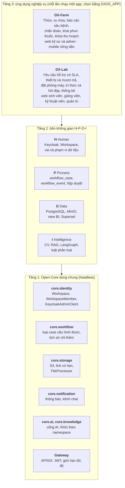
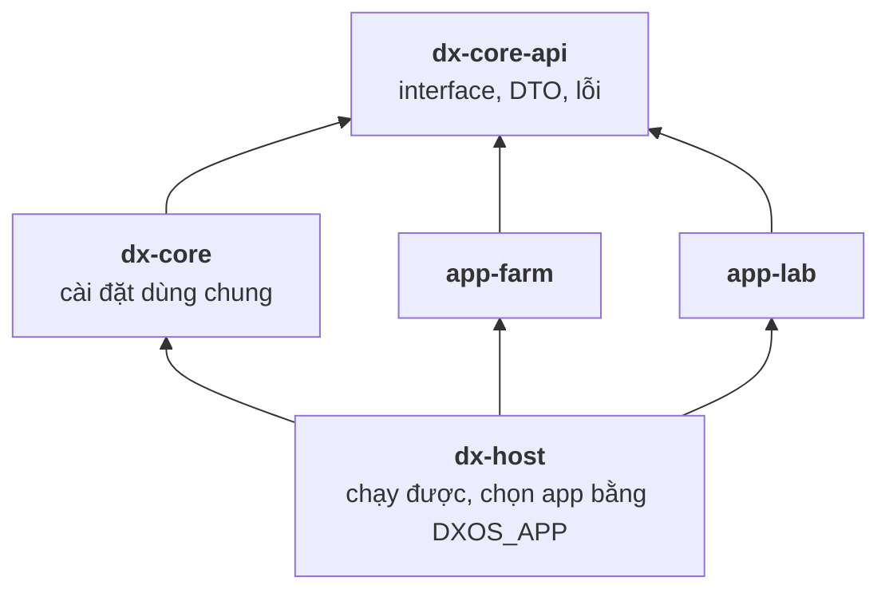
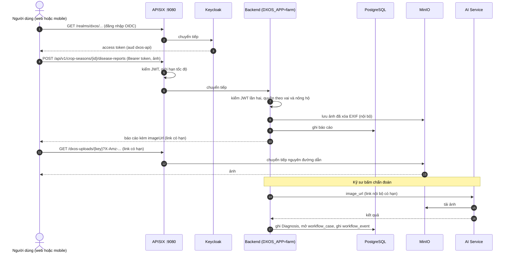
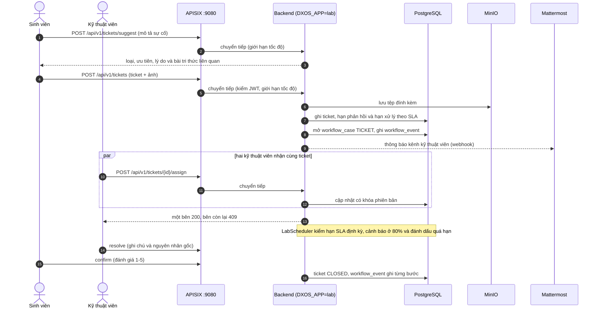

# Kiến trúc Open-Core 3 tầng

Tài liệu mô tả ranh giới giữa phần lõi dùng chung (Core) và hai ứng dụng chạy trên nó: DX-Farm (nông nghiệp) và DX-Lab (vận hành CNTT của khoa).
Sơ đồ viết bằng Mermaid, GitHub hiển thị trực tiếp.

## 1. Sơ đồ 3 tầng

| Tầng | Thành phần | Nơi nằm trong repo |
|---|---|---|
| 1. Core | Identity, SSO | `backend/dx-core/.../core/identity`, `sso/` (Keycloak) |
| 1. Core | Workflow | `backend/dx-core/.../core/workflow`, bảng `workflow_case`, `workflow_event` |
| 1. Core | Storage | `backend/dx-core/.../core/storage`, `minio/` |
| 1. Core | Notification | `backend/dx-core/.../core/notification`, bảng `notifications` |
| 1. Core | Cổng AI, tri thức | `backend/dx-core/.../core/ai`, `.../core/knowledge` |
| 1. Core | Bảo mật, trạng thái hệ thống | `backend/dx-core/.../core/security`, `.../core/status` |
| 1. Core | API Gateway | `deploy/apisix/common.yaml` |
| 2. H-P-D-I | Human, Process, Data, Intelligence | các thành phần Core ở trên cộng `ai/`, `bi/`, `chat/` |
| 3. Ứng dụng | DX-Farm | `backend/app-farm`, `frontend/src/apps/farm`, `mobile/`, `data/` |
| 3. Ứng dụng | DX-Lab | `backend/app-lab`, `frontend/src/apps/lab`, `data/rag/lab/` |

## 2. Module và ranh giới biên dịch

- Backend gồm năm module Maven.
  `dx-core-api` giữ interface, DTO và lỗi; `dx-core` cài đặt các dịch vụ dùng chung; `app-farm` và `app-lab` là hai ứng dụng; `dx-host` ghép chúng và là fat jar duy nhất được đóng gói.
- Mỗi ứng dụng chỉ có `dx-core-api` trên classpath.
  Compiler từ chối mọi import từ ứng dụng vào ruột `dx-core`, và `dx-core` không import ứng dụng nào.
- Core không biết ứng dụng nào đang chạy:
  - `WorkflowService` nhận `caseType`, `entityType`, `entityId` dạng chuỗi và số; trạng thái, bước chuyển và vai do app khai báo bằng `CaseTypeDefinition`.
  - `StorageService` nhận khóa object và byte; việc làm sạch tệp do app cài `FileProcessor`.
  - Vai, endpoint công khai, loại workspace, loại thông báo, kênh chat, view BI, nguồn tri thức và chỉ báo sức khỏe do app khai báo qua interface; core chỉ gom các bean đó lúc khởi động.
- Entity của core không lộ ra ứng dụng: app nhận `CaseView` và `WorkspaceView`, và lưu id dạng số thay cho quan hệ JPA xuyên module.
- Đổi ứng dụng chỉ thêm module ứng dụng mới; `dx-core-api`, `dx-core` và `deploy/apisix/common.yaml` giữ nguyên.
  Cách thêm ở [`CONTRIBUTING.md`](./CONTRIBUTING.md) mục "Thêm một ứng dụng mới".

## 3. Interface của Core

Interface khai báo một lần ở `dx-core-api`, mỗi ứng dụng cài theo cách riêng.
Chỉ có interface khi Farm và Lab thật sự khác nhau; phần giống nhau nằm trực tiếp trong `dx-core` (RBAC, base entity, error envelope, idempotency, giới hạn tốc độ, phân trang, audit và xóa mềm).

### Interface ứng dụng cài

Ứng dụng khai báo mỗi interface bằng một Spring bean; core gom các bean đó lúc khởi động và chỉ bắt buộc có `AppModule`.

| Interface | Mục đích | Farm cài | Lab cài |
|---|---|---|---|
| `AppModule` | id, tên, menu, loại workspace, loại case tính giới hạn yêu cầu chờ | `farm` | `lab` |
| `RoleProvider` | Vai của app (tên, mô tả, cờ nhân sự); core tạo vai thiếu trong Keycloak lúc khởi động | FARMER, ENGINEER, ADMIN | STUDENT, LECTURER, TECHNICIAN, ADMIN |
| `CaseTypeDefinition` | Loại case: trạng thái, bước chuyển và vai được thực hiện (bean) | 5 loại duyệt | `TICKET` (nhiều trạng thái), `DEVICE_LOAN`, `ROOM_BOOKING` |
| `WorkflowDecisionHandler` | Áp dụng quyết định lên entity của app | 3 handler | handler ticket và mượn thiết bị |
| `CaseSummaryProvider` | Mô tả entity cho hộp duyệt, theo lô | thửa, vụ, sửa thửa, chẩn đoán, phun | ticket, phiếu mượn, đặt phòng |
| `NotificationTypeDefinition` | Loại thông báo (mã, nhãn, biểu tượng); bean | 13 loại | 12 loại |
| `NotificationChannel` | Kênh chat app đăng bài; webhook đọc từ `mattermost.webhook.url-<khóa>` | `admin`, `engineer` | `technician`, `admin` |
| `BiDatasetProvider` | View và bảng vai chỉ đọc của Superset được `SELECT` | `vw_*` nông nghiệp và danh mục | `vw_lab_*` |
| `FileProcessor` | Kiểm tra và làm sạch tệp theo mục đích trước khi lưu | ảnh lá: chỉ JPEG/PNG, xóa EXIF | tệp đính kèm: JPEG, PNG, PDF tối đa 5 MiB, loại theo nội dung |
| `KnowledgeNamespace` | Tên corpus RAG và danh mục nguồn | `farm` | `lab` |
| `EndpointPolicyContributor` | Đường dẫn GET công khai | `diseases`, `pesticides`, `treatment-rules` | không có |
| `ClientRestrictionPolicy` | Vai chỉ được dùng một số client | FARMER chỉ dùng mobile | không có |
| `HealthContributor` | Thêm dịch vụ vào `GET /api/v1/system/status` | AI | AI |

Schema: mỗi ứng dụng có Flyway location và bảng lịch sử riêng (`db/migration/farm`, `db/migration/lab`); core chạy trước với `db/migration/core`.

### Facade ứng dụng gọi

| Facade | Dùng để |
|---|---|
| `WorkflowOperations` | mở case, ghi bước, gán người phụ trách, đếm case chờ, tìm case theo `CaseQuery` |
| `ApprovalInbox` | danh sách và chi tiết yêu cầu chờ duyệt, lọc theo workspace và ngày |
| `PendingRequestLimit` | chặn người dùng gửi thêm khi đã có đủ yêu cầu chờ |
| `WorkspaceDirectory` | tra workspace theo id, mã, tài khoản; liệt kê theo loại; thành viên |
| `WorkspaceAdministration` | tạo workspace kèm tài khoản chủ, gắn tài khoản chủ, thêm thành viên |
| `UserContext` | id, tên, vai và workspace của người đang đăng nhập |
| `ObjectStorage`, `FileStore` | lưu, tạo link có hạn, xử lý tệp qua `FileProcessor` |
| `NotificationPublisher`, `ChatWebhook` | ghi thông báo có khóa chống trùng, đăng lên webhook của kênh chat |
| `AiGateway`, `KnowledgeGateway` | gọi AI service kèm khóa dịch vụ; hỏi đáp RAG theo namespace, lọc theo ngưỡng điểm, gắn nguồn |

### Kiểu dữ liệu công khai

- `CaseView`: id, caseType, entityType, entityId, status (chuỗi), createdBy, assignedTo, thời điểm.
- `WorkspaceView`, `WorkspaceMemberView`: workspace và thành viên (`OWNER` hoặc `MEMBER`).
- `InboxItem`: case, `CaseSummary` của entity và workspace của entity.
- Trạng thái, hành động của case và loại thông báo là chuỗi; core từ chối loại thông báo chưa được app đăng ký.
- Controller có tên trường riêng của app (`/api/v1/households`, `/api/v1/approval-requests`, `/api/v1/knowledge/ask`) nằm ở app và dựng từ facade; core chỉ có controller với JSON trung tính.

## 4. Chọn ứng dụng lúc chạy

- `DXOS_APP` (`farm` hoặc `lab`) chọn app; giá trị khác làm backend dừng trước khi tạo bean (`AppSelectionCheck`).
- Mỗi app nạp bằng một cấu hình tự động có điều kiện `dxos.app=<app>`: chỉ app đang chạy có entity, bảng, controller và lịch chạy.
- Lớp ngoài backend đổi theo cùng biến:
  - Gateway: `apisix-config` ghép `common.yaml` với `apps/<app>.yaml`.
  - Superset: kết nối và dataset của app.
  - Tri thức: job `rag-ingest` nạp corpus của app vào namespace riêng.
  - Web: một image, đọc `GET /api/v1/app` rồi nạp module giao diện của app.
- `deploy/start.sh <app>` đổi app bằng một lệnh; bảng của app trước nằm lại trong database, không dùng tới.

## 5. Thành phần

- **Backend (Java, Spring Boot)** sở hữu dữ liệu nghiệp vụ trong PostgreSQL, state machine duyệt, poka-yoke (khóa PHI, ràng buộc vụ mùa), phân quyền theo vai và nông hộ; schema do Flyway quản lý.
- **Workflow dùng chung** ghi mỗi quyết định thành một `workflow_event` chỉ thêm, mỗi yêu cầu có người phụ trách; danh sách việc chờ ở `GET /api/v1/workflow-cases`.
- **AI Service (Python, FastAPI)** gồm CV (YOLOv8n), RAG trên pgvector, LangGraph và Qwen2.5-1.5B qua Ollama; không có quyền vào database của Backend, gọi API nội bộ của Backend để lấy dữ kiện có cấu trúc.
- **Web (React, Vite)**: một image phục vụ cả hai app, đọc `GET /api/v1/app` rồi nạp giao diện của app đang chạy.
- **Mobile (Expo)** dành cho nông dân: đăng nhập Keycloak (PKCE), tạo thửa và vụ, chụp và gửi ảnh, hộp thông báo, hàng đợi gửi lại khi mất mạng.
- **BI (Superset)** chỉ đọc các view `vw_*` của bản ghi đã duyệt.
- **Lưu ảnh (MinIO)** bucket riêng tư, client nhận link có hạn (mặc định 15 phút).
- **Chat (Mattermost)** nhận thông báo một chiều từ Backend qua Incoming Webhook.
- **Portal** trang liên kết tới các ứng dụng và hiện trạng thái từng dịch vụ.

Dữ liệu:

- Hai database trên cùng một Postgres: `dxos` (dữ liệu nghiệp vụ và tri thức có cấu trúc) và `dx_farm_ai_vector_db` (`documents`, `document_chunks` cho RAG; AI dùng role chỉ đọc, job ingest dùng role ghi riêng).
- Seed nghiệp vụ của Farm ở `backend/app-farm/src/main/resources/farm/data.sql`, sinh từ `data/structured/*.json` bằng `data/scripts/generate_seed_sql.py`; chỉ record được duyệt (`eligible_for_seed=true`) mới được seed.
  Không sửa tay `data.sql`; CI chạy `generate_seed_sql.py --check` để phát hiện dữ liệu nguồn và `data.sql` bị lệch.
- Lab không có seed SQL: phòng, thiết bị, yêu cầu, phiếu và lịch mẫu nạp qua API bằng `deploy/demo/seed_demo.py`; tri thức quy chế ở `data/rag/lab/`.
- Hạ tầng Postgres (role, database, extension) do các `*Seeder` trong `dx-core`.

Nguyên tắc nghiệp vụ:

1. Deterministic-first: thuốc, liều, PHI luôn lấy từ dữ liệu có cấu trúc, LLM không tự sinh con số.
2. Human-in-the-loop: khuyến nghị có thuốc phải qua kỹ sư duyệt.
3. PostgreSQL là nguồn sự thật; RAG chỉ để giải thích.
4. Poka-yoke chặn ở Backend, không chỉ ẩn nút ở giao diện.

## 6. Sơ đồ luồng request: Farm

## 7. Sơ đồ luồng request: Lab

## 8. Nguyên tắc vận hành

- Mọi client chỉ biết một địa chỉ: gateway.
  Cổng của backend, Keycloak, AI, MinIO và portal không publish ra host.
  Gateway có ba listener: `9080` cho web, API, Keycloak, ảnh và portal (`/portal/`), `9081` riêng cho Superset (bản 3.1 không chạy được dưới đường dẫn con), `9082` riêng cho console MinIO.
- Gateway chỉ có route và giới hạn tốc độ của app đang chạy.
- Backend kiểm lại JWT độc lập với gateway; gateway sai cấu hình thì backend vẫn tự bảo vệ.
- AI Service không có route ở gateway, chỉ backend gọi được qua mạng nội bộ của compose.
- `GET /api/v1/system/status` (công khai) trả app đang chạy và trạng thái từng dịch vụ; portal đọc từ đây.

## 9. Đối chiếu với yêu cầu của đề

| Yêu cầu (đề mục 3 và 4.1) | Chứng minh |
|---|---|
| Tầng 1 headless, không có giao diện người dùng cuối | `dx-core` chỉ có API; giao diện nằm ở `frontend/` và `mobile/` (tầng 2 và 3) |
| Identity/SSO | Keycloak, realm `dxos`, `core.identity`, vai do app khai báo |
| API Gateway | APISIX: JWT, giới hạn tốc độ, một cửa cho mọi client |
| Dữ liệu cấu trúc và phi cấu trúc | PostgreSQL (nghiệp vụ, pgvector), MinIO (ảnh, tệp đính kèm) |
| Workflow | `core.workflow`: loại case cấu hình được, lịch sử chỉ thêm, hộp duyệt |
| Ít nhất một ứng dụng ở tầng 3 | Hai ứng dụng: DX-Farm và DX-Lab, cùng một Core không đổi |
