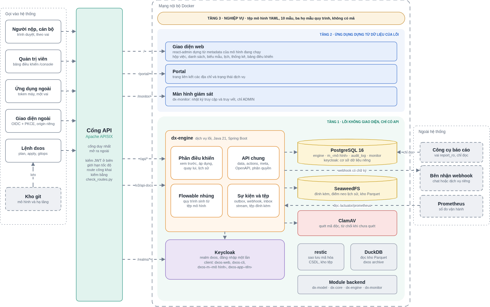

# Kiến trúc

Lõi nhận một tệp mô hình và phục vụ nghiệp vụ mà tệp đó khai báo.
Hướng thiết kế và phạm vi đầy đủ ở [`docs/dynamic-core/README.md`](./docs/dynamic-core/README.md); tài liệu này mô tả phần đã chạy.

## 1. Ba tầng

- **Tầng 1, lõi:** không có trang nào do đội viết; mọi thứ qua API.
- **Tầng 2:** giao diện đọc metadata của lõi, cùng portal, màn hình giám sát và lệnh `dxos`.
- **Tầng 3:** chỉ là tệp mô hình, không có mã.
- Chữ người dùng đọc do frontend quyết định: backend trả thông báo tiếng Anh kèm `errorCode`, frontend dịch theo `frontend/src/shell/backendMessages.ts`.

## 2. Module backend

| Module | Vai trò |
|---|---|
| `dx-model` | Định dạng tệp mô hình: đọc YAML, kiểm tra, báo lỗi theo dòng và cột; không phụ thuộc Spring |
| `dx-core` | Thư viện dùng chung: bảo mật, audit, lưu trữ và quét tệp, trạng thái hệ thống, client Keycloak |
| `dx-engine` | Dịch vụ chạy được, gồm phần điều khiển, API chung và Flowable nhúng |
| `dx-monitor` | Dịch vụ giám sát chạy riêng, không phụ thuộc module nào ở trên |

`dx-model` không phụ thuộc module nào; `dx-core` không phụ thuộc `dx-engine`; mã lõi không chứa tên thực thể, vai hay luồng của một lĩnh vực.

## 3. Định danh và token

Keycloak giữ tài khoản, mật khẩu và vai; realm `dxos` được nhập một lần từ [`sso/realm-dxos.json`](./sso/realm-dxos.json).

| Client | Dùng cho |
|---|---|
| `dxos-web` | Người dùng đăng nhập vào ứng dụng web |
| `dxos-monitor` | Đăng nhập vào màn hình giám sát |
| `dxos-cli` | Lệnh `dxos plan`, `dxos apply` và `dxos gitops`; tài khoản dịch vụ giữ vai `ADMIN` |
| `dxos-backend-admin` | Tài khoản dịch vụ của backend gọi Admin API: tạo client, vai, nhóm và quản trị người dùng |
| `dxos-m-<mô hình>` | Chỉ để chứa vai của mô hình, không cho ai đăng nhập |
| `dxos-app-<tên>` | Một ứng dụng ngoài gọi API bằng token máy; tài khoản dịch vụ giữ đúng một vai của một mô hình |

- Vai `ADMIN` của nền tảng nằm ở `realm_access`, vai của mô hình ở `resource_access.dxos-m-<mô hình>.roles`, đơn vị ở claim `groups`.
- APISIX kiểm token ở biên; backend kiểm lại chữ ký, thời hạn và audience `dxos-api`.
- Vai và đơn vị đọc từ token đã ký, nên đổi vai hay đơn vị có hiệu lực sau tối đa khoảng 5 phút (token sống 300 giây).
- Admin API của Keycloak 26.8 chỉ nhận token có audience của chính nó, nên `dxos-backend-admin` mang scope `kc-admin-api`; xem [`sso/README.md`](./sso/README.md).

## 4. Áp dụng một mô hình

Mô hình đi qua một đường duy nhất, từ hệ thống rỗng hay từ phiên bản đang chạy.

### Xem trước

`POST /api/v1/models/plan` không đổi bảng hay bản ghi nào, chỉ trả về:

- Thay đổi theo ba mức `SAFE`, `MIGRATION`, `LOSS`; đổi kiểu trường và đổi họ mẫu quy trình bị từ chối.
- Dòng đang vi phạm quy tắc mới: siết hoặc thêm `min`, `max`, `pattern` hay danh sách lựa chọn là `MIGRATION` kèm số dòng và bị từ chối đến khi dữ liệu được sửa; nới hoặc bỏ là `SAFE`.
  Đổi `required_when`, `ui:` hay `documents:` là `SAFE` và không bị chặn khi còn hồ sơ đang xử lý.
- Số hồ sơ đang xử lý của các quy trình bị ảnh hưởng, và các câu lệnh pgschema sẽ chạy.

### Áp dụng

`POST /api/v1/models/apply?base=N&accept=<mức>` (ADMIN) chạy khi `base` đúng phiên bản đang chạy, mức rủi ro không vượt `accept` và không có dòng vi phạm.
Từng bước được ghi vào `engine.apply_step`:

1. `RENAME_FIELD`: đổi tên cột theo `renamed_from`, cùng ràng buộc và chỉ mục mang tên trường.
2. `CHANGE_SCHEMA`: pgschema đưa schema `m_<tên mô hình>` về trạng thái đích, gồm bảng, cột hệ thống, ràng buộc `CHECK`, chỉ mục và quyền đọc của `report_ro`.
3. `DROP_FILES`: xóa dòng và đối tượng tệp đính kèm của thực thể bị bỏ khỏi mô hình.
4. `ENSURE_CLIENT`, `ENSURE_ROLE`, `ENSURE_UNIT`: client `dxos-m-<mô hình>`, vai của mô hình dưới client đó, và đơn vị là nhóm Keycloak.
5. `SAVE_VERSION`: lưu nội dung và mã băm; từ đây phiên bản có hiệu lực.

Các bảo đảm:

- Bảo vệ dữ liệu nằm ở lõi: kế hoạch của pgschema có thao tác xóa bảng hoặc cột mà so sánh mô hình không có thì áp dụng dừng lại.
- Không có giao dịch chung giữa PostgreSQL, Keycloak, Flowable và SeaweedFS.
  Mỗi bước chạy lại được an toàn, nên áp dụng bị gián đoạn thì áp dụng lại để làm tiếp.
- Tệp không đổi vẫn được so với bảng và Keycloak thật: thứ bị mất thành thay đổi `REPAIR_*` (action `repair`), chạy bằng chính các bước trên và không tăng phiên bản; bảng hoặc cột thừa bị từ chối.
  Việc kiểm chỉ chạy khi xem kế hoạch hoặc áp dụng, không chạy lúc backend khởi động.
- `POST /api/v1/models/{model}/rollback` đi qua đúng đường này với nội dung phiên bản trước và ghi thành phiên bản mới.
- Lõi từ chối vai `ADMIN` của nền tảng, thay đổi người xử lý, hạn xử lý, quyền tự quyết, hành động hoàn tất hay đặt chỗ khi thực thể còn hồ sơ đang xử lý, và xóa thực thể còn hồ sơ đang chạy quy trình.

### Giữ mô hình và áp dụng dở

- Mỗi mô hình có một khóa Postgres riêng cho lần áp dụng, nên các mô hình khác nhau áp dụng song song.
- Mô hình được giữ từ bước đầu đến khi registry nạp xong phiên bản mới: người dùng chưa vào được và `GET /api/v1/models` báo `held`.
- Một bước lỗi làm lần áp dụng dừng và mô hình vẫn bị giữ, kể cả sau khi backend khởi động lại, vì trạng thái suy ra từ `engine.apply_run`, nơi lưu tệp, các lần đổi tên và mức đã xác nhận.
- `POST /api/v1/models/{model}/resume` hoàn tất lần dở mà không cần tệp.
- `POST /api/v1/models/{model}/abandon` đưa các bảng về phiên bản đang chạy; cột và bảng mà lần dở đã thêm bị xóa cùng dữ liệu.

### Vai và đơn vị

- Vai của mỗi mô hình nằm trong client riêng, nên hai mô hình dùng cùng tên vai không va nhau.
- Vai bỏ khỏi tệp mô hình vẫn còn ở client cùng người giữ nhưng không cho quyền gì, vì quyền chỉ theo vai mà mô hình đang khai báo; khai báo lại thì kế hoạch hỏi xác nhận, và xóa hẳn vai hay client làm tay ở Keycloak.
- Đơn vị là cơ cấu tổ chức nên mọi mô hình dùng cùng nhóm Keycloak theo tên; đơn vị chỉ cho phạm vi dòng, còn quyền làm gì do vai của từng mô hình quyết định.

### Tệp mô hình lúc khởi động

`ModelBootstrap` áp dụng các tệp ở `ENGINE_MODEL_FILE` (tên cách nhau bởi dấu phẩy, tìm trong `ENGINE_MODEL_DIR`) khi backend khởi động, trên một luồng riêng chờ Keycloak một lần, lần lượt từng tệp, với người thực hiện `bootstrap`.
Chỉ tệp chưa từng áp dụng, có kế hoạch an toàn và không có lần áp dụng dở mới được áp dụng; tệp lỗi không chặn tệp sau.

## 5. Một yêu cầu đi qua API chung

- **Tên và truy vấn:** tên bảng và cột chỉ lấy từ mô hình đã kiểm, giá trị luôn đi qua tham số; tên trường hay toán tử không có trong mô hình bị từ chối (400).
- **Quyền:** các phạm vi của những vai người gọi có được hợp lại: `all` và `read` chạm mọi dòng, `own` chạm dòng do người gọi tạo, `unit` chạm dòng thuộc đơn vị của người gọi, `assigned` chạm dòng giao cho người gọi.
  Thực thể con (`owner_via`) xét các phạm vi này trên bản ghi cha, qua nhiều cấp, và không gắn được vào bản ghi cha ngoài tầm với (403).
- **Quy tắc:** bắt buộc, duy nhất, lựa chọn, `min`, `max` và `pattern` vừa được API kiểm để báo lỗi theo từng trường, vừa là ràng buộc trong cơ sở dữ liệu.
  `required_when` chỉ kiểm ở API, trên hồ sơ sau khi gộp giá trị mới vào bản ghi hiện có.
- **Mã hồ sơ:** trường `code` nhận số từ `engine.record_counter` trong giao dịch tạo hồ sơ, nên hai hồ sơ không trùng mã và hồ sơ lỗi không làm mất số; lần áp dụng điền mã cho hồ sơ có sẵn khi một trường `code` mới được thêm.
- **Gửi lại:** tạo hồ sơ và hành động nhận header `Idempotency-Key`, ghi vào `engine.idempotency` cùng giao dịch với việc làm; hai yêu cầu cùng khóa chạy cùng lúc chỉ làm một lần, và khóa giữ 24 giờ.
- **Tài liệu API:** `GET /api/v1/meta/models/{model}/openapi` sinh OpenAPI của mô hình đang chạy ngay lúc gọi, nên luôn khớp tệp mô hình; người có vai của mô hình đọc được.

## 6. Quy trình và trạng thái

Trạng thái của hồ sơ chỉ đổi qua quy trình.

- Flowable chạy nhúng, dùng chung nguồn dữ liệu và giao dịch Spring; bảng của nó nằm ở schema `engine`.
- Họ mẫu quy trình (`approval`, `work_item`, `reservation`) khai báo trạng thái và hành động; một thực thể có thể ghi đè từng cái, hoặc tự khai báo `states` và `actions` không cần họ mẫu.
  Quy trình sinh từ khai báo lúc áp dụng; lõi không nạp tệp BPMN tự viết.
- Quy tắc chung của mọi họ mẫu: vai và quyền của người làm, người tạo không tự quyết định, lý do khi từ chối hoặc trả lại, rút lại giữ bản ghi.
- Họ `reservation` kiểm khi tạo và sửa: khung giờ hợp lệ và số lượt chạy cùng lúc không vượt sức chứa; dòng tài nguyên bị khóa đến hết giao dịch.
- API chung từ chối mọi yêu cầu có cột `status` (403).
  `POST .../{id}/actions/{action}` kiểm người được làm và trạng thái đầu, hoàn tất tác vụ, rồi bước kế của quy trình ghi trạng thái mới.
- Hồ sơ đã giao thì chỉ người được giao thực hiện được hành động của vai xử lý.
- Hành động có thể kèm `when`, so một trường với một giá trị trên bản ghi đã khóa; chưa đạt thì bị từ chối 409 với `data.reason` là `CONDITION_NOT_MET`, và giá trị trống không đạt.
- Hành động sai trạng thái bị từ chối (409); lỗi sau bước quy trình làm cả hồ sơ, quy trình lẫn dòng lịch sử quay về như cũ.
- Hạn xử lý lưu ở cột `handle_by` khi hồ sơ chờ người xử lý; `overdue` được tính khi đọc.
- `GET /api/v1/models/{model}/data-catalog` (ADMIN) mô tả dữ liệu của mô hình đang chạy: trường, vai được truy cập, số dòng, liên kết giữa các thực thể, nơi dữ liệu đi vào và đi ra.

## 7. Sự kiện và hành động sau quyết định

- Bảng `engine.outbox` nhận thông điệp trong giao dịch của thay đổi; `OutboxDispatcher` giao sau khi giao dịch xong, thử lại với thời gian chờ tăng dần, mỗi khóa một thông điệp.
  ADMIN xem thông điệp theo trạng thái và thử lại thông điệp chưa gửi; thông điệp đã gửi bị xóa sau 30 ngày.
- Hành động hoàn tất của khối `after:` đi qua outbox; hiện có `add_to_group` và `remove_from_group` của Keycloak.
- Hồ sơ quá hạn ghi một dòng lịch sử cho mỗi hạn, và dòng `due_soon` trước hạn một khoảng `ENGINE_DUE_SOON_BEFORE`.
  Mỗi mức của `escalate` đến hạn ghi một dòng `escalated` và gửi webhook, không đổi trạng thái hay người giữ hồ sơ.
- Hành động khai `check: <tên đích>` hỏi đích đó trước khi trạng thái đổi, trong giao dịch giữ khóa hồ sơ; đích từ chối hoặc không trả lời theo `on_error` thì hồ sơ giữ nguyên và dòng `check_denied` hoặc `check_unavailable` được ghi.
- Khi mô hình có đích webhook (khóa `webhook` hoặc `DXOS_WEBHOOK_URL`), mỗi dòng lịch sử có thêm một thông điệp `record.event` trong outbox cùng giao dịch, gửi kèm chữ ký và giao theo thứ tự trong một hồ sơ.
  Việc áp dụng mô hình và thay đổi tài khoản đi qua chủ đề `admin.event`; bên nhận lỡ tin kéo lại bằng `GET /api/v1/events`.
  Cấu trúc thông điệp, chữ ký, thử lại và đích dạng `chat` ở [`docs/INTEGRATIONS.md`](./docs/INTEGRATIONS.md).

## 8. Tệp đính kèm và mẫu in

- Trường kiểu `file` gắn tệp: byte ở SeaweedFS, siêu dữ liệu ở `engine.attachment`, quét ClamAV, quyền theo quyền của bản ghi, phần mở rộng và số tệp mỗi hồ sơ theo cấu hình.
- Khi tệp hoặc hồ sơ bị gỡ, đối tượng trong kho bị xóa qua thông điệp `file.delete` sau một khoảng trễ, để bản sao lưu luôn có đủ tệp của mọi dòng trong bản dump.
- Khối `documents` của thực thể là các mẫu in có cấu trúc, kiểm khi đọc mô hình: chỗ trống chỉ gồm trường của thực thể và cột của hồ sơ.
  In một hồ sơ đi qua quyền đọc của hồ sơ, ghi `audit_log` rồi trả PDF dàn bằng Apache PDFBox với phông Noto Sans nhúng; mẫu không có điều kiện, vòng lặp hay biểu thức, nên không có gì để chạy.

## 9. Quản trị người dùng và nhật ký

- Quản lý tài khoản (ADMIN) đi qua Admin API của Keycloak bằng tài khoản dịch vụ `dxos-backend-admin`; Keycloak vẫn giữ tài khoản, mật khẩu và vai.
- Chỉ gán được vai và đơn vị mà một mô hình đang chạy khai báo (404 với cái khác); vai `ADMIN` của nền tảng không có đường nào qua API này, và ADMIN không khóa được chính mình (409).
- Mật khẩu tạm do hệ thống sinh, trả về một lần và phải đổi ở lần đăng nhập đầu; không ghi vào log hay audit.
- Mỗi thay đổi tài khoản thành công và mỗi lần áp dụng, quay về, tiếp tục hay hủy bỏ mô hình ghi một bản ghi `audit_log` kèm người thực hiện lấy từ token; ghi audit lỗi chỉ để lại dòng log, thay đổi vẫn thành công.
  `GET /api/v1/audit-logs` lọc được theo đối tượng (`targetType`, `targetId`).
- Thay đổi làm thẳng ở Keycloak Admin Console không đi qua đây; sự kiện quản trị của Keycloak (giữ 90 ngày) là nơi tra cứu.
- Các hành động ghi và cách tra cứu ở [`docs/MONITORING.md`](./docs/MONITORING.md).

## 10. Toàn vẹn và phục hồi

- **Lịch sử chống sửa:** các dòng `engine.record_event` nối thành một chuỗi hash; mỗi giờ backend ghi một điểm neo vào kho đối tượng, ngoài Postgres.
  `dxos history verify` hay `GET /api/v1/history/verify` (ADMIN) tính lại chuỗi và so với các điểm neo.
  Chuỗi phát hiện chứ không ngăn việc sửa; bên nhận webhook giữ `hash` của tin đã nhận thì có thêm một điểm neo ngoài máy chủ (`examples/history-witness`).
- **Hồ dữ liệu:** `dxos archive` xuất hồ sơ đã tới trạng thái cuối và lịch sử của chúng ra Parquet kèm `manifest.json` ghi số dòng và sha256, vào một thư mục hoặc (`--store`) vào bucket riêng của SeaweedFS.
  `dxos archive schedule install` đặt lịch hằng ngày cho hồ sơ đã đóng quá `ARCHIVE_AFTER_DAYS`.
- **Tự phục hồi:** mọi service chạy lâu có `restart: unless-stopped`; `dxos reconcile` đưa stack về đúng khai báo và chạy mỗi phút bằng systemd user timer.
- **GitOps:** `dxos gitops` kéo theo chu kỳ hạ tầng (`deploy/`, cấu hình cổng vào, tag image) từ một kho DX-OS và các tệp mô hình từ một kho của người triển khai, xác minh chữ ký commit nếu bật, rồi báo lệch, chờ duyệt hoặc tự áp dụng.
  Nâng cấp hạ tầng đi qua `install.sh --upgrade` và `update.sh`.
- **Sao lưu:** `deploy/backup.sh` chụp bản sao lưu mã hóa của Postgres và kho tệp; `verify` nạp bản dump vào Postgres tạm và kiểm mọi tệp đính kèm đều có.
- Cách dùng từng việc ở [`docs/OPERATIONS.md`](./docs/OPERATIONS.md) và [`docs/INTEGRATIONS.md`](./docs/INTEGRATIONS.md).

## 11. Dữ liệu

| Schema | Nội dung |
|---|---|
| `engine` | Phiên bản mô hình, lịch sử áp dụng, dòng lịch sử của bản ghi, bảng của Flowable |
| `m_<mô hình>` | Bảng nghiệp vụ sinh từ mô hình |
| `public` (bảng `audit_log`) | Nhật ký truy cập và thao tác quản trị |
| `monitor` | Dữ liệu của màn hình giám sát |
| `keycloak` (cơ sở dữ liệu riêng) | Tài khoản, vai, phiên |

Flowable đặt `search_path` của kết nối nó dùng về `engine` và không trả lại, nên truy vấn vào bảng ngoài `engine` luôn ghi rõ schema.

- **Ghi và đọc:** dịch vụ lõi là kết nối ghi duy nhất vào dữ liệu nghiệp vụ.
  Vai `report_ro` chỉ đọc, thấy mọi dòng của mọi bảng nghiệp vụ và không áp quyền `own`, `unit`, `assigned` của người xem, nên chỉ cấp cho công cụ báo cáo của người vận hành; cách kết nối ở [`docs/REPORTING.md`](./docs/REPORTING.md).
- **Số liệu theo quyền:** các API dưới đây dùng cùng dòng và bộ lọc với danh sách, nên quyền theo dòng được áp dụng; công cụ báo cáo cần quyền theo dòng dùng chúng thay cho `report_ro`.
  - `GET /api/v1/data/{model}/{entity}/stats`: số liệu tổng quan.
  - `.../report`: nhóm theo một trường và tính đếm, tổng, trung bình, nhỏ nhất, lớn nhất trên trường số; tên trường và phép tính được kiểm theo mô hình nên không phần nào của yêu cầu thành SQL.
  - `.../quality` (ADMIN, chỉ nhận số đếm): độ điền, thiếu theo điều kiện, kiểm lại ràng buộc, độ mới.
- **Phả hệ:** `GET /api/v1/models/{model}/data-lineage` dựng từ tệp mô hình, với mỗi trường: nơi giá trị đi vào, các quy tắc đọc nó và nơi nó đi ra.
  Lõi giữ nguyên giá trị đã nhập nên phả hệ không có bước biến đổi nào.

## 12. Triển khai

- Compose chạy lõi (`postgres`, `keycloak`, `seaweedfs`, `backend`, `apisix`) và Tầng 2 (`frontend`, `portal`, `monitor`); `clamav` chạy với profile `av`, có sẵn trong cấu hình mặc định.
- `dxos start --core` chỉ chạy lõi: không có Tầng 2 và gateway không có route của nó.
  Keycloak Admin Console mặc định không mở ra gateway.
- Gateway kiểm token cho mọi route API; các route không kiểm token nằm trong danh sách công khai kiểm bởi `e2e/api/check_routes.py`.
- `dxos start <tệp>...` đưa các tệp mô hình vào qua `deploy/model/` và in kết quả của `ModelBootstrap` cho từng tệp.
- Chi tiết vận hành ở [`docs/OPERATIONS.md`](./docs/OPERATIONS.md), log và audit ở [`docs/MONITORING.md`](./docs/MONITORING.md), webhook và lịch sử chống sửa ở [`docs/INTEGRATIONS.md`](./docs/INTEGRATIONS.md).

## 13. Đối chiếu với yêu cầu của đề

| Đề yêu cầu | Đáp ứng |
|---|---|
| Định danh và SSO | Keycloak; vai sinh từ mô hình, quản trị người dùng ở bảng điều khiển |
| Cổng API | APISIX kiểm token, giới hạn tốc độ, định tuyến |
| Dữ liệu có cấu trúc | PostgreSQL; schema và ràng buộc sinh từ mô hình |
| Dữ liệu phi cấu trúc | SeaweedFS và quét ClamAV, gắn vào trường `file` |
| Động cơ luồng công việc | Flowable nhúng; họ mẫu `approval`, `work_item`, `reservation` |
| Lõi không có giao diện | `dx-engine` chỉ phục vụ API; giao diện thuộc Tầng 2 |

| Nguyên lý kỹ thuật của đề | Đáp ứng |
|---|---|
| Phân tách theo vòng đời dữ liệu, đẩy lịch sử xuống hồ dữ liệu | `dxos archive --store` ghi hồ sơ đã đóng ra Parquet kèm manifest và hash, đặt lịch hằng ngày (mục 10) |
| Hội tụ dữ liệu hành chính (IT) và vận hành (OT) | Chương trình giả lập thiết bị tạo hồ sơ sự cố qua API (`examples/itot-simulator`), cùng quy trình, quyền và lịch sử với hồ sơ hành chính |
| Quản trị dữ liệu, phả hệ và nguồn gốc | Tệp mô hình là danh mục dữ liệu; danh mục, số đo chất lượng và phả hệ từng trường đọc từ đó (mục 11); lịch sử hồ sơ chống sửa |
| Zero-Trust, GitOps, kiểm dịch mã độc, tự phục hồi | Token kiểm ở gateway và backend; ClamAV từ chối tệp khi chưa quét được; `dxos gitops` kéo hạ tầng và mô hình từ git; `dxos reconcile` và `restart: unless-stopped` |

## 14. Quyết định đã chốt

Mỗi quyết định ghi theo mẫu: bối cảnh, phương án, quyết định, hệ quả.
Lý do chọn từng công cụ ở [trang thành phần](https://haui-implsolution.github.io/DX-OS/docs/dependencies); mục này chỉ ghi các quyết định về cấu trúc.

### QĐ-1: API chung đọc mô hình lúc chạy

- **Bối cảnh:** lõi phải phục vụ nhiều nghiệp vụ mà không biết trước thực thể nào, và đổi mô hình khi hệ thống đang chạy.
- **Phương án:** sinh mã cho từng thực thể; dùng một nền dựng backend từ bảng có sẵn (Supabase, Strapi, Directus); một API chung đọc mô hình lúc chạy.
- **Quyết định:** API chung đọc mô hình đang chạy rồi mới dựng truy vấn.
- **Hệ quả:** không có mã sinh ra để bảo trì, và đổi thực thể chỉ cần đổi mô hình; đổi lại, việc chống chèn SQL, quyền theo dòng và hiệu năng nằm trong mã tự viết (mục 5).

### QĐ-2: Một PostgreSQL cho dữ liệu, lịch sử, hàng đợi và quy trình

- **Bối cảnh:** ghi một hồ sơ, đổi trạng thái và ghi sự kiện phải thành công hoặc hỏng cùng nhau.
- **Phương án:** mỗi thành phần một kho riêng; một cơ sở dữ liệu cho tất cả.
- **Quyết định:** một PostgreSQL, mỗi mô hình một schema, Flowable dùng chung (mục 11); Keycloak giữ cơ sở dữ liệu riêng.
- **Hệ quả:** một giao dịch bao trùm cả ba việc; đổi lại, PostgreSQL là điểm lỗi đơn, và sao lưu phải chụp cả dữ liệu lẫn kho tệp (mục 10).

### QĐ-3: Flowable nhúng, BPMN sinh từ khai báo

- **Bối cảnh:** người triển khai cần quy trình duyệt mà không viết BPMN, và quy trình không được đi vòng quy tắc của lõi.
- **Phương án:** trình thiết kế BPMN kéo thả; nạp tệp BPMN tự viết; họ mẫu có tham số hoặc `states` và `actions` khai báo.
- **Quyết định:** Flowable chạy nhúng trong `dx-engine`; lõi sinh BPMN từ họ mẫu hoặc từ khai báo (mục 6).
- **Hệ quả:** mọi quy trình chịu cùng bộ quy tắc bất biến; đổi lại, không nạp được BPMN tự viết và không có trình kéo thả.

### QĐ-4: Áp dụng mô hình theo kế hoạch có thứ tự, không giao dịch chung

- **Bối cảnh:** một lần đổi mô hình chạm PostgreSQL, Keycloak, Flowable và SeaweedFS, mà bốn thành phần không chung một giao dịch.
- **Phương án:** một giao dịch phân tán; đổi tay từng thành phần; xem trước một kế hoạch rồi chạy từng bước.
- **Quyết định:** xem trước, rồi áp dụng từng bước ghi vào `engine.apply_step`, mỗi bước chạy lại được an toàn (mục 4).
- **Hệ quả:** lần áp dụng dừng giữa chừng thì lõi giữ mô hình, và quản trị viên chọn tiếp tục hoặc hủy bỏ; lõi không tự thử lại và không tự quay lui.

### QĐ-5: Trục sự kiện bằng bảng outbox, không có message broker

- **Bối cảnh:** hệ thống ngoài cần biết hồ sơ đổi, mà việc gửi không được làm hỏng hay chặn thay đổi.
- **Phương án:** một message broker; gọi thẳng hệ thống ngoài trong giao dịch; ghi sự kiện vào bảng cùng giao dịch rồi gửi sau.
- **Quyết định:** bảng `engine.outbox` trong PostgreSQL, gửi webhook có chữ ký, thử lại khi bên nhận lỗi, và API kéo sự kiện theo `eventId` (mục 7).
- **Hệ quả:** không mất sự kiện khi bên nhận lỗi; đổi lại, giao ít nhất một lần nên bên nhận phải khử trùng theo `eventId`.

### QĐ-6: Vai theo từng mô hình, đơn vị dùng chung

- **Bối cảnh:** hai mô hình có thể dùng cùng tên vai, còn đơn vị là cơ cấu tổ chức chung của cả hệ thống.
- **Phương án:** vai và đơn vị cùng chung toàn hệ thống; cả hai riêng từng mô hình; vai riêng từng mô hình, đơn vị chung.
- **Quyết định:** vai của mỗi mô hình nằm trong client `dxos-m-<mô hình>`; đơn vị là nhóm Keycloak theo tên, chỉ cho phạm vi dòng (mục 3 và 4).
- **Hệ quả:** hai mô hình dùng cùng tên vai không va nhau; đổi vai hay đơn vị có hiệu lực sau tối đa khoảng 5 phút vì đọc từ token đã ký.

### QĐ-7: Lịch sử chống sửa bằng chuỗi hash và điểm neo ngoài cơ sở dữ liệu

- **Bối cảnh:** lịch sử hồ sơ phải cho thấy khi bị sửa, kể cả bởi người có quyền trên cơ sở dữ liệu.
- **Phương án:** chặn mọi quyền sửa; nối các dòng thành một chuỗi hash; chuỗi hash cộng điểm neo lưu ở nơi khác.
- **Quyết định:** các dòng `engine.record_event` nối thành chuỗi hash, và mỗi giờ lõi ghi một điểm neo vào kho đối tượng, ngoài PostgreSQL (mục 10).
- **Hệ quả:** chuỗi phát hiện chứ không ngăn việc sửa; bên nhận webhook giữ `hash` của tin đã nhận thì có thêm một điểm neo ngoài máy chủ.

### QĐ-8: Thành phần nguồn mở dùng nguyên bản, giấy phép OSI

- **Bối cảnh:** đề thi đòi sản phẩm nguồn mở, và lõi không được phụ thuộc vào một nhà cung cấp.
- **Phương án:** viết lại các thành phần; sửa hoặc vá mã thượng nguồn; dùng nguyên bản và cấu hình.
- **Quyết định:** image chính thức ghim tag và digest, không sửa mã thượng nguồn, mọi giấy phép thuộc danh sách OSI và được máy kiểm ở mỗi pull request.
- **Hệ quả:** thay một thành phần là đổi cấu hình hoặc địa chỉ; đổi lại, phần dự án cần mà thượng nguồn không có phải tự viết ở lớp nối.
