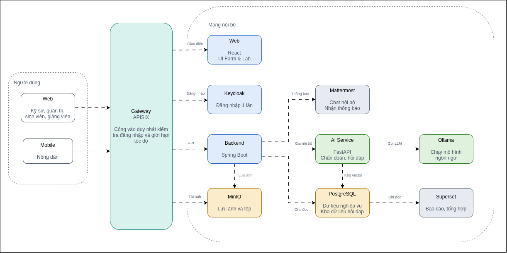
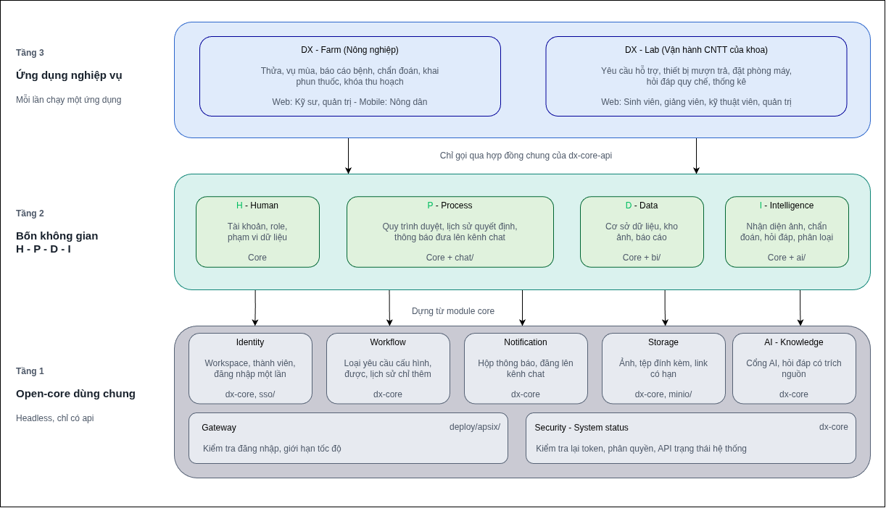
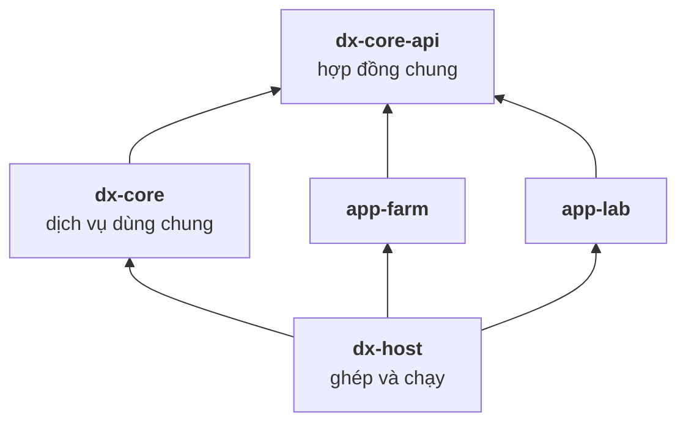
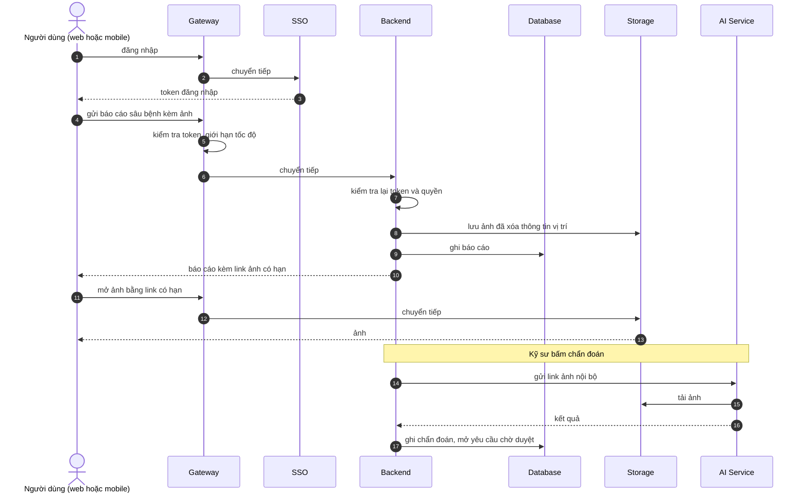
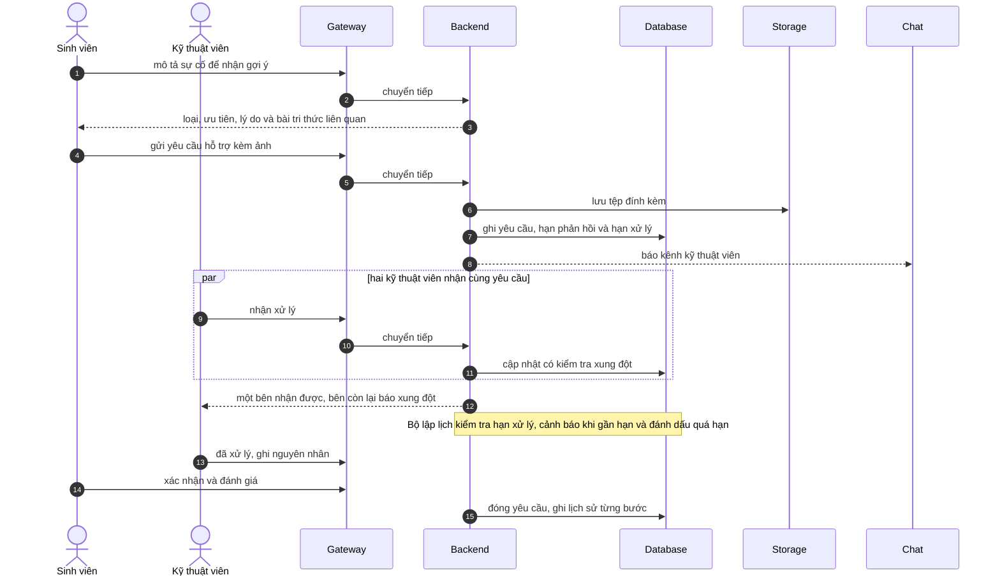

# Kiến trúc Open-Core 3 tầng

Tài liệu mô tả ranh giới giữa phần lõi dùng chung (Core) và hai ứng dụng chạy trên nó: DX-Farm (nông nghiệp) và DX-Lab (vận hành CNTT của khoa).
Sơ đồ tổng quan và sơ đồ 3 tầng là ảnh; các sơ đồ còn lại viết bằng Mermaid, GitHub hiển thị trực tiếp.

## Tổng quan

Mọi người dùng, web hay mobile, đều đi qua một cổng vào duy nhất.
Backend xử lý nghiệp vụ, lưu dữ liệu và ảnh, nhờ AI Service chẩn đoán và hỏi đáp.

| Dịch vụ | Vai trò |
|---|---|
| Gateway (APISIX) | Cổng vào duy nhất, kiểm tra đăng nhập, giới hạn tốc độ và ghi log truy cập |
| Backend (Spring Boot) | Nghiệp vụ, phân quyền, quy trình duyệt, thông báo |
| Web (React) | Giao diện cho Farm và Lab |
| Mobile (Expo) | Ứng dụng cho nông dân, dùng được khi mất mạng |
| Keycloak | Đăng nhập một lần, quản lý tài khoản và vai |
| PostgreSQL | Dữ liệu nghiệp vụ và dữ liệu cho hỏi đáp |
| MinIO | Lưu ảnh và tệp đính kèm |
| AI Service (FastAPI) | Nhận diện bệnh từ ảnh, hỏi đáp tài liệu |
| Ollama | Chạy mô hình ngôn ngữ cho AI Service |
| Superset | Báo cáo tổng hợp |
| Mattermost | Nhận thông báo từ Backend |
| Portal | Trang liên kết và trạng thái các dịch vụ |

## 1. Sơ đồ 3 tầng

| Tầng | Thành phần | Thư mục |
|---|---|---|
| 1. Core | Identity, SSO | `backend/dx-core`, `sso/` |
| 1. Core | Workflow, Notification | `backend/dx-core` |
| 1. Core | Audit | `backend/dx-core` |
| 1. Core | Storage | `backend/dx-core`, `minio/` |
| 1. Core | AI, Knowledge | `backend/dx-core` |
| 1. Core | Security, System status | `backend/dx-core` |
| 1. Core | Gateway | `deploy/apisix/` |
| 2. H-P-D-I | Human, Process, Data, Intelligence | các thành phần Core ở trên, cộng `ai/`, `bi/`, `chat/` |
| 3. Ứng dụng | DX-Farm | `backend/app-farm`, `frontend/`, `mobile/`, `data/` |
| 3. Ứng dụng | DX-Lab | `backend/app-lab`, `frontend/`, `data/` |

## 2. Module và ranh giới biên dịch

- Backend gồm năm module: hợp đồng chung, dịch vụ dùng chung, hai ứng dụng và module ghép để chạy.
- Ứng dụng chỉ nhìn thấy hợp đồng chung, không chạm được vào ruột của Core; trình biên dịch chặn việc này.
- Core không biết ứng dụng nào đang chạy, mọi thứ riêng của ứng dụng đều do ứng dụng khai báo.
- Thêm ứng dụng mới chỉ cần thêm một module, không sửa Core; cách làm ở [`CONTRIBUTING.md`](./CONTRIBUTING.md) mục "Thêm một ứng dụng mới".

## 3. Interface của Core

Core khai báo hợp đồng chung một lần; mỗi ứng dụng cài phần riêng của mình.
Chỗ nào Farm và Lab giống nhau thì nằm thẳng trong Core (phân quyền, phân trang, ghi nhật ký, xóa mềm, giới hạn tốc độ).

### Ứng dụng khai báo

| Nội dung | Farm | Lab |
|---|---|---|
| Vai người dùng | Nông dân, kỹ sư, quản trị | Sinh viên, giảng viên, kỹ thuật viên, quản trị |
| Loại yêu cầu cần duyệt | Thửa, vụ mùa, sửa thửa, chẩn đoán, phun thuốc | Yêu cầu hỗ trợ, mượn thiết bị, đặt phòng |
| Loại thông báo | 13 loại | 12 loại |
| Kênh chat | Quản trị, kỹ sư | Kỹ thuật viên, quản trị |
| Dữ liệu báo cáo | Các view nông nghiệp và danh mục | Các view của Lab |
| Xử lý tệp | Ảnh lá: chỉ JPEG, PNG, xóa thông tin vị trí | Tệp đính kèm: JPEG, PNG, PDF, tối đa 5 MiB |
| Kho tri thức hỏi đáp | Của Farm | Của Lab |
| Dữ liệu tra cứu công khai | Bệnh, thuốc, quy tắc xử lý | Không có |
| Hạn chế thiết bị | Nông dân chỉ dùng mobile | Không có |
| Dịch vụ hiện trên trạng thái hệ thống | AI | AI |

### Core cung cấp cho ứng dụng

- Mở, ghi bước và theo dõi yêu cầu duyệt; hộp duyệt theo workspace và ngày.
- Chặn người dùng gửi thêm khi đã có đủ yêu cầu chờ.
- Tra workspace, thành viên và thông tin người đang đăng nhập.
- Lưu tệp và tạo link có hạn.
- Ghi thông báo không trùng và đăng lên kênh chat.
- Gọi AI và hỏi đáp tài liệu có trích nguồn.

### Dữ liệu trao đổi

- Core và ứng dụng trao đổi dữ liệu trung tính (chuỗi và số), không lộ entity nội bộ của Core.
- Giao diện API riêng của từng ứng dụng nằm ở ứng dụng; Core chỉ có API trung tính.
- Mỗi ứng dụng có schema và lịch sử migrate riêng; Core chạy trước.

## 4. Chọn ứng dụng lúc chạy

- Biến `DXOS_APP` (`farm` hoặc `lab`) chọn ứng dụng; giá trị khác làm backend dừng ngay khi khởi động.
- Chỉ ứng dụng đang chạy được nạp: bảng, API và lịch chạy của ứng dụng kia không tồn tại.
- Các lớp ngoài backend đổi theo cùng biến:
  - Gateway chỉ có route và giới hạn tốc độ của ứng dụng đang chạy.
  - Báo cáo dùng kết nối và dữ liệu của ứng dụng đó.
  - Kho tri thức nạp tài liệu của ứng dụng đó.
  - Web là một image, tự nạp giao diện đúng ứng dụng.
- `deploy/start.sh <app>` đổi ứng dụng bằng một lệnh; dữ liệu của ứng dụng trước vẫn nằm trong database.

## 5. Dữ liệu và nguyên tắc

- Hai database trên cùng một máy chủ: một cho dữ liệu nghiệp vụ và tri thức có cấu trúc, một cho vector phục vụ hỏi đáp.
- Dữ liệu mẫu của Farm sinh từ `data/structured/` và chỉ nhận bản ghi đã được duyệt; không sửa tay file sinh ra.
- Lab nạp dữ liệu mẫu qua API bằng script demo; tri thức quy chế ở `data/rag/lab/`.
- AI Service không có quyền vào database của Backend, chỉ gọi API nội bộ để lấy dữ kiện có cấu trúc.
- Ảnh lưu ở kho riêng tư, client nhận link có hạn (mặc định 15 phút).
- Mobile chỉ dành cho nông dân; báo cáo chỉ đọc dữ liệu đã duyệt; chat chỉ nhận thông báo một chiều.

Nguyên tắc nghiệp vụ:

1. Thuốc, liều, thời gian cách ly luôn lấy từ dữ liệu có cấu trúc, AI không tự sinh con số.
2. Khuyến nghị có thuốc phải qua kỹ sư duyệt.
3. Cơ sở dữ liệu là nguồn sự thật; hỏi đáp chỉ để giải thích.
4. Quy tắc an toàn được chặn ở Backend, không chỉ ẩn nút ở giao diện.

## 6. Luồng request: Farm

## 7. Luồng request: Lab

## 8. Nguyên tắc vận hành

- Mọi client chỉ biết một địa chỉ: gateway.
  Backend, SSO, AI, kho ảnh và portal không mở cổng ra ngoài.
  Báo cáo BI và trang quản trị kho ảnh có cổng riêng.
- Gateway chỉ có route và giới hạn tốc độ của ứng dụng đang chạy.
- Backend kiểm tra lại token độc lập với gateway; gateway cấu hình sai thì backend vẫn tự bảo vệ.
- AI Service không có route ở gateway, chỉ backend gọi được qua mạng nội bộ.
- Trạng thái hệ thống là API công khai, portal đọc từ đây.
- Máy chủ công khai chạy sau Cloudflare Tunnel và không mở cổng vào.
  Gateway ghi log JSON kèm `X-Request-Id`, backend ghi audit chỉ thêm; cấu hình Cloudflare ở [`docs/CLOUDFLARE.md`](./docs/CLOUDFLARE.md).

## 9. Đối chiếu với yêu cầu của đề

| Yêu cầu (đề mục 3 và 4.1) | Chứng minh |
|---|---|
| Tầng 1 headless, không có giao diện người dùng cuối | Core chỉ có API; giao diện nằm ở `frontend/` và `mobile/` |
| Identity, SSO | Đăng nhập một lần, vai do ứng dụng khai báo |
| API Gateway | Kiểm tra đăng nhập, giới hạn tốc độ, ghi log truy cập, một cửa cho mọi client |
| Dữ liệu cấu trúc và phi cấu trúc | Cơ sở dữ liệu cho nghiệp vụ và hỏi đáp, kho lưu ảnh và tệp đính kèm |
| Workflow | Loại yêu cầu duyệt cấu hình được, lịch sử chỉ thêm, hộp duyệt |
| Ít nhất một ứng dụng ở tầng 3 | Hai ứng dụng: DX-Farm và DX-Lab, cùng một Core không đổi |
