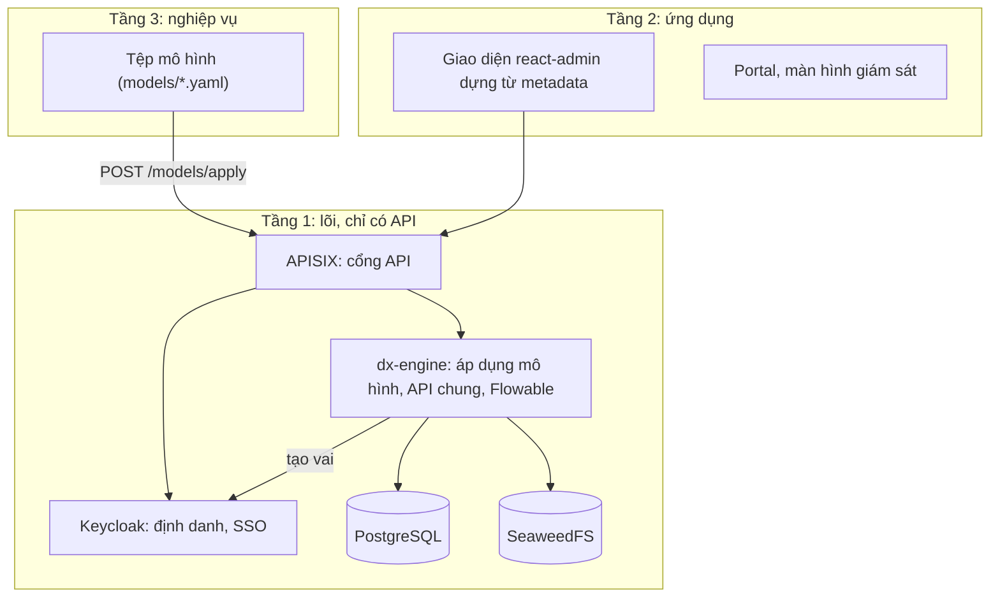
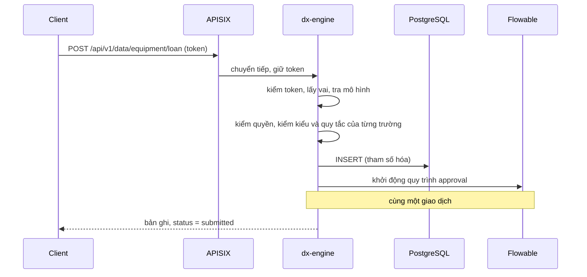

# Kiến trúc

Lõi nhận một tệp mô hình và phục vụ nghiệp vụ mà tệp đó khai báo.
Hướng thiết kế và phạm vi đầy đủ ở [`docs/dynamic-core/README.md`](./docs/dynamic-core/README.md); tài liệu này mô tả phần đã chạy.

## 1. Ba tầng

- **Tầng 1, lõi:** không có trang nào do đội viết; mọi thứ qua API.
- **Tầng 2:** giao diện đọc metadata của lõi; portal và màn hình giám sát.
- **Tầng 3:** chỉ là tệp mô hình, không có mã.

## 2. Module backend

| Module | Vai trò |
|---|---|
| `dx-model` | Định dạng tệp mô hình: đọc YAML, kiểm tra, báo lỗi theo dòng và cột; không phụ thuộc Spring |
| `dx-core` | Thư viện dùng chung: bảo mật, audit, lưu trữ và quét tệp, trạng thái hệ thống, client Keycloak |
| `dx-engine` | Dịch vụ chạy được, gồm phần điều khiển, API chung và Flowable nhúng |
| `dx-monitor` | Dịch vụ giám sát chạy riêng, không phụ thuộc module nào ở trên |

`dx-model` không phụ thuộc module nào; `dx-core` không phụ thuộc `dx-engine`; mã lõi không chứa tên thực thể, vai hay luồng của một lĩnh vực.

## 3. Áp dụng một mô hình

`POST /api/v1/models/apply` (ADMIN) chạy các bước tuần tự và ghi từng bước vào `engine.apply_step`:

1. `CREATE_SCHEMA`: schema `m_<tên mô hình>`.
2. `CREATE_TABLE`: một bảng cho mỗi thực thể, kèm các cột hệ thống (`id`, `created_by`, `created_at`, `updated_at`, `version`, và `status` nếu có quy trình), ràng buộc `NOT NULL`, `UNIQUE`, `CHECK` cho lựa chọn.
3. `ADD_LINKS`: khóa ngoại và chỉ mục, sau khi mọi bảng đã có.
4. `GRANT_READ_ONLY`: vai `report_ro` chỉ có quyền đọc, dùng cho báo cáo.
5. `ENSURE_ROLE`: vai của mô hình trong Keycloak.
6. `SAVE_VERSION`: lưu nội dung và mã băm; từ đây mô hình có hiệu lực.

Mỗi bước chạy lại được an toàn, nên áp dụng bị gián đoạn thì áp dụng lại để làm tiếp.
Cùng một tệp áp dụng lại thì không làm gì; tệp khác cho mô hình đã áp dụng bị từ chối (đổi mô hình khi có dữ liệu là bước sau).

## 4. Một yêu cầu đi qua API chung

- **Tên và truy vấn:** tên bảng và cột chỉ lấy từ mô hình đã kiểm, giá trị luôn đi qua tham số; tên trường hay toán tử không có trong mô hình bị từ chối (400).
- **Quyền:** vai lấy từ token Keycloak; vai `own` chỉ chạm các dòng có `created_by` là người gọi, hoặc dòng con của bản ghi cha do người gọi tạo (`owner_via`); gắn dòng con vào cha của người khác bị từ chối (403).
- **Quy tắc:** bắt buộc, duy nhất và lựa chọn vừa được API kiểm để báo lỗi theo từng trường, vừa là ràng buộc trong cơ sở dữ liệu.

## 5. Trạng thái chỉ đổi qua quy trình

- Flowable chạy nhúng, dùng chung nguồn dữ liệu và giao dịch Spring; bảng của nó nằm ở schema `engine`.
- API chung từ chối mọi yêu cầu có cột `status` (403); `POST .../{id}/decision` do vai duyệt gọi, hoàn tất tác vụ, và bước kế của quy trình ghi `approved` hoặc `rejected` qua bean `recordStatus`.
- Quyết định lần hai bị từ chối (409); lỗi sau bước quy trình làm cả hồ sơ lẫn quy trình quay về như cũ.
- Dịch vụ lõi là kết nối ghi duy nhất vào dữ liệu nghiệp vụ; vai `report_ro` chỉ đọc.

## 6. Dữ liệu

| Schema | Nội dung |
|---|---|
| `engine` | Phiên bản mô hình, lịch sử áp dụng, bảng của Flowable |
| `m_<mô hình>` | Bảng nghiệp vụ sinh từ mô hình |
| `public` (bảng `audit_log`) | Nhật ký truy cập và thao tác quản trị |
| `monitor` | Dữ liệu của màn hình giám sát |
| `keycloak` (cơ sở dữ liệu riêng) | Tài khoản, vai, phiên |

## 7. Triển khai

Compose chạy lõi (`postgres`, `keycloak`, `seaweedfs`, `backend`, `apisix`) và Tầng 2 (`frontend`, `portal`, `monitor`); `clamav` bật bằng profile `av`.
Gateway kiểm token cho mọi route API; các route không kiểm token nằm trong danh sách công khai kiểm bởi `deploy/apisix/check_routes.py`.
Chi tiết vận hành ở [`deploy/OPERATIONS.md`](./deploy/OPERATIONS.md).

## 8. Đối chiếu với yêu cầu của đề

| Đề yêu cầu | Đáp ứng |
|---|---|
| Định danh và SSO | Keycloak, vai sinh từ mô hình |
| Cổng API | APISIX kiểm token, giới hạn tốc độ, định tuyến |
| Dữ liệu có cấu trúc | PostgreSQL, schema và ràng buộc sinh từ mô hình |
| Dữ liệu phi cấu trúc | SeaweedFS và quét ClamAV ở `dx-core` (gắn vào trường tệp là bước sau) |
| Động cơ luồng công việc | Flowable nhúng, mẫu `approval` |
| Lõi không có giao diện | `dx-engine` chỉ phục vụ API; giao diện thuộc Tầng 2 |
