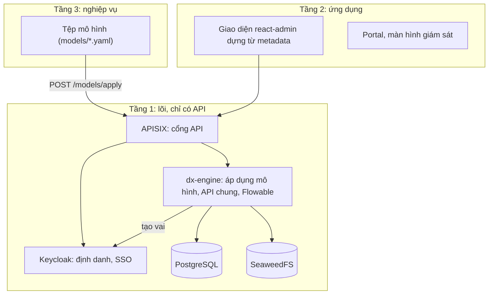

# Kiến trúc

Lõi nhận một tệp mô hình và phục vụ nghiệp vụ mà tệp đó khai báo.
Hướng thiết kế và phạm vi đầy đủ ở [`docs/dynamic-core/README.md`](./docs/dynamic-core/README.md); tài liệu này mô tả phần đã chạy.

## 1. Ba tầng

- **Tầng 1, lõi:** không có trang nào do đội viết; mọi thứ qua API.
- **Tầng 2:** giao diện đọc metadata của lõi; portal và màn hình giám sát.
- **Tầng 3:** chỉ là tệp mô hình, không có mã.

## 2. Module backend

| Module | Vai trò |
|---|---|
| `dx-model` | Định dạng tệp mô hình: đọc YAML, kiểm tra, báo lỗi theo dòng và cột; không phụ thuộc Spring |
| `dx-core` | Thư viện dùng chung: bảo mật, audit, lưu trữ và quét tệp, trạng thái hệ thống, client Keycloak |
| `dx-engine` | Dịch vụ chạy được, gồm phần điều khiển, API chung và Flowable nhúng |
| `dx-monitor` | Dịch vụ giám sát chạy riêng, không phụ thuộc module nào ở trên |

`dx-model` không phụ thuộc module nào; `dx-core` không phụ thuộc `dx-engine`; mã lõi không chứa tên thực thể, vai hay luồng của một lĩnh vực.

## 3. Áp dụng một mô hình

Mô hình đi qua một đường duy nhất, từ hệ thống rỗng hay từ phiên bản đang chạy.

`POST /api/v1/models/plan` không đổi bảng hay bản ghi nào, chỉ trả về:

- Thay đổi theo ba mức, do `ModelDiff` so sánh hai phiên bản mô hình: `SAFE`, `MIGRATION`, `LOSS`; đổi kiểu trường và đổi họ mẫu quy trình bị từ chối.
- Dòng đang vi phạm quy tắc mới, kèm một phần id.
- Số hồ sơ đang xử lý của các quy trình bị ảnh hưởng.
- Các câu lệnh sẽ chạy, do pgschema lập từ trạng thái đích mà `DdlGenerator` sinh ra.

`POST /api/v1/models/apply?base=N&accept=<mức>` (ADMIN) chạy khi `base` đúng phiên bản đang chạy, mức rủi ro không vượt `accept` và không có dòng vi phạm, rồi ghi từng bước vào `engine.apply_step`:

1. `RENAME_FIELD`: đổi tên cột theo `renamed_from`, cùng ràng buộc và chỉ mục mang tên trường.
2. `CHANGE_SCHEMA`: pgschema đưa schema `m_<tên mô hình>` về trạng thái đích, gồm bảng, cột hệ thống, ràng buộc, chỉ mục và quyền đọc của `report_ro`.
3. `ENSURE_ROLE`: vai của mô hình trong Keycloak.
4. `ENSURE_UNIT`: đơn vị của mô hình, là nhóm trong Keycloak.
5. `SAVE_VERSION`: lưu nội dung và mã băm; từ đây phiên bản có hiệu lực.

Bảo vệ dữ liệu nằm ở lõi: nếu kế hoạch của pgschema có thao tác xóa bảng hoặc cột mà so sánh mô hình không có, áp dụng dừng lại.
Mỗi bước chạy lại được an toàn, nên áp dụng bị gián đoạn thì áp dụng lại để làm tiếp; đã đổi tên thì chỉ đúng tệp đó mới hoàn tất được.
`POST /api/v1/models/{model}/rollback` đi qua đúng đường này với nội dung phiên bản trước, đảo các lần đổi tên và ghi thành phiên bản mới.

## 4. Một yêu cầu đi qua API chung

- **Tên và truy vấn:** tên bảng và cột chỉ lấy từ mô hình đã kiểm, giá trị luôn đi qua tham số; tên trường hay toán tử không có trong mô hình bị từ chối (400).
- **Quyền:** vai và đơn vị lấy từ token Keycloak; các phạm vi của những vai người gọi có được hợp lại: `all`, `read` chạm mọi dòng, `own` chạm dòng do người gọi tạo, `unit` chạm dòng thuộc đơn vị của người gọi, `assigned` chạm dòng giao cho người gọi.
  Thực thể con (`owner_via`) xét các phạm vi này trên bản ghi cha, và không gắn được vào bản ghi cha ngoài tầm với (403).
- **Quy tắc:** bắt buộc, duy nhất và lựa chọn vừa được API kiểm để báo lỗi theo từng trường, vừa là ràng buộc trong cơ sở dữ liệu.

## 5. Trạng thái chỉ đổi qua quy trình

- Flowable chạy nhúng, dùng chung nguồn dữ liệu và giao dịch Spring; bảng của nó nằm ở schema `engine`.
- Họ mẫu quy trình (`approval`, `work_item`) khai báo trạng thái và hành động ở `ProcessFamily`; các bước nằm ở tệp BPMN cùng tên.
- `ProcessRules` giữ các quy tắc mọi họ mẫu cùng chịu: vai và quyền của người làm, người tạo không tự quyết định, lý do khi từ chối hoặc trả lại, rút lại giữ bản ghi.
- Hạn xử lý lưu ở cột `handle_by` khi hồ sơ chờ người xử lý; `overdue` được tính khi đọc.
- Bảng `engine.outbox` nhận thông điệp trong giao dịch của thay đổi; `OutboxDispatcher` giao sau khi giao dịch xong, thử lại với thời gian chờ tăng dần, mỗi khóa một thông điệp.
- Hành động hoàn tất của khối `after:` đi qua outbox đến `CompletionHandler`; hiện có thao tác `add_to_group` của Keycloak.
- `OverdueSweep` ghi dòng quá hạn vào lịch sử, một lần cho mỗi hạn.
- Trường kiểu `file` gắn tệp qua `AttachmentService`: byte ở SeaweedFS, siêu dữ liệu ở `engine.attachment`, quét ClamAV khi bật, quyền theo quyền của bản ghi.
- API chung từ chối mọi yêu cầu có cột `status` (403); `POST .../{id}/actions/{action}` kiểm người được làm và trạng thái đầu, hoàn tất tác vụ, và bước kế của quy trình ghi trạng thái mới qua bean `recordStatus`.
- Hồ sơ đã giao thì chỉ người được giao thực hiện được hành động của vai xử lý.
- Hành động sai trạng thái bị từ chối (409); lỗi sau bước quy trình làm cả hồ sơ, quy trình lẫn dòng lịch sử quay về như cũ.
- Dịch vụ lõi là kết nối ghi duy nhất vào dữ liệu nghiệp vụ; vai `report_ro` chỉ đọc.

## 6. Dữ liệu

| Schema | Nội dung |
|---|---|
| `engine` | Phiên bản mô hình, lịch sử áp dụng, dòng lịch sử của bản ghi, bảng của Flowable |
| `m_<mô hình>` | Bảng nghiệp vụ sinh từ mô hình |
| `public` (bảng `audit_log`) | Nhật ký truy cập và thao tác quản trị |
| `monitor` | Dữ liệu của màn hình giám sát |
| `keycloak` (cơ sở dữ liệu riêng) | Tài khoản, vai, phiên |

## 7. Triển khai

Compose chạy lõi (`postgres`, `keycloak`, `seaweedfs`, `backend`, `apisix`) và Tầng 2 (`frontend`, `portal`, `monitor`); `clamav` bật bằng profile `av`.
Gateway kiểm token cho mọi route API; các route không kiểm token nằm trong danh sách công khai kiểm bởi `deploy/apisix/check_routes.py`.
Chi tiết vận hành ở [`deploy/OPERATIONS.md`](./deploy/OPERATIONS.md).

## 8. Đối chiếu với yêu cầu của đề

| Đề yêu cầu | Đáp ứng |
|---|---|
| Định danh và SSO | Keycloak, vai sinh từ mô hình |
| Cổng API | APISIX kiểm token, giới hạn tốc độ, định tuyến |
| Dữ liệu có cấu trúc | PostgreSQL, schema và ràng buộc sinh từ mô hình |
| Dữ liệu phi cấu trúc | SeaweedFS và quét ClamAV ở `dx-core`, gắn vào trường `file` của mô hình |
| Động cơ luồng công việc | Flowable nhúng, họ mẫu `approval` và `work_item` |
| Lõi không có giao diện | `dx-engine` chỉ phục vụ API; giao diện thuộc Tầng 2 |
