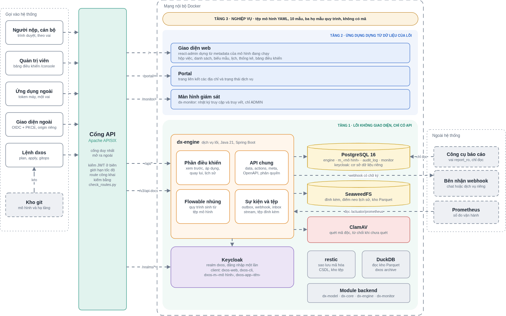
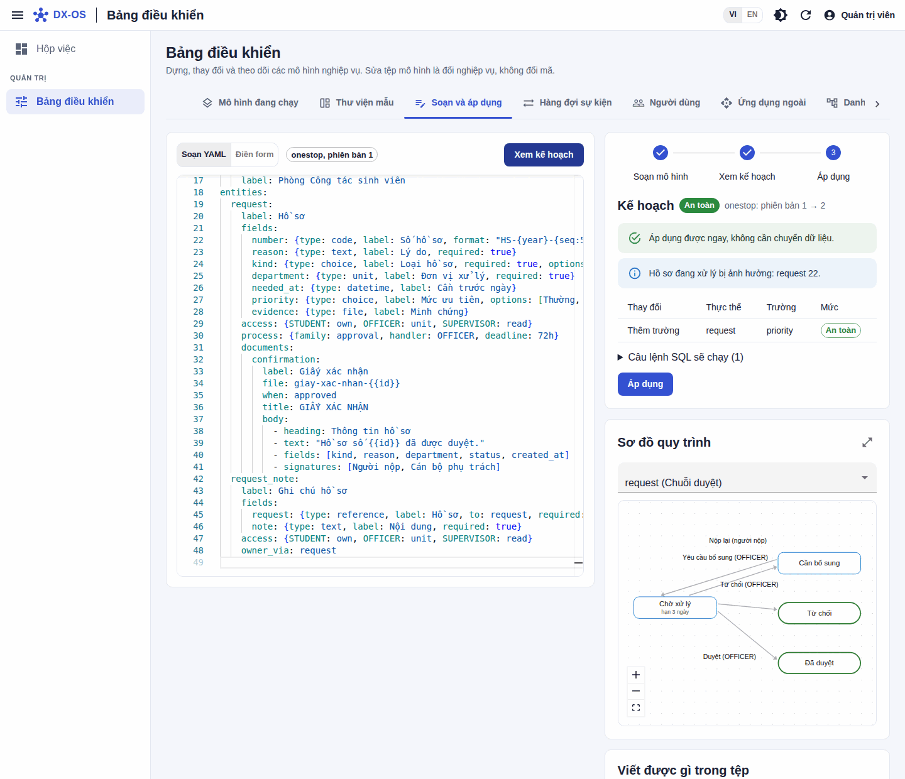
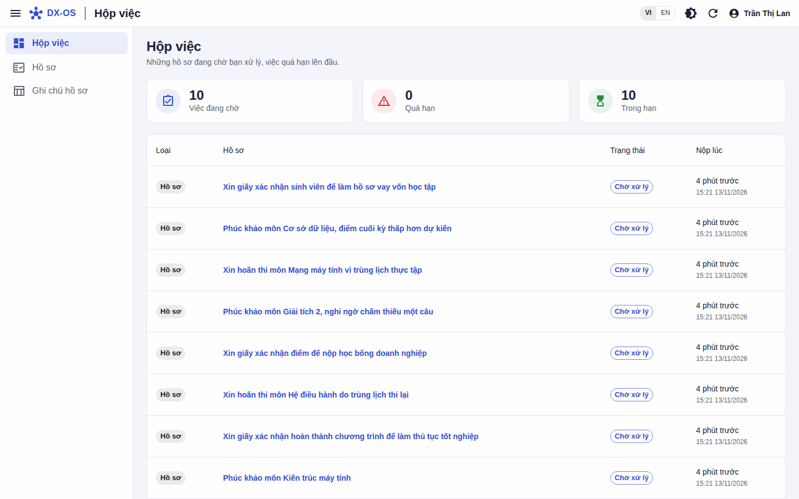
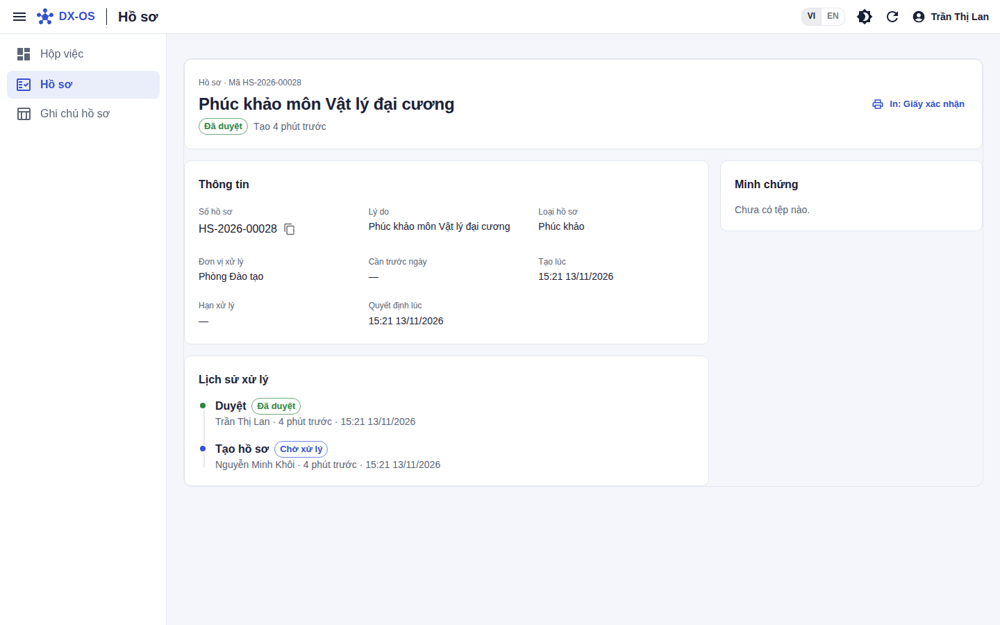

# DX-OS

🇻🇳 **Tiếng Việt** | 🇬🇧 [English](./README_EN.md)

> **Lõi dynamic nguồn mở cho hệ thống hồ sơ có quy trình.**
> Khai báo nghiệp vụ trong một tệp mô hình; DX-OS dựng cơ sở dữ liệu, tài khoản và vai, API có phân quyền, quy trình duyệt và giao diện.
> Đổi nghiệp vụ là đổi tệp, không đổi mã.

[](./LICENSE)
[](https://github.com/HaUI-ImplSolution/DX-OS/releases)
[](https://github.com/HaUI-ImplSolution/DX-OS/actions/workflows/ci-platform.yml)
[](https://github.com/HaUI-ImplSolution/DX-OS/actions/workflows/ci-compliance.yml)
[](https://haui-implsolution.github.io/DX-OS/)
[](https://www.bestpractices.dev/projects/16682)

Bài dự thi **OLP Phần mềm nguồn mở 2026**, khối thi DX-OS (VFOSSA), của đội **HaUI-ImplSolution**, Trường Công nghệ Thông tin và Truyền thông, Đại học Công nghiệp Hà Nội.

**Dùng thử:** <https://khuongdev.io.vn/> (tài khoản thử ở mục [Chạy thử](#chạy-thử)) · tự cài trên máy mình bằng hai lệnh ở mục [Cài đặt](#cài-đặt).

**Tài liệu:** <https://haui-implsolution.github.io/DX-OS/>, tìm tài liệu theo từng việc ở mục [Tài liệu](#tài-liệu).

**Đọc nhanh:** [Giới thiệu](#giới-thiệu) · [Kiến trúc](#kiến-trúc) · [Tính năng](#tính-năng) · [Hình ảnh](#hình-ảnh) · [Công nghệ](#công-nghệ-và-giấy-phép) · [Cài đặt](#cài-đặt) · [Chạy thử](#chạy-thử) · [Vận hành](#vận-hành-và-xử-lý-sự-cố) · [Đề thi](#đối-chiếu-với-đề-thi) · [Tài liệu](#tài-liệu) · [Cấu trúc](#cấu-trúc-repository) · [Đóng góp](#đóng-góp) · [Giấy phép](#giấy-phép)

---

## Giới thiệu

Trường học, khoa, doanh nghiệp nhỏ nào cũng có quy trình giống nhau: một người gửi yêu cầu, một người khác xem xét, duyệt hoặc trả lại, và mọi bước phải để lại dấu vết.
Mỗi lần có nghiệp vụ mới, phần đăng nhập, phân quyền, lưu tệp và luồng duyệt lại bị dựng lại từ đầu.

DX-OS làm phần dùng chung đó một lần, thành một lõi chạy ngầm không gắn với nghiệp vụ nào.
Người triển khai mô tả nghiệp vụ của mình trong một tệp mô hình — hồ sơ cần thông tin gì, ai xem và sửa, ai duyệt, hạn xử lý bao lâu — và lõi đọc tệp đó để dựng hệ thống chạy được.
Đổi nghiệp vụ là đổi tệp, không đổi mã.

Toàn bộ hệ thống lắp từ phần mềm nguồn mở có giấy phép được OSI công nhận, tự cài trên máy của bạn, dữ liệu nằm hoàn toàn ở đó.
Phiên bản hiện tại là `2.0.0`; thay đổi theo từng phiên bản ở [`CHANGELOG.md`](./CHANGELOG.md).

## Kiến trúc



Hệ thống có ba tầng:

| Tầng | Vai trò |
|---|---|
| Lõi | Dịch vụ không giao diện: đọc mô hình, áp dụng, API chung, quy trình, lịch sử, sự kiện |
| Ứng dụng | Giao diện web và bảng điều khiển dựng từ dữ liệu của lõi, cùng trang liên kết (portal) và màn hình giám sát |
| Mô hình | Các tệp mô tả nghiệp vụ; thêm nghiệp vụ mới chỉ là thêm một tệp |

Cách một yêu cầu đi qua hệ thống:

1. **Khai báo.** Viết hoặc chọn một tệp mô hình: thực thể, trường, vai, quyền và quy trình của nghiệp vụ.
2. **Áp dụng.** Xem kế hoạch rồi áp dụng; lõi dựng cơ sở dữ liệu, vai trong Keycloak, API và quy trình, và ghi lại từng bước.
3. **Dùng.** Người dùng đăng nhập và làm việc trên giao diện web dựng từ chính tệp đó; mọi thay đổi để lại lịch sử và được báo ra ngoài.

Sơ đồ chi tiết, các module và luồng một yêu cầu ở [`ARCHITECTURE.md`](./ARCHITECTURE.md); cách viết tệp mô hình ở [`docs/MODEL.md`](./docs/MODEL.md).

Mười mẫu có sẵn, chọn được ngay ở bảng điều khiển: một cửa sinh viên, hỗ trợ kỹ thuật, sự cố thiết bị, đặt phòng, cấp quyền dịch vụ CNTT, mượn thiết bị, ghi chú, sổ tài sản, đặt lịch khám và đổi trả hàng.

## Tính năng

| Nhóm | Tính năng |
|---|---|
| **Khai báo mô hình** | **Từ một tệp đến hệ thống chạy được:** hồ sơ, bảng dữ liệu, tài khoản, vai, màn hình danh sách và biểu mẫu đều dựng từ tệp mô hình; tệp viết theo kiểu cũ vẫn chạy được, và có lệnh đưa lên kiểu mới sau khi xem trước những gì sẽ đổi. |
| | **Mã hồ sơ dễ đọc:** tệp khai báo khuôn mã như tiền tố, năm và số thứ tự; mỗi hồ sơ nhận một mã không trùng, kể cả khi nhiều người nộp cùng lúc. |
| | **Quy tắc dữ liệu ngay trong tệp:** đúng/sai, ngày, chọn nhiều giá trị, giới hạn giá trị, mẫu chuỗi và điều kiện bắt buộc đều khai báo trong tệp; cơ sở dữ liệu cũng từ chối giá trị sai. |
| | **Quy trình tùy biến:** chọn một trong ba mẫu có sẵn (phê duyệt, công việc cần xử lý, đặt chỗ theo khung giờ có kiểm sức chứa), thêm bớt bước và giao cho vai riêng, hoặc tự khai báo từ đầu; một bước có thể chỉ mở khi hồ sơ đạt điều kiện, từ chối và trả lại đều cần lý do, và không ai tự duyệt hồ sơ của mình. |
| | **Đổi nghiệp vụ khi đã có dữ liệu:** xem trước tác động, cảnh báo rủi ro, giữ nguyên dữ liệu khi đổi tên, và quay về được phiên bản trước. |
| **Quyền và dấu vết** | **Phân quyền đến từng dòng:** mỗi vai chỉ thấy và sửa phần việc của mình, của đơn vị mình hoặc được giao cho mình. |
| | **Dấu vết không sửa được:** lịch sử hồ sơ nối thành một chuỗi có dấu kiểm; ai sửa, xóa hoặc chèn một dòng thì một lệnh chỉ ra đúng dòng đó. |
| | **Danh mục dữ liệu:** một trang cho biết dữ liệu của mỗi mô hình nằm ở đâu, ai được xem, các loại hồ sơ liên quan nhau thế nào, dữ liệu đi vào và đi ra đâu đến từng trường, và dữ liệu hiện có đầy đủ và còn mới đến đâu. |
| | **Lưu trữ hồ sơ cũ:** hồ sơ đã đóng lâu được ghi sang kho lưu trữ theo lịch mỗi ngày; dữ liệu đang dùng vẫn giữ nguyên, bản lưu kiểm lại được và truy vấn trực tiếp bằng DuckDB. |
| **Mở rộng và kết nối** | **Kết nối ra ngoài:** mọi thay đổi của hồ sơ được báo tới địa chỉ web hoặc kênh chat (Mattermost, Slack) với chữ ký để bên nhận kiểm tra, và được gửi lại khi bên nhận lỗi. |
| | **Mở cho ứng dụng bên ngoài:** mỗi mô hình có tài liệu API riêng, tự đổi theo mô hình; dịch vụ ngoài đăng ký với đúng một vai và mã bí mật riêng, còn giao diện ở tên miền khác đăng nhập người dùng bằng OIDC Authorization Code với PKCE. |
| | **Bảng điều khiển cho người triển khai:** thư viện mẫu, trình soạn mô hình (viết tệp hoặc điền form, có hướng dẫn nói rõ viết được và mở rộng được gì) kèm sơ đồ quy trình vẽ theo tệp đang soạn, xem kế hoạch, áp dụng, lịch sử, quản lý người dùng và thống kê hồ sơ. |
| | **In giấy tờ từ hồ sơ:** tệp mô hình khai báo mẫu giấy xác nhận, phiếu hay biên bản; hồ sơ thành tệp PDF tiếng Việt cho đúng người được xem hồ sơ đó, chỉ in được ở những trạng thái mẫu cho phép. |
| **Dùng và vận hành** | **Giao diện theo khai báo:** tệp mô hình chọn được biểu tượng, nhóm menu, cột và sắp xếp mặc định, cách chia nhóm biểu mẫu và lời gợi ý; cán bộ chọn nhiều hồ sơ rồi xử lý cùng lúc, mỗi hồ sơ vẫn qua đủ luật. |
| | **Xem theo trạng thái và xuất danh sách:** danh sách hồ sơ có quy trình xem được như một bảng theo từng trạng thái, xuất ra tệp CSV mà bảng tính đọc được, đúng phần người xem được quyền thấy. |
| | **Hộp việc tự cập nhật:** khi hồ sơ đổi, hộp việc, danh sách và trang chi tiết đang mở tự làm mới, không cần tải lại trang. |
| | **Dùng thử ngay:** một lệnh tạo tài khoản thử cho từng vai cùng hồ sơ mẫu ở nhiều trạng thái, để người xem đăng nhập là thấy hệ thống có việc đang chạy. |
| | **Cài và vận hành đơn giản:** một lệnh cài, một lệnh chạy; có sao lưu kiểm được, tự khởi động lại dịch vụ, quét mã độc cho tệp đính kèm và số đo vận hành đọc được bằng công cụ giám sát có sẵn của bạn. |
| | **Đăng nhập một lần:** qua Keycloak, có thể bắt quản trị viên nhập thêm mã một lần. |

Bảng đối chiếu từng tính năng với bài kiểm của nó ở [ma trận bằng chứng](https://haui-implsolution.github.io/DX-OS/docs/evidence-matrix).

## Hình ảnh

Các màn hình dưới đây chụp từ hệ thống đang chạy với dữ liệu mẫu; tên người và hồ sơ đều là giả.

Từ một yêu cầu gửi đi đến khi hồ sơ được duyệt và in ra:


Sửa tệp mô hình, xem kế hoạch thay đổi rồi áp dụng; hệ thống chuyển sang phiên bản mới mà dữ liệu cũ vẫn còn:


| Bảng điều khiển: soạn mô hình, xem trước tác động | Hộp việc của người xử lý | Chi tiết hồ sơ, có lịch sử từng bước |
|---|---|---|
| [](website/docs/images/vi/plan.png) | [](website/docs/images/vi/inbox.png) | [](website/docs/images/vi/detail.png) |

Đủ bộ ảnh, gồm lịch đặt phòng, báo cáo, giao diện điện thoại, danh mục dữ liệu và màn hình giám sát, cùng hai đoạn video ở [trang tài liệu](https://haui-implsolution.github.io/DX-OS/docs/hinh-anh).

## Công nghệ và giấy phép

DX-OS điều phối phần mềm nguồn mở ở dạng nguyên bản: image chính thức, phiên bản ghim, không sửa mã thượng nguồn.
Danh mục đầy đủ ở [`DEPENDENCIES.txt`](./DEPENDENCIES.txt) và [`sbom/`](./sbom/README.md).

| Thành phần | Phiên bản | Giấy phép | Vai trò |
|---|---|---|---|
| Apache APISIX | 3.11.0 | Apache-2.0 | Cổng API, cổng duy nhất mở ra ngoài |
| Keycloak | 26.8.2 | Apache-2.0 | Đăng nhập một lần, tài khoản và vai |
| Spring Boot, Java | 4.1.2, 21 | Apache-2.0, GPL-2.0 với ngoại lệ Classpath | Dịch vụ lõi và màn hình giám sát |
| Flowable | nhúng trong lõi | Apache-2.0 | Động cơ quy trình |
| PostgreSQL | 16 | PostgreSQL | Cơ sở dữ liệu duy nhất: dữ liệu, lịch sử và hàng đợi |
| SeaweedFS | 4.51 | Apache-2.0 | Kho tệp đính kèm chuẩn S3 |
| ClamAV | 1.5.4 | GPL-2.0-only | Quét mã độc tệp tải lên, dịch vụ riêng, bật sẵn và tắt được bằng `dxos av off` |
| React, react-admin | 18, 5 | MIT | Giao diện web dựng từ metadata của lõi |
| nginx | 1.30 | BSD-2-Clause | Phục vụ giao diện web và portal |
| pgschema | 1.13.4 | Apache-2.0 | So bảng với mô hình và đổi bảng cho khớp |
| DuckDB | 1.4.1 | MIT | Đọc kho lưu trữ Parquet bằng `dxos archive` |
| restic | 0.17.3 | BSD-2-Clause | Sao lưu mã hóa, tùy chọn |

Mã của đội theo Apache-2.0, có dòng SPDX ở đầu mỗi tệp và được `reuse lint` kiểm ở mỗi pull request.
ClamAV chạy thành dịch vụ riêng, giao tiếp qua mạng, không liên kết mã nên không xung đột với Apache-2.0.
Lý do đọc hoặc không dùng làm nền với Supabase, Strapi và Directus ở [trang thành phần](https://haui-implsolution.github.io/DX-OS/docs/dependencies).

## Cài đặt

### Yêu cầu hệ thống

| Thành phần | Yêu cầu | Ghi chú |
|---|---|---|
| Hệ điều hành | Linux | Có Docker và Docker Compose v2 |
| Mã nguồn | Không cần khi dùng bộ cài | Chỉ cần khi tự build |
| JDK, Node | 21, 22 | Chỉ cần để build và kiểm thử ngoài Docker |
| RAM | Khoảng 1,8 GiB cho tám service lúc rảnh | Số đo thật ở [`docs/OPERATIONS.md`](./docs/OPERATIONS.md#tài-nguyên-và-số-bản-sao); ClamAV thêm khoảng 1 GB, tắt bằng `dxos av off` |
| Đĩa | Khoảng 3,5 GiB cho image | Cơ sở dữ liệu và tệp đính kèm tăng theo dữ liệu |

`dxos doctor` (hoặc `deploy/doctor.sh`) kiểm Docker, RAM, ổ đĩa, `deploy/.env` và các cổng trước khi chạy.
Cỡ máy theo số người dùng đồng thời ở [`docs/SIZING.md`](./docs/SIZING.md).

### Cài nhanh bằng bộ cài

Cần máy Linux có Docker với Compose v2; không cần mã nguồn.

```bash
curl -fsSL https://github.com/HaUI-ImplSolution/DX-OS/releases/latest/download/dxos-install.sh | bash
dxos start
```

Bộ cài tải bản phát hành mới nhất, kiểm SHA-256 rồi cài vào `~/.dxos`; lệnh `dxos` nằm ở `~/.local/bin`.
`dxos start` tải image ở lần đầu, chờ mọi dịch vụ sẵn sàng, tạo tài khoản `admin` với mật khẩu tạm in ra màn hình, rồi in các địa chỉ.
Đăng nhập `http://localhost:9080/console` bằng `admin`, đổi mật khẩu, chọn một mẫu ở tab Thư viện mẫu, xem kế hoạch rồi áp dụng.
Đã có tệp mô hình thì `dxos start <tệp>` đưa tệp vào luôn; có nhiều tệp thì liệt kê hết sau `dxos start`.
Chỉ cần nền tảng API cho ứng dụng bên ngoài thì chạy `dxos start --core`: không có ứng dụng web, portal và giám sát, xem [Chế độ chỉ lõi](./docs/OPERATIONS.md#chế-độ-chỉ-lõi).

### Từ mã nguồn

Cần thêm JDK 21 và Node 22 nếu muốn build và kiểm thử ngoài Docker.

```bash
deploy/make_env.sh                       # sinh deploy/.env với mật khẩu ngẫu nhiên
cd deploy && docker compose up -d --build
./dxos admin                             # tạo tài khoản admin với mật khẩu tạm
```

Người dùng vào qua gateway `http://localhost:9080`:

| Địa chỉ | Nội dung |
|---|---|
| `/` | Giao diện web |
| `/console` | Bảng điều khiển cho người triển khai |
| `/portal/` | Trang liệt kê các địa chỉ và trạng thái dịch vụ |
| `/monitor/` | Giám sát và truy vết (ADMIN) |
| `/v3/api-docs` | Đặc tả OpenAPI của backend |

Trang quản trị Keycloak (`/admin`) mặc định không mở ra ngoài; đặt `KEYCLOAK_ADMIN_CONSOLE=true` trong `deploy/.env` rồi tạo lại gateway để mở (tài khoản trong `deploy/.env`).
Hướng dẫn kiểm thử đầy đủ ở [`docs/TESTING.md`](./docs/TESTING.md).

## Chạy thử

Bản `2.0.0` chạy công khai tại https://khuongdev.io.vn/ với mô hình Một cửa sinh viên và 40 hồ sơ mẫu.
Đăng nhập bằng một trong bốn tài khoản thử dưới đây, cùng mật khẩu `15c9777835f0dfcf4e8d`.

| Tài khoản | Vai |
|---|---|
| `judge_student` | Sinh viên, nộp hồ sơ |
| `judge_officer` | Cán bộ đơn vị DAO_TAO |
| `judge_officer2` | Cán bộ đơn vị CTSV |
| `judge_supervisor` | Giám sát, đọc mọi hồ sơ |

Bảng điều khiển `/console` và màn hình giám sát chỉ dành cho quản trị viên nên các tài khoản này không vào được.
Trên bản tự cài, `dxos demo` tạo bốn tài khoản thử cùng 40 hồ sơ mẫu; kịch bản trình diễn 15 phút ở [`docs/DEMO.md`](./docs/DEMO.md).
Góp ý hoặc báo lỗi bằng cách [mở một issue](https://github.com/HaUI-ImplSolution/DX-OS/issues/new/choose).

## Vận hành và xử lý sự cố

Các lệnh hay dùng của `dxos`:

| Việc | Lệnh |
|---|---|
| Kiểm máy và `.env` trước khi chạy | `dxos doctor` |
| Xem trạng thái các dịch vụ | `dxos status` |
| Dựng lại dịch vụ bị mất | `dxos reconcile` |
| Xem kế hoạch và áp dụng một tệp mô hình | `dxos plan <tệp>`, `dxos apply <tệp>` |
| Đặt lại mật khẩu tài khoản thử | `dxos demo` |
| Bật hoặc tắt quét mã độc | `dxos av on`, `dxos av off` |

| Sự cố | Cách xử lý |
|---|---|
| Một thành phần ngừng | `dxos status`, rồi `dxos reconcile`; mọi service chạy lâu tự khởi động lại khi tiến trình thoát |
| Máy không chạy được stack | `dxos doctor` chỉ đọc, báo thiếu biến trong `.env`, cổng bị chiếm, thiếu RAM hay ổ đĩa |
| Mọi tệp tải lên bị từ chối | Quét mã độc bật mà ClamAV không chạy; `dxos doctor` báo `FAIL`, chạy `dxos av on` hoặc `dxos av off` |
| Không đăng nhập được tài khoản thử | `dxos demo` đặt lại mật khẩu và in mật khẩu mới |
| Sau lần áp dụng, một bản `backend` trả 404 | Chỉ chạy một bản `backend`, hoặc khởi động lại cả hai |

Cài đặt, mọi lệnh `dxos`, sao lưu, khôi phục và ứng phó sự cố ở [`docs/OPERATIONS.md`](./docs/OPERATIONS.md); giám sát và log ở [`docs/MONITORING.md`](./docs/MONITORING.md).

## Đối chiếu với đề thi

Đề OLP 2026 chia hệ thống thành các tầng và nêu bốn không gian cần chạm tới: H (môi trường số chung), P (rào chắn và luồng tự động), D (một nguồn sự thật) và I (trí tuệ nhân tạo).
DX-OS ở Tầng 1 là lõi không giao diện, ở Tầng 2 là giao diện web và bảng điều khiển dựng trên lõi, còn Một cửa sinh viên và các nghiệp vụ khác là tệp mô hình, tức ứng dụng của Tầng 3.

| Không gian | DX-OS làm gì | Trạng thái |
|---|---|---|
| H, môi trường số chung | Một lần đăng nhập; vai và đơn vị khai trong mô hình; mỗi người chỉ thấy phần việc của mình trong hộp việc, bảng theo trạng thái và lịch | Có |
| P, rào chắn và luồng tự động | Trạng thái chỉ đổi qua quy trình; từ chối và trả lại bắt buộc có lý do; người tạo không tự duyệt hồ sơ của mình; hạn xử lý, quá hạn và leo thang lên vai khác; việc sau khi duyệt chạy qua hàng đợi và được thử lại | Có |
| D, một nguồn sự thật | Dữ liệu, lịch sử và hàng đợi cùng nằm ở một cơ sở dữ liệu; lịch sử nối thành chuỗi chống sửa; mọi thay đổi báo ra ngoài bằng webhook có chữ ký; thống kê và danh mục dữ liệu | Có |
| I, trí tuệ nhân tạo | Chưa có; chỉ dùng mô hình mở hoàn toàn theo định nghĩa của OSI, chưa chọn được mô hình đạt | Chưa làm |

Cách tính các giao diện đi kèm và đối chiếu chi tiết từng ý của đề ở [`DANH_GIA.md`](./docs/dynamic-core/DANH_GIA.md), việc còn lại ở [`BACKLOG.md`](./docs/dynamic-core/BACKLOG.md).

## Tài liệu

Trang tài liệu: <https://haui-implsolution.github.io/DX-OS/>.
Các tài liệu về viết tệp mô hình, API, vận hành, giám sát, tích hợp, mở rộng và kiến trúc cũng đọc được trên trang đó, có mục lục và liên kết giữa các trang.

| Cần gì | Xem |
|---|---|
| Xem nhanh trong 5 phút, tìm tài liệu theo thư mục | [`docs/README.md`](./docs/README.md) |
| Ảnh màn hình và video | [trang hình ảnh](https://haui-implsolution.github.io/DX-OS/docs/hinh-anh) |
| Dùng hệ thống theo vai | [người nộp](https://haui-implsolution.github.io/DX-OS/docs/huong-dan/nguoi-nop), [người xử lý](https://haui-implsolution.github.io/DX-OS/docs/huong-dan/nguoi-xu-ly), [người triển khai](https://haui-implsolution.github.io/DX-OS/docs/huong-dan/nguoi-trien-khai) |
| Viết tệp mô hình | [`docs/MODEL.md`](./docs/MODEL.md) |
| Gọi API | [`docs/API.md`](./docs/API.md) và đặc tả OpenAPI (`/v3/api-docs`) của backend đang chạy |
| Phát triển dịch vụ, webhook và giao diện mở rộng | [`docs/EXTENSIONS.md`](./docs/EXTENSIONS.md) |
| Kiến trúc và các quyết định đã chốt | [`ARCHITECTURE.md`](./ARCHITECTURE.md) |
| Thuật ngữ | [`docs/GLOSSARY.md`](./docs/GLOSSARY.md) |
| Cài đặt, lệnh `dxos`, sao lưu, ứng phó sự cố | [`docs/OPERATIONS.md`](./docs/OPERATIONS.md) |
| Giám sát, log, nhật ký truy cập | [`docs/MONITORING.md`](./docs/MONITORING.md) |
| Webhook, lịch sử chống sửa, lưu trữ dài hạn | [`docs/INTEGRATIONS.md`](./docs/INTEGRATIONS.md) |
| Kết nối công cụ báo cáo | [`docs/REPORTING.md`](./docs/REPORTING.md) |
| Kiểm thử | [`docs/TESTING.md`](./docs/TESTING.md), [`e2e/README.md`](./e2e/README.md) |
| Kiểm chứng chỉ số mục tiêu, chi phí tự cài | [`docs/TARGETS.md`](./docs/TARGETS.md) |
| Kịch bản trình diễn 15 phút | [`docs/DEMO.md`](./docs/DEMO.md) |
| Hướng thiết kế và việc còn lại | [`docs/dynamic-core/README.md`](./docs/dynamic-core/README.md), [`BACKLOG.md`](./docs/dynamic-core/BACKLOG.md) |
| Thay đổi theo phiên bản | [`CHANGELOG.md`](./CHANGELOG.md) |
| Giữ tương thích giữa các bản | [`docs/COMPATIBILITY.md`](./docs/COMPATIBILITY.md) |
| Hướng phát triển | [`ROADMAP.md`](./ROADMAP.md) |
| Thành phần bên thứ ba và giấy phép | [`DEPENDENCIES.txt`](./DEPENDENCIES.txt), [`NOTICE`](./NOTICE), [`sbom/`](./sbom/README.md) |

## Cấu trúc repository

| Thư mục | Tầng | Nội dung |
|---|---|---|
| `backend/dx-model` | Lõi | Định dạng tệp mô hình: đọc và kiểm tra |
| `backend/dx-core` | Lõi | Thư viện dùng chung: bảo mật, audit, lưu trữ, trạng thái, client Keycloak |
| `backend/dx-engine` | Lõi | Dịch vụ lõi: áp dụng mô hình, API chung, Flowable |
| `backend/dx-monitor` | Ứng dụng | Màn hình giám sát và truy vết |
| `frontend` | Ứng dụng | Giao diện react-admin dựng từ metadata, có tiếng Việt và tiếng Anh |
| `deploy` | Dùng chung | Compose, gateway APISIX, bộ cài và lệnh `dxos`, script vận hành |
| `sso` | Lõi | Keycloak realm |
| `portal` | Ứng dụng | Trang liên kết các địa chỉ và trạng thái dịch vụ |
| `examples` | Ngoài lõi | Chương trình mẫu: bên nhận sự kiện giữ hash lịch sử ([`history-witness`](./examples/history-witness/README.md)), giả lập hệ thống IT/OT ([`itot-simulator`](./examples/itot-simulator/README.md)) |
| `tools` | Công cụ | Công cụ của người phát triển, như đếm mã tự viết |
| `e2e` | Kiểm thử | Kiểm tự động trên stack đang chạy: API (`api/`), giao diện web bằng Playwright (`web/`) và tệp mô hình sai mẫu (`fixtures/`) |
| `website` | Tài liệu | Trang tài liệu (Docusaurus), đăng lên GitHub Pages |
| `docs` | Tài liệu | Hướng dẫn kiểm thử, tệp mô hình, API, vận hành, giám sát, tích hợp, báo cáo, lưu trữ tệp; hướng thiết kế ở `dynamic-core/` |
| `sbom` | Giấy phép | Danh mục thành phần CycloneDX của backend, web, và trang tài liệu |
| `LICENSES` | Giấy phép | Toàn văn giấy phép của kho theo chuẩn REUSE |
| `.github` | Dùng chung | Workflow CI, mẫu issue và pull request, quy tắc nhánh, script kiểm tra |

## Đóng góp

- **Báo lỗi:** [tạo bug report](https://github.com/HaUI-ImplSolution/DX-OS/issues/new?template=bug_report.yml).
- **Đề xuất tính năng:** [tạo feature request](https://github.com/HaUI-ImplSolution/DX-OS/issues/new?template=feature_request.yml).
- **Gửi mã:** đọc [`CONTRIBUTING.md`](./CONTRIBUTING.md) và tuân theo [`CODE_OF_CONDUCT.md`](./CODE_OF_CONDUCT.md).
- **Lỗ hổng bảo mật:** không đăng công khai, làm theo [`SECURITY.md`](./SECURITY.md).

## Nhóm phát triển

| Tên | Liên hệ |
|---|---|
| Phạm Minh Khương | pkhuong535@gmail.com |
| Nguyễn Đình Duy Khánh | dinhkhanh19042006@gmail.com |
| Trần Quang Tùng | tung51652@gmail.com |

## Giấy phép

Mã nguồn, tài liệu, ảnh chụp màn hình, video và sơ đồ theo Apache License 2.0, xem [`LICENSE`](./LICENSE).
Mọi giấy phép của dự án và của thành phần dùng đều được OSI công nhận, trừ vài gói dữ liệu chỉ đọc lúc dựng trang tài liệu; tên và lý do ở [`DEPENDENCIES.txt`](./DEPENDENCIES.txt), mục 7.
Giấy phép của từng thành phần bên thứ ba ở [`DEPENDENCIES.txt`](./DEPENDENCIES.txt).

Tham khảo: [chủ đề cuộc thi](https://vfossa.vn/tin-tuc/gioi-thieu-mo-hinh-dx-os-va-chu-de-cuoc-thi-phan-mem-nguon-mo-olp-2026-761.html) · [giáo trình DX-OS](https://opendigitransform.gitbook.io/dx-os)
