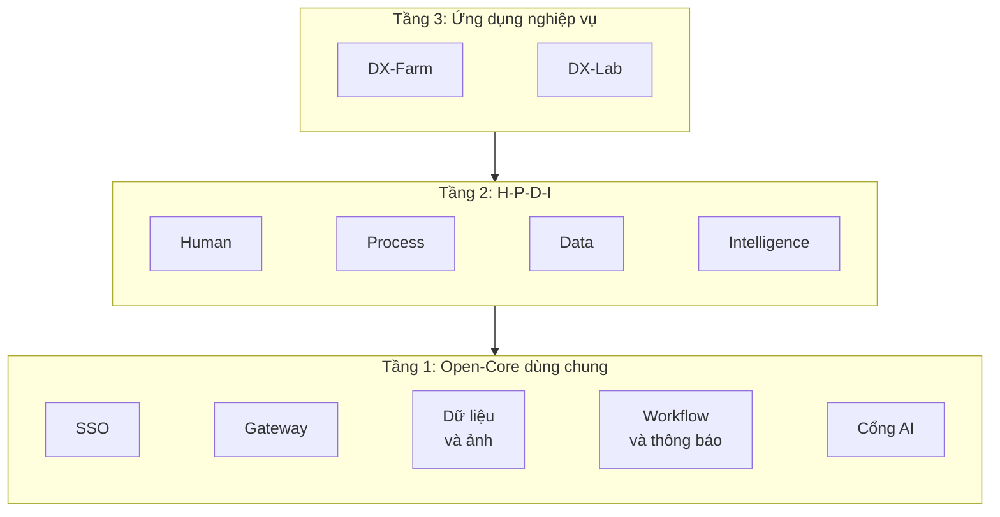

# DX-OS: DX-Farm và DX-Lab (Bài dự thi Phần Mềm Nguồn Mở 2026)

**Tiếng Việt** · [English](./README_EN.md)

[](./LICENSE)
[](./ai/LICENSE)

**Đội:** HaUI-ImplSolution · **Trường:** Trường Công nghệ Thông tin và Truyền thông, Đại học Công nghiệp Hà Nội

Nền tảng mã nguồn mở dùng chung cho chuyển đổi số, dự thi **OLP Phần mềm nguồn mở 2026** (khối thi DX-OS, VFOSSA).
Một lõi dùng chung lo đăng nhập, dữ liệu, quy trình, thông báo và AI; hai ứng dụng nghiệp vụ được xây trên lõi đó.

## 💡 Giới thiệu

| Ứng dụng | Bài toán | Luồng chính |
|---|---|---|
| **DX-Farm** | Chuyển đổi số cho Hợp tác xã Nông nghiệp Số chuyên canh lúa nước (ĐBSCL) | Nông dân chụp ảnh báo bệnh, AI chẩn đoán, kỹ sư duyệt và hướng dẫn xử lý, ghi nhận phun thuốc, hệ thống chặn thu hoạch khi chưa hết thời gian cách ly |
| **DX-Lab** | Trạm vận hành CNTT của khoa | Sinh viên báo sự cố, kỹ thuật viên xử lý đúng hạn, mượn thiết bị và đặt phòng máy có duyệt, hỏi đáp quy chế, quản trị xem thống kê |

## ✨ Điểm nổi bật

- **Một lõi, nhiều ứng dụng:** Farm và Lab dùng chung một lõi, thêm ứng dụng không phải sửa core.
- **An toàn nghiệp vụ:** các quy tắc quan trọng được kiểm ngay ở Backend và cơ sở dữ liệu, không chỉ ở giao diện.
- **AI có kiểm soát:** AI chỉ hỗ trợ, thông tin thuốc và liều lấy từ dữ liệu chuyên gia đã duyệt, kỹ sư là người quyết định.
- **Chạy một lệnh:** dựng toàn bộ hệ thống kèm dữ liệu demo, có kiểm thử tự động trên môi trường sạch.
- **Nguồn mở minh bạch:** công khai giấy phép và danh sách thành phần phần mềm, quét lộ mật khẩu tự động.

## 🧱 Kiến trúc 3 tầng



| Tầng | Thành phần |
|---|---|
| 1. Open-Core (không có giao diện người dùng) | Xử lý nghiệp vụ lõi, SSO, Gateway, cơ sở dữ liệu, kho ảnh |
| 2. H-P-D-I | Giao diện web và di động trên các dịch vụ của lõi, kèm AI, báo cáo và chat |
| 3. Ứng dụng | Farm và Lab |

| Không gian | Farm | Lab |
|---|---|---|
| **H** Human | Tài khoản nông hộ; vai nông dân, kỹ sư, quản trị | Tài khoản lớp và bộ môn; vai sinh viên, giảng viên, kỹ thuật viên, quản trị |
| **P** Process | Duyệt thửa, vụ mùa, chẩn đoán và khai phun; chặn thu hoạch khi chưa hết thời gian cách ly | Yêu cầu hỗ trợ có hạn xử lý, mượn thiết bị có duyệt, đặt phòng chống trùng giờ |
| **D** Data | Cơ sở dữ liệu, kho ảnh, báo cáo tổng hợp, thời tiết | Cơ sở dữ liệu, kho ảnh, thống kê hạn xử lý và mức dùng phòng |
| **I** Intelligence | Nhận diện bệnh từ ảnh, hỏi đáp tài liệu | Gợi ý phân loại có giải thích, hỏi đáp quy chế |

Mọi ứng dụng chỉ đi qua một Gateway duy nhất để kiểm tra đăng nhập, Backend kiểm tra lại lần nữa.
Sơ đồ đầy đủ và luồng xử lý ở [`ARCHITECTURE.md`](./ARCHITECTURE.md).

## 🧩 Tính năng

**DX-Farm:** quản lý nông hộ và thửa ruộng có vị trí, vụ mùa, báo cáo sâu bệnh kèm kiểm tra chất lượng ảnh, chẩn đoán AI và kỹ sư duyệt, khai báo phun thuốc, chặn thu hoạch khi chưa hết thời gian cách ly, nhắc hạn, hộp thông báo, thời tiết theo thửa, hỏi đáp tài liệu có trích nguồn, báo cáo tổng hợp; ứng dụng di động cho nông dân dùng được cả khi mất mạng.

**DX-Lab:** yêu cầu hỗ trợ có hạn xử lý và trao đổi nội bộ, gợi ý loại và mức ưu tiên, mượn trả thiết bị và nhật ký sửa chữa, đặt phòng máy không trùng giờ, hỏi đáp quy chế có trích nguồn và giấy phép, thống kê.

Mức hoàn thiện và độ phủ kiểm thử từng tính năng ở [`docs/TESTING.md`](./docs/TESTING.md); việc chưa làm ở [`docs/BACKLOG.md`](./docs/BACKLOG.md).

## 🧰 Công nghệ và giấy phép

| Thành phần | Công nghệ | Giấy phép |
|---|---|---|
| Backend | Java 21, Spring Boot, Flyway | Apache-2.0 |
| AI Service | Python, FastAPI, LangGraph, pgvector, Ollama (Qwen2.5-1.5B) | MIT, Apache-2.0 |
| CV | YOLOv8n (Ultralytics) và crop classifier ONNX | AGPL-3.0 |
| Web, Mobile | React, Vite, Expo | MIT |
| SSO, Gateway | Keycloak, Apache APISIX | Apache-2.0 |
| Dữ liệu, BI | PostgreSQL, MinIO, Apache Superset | PostgreSQL License, AGPL-3.0, Apache-2.0 |
| Chat | Mattermost Team Edition (chạy nguyên bản) | AGPL-3.0 |

Mã tự viết theo Apache-2.0 ([`LICENSE`](./LICENSE)), riêng `ai/` theo AGPL-3.0 vì import Ultralytics ([`ai/LICENSE`](./ai/LICENSE)).
Bảng dependency và giấy phép đầy đủ ở [`LICENSES.md`](./LICENSES.md); SBOM CycloneDX ở [`sbom/`](./sbom/README.md).

## 🚀 Cài đặt và chạy

### 💻 Yêu cầu hệ thống

| Hạng mục | Tối thiểu | Ghi chú |
|---|---|---|
| Phần mềm | Docker và Docker Compose v2, Git | Không cần cài JDK, Node, Python để chạy (chỉ cần `pillow` cho script demo) |
| RAM | 8 GB | Khuyến nghị 16 GB nếu chạy LLM và build cùng lúc |
| CPU | 4 vCPU | Không cần GPU |
| Ổ đĩa | 40 GB trống | Image AI khoảng 3 GB, Ollama khoảng 9 GB cùng model Qwen2.5 |
| Cổng | `9080`, `9081`, `9082`, `8065` | Đổi bằng biến `*_HOST_PORT` |

### 📝 Các bước

```bash
git clone https://github.com/HaUI-ImplSolution/DX-OS.git && cd DX-OS
cp deploy/.env.example deploy/.env      # điền mọi biến đang để trống
python3 -m pip install pillow           # cho script dữ liệu demo
./deploy/start.sh                       # dựng, chạy ứng dụng trong DXOS_APP và nạp dữ liệu demo
```

Lần dựng đầu tải và build nhiều thứ (MinIO build từ mã nguồn Go khoảng 2 phút).
Đổi ứng dụng bằng một lệnh, web đổi theo mà không build lại:

```bash
./deploy/start.sh farm                  # chạy Farm, nạp dữ liệu demo của Farm
./deploy/start.sh lab                   # đổi sang Lab, nạp dữ liệu demo của Lab (khoảng 1 phút)
./deploy/start.sh farm --reset --yes    # xóa deploy/data và dựng lại sạch
docker compose down                     # dừng, giữ dữ liệu trong deploy/data (chạy trong deploy/)
```

Chạy lại `start.sh` không tạo dữ liệu trùng.
Dữ liệu demo nạp riêng xem chi tiết ở [`deploy/demo/README.md`](./deploy/demo/README.md).

### 🔧 Cấu hình

Mọi cấu hình nằm ở `deploy/.env` (mẫu [`deploy/.env.example`](./deploy/.env.example)); thiếu biến nào, Compose dừng và báo tên biến đó.

| Biến | Ý nghĩa |
|---|---|
| `DXOS_APP` | Ứng dụng chạy: `farm` (mặc định) hoặc `lab` |
| `POSTGRES_*`, `MINIO_*`, `KEYCLOAK_*`, `SUPERSET_*`, `MATTERMOST_*` | Tài khoản và mật khẩu từng dịch vụ, để trống trong mẫu, không commit |
| `BACKEND_TO_AI_API_KEY`, `AI_TO_BACKEND_API_KEY` | Khóa dịch vụ hai chiều giữa Backend và AI |
| `GATEWAY_PUBLIC_URL`, `SUPERSET_PUBLIC_URL` | Địa chỉ công khai của gateway và Superset; đổi khỏi `localhost` khi chạy trên server |
| `MATTERMOST_WEBHOOK_URL_*` | Webhook từng kênh chat; để trống thì tắt thông báo kênh đó |
| `OLLAMA_MODEL` | Model LLM, mặc định `qwen2.5:1.5b` |

Cấu hình riêng của từng ứng dụng ở [`backend/app-farm/README.md`](./backend/app-farm/README.md) và [`backend/app-lab/README.md`](./backend/app-lab/README.md).

## 🌐 Chạy thử

| Dịch vụ | Địa chỉ | Đăng nhập |
|---|---|---|
| Ứng dụng web | http://localhost:9080 | SSO Keycloak, tài khoản bên dưới |
| Portal (trạng thái dịch vụ) | http://localhost:9080/portal/ | Không cần |
| Swagger | http://localhost:9080/swagger-ui.html | Access token Keycloak, bấm Authorize |
| Keycloak Admin | http://localhost:9080/admin | `KEYCLOAK_ADMIN_USERNAME` / `KEYCLOAK_ADMIN_PASSWORD` |
| BI (Superset) | http://localhost:9081 | SSO Keycloak; `admin1` vào trang quản trị |
| Quản trị lưu ảnh (MinIO) | http://localhost:9082 | `MINIO_ACCESS_KEY` / `MINIO_SECRET_KEY` |
| Chat (Mattermost) | http://localhost:8065 | `MATTERMOST_ADMIN_USERNAME` / `MATTERMOST_ADMIN_PASSWORD` |

### 🔑 Tài khoản demo

`seed_demo.py` tạo các tài khoản này trong realm `dxos` chỉ để demo và chấm thi; đổi mật khẩu hoặc xóa trước khi dùng cho dữ liệu thật.

| Ứng dụng | Username | Mật khẩu | Vai |
|---|---|---|---|
| Farm | `farmer1` | `farmer123` | FARMER (chỉ app mobile) |
| Farm | `engineer1` | `engineer123` | ENGINEER |
| Farm, Lab | `admin1` | `admin123` | ADMIN |
| Lab | `student1`, `student2` | `student123` | STUDENT |
| Lab | `lecturer1` | `lecturer123` | LECTURER |
| Lab | `tech1`, `tech2` | `tech123` | TECHNICIAN |

## 🧪 Kiểm thử

- Backend: `./mvnw verify` trong `backend` (cần Docker cho Testcontainers); AI: `pytest` trong `ai/`.
- Web và mobile: `npx tsc --noEmit`.
- E2E trên stack sạch: `python3 deploy/demo/e2e.py [--app farm|lab]`; CI chạy workflow `E2E` cho cả hai ứng dụng.

Hướng dẫn kiểm thử đầy đủ ở [`docs/TESTING.md`](./docs/TESTING.md).

## 🐛 Xử lý sự cố

| Dấu hiệu | Cách xử lý |
|---|---|
| Compose báo thiếu biến | Điền biến được nêu tên trong `deploy/.env` |
| Web hoặc API trả 401 sau khi dựng lại | Đăng xuất, đăng nhập lại (trình duyệt giữ token của lần dựng trước) |
| Web hiện giao diện app cũ sau khi đổi ứng dụng | Tải lại cứng, đợi `/api/v1/system/status` báo đúng app |
| Hỏi đáp không có kết quả | Kiểm `docker compose logs rag-ingest`; job nạp tri thức chưa xong hoặc lỗi |
| Hết dung lượng khi dựng | `docker system df`, dọn image và cache không dùng |

Bảng đầy đủ ở [`docs/TESTING.md`](./docs/TESTING.md) mục 8.

## 📁 Cấu trúc repository

| Thư mục | Nội dung |
|---|---|
| [`backend/`](./backend/README.md) | `dx-core-api`, `dx-core`, `app-farm`, `app-lab`, `dx-host` |
| [`frontend/`](./frontend/README.md) · [`mobile/`](./mobile/README.md) | Web React (hai ứng dụng) · Mobile Expo cho nông dân |
| [`ai/`](./ai/README.md) | AI Service: CV, RAG, LangGraph |
| [`data/`](./data/README.md) | Dữ liệu có cấu trúc, corpus RAG, script sinh seed |
| [`deploy/`](./deploy) | Docker Compose, gateway, `start.sh`, dữ liệu demo và E2E |
| [`sso/`](./sso/README.md) · [`bi/`](./bi/README.md) · [`chat/`](./chat/README.md) · [`minio/`](./minio/README.md) · [`portal/`](./portal/README.md) | Keycloak, Superset, Mattermost, MinIO, portal |
| [`docs/`](./docs) | Tồn đọng, kiểm thử, hồ sơ nộp bài, câu hỏi hội đồng, mẫu phase (`_template/`), tài liệu tham chiếu |

Tài liệu gốc: [`ARCHITECTURE.md`](./ARCHITECTURE.md) · [`CHANGELOG.md`](./CHANGELOG.md) · [`LICENSES.md`](./LICENSES.md).

## 🤝 Đóng góp

- **Báo lỗi:** [tạo bug report](https://github.com/HaUI-ImplSolution/DX-OS/issues/new?template=bug_report.md).
- **Đề xuất tính năng:** [tạo feature request](https://github.com/HaUI-ImplSolution/DX-OS/issues/new?template=feature_request.md).
- **Gửi mã:** đọc [`CONTRIBUTING.md`](./CONTRIBUTING.md) và tuân theo [`CODE_OF_CONDUCT.md`](./CODE_OF_CONDUCT.md).

## 📞 Liên hệ

| Vai trò | Tên | Liên hệ |
|---|---|---|
| Người duy trì | KhuongSpring | pkhuong535@gmail.com |

## 📜 Giấy phép

Apache License 2.0, xem [`LICENSE`](./LICENSE); thư mục `ai/` theo AGPL-3.0, xem [`ai/LICENSE`](./ai/LICENSE) và [`LICENSES.md`](./LICENSES.md).

Tham khảo: [chủ đề cuộc thi](https://vfossa.vn/tin-tuc/gioi-thieu-mo-hinh-dx-os-va-chu-de-cuoc-thi-phan-mem-nguon-mo-olp-2026-761.html) · [giáo trình DX-OS](https://opendigitransform.gitbook.io/dx-os)
