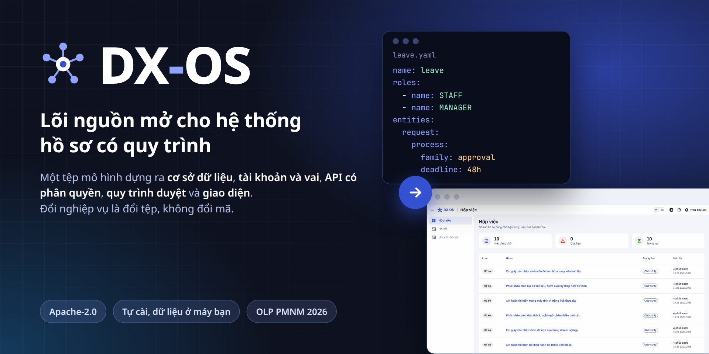
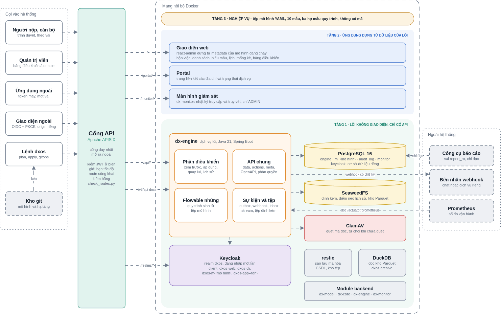

# DX-OS



🇻🇳 **Tiếng Việt** | 🇬🇧 [English](./README_EN.md)

> **Lõi dynamic nguồn mở cho hệ thống hồ sơ có quy trình.**
> Khai báo nghiệp vụ trong một tệp mô hình; DX-OS dựng cơ sở dữ liệu, tài khoản và vai, API có phân quyền, quy trình duyệt và giao diện.
> Đổi nghiệp vụ là đổi tệp, không đổi mã.

[](./LICENSE)
[](https://github.com/HaUI-ImplSolution/DX-OS/releases)
[](https://github.com/HaUI-ImplSolution/DX-OS/actions/workflows/ci-platform.yml)
[](https://www.bestpractices.dev/projects/16682)

**[Dùng thử](#dùng-thử)** · **[Bắt đầu nhanh](./docs/QUICKSTART.md)** · **[Tài liệu](https://haui-implsolution.github.io/DX-OS/)** · **[Tính năng](./docs/FEATURES.md)** · **[Thay đổi theo bản](./CHANGELOG.md)**

Bài dự thi **OLP Phần mềm nguồn mở 2026**, khối thi DX-OS (VFOSSA), của đội **HaUI-ImplSolution**, Trường Công nghệ Thông tin và Truyền thông, Đại học Công nghiệp Hà Nội.

## Giới thiệu

Trường học, khoa, doanh nghiệp nhỏ nào cũng có quy trình giống nhau: một người gửi yêu cầu, một người khác xem xét, duyệt hoặc trả lại, và mọi bước phải để lại dấu vết.
Mỗi lần có nghiệp vụ mới, phần đăng nhập, phân quyền, lưu tệp và luồng duyệt lại bị dựng lại từ đầu.

DX-OS làm phần dùng chung đó một lần, thành một lõi chạy ngầm không gắn với nghiệp vụ nào.
Người triển khai mô tả nghiệp vụ của mình trong một tệp mô hình, và lõi đọc tệp đó để dựng hệ thống chạy được.
Ví dụ, đây là toàn bộ tệp cho một quy trình nghỉ phép:

```yaml
format: 1
name: leave
roles:
  - name: STAFF
  - name: MANAGER
    staff: true
entities:
  request:
    label: Đơn nghỉ phép
    fields:
      reason: {type: text, label: Lý do, required: true}
      from_date: {type: date, label: Từ ngày, required: true}
      days: {type: number, label: Số ngày, required: true, min: 1, max: 30}
    access: {STAFF: own, MANAGER: all}
    process: {family: approval, handler: MANAGER, deadline: 48h}
```

Áp dụng tệp này thì lõi dựng bảng dữ liệu, hai vai trong Keycloak, API có phân quyền, quy trình duyệt hạn 48 giờ, cùng màn hình danh sách, biểu mẫu và hộp việc.
Nhân viên chỉ thấy đơn của mình, quản lý thấy tất cả, và mọi bước để lại lịch sử.
Đổi nghiệp vụ là đổi tệp, không đổi mã.

Toàn bộ hệ thống lắp từ phần mềm nguồn mở có giấy phép được OSI công nhận, tự cài trên máy của bạn, dữ liệu nằm hoàn toàn ở đó.

## Điểm nổi bật

- **Một tệp dựng cả hệ thống:** bảng dữ liệu, tài khoản, vai, quy trình, màn hình và tài liệu API đều sinh từ tệp mô hình.
- **Đổi nghiệp vụ khi đang chạy:** xem trước tác động và mức rủi ro, giữ nguyên dữ liệu cũ, quay về được phiên bản trước.
- **Quy trình duyệt không lách được:** trạng thái chỉ đổi qua quy trình, từ chối phải có lý do, không ai tự duyệt hồ sơ của mình, quá hạn thì tự báo và leo thang.
- **Phân quyền đến từng dòng:** mỗi người chỉ thấy phần việc của mình, của đơn vị mình hoặc được giao cho mình.
- **Lịch sử không sửa được lén:** ai sửa, xóa hoặc chèn một dòng thì một lệnh chỉ ra đúng dòng đó.
- **Nối với hệ thống khác:** mọi thay đổi báo ra ngoài kèm chữ ký, mỗi mô hình có tài liệu API riêng cho ứng dụng bên ngoài.
- **Trợ lý nghiệp vụ chạy tại chỗ:** mô hình AI do đội tự huấn luyện gợi ý cách điền hồ sơ kèm căn cứ; người dùng xác nhận mới lưu.
- **Việc thường ngày có sẵn:** in giấy tờ PDF tiếng Việt, nhập hồ sơ từ bảng tính, lưu trữ hồ sơ cũ, quét mã độc tệp đính kèm, sao lưu mã hóa.
- **Cài bằng hai lệnh:** chạy trên một máy bằng Docker, dữ liệu không rời khỏi máy đó.

Danh sách đầy đủ ở [`docs/FEATURES.md`](./docs/FEATURES.md); mỗi tính năng đối chiếu với bài kiểm của nó ở [ma trận bằng chứng](https://haui-implsolution.github.io/DX-OS/docs/evidence-matrix).

## Cách hoạt động



Hệ thống có ba tầng:

| Tầng | Vai trò |
|---|---|
| Lõi | Dịch vụ không giao diện: đọc mô hình, áp dụng, API chung, quy trình, lịch sử, sự kiện |
| Ứng dụng | Giao diện web và bảng điều khiển dựng từ dữ liệu của lõi, cùng trang liên kết, màn hình giám sát và trợ lý nghiệp vụ |
| Mô hình | Các tệp mô tả nghiệp vụ; thêm nghiệp vụ mới chỉ là thêm một tệp |

Cách một nghiệp vụ đi vào hệ thống:

1. **Khai báo.** Viết hoặc chọn một tệp mô hình: thực thể, trường, vai, quyền và quy trình.
2. **Áp dụng.** Xem kế hoạch rồi áp dụng; lõi dựng cơ sở dữ liệu, vai trong Keycloak, API và quy trình, và ghi lại từng bước.
3. **Dùng.** Người dùng đăng nhập và làm việc trên giao diện web dựng từ chính tệp đó; mọi thay đổi để lại lịch sử và được báo ra ngoài.

Một hồ sơ đi từ lúc nộp đến khi được duyệt và in ra:


Lõi lắp từ phần mềm nguồn mở ở dạng nguyên bản, không sửa mã thượng nguồn: APISIX làm cổng API, Keycloak lo đăng nhập, PostgreSQL giữ dữ liệu, SeaweedFS giữ tệp đính kèm, Flowable chạy quy trình và ClamAV quét mã độc.
Phiên bản và giấy phép của từng thành phần ở [`DEPENDENCIES.txt`](./DEPENDENCIES.txt) và [`sbom/`](./sbom/README.md).
Sơ đồ chi tiết ở [`ARCHITECTURE.md`](./ARCHITECTURE.md); cách viết tệp mô hình ở [`docs/MODEL.md`](./docs/MODEL.md); mười mẫu có sẵn chọn được ngay ở bảng điều khiển.

## Bắt đầu nhanh

Cần máy Linux (hoặc WSL2 trên Windows) có Docker với Compose v2; không cần mã nguồn.

```bash
curl -fsSL https://github.com/HaUI-ImplSolution/DX-OS/releases/latest/download/dxos-install.sh | bash
dxos start
```

Bộ cài tải bản phát hành mới nhất, kiểm SHA-256 rồi cài vào `~/.dxos`.
`dxos start` tải image ở lần đầu, chờ mọi dịch vụ sẵn sàng, tạo tài khoản `admin` với mật khẩu tạm in ra màn hình, rồi in các địa chỉ.
Đăng nhập `http://localhost:9080/console` bằng `admin`, đổi mật khẩu, chọn một mẫu ở tab Thư viện mẫu, xem kế hoạch rồi áp dụng.

- **Nối vào ứng dụng của bạn:** [bắt đầu nhanh](./docs/QUICKSTART.md) có hai đường, không cần code và có code, từ máy sạch đến quy trình chạy được.
- **Chỉ cần nền tảng API:** `dxos start --core`, xem [Chế độ chỉ lõi](./docs/OPERATIONS.md#chế-độ-chỉ-lõi).
- **Tự build từ mã nguồn:** `deploy/make_env.sh`, rồi `cd deploy && docker compose up -d --build`, rồi `./dxos admin`; cần thêm JDK 21 và Node 22 để build ngoài Docker.
- **Yêu cầu máy, lệnh `dxos`, sao lưu và xử lý sự cố:** [`docs/OPERATIONS.md`](./docs/OPERATIONS.md).

## Dùng thử

Bản chạy công khai tại <https://khuongdev.io.vn/> với mô hình Một cửa sinh viên và hồ sơ mẫu ở nhiều trạng thái.
Chọn một vai để đăng nhập; mật khẩu chung và kịch bản trình diễn 15 phút ở [`docs/DEMO.md`](./docs/DEMO.md#tài-khoản-thử).

| Muốn xem | Đăng nhập |
|---|---|
| Sinh viên nộp hồ sơ | `judge_student` |
| Cán bộ xử lý hồ sơ của một phòng | `judge_officer` hoặc `judge_officer2` |
| Người giám sát đọc mọi hồ sơ, thống kê | `judge_supervisor` |

Trên bản tự cài, `dxos demo` tạo cùng bốn tài khoản cùng 40 hồ sơ mẫu.

## Dành cho giám khảo

Đường ngắn nhất để kiểm DX-OS:

1. Mở bản chạy sẵn ở <https://khuongdev.io.vn/>, đăng nhập theo mục [Dùng thử](#dùng-thử).
2. Làm theo [kịch bản trình diễn 15 phút](./docs/DEMO.md), kèm cách chạy bằng chứng cho bốn nguyên lý của đề.
3. Tự cài bằng hai lệnh ở mục [Bắt đầu nhanh](#bắt-đầu-nhanh).
4. Đối chiếu từng tính năng với bài kiểm của nó ở [ma trận bằng chứng](https://haui-implsolution.github.io/DX-OS/docs/evidence-matrix), và với thang chấm kho mã ở [bảng rà soát PoF](https://haui-implsolution.github.io/DX-OS/docs/pof-audit).

### Đối chiếu với đề thi

Đề OLP 2026 chia hệ thống thành các tầng và nêu bốn không gian cần chạm tới.
DX-OS ở Tầng 1 là lõi không giao diện, ở Tầng 2 là giao diện web và bảng điều khiển, còn Một cửa sinh viên và các nghiệp vụ khác là tệp mô hình, tức ứng dụng của Tầng 3.

| Không gian | DX-OS làm gì | Trạng thái |
|---|---|---|
| H, môi trường số chung | Một lần đăng nhập; vai và đơn vị khai trong mô hình; mỗi người chỉ thấy phần việc của mình | Có |
| P, rào chắn và luồng tự động | Trạng thái chỉ đổi qua quy trình; từ chối bắt buộc có lý do; hạn xử lý, quá hạn và leo thang; việc sau khi duyệt chạy qua hàng đợi và được thử lại | Có |
| D, một nguồn sự thật | Dữ liệu, lịch sử và hàng đợi cùng một cơ sở dữ liệu; lịch sử chống sửa; mọi thay đổi báo ra ngoài bằng webhook có chữ ký | Có |
| I, trí tuệ nhân tạo | Trợ lý nghiệp vụ dùng bộ phân loại hồ sơ tiếng Việt do đội tự huấn luyện, chạy trên CPU không cần model ngoài; người dùng xác nhận trước khi lưu | Có, một thành phần |

Bốn nguyên lý kỹ thuật của đề (tách theo vòng đời dữ liệu, hội tụ IT và OT, quản trị dữ liệu, Zero-Trust) và đối chiếu chi tiết từng ý ở [`DANH_GIA.md`](./docs/dynamic-core/DANH_GIA.md); cách chạy từng việc ở [`docs/DEMO.md`](./docs/DEMO.md#8-bốn-nguyên-lý-của-đề-tùy-chọn).

## Giới hạn đã biết

- Phần AI là một trợ lý đề xuất giá trị một trường, người dùng xác nhận trước khi lưu; trợ lý mới dùng được cho vài mẫu có sẵn, nghiệp vụ mới cần dữ liệu và huấn luyện riêng; chưa có hỏi đáp trên tri thức nội bộ.
- Một bản cài chạy trên một máy bằng Docker Compose; chưa chạy nhiều bản sao của lõi.
- Số đo của thiết bị vào lõi qua API chung; lõi không giữ trạng thái thiết bị.
- Chưa có chữ ký số, két bí mật, đa thuê giữa các tổ chức và tìm kiếm toàn văn.
- Người dùng Windows chạy bản Linux trong WSL2 với Docker Desktop; không có bản chạy thẳng trên Windows.
- Một số tài liệu, như hướng dẫn vận hành và kiểm thử, chỉ có tiếng Việt.

Danh sách đầy đủ và lý do ở [`BACKLOG.md`](./docs/dynamic-core/BACKLOG.md); hướng đi tiếp ở [`ROADMAP.md`](./ROADMAP.md).

## Tài liệu

Trang tài liệu: <https://haui-implsolution.github.io/DX-OS/>; mục lục đầy đủ theo thư mục ở [`docs/README.md`](./docs/README.md).

| Cần gì | Xem |
|---|---|
| Từ máy sạch đến một quy trình chạy được, hoặc nối vào ứng dụng của bạn | [`docs/QUICKSTART.md`](./docs/QUICKSTART.md) |
| Dùng hệ thống theo vai | [người nộp](https://haui-implsolution.github.io/DX-OS/docs/huong-dan/nguoi-nop), [người xử lý](https://haui-implsolution.github.io/DX-OS/docs/huong-dan/nguoi-xu-ly), [người triển khai](https://haui-implsolution.github.io/DX-OS/docs/huong-dan/nguoi-trien-khai) |
| Ảnh màn hình và video | [trang hình ảnh](https://haui-implsolution.github.io/DX-OS/docs/hinh-anh) |
| Viết tệp mô hình | [`docs/MODEL.md`](./docs/MODEL.md) |
| Gọi API, viết dịch vụ và webhook | [`docs/API.md`](./docs/API.md), [`docs/EXTENSIONS.md`](./docs/EXTENSIONS.md) |
| Cài đặt, lệnh `dxos`, sao lưu, sự cố, giám sát | [`docs/OPERATIONS.md`](./docs/OPERATIONS.md), [`docs/MONITORING.md`](./docs/MONITORING.md) |
| Kiến trúc và các quyết định đã chốt | [`ARCHITECTURE.md`](./ARCHITECTURE.md) |
| Kiểm thử | [`docs/TESTING.md`](./docs/TESTING.md) |
| Thuật ngữ | [`docs/GLOSSARY.md`](./docs/GLOSSARY.md) |
| Thành phần bên thứ ba và giấy phép | [`DEPENDENCIES.txt`](./DEPENDENCIES.txt), [`NOTICE`](./NOTICE), [`sbom/`](./sbom/README.md) |

## Đóng góp

- **Báo lỗi:** [tạo bug report](https://github.com/HaUI-ImplSolution/DX-OS/issues/new?template=bug_report.yml).
- **Đề xuất tính năng:** [tạo feature request](https://github.com/HaUI-ImplSolution/DX-OS/issues/new?template=feature_request.yml).
- **Gửi mã:** đọc [`CONTRIBUTING.md`](./CONTRIBUTING.md), nơi có cả cấu trúc thư mục của repository, và tuân theo [`CODE_OF_CONDUCT.md`](./CODE_OF_CONDUCT.md).
- **Lỗ hổng bảo mật:** không đăng công khai, làm theo [`SECURITY.md`](./SECURITY.md).

## Nhóm phát triển

| Tên | GitHub |
|---|---|
| Phạm Minh Khương | [@KhuongSpring](https://github.com/KhuongSpring) |
| Nguyễn Đình Duy Khánh | [@nddKhanh](https://github.com/nddKhanh) |
| Trần Quang Tùng | [@tung51652-alt](https://github.com/tung51652-alt) |

## Giấy phép

Mã nguồn, tài liệu, ảnh chụp màn hình, video và sơ đồ theo Apache License 2.0, xem [`LICENSE`](./LICENSE).
Mọi giấy phép của dự án và của thành phần dùng đều được OSI công nhận, trừ các ngoại lệ gồm dữ liệu (kể cả dữ liệu của bộ phân loại hồ sơ, CC-BY-4.0), phông, công cụ dựng và gói có sẵn trong image bên thứ ba; từng ngoại lệ nêu tên và lý do ở phần "Giấy phép ngoài danh sách OSI" của [`DEPENDENCIES.txt`](./DEPENDENCIES.txt).
ClamAV chạy thành dịch vụ riêng, giao tiếp qua mạng, không liên kết mã nên không xung đột với Apache-2.0.

Tham khảo: [chủ đề cuộc thi](https://vfossa.vn/tin-tuc/gioi-thieu-mo-hinh-dx-os-va-chu-de-cuoc-thi-phan-mem-nguon-mo-olp-2026-761.html) · [giáo trình DX-OS](https://opendigitransform.gitbook.io/dx-os)
