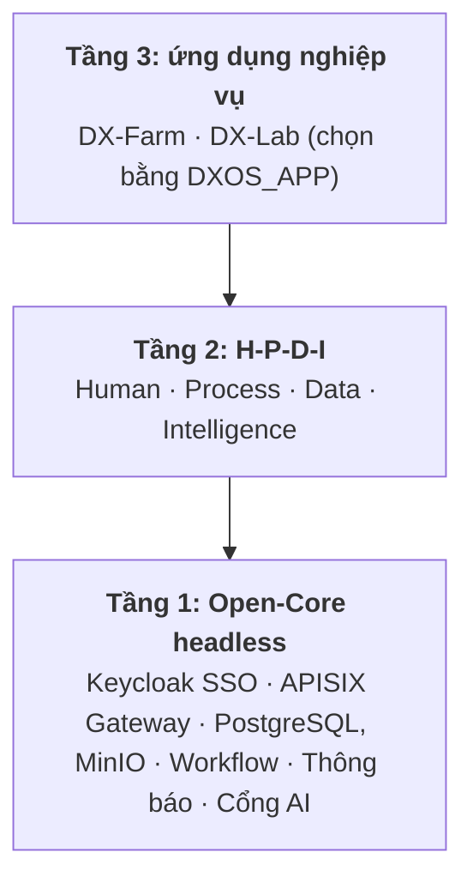

# DX-OS: DX-Farm và DX-Lab

Nền tảng **Open-Core** dùng chung cho chuyển đổi số, dự thi **OLP Phần mềm nguồn mở 2026** (khối thi DX-OS, VFOSSA).
Lõi headless cung cấp định danh và SSO, API Gateway, dữ liệu, workflow, thông báo và cổng AI; hai ứng dụng nghiệp vụ cắm vào qua interface:

- **DX-Farm**: hệ điều hành chuyển đổi số cho Hợp tác xã Nông nghiệp Số chuyên canh lúa nước (ĐBSCL).
  Nông dân báo bệnh bằng ảnh, AI chẩn đoán, hệ thống tra quy tắc xử lý xác định, kỹ sư duyệt, ghi nhận phun thuốc và khóa thu hoạch theo thời gian cách ly (PHI).
- **DX-Lab**: trạm vận hành CNTT của khoa.
  Sinh viên báo sự cố có gợi ý, kỹ thuật viên xử lý theo SLA, mượn thiết bị và đặt phòng máy có duyệt, hỏi đáp quy chế, quản trị xem thống kê.

Mỗi lần khởi động chạy một ứng dụng, chọn bằng biến `DXOS_APP` (`farm` hoặc `lab`); core giữ nguyên khi đổi ứng dụng.

## Kiến trúc 3 tầng



| Tầng | Thành phần |
|---|---|
| 1. Open-Core (headless, không có giao diện người dùng) | `dx-core` của Backend: `core.identity`, `core.workflow`, `core.notification`, `core.storage`, `core.ai`, `core.knowledge`, `core.security`; Keycloak (SSO), APISIX (gateway), PostgreSQL, MinIO |
| 2. H-P-D-I | Giao diện web (React) và mobile (Expo) trên các dịch vụ của Core, kèm AI Service, BI và chat |
| 3. Ứng dụng | `backend/app-farm` và `backend/app-lab`, chỉ phụ thuộc `dx-core-api` nên compiler chặn việc ứng dụng import ruột core |

| Không gian | Farm | Lab |
|---|---|---|
| **H** Human | Keycloak, workspace nông hộ, vai FARMER, ENGINEER, ADMIN | Keycloak, workspace lớp và bộ môn, vai STUDENT, LECTURER, TECHNICIAN, ADMIN |
| **P** Process | Duyệt thửa, vụ, chẩn đoán, khai phun; khóa thu hoạch theo PHI | Ticket có SLA, mượn thiết bị có duyệt, đặt phòng chống trùng giờ |
| **D** Data | PostgreSQL, MinIO, 6 view BI, Superset, thời tiết Open-Meteo | PostgreSQL, MinIO, 5 view `vw_lab_*`, thống kê SLA và mức dùng phòng |
| **I** Intelligence | CV (YOLOv8n), RAG, LangGraph, Qwen2.5 | Luật phân loại giải thích được, RAG quy chế |

Mọi client chỉ gọi gateway APISIX (cổng `9080`), gateway kiểm JWT Keycloak và Backend kiểm lần hai.
Sơ đồ đầy đủ, luồng request và danh sách interface ở [`ARCHITECTURE.md`](./ARCHITECTURE.md).

## Tính năng

**DX-Farm**: nông hộ và thửa có GPS, vụ mùa, báo cáo sâu bệnh kèm kiểm tra chất lượng ảnh, chẩn đoán AI và kỹ sư duyệt, khai phun thuốc, khóa thu hoạch theo PHI, nhắc hạn, hộp thông báo, thời tiết theo thửa, hỏi đáp tài liệu có trích nguồn, dashboard BI; mobile offline-first cho nông dân.

**DX-Lab**: yêu cầu hỗ trợ có SLA và trao đổi nội bộ, gợi ý loại và ưu tiên bằng luật, mượn trả thiết bị và nhật ký sửa chữa, đặt phòng máy chống trùng giờ ở cơ sở dữ liệu, hỏi đáp quy chế có trích nguồn và giấy phép, thống kê.

Mức hoàn thiện và độ phủ kiểm thử từng tính năng ở [`docs/TESTING.md`](./docs/TESTING.md); việc chưa làm ở [`docs/BACKLOG.md`](./docs/BACKLOG.md).

## Công nghệ và giấy phép

| Thành phần | Công nghệ | Giấy phép |
|---|---|---|
| Backend | Java 21, Spring Boot, Flyway | Apache-2.0 |
| AI Service | Python, FastAPI, LangGraph, pgvector, Ollama (Qwen2.5-1.5B) | MIT, Apache-2.0 |
| CV | YOLOv8n (Ultralytics) và crop classifier ONNX | AGPL-3.0 |
| Web, Mobile | React, Vite, Expo | MIT |
| SSO, Gateway | Keycloak, Apache APISIX | Apache-2.0 |
| Dữ liệu, BI | PostgreSQL, MinIO, Apache Superset | PostgreSQL License, AGPL-3.0, Apache-2.0 |
| Chat | Mattermost Team Edition (chạy nguyên bản) | AGPL-3.0 |

- Mã tự viết: Apache-2.0 ([`LICENSE`](./LICENSE)), SPDX header ở đầu file Java và Python; riêng `ai/` theo AGPL-3.0 vì import Ultralytics ([`ai/LICENSE`](./ai/LICENSE)).
- Bảng dependency và license đầy đủ ở [`LICENSES.md`](./LICENSES.md); SBOM CycloneDX ở [`sbom/`](./sbom/README.md).

## Cài đặt và chạy

Yêu cầu: Docker và Docker Compose.
Lần dựng đầu tải và build nhiều thứ: image AI khoảng 3 GB, Ollama khoảng 9 GB cùng model Qwen2.5; MinIO build từ mã nguồn Go (khoảng 2 phút).

```bash
cp deploy/.env.example deploy/.env      # điền mọi biến đang để trống
python3 -m pip install pillow           # cho script dữ liệu demo
./deploy/start.sh                       # dựng, chạy ứng dụng trong DXOS_APP và nạp dữ liệu demo
```

Đổi ứng dụng bằng một lệnh, web đổi theo mà không build lại:

```bash
./deploy/start.sh farm                  # chạy Farm, nạp dữ liệu demo của Farm
./deploy/start.sh lab                   # đổi sang Lab, nạp dữ liệu demo của Lab (khoảng 1 phút)
./deploy/start.sh farm --reset --yes    # xóa deploy/data và dựng lại sạch
docker compose down                     # dừng, giữ dữ liệu trong deploy/data
```

Chạy lại `start.sh` không tạo dữ liệu trùng.
Dữ liệu demo nạp riêng bằng `python3 deploy/demo/seed_demo.py [--app farm|lab] [--images DIR]`, chi tiết ở [`deploy/demo/README.md`](./deploy/demo/README.md).

### Cấu hình

Mọi cấu hình nằm ở `deploy/.env` (mẫu [`deploy/.env.example`](./deploy/.env.example)); thiếu biến nào, Compose dừng và báo tên biến đó.

| Biến | Ý nghĩa |
|---|---|
| `DXOS_APP` | Ứng dụng chạy: `farm` (mặc định) hoặc `lab` |
| `POSTGRES_*`, `MINIO_*`, `KEYCLOAK_*`, `SUPERSET_*`, `MATTERMOST_*` | Tài khoản và mật khẩu từng dịch vụ, để trống trong mẫu, không commit |
| `BACKEND_TO_AI_API_KEY`, `AI_TO_BACKEND_API_KEY` | Khóa dịch vụ hai chiều giữa Backend và AI |
| `MATTERMOST_WEBHOOK_URL_*` | Webhook từng kênh chat; để trống thì tắt thông báo kênh đó |
| `OLLAMA_MODEL` | Model LLM, mặc định `qwen2.5:1.5b` |
| `*_HOST_PORT` | Cổng publish ra host (gateway `9080`, Superset `9081`, MinIO `9082`, Mattermost `8065`) |

Cấu hình riêng của từng ứng dụng ở [`backend/app-farm/README.md`](./backend/app-farm/README.md) và [`backend/app-lab/README.md`](./backend/app-lab/README.md).

## Chạy thử

| Dịch vụ | Địa chỉ | Đăng nhập |
|---|---|---|
| Ứng dụng web | http://localhost:9080 | SSO Keycloak, tài khoản bên dưới |
| Portal (trạng thái dịch vụ) | http://localhost:9080/portal/ | Không cần |
| Swagger | http://localhost:9080/swagger-ui.html | Access token Keycloak, bấm Authorize |
| Keycloak Admin | http://localhost:9080/admin | `KEYCLOAK_ADMIN_USERNAME` / `KEYCLOAK_ADMIN_PASSWORD` |
| BI (Superset) | http://localhost:9081 | SSO Keycloak; `admin1` vào trang quản trị |
| Quản trị lưu ảnh (MinIO) | http://localhost:9082 | `MINIO_ACCESS_KEY` / `MINIO_SECRET_KEY` |
| Chat (Mattermost) | http://localhost:8065 | `MATTERMOST_ADMIN_USERNAME` / `MATTERMOST_ADMIN_PASSWORD` |

### Tài khoản demo

`seed_demo.py` tạo các tài khoản này trong realm `dxos` chỉ để demo và chấm thi; đổi mật khẩu hoặc xóa trước khi dùng cho dữ liệu thật.

| Ứng dụng | Username | Mật khẩu | Vai |
|---|---|---|---|
| Farm | `farmer1` | `farmer123` | FARMER (chỉ app mobile) |
| Farm | `engineer1` | `engineer123` | ENGINEER |
| Farm, Lab | `admin1` | `admin123` | ADMIN |
| Lab | `student1`, `student2` | `student123` | STUDENT |
| Lab | `lecturer1` | `lecturer123` | LECTURER |
| Lab | `tech1`, `tech2` | `tech123` | TECHNICIAN |

Kịch bản demo 10 phút ở [`docs/SUBMISSION.md`](./docs/SUBMISSION.md); app mobile ở [`mobile/README.md`](./mobile/README.md).

## API

Tài liệu tương tác ở `/swagger-ui.html` (OpenAPI), sinh từ code.
Mọi response bọc trong `ApiResponse` (`success`, `message`, `data`, `timestamp`); lỗi có thêm `errorCode` ổn định.
Nhóm endpoint dùng chung: `workflow-cases`, `approval-requests`, `workspaces`, `notifications`, `knowledge/ask`, `system/status`, `app`.
Farm thêm `parcels`, `crop-seasons`, `disease-reports`, `households`; Lab thêm `tickets`, `device-loans`, `devices`, `rooms`, `room-bookings`, `lab-stats/summary`.
Một ứng dụng chỉ nạp controller của nó: route của ứng dụng kia trả 404.

## Kiểm thử

- Backend: `./mvnw verify` trong `backend` (cần Docker cho Testcontainers); AI: `pytest` trong `ai/`.
- Web và mobile: `npx tsc --noEmit`.
- E2E trên stack sạch: `python3 deploy/demo/e2e.py [--app farm|lab]`; CI chạy workflow `E2E` cho cả hai ứng dụng.

Hướng dẫn kiểm thử đầy đủ ở [`docs/TESTING.md`](./docs/TESTING.md).

## Cấu trúc repository

| Thư mục | Nội dung |
|---|---|
| [`backend/`](./backend/README.md) | `dx-core-api`, `dx-core`, `app-farm`, `app-lab`, `dx-host` |
| [`frontend/`](./frontend/README.md) · [`mobile/`](./mobile/README.md) | Web React (hai ứng dụng) · Mobile Expo cho nông dân |
| [`ai/`](./ai/README.md) | AI Service: CV, RAG, LangGraph |
| [`data/`](./data/README.md) | Dữ liệu có cấu trúc, corpus RAG, script sinh seed |
| [`deploy/`](./deploy) | Docker Compose, gateway, `start.sh`, dữ liệu demo và E2E |
| [`sso/`](./sso/README.md) · [`bi/`](./bi/README.md) · [`chat/`](./chat/README.md) · [`minio/`](./minio/README.md) · [`portal/`](./portal/README.md) | Keycloak, Superset, Mattermost, MinIO, portal |
| [`docs/`](./docs) | Tồn đọng, kiểm thử, hồ sơ nộp bài, câu hỏi hội đồng, mẫu phase (`_template/`), tài liệu tham chiếu |

## Tài liệu và đóng góp

[`ARCHITECTURE.md`](./ARCHITECTURE.md) · [`CHANGELOG.md`](./CHANGELOG.md) · [`CONTRIBUTING.md`](./CONTRIBUTING.md) (kèm hướng dẫn thêm ứng dụng mới) · [`LICENSES.md`](./LICENSES.md) · [`docs/`](./docs).

Báo lỗi và đề xuất qua GitHub Issues (mẫu bug report và feature request).
Chủ đề chính thức: https://vfossa.vn/tin-tuc/gioi-thieu-mo-hinh-dx-os-va-chu-de-cuoc-thi-phan-mem-nguon-mo-olp-2026-761.html · Giáo trình DX-OS: https://opendigitransform.gitbook.io/dx-os
