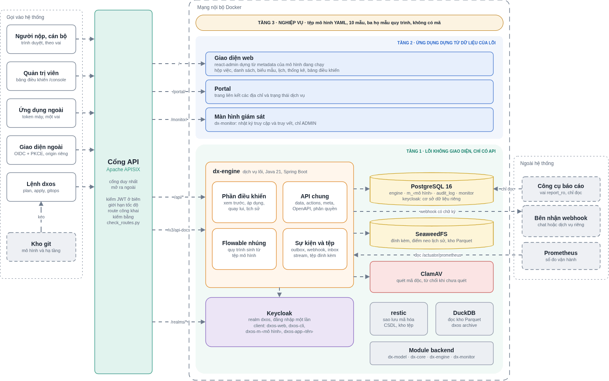
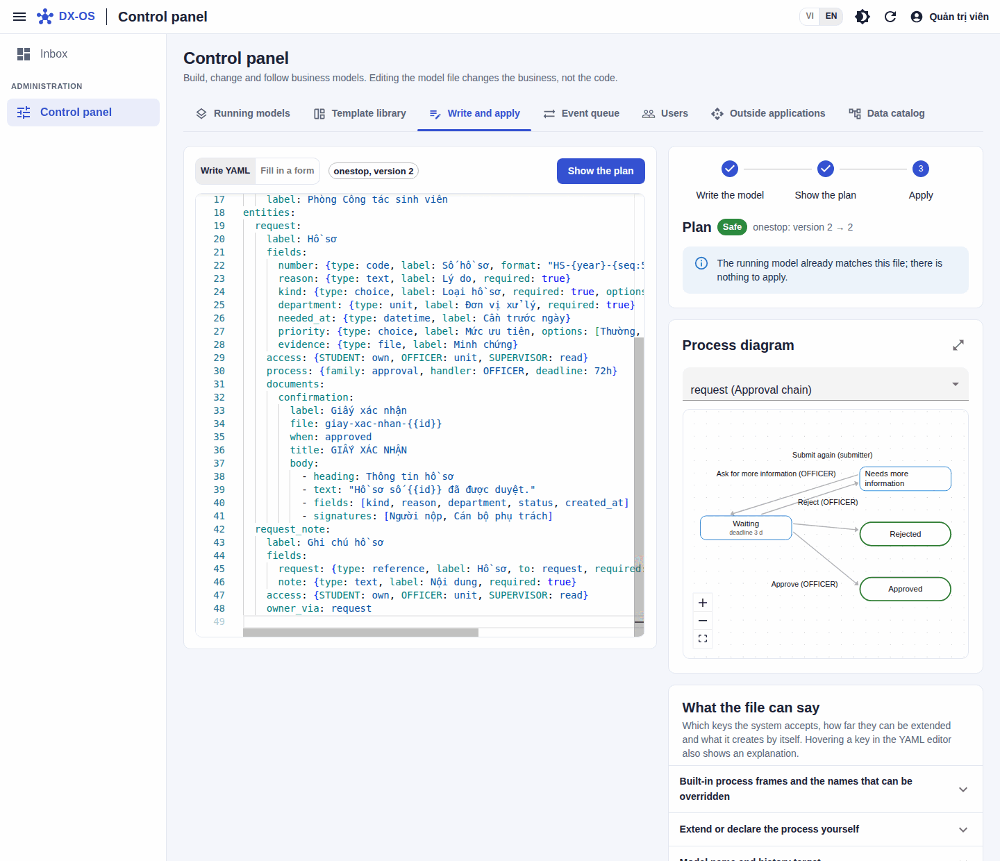
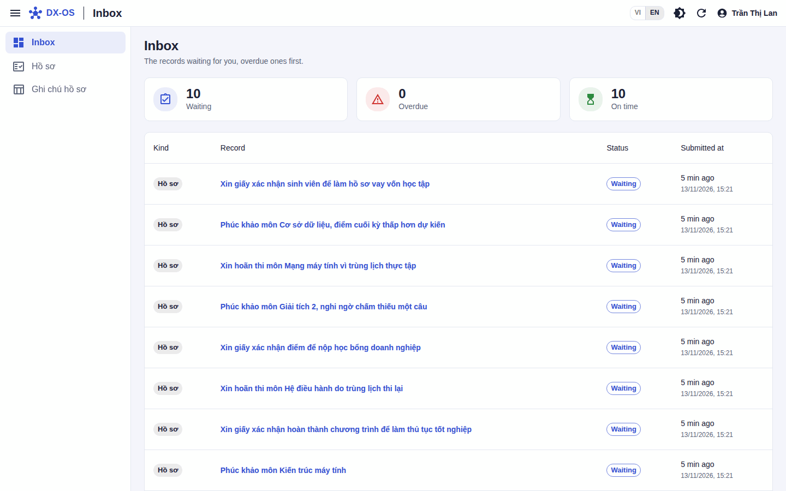
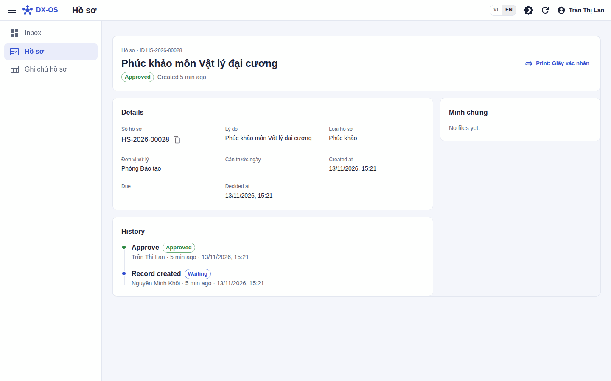

# DX-OS

🇻🇳 [Tiếng Việt](./README.md) | 🇬🇧 **English**

> **An open-source dynamic core for record-and-workflow systems.**
> Declare a business in one model file; DX-OS builds the database, the accounts and roles, a permissioned API, the approval workflow and the screens.
> Changing the business means changing the file, not the code.

[](./LICENSE)
[](https://github.com/HaUI-ImplSolution/DX-OS/releases)
[](https://github.com/HaUI-ImplSolution/DX-OS/actions/workflows/ci-platform.yml)
[](https://github.com/HaUI-ImplSolution/DX-OS/actions/workflows/ci-compliance.yml)
[](https://haui-implsolution.github.io/DX-OS/)
[](https://www.bestpractices.dev/projects/16682)

Entry of the **OLP Open Source Software 2026** contest, DX-OS track (VFOSSA), by team **HaUI-ImplSolution**, School of Information and Communication Technology, Hanoi University of Industry.

**Try it:** <https://khuongdev.io.vn/> (trial accounts in [Try it](#try-it)) · or install it on your own machine with two commands in [Install](#install).

**Documentation:** <https://haui-implsolution.github.io/DX-OS/>, with the documents sorted by need in [Documentation](#documentation).

**Quick links:** [Overview](#overview) · [Architecture](#architecture) · [Features](#features) · [Screenshots](#screenshots) · [Technology](#technology-and-licenses) · [Install](#install) · [Try it](#try-it) · [Operation](#operation-and-troubleshooting) · [Brief](#against-the-brief) · [Documentation](#documentation) · [Structure](#repository-structure) · [Contributing](#contributing) · [License](#license)

---

## Overview

Every school, department and small business has the same kind of process: one person sends a request, another reviews it, approves or returns it, and every step must leave a trace.
Each new business need usually means building login, permissions, file storage and the approval flow from scratch.

DX-OS builds that shared part once, as a headless core that is not tied to any business.
The person deploying it describes their business in one model file — what a record holds, who may see and edit it, who approves it, how long handling may take — and the core reads the file to build a working system.
Changing the business means changing the file, not the code.

The whole system is assembled from open-source software under OSI-approved licenses, installs on your own machine, and the data stays there.
The current version is `2.0.0`; the changes of each version are in [`CHANGELOG.md`](./CHANGELOG.md).

## Architecture



The system has three tiers:

| Tier | Role |
|---|---|
| Core | A headless service: reads models, applies them, the common API, workflows, history, events |
| Apps | A web interface and a control panel built from the data of the core, plus a links page (portal) and a monitoring screen |
| Models | The files that describe a business; adding a business is adding a file |

The path of one request:

1. **Declare.** Write or pick a model file: the entities, fields, roles, permissions and workflows of the business.
2. **Apply.** Preview the plan, then apply it; the core builds the database, the roles in Keycloak, the API and the workflows, and records each step.
3. **Use.** People sign in and work in a web interface built from the same file; every change leaves history and is reported outside.

The detailed diagrams, the modules and the path of one request are in [`ARCHITECTURE.md`](./ARCHITECTURE.md) (Vietnamese); how to write a model file is in [`docs/MODEL.md`](./docs/MODEL.md) (Vietnamese).

Ten templates are ready to pick in the control panel: student one-stop service, technical support, equipment incident, room booking, IT service access, equipment loan, notes, an asset register, clinic appointments and retail returns.

## Features

| Group | Feature |
|---|---|
| **Declaring the model** | **From one file to a running system:** records, tables, accounts, roles, list screens and forms are all built from the model file; a file written in an older style still runs, and a command moves it to the new style after you preview what will change. |
| | **Readable record codes:** the file declares a code format such as a prefix, the year and a sequence number; every record gets a code nobody else has, even when many people submit at once. |
| | **Data rules in the file:** true or false, dates, several values at once, limits on values, text patterns and conditional requirements are all declared in the file, and the database refuses a wrong value as well. |
| | **Customizable workflows:** start from one of three ready made shapes (approval, work items, time-slot reservations with a capacity check), add or remove steps and give each to its own role, or declare a workflow from scratch; a step can open only when the record meets a condition, rejecting and returning need a reason, and nobody approves their own record. |
| | **Changing the business once data exists:** the system previews the impact, warns about risk, keeps the values when something is renamed, and can return to the previous version. |
| **Permissions and the trail** | **Permissions down to the row:** each role sees and edits only its own work, the work of its unit, or the work assigned to it. |
| | **A trace that cannot be edited:** the history of records is one chain with checks; if anyone edits, deletes or inserts a line, one command names that line. |
| | **A data catalog:** one page shows where the data of each model lives, who may see it, how the kinds of records relate, where the data comes in from and where it goes out down to each field, and how complete and recent the data is. |
| | **Archive of old records:** records closed long ago are written to an archive store on a daily schedule; the data in use stays as it is, and the copy can be checked and queried directly with DuckDB. |
| **Extension and connections** | **Connections to the outside:** every change to a record is reported to a web address or a chat channel (Mattermost, Slack), signed so the receiver can check it and sent again when the receiver fails. |
| | **Open to outside applications:** each model has its own API document that follows the model; an outside service gets one model role and its own secret, while a browser interface on another domain signs users in with OIDC Authorization Code and PKCE. |
| | **A control panel for the person deploying:** template library, model editor (write the file or fill a form, with guidance on what can be written and extended) with a process diagram drawn from the file being written, plan preview, apply, history, user management and record statistics. |
| | **Printed documents from a record:** the model file declares a template for a certificate, slip or report; a record becomes a PDF with Vietnamese text for whoever may see that record, only in the states the template allows. |
| **Using and running it** | **An interface set by declaration:** the model file can choose icons, menu groups, the default columns and sort, how forms are grouped and the hints; an officer selects several records and handles them at once, each still going through every rule. |
| | **Board by state and list export:** the list of records with a process can be seen as a board with one column per state, and exported to a CSV file a spreadsheet can read, with exactly the rows the viewer may see. |
| | **An inbox that updates itself:** when a record changes, the inbox, the lists and the detail page that are open refresh without reloading the page. |
| | **Try it at once:** one command creates a trial account for each role and sample records in several states, so a visitor who signs in finds a system with work in it. |
| | **Simple to install and run:** one command installs and one starts; backups can be checked, services restart on their own, attachments are virus-scanned, and the operational numbers can be read by the monitoring tool you already have. |
| | **Single sign-on:** through Keycloak, and administrators can be required to enter a one-time code as well. |

Each feature and the test that proves it are matched in the [evidence matrix](https://haui-implsolution.github.io/DX-OS/docs/evidence-matrix) (Vietnamese).

## Screenshots

The screens below are captured from a running system with sample data; every name and record is invented.
The labels of the sample models are in Vietnamese, and the interface text follows the language switch.

From a submitted request to a record that is approved and printed:


Edit the model file, preview the plan of the change and apply it; the system moves to the new version and the old data stays:


| Control panel: write the model, preview the impact | The inbox of the person handling records | A record in detail, with the history of every step |
|---|---|---|
| [](website/docs/images/en/plan.png) | [](website/docs/images/en/inbox.png) | [](website/docs/images/en/detail.png) |

The full set, with the booking calendar, the report, the phone layout, the data catalog and the monitor screen, and the two videos are on the [documentation page](https://haui-implsolution.github.io/DX-OS/docs/hinh-anh) (Vietnamese).

## Technology and licenses

DX-OS orchestrates open-source software as it is: official images, pinned versions, no change to upstream code.
The full list is in [`DEPENDENCIES.txt`](./DEPENDENCIES.txt) and [`sbom/`](./sbom/README.md).

| Component | Version | License | Role |
|---|---|---|---|
| Apache APISIX | 3.11.0 | Apache-2.0 | API gateway, the only way in from outside |
| Keycloak | 26.8.2 | Apache-2.0 | Single sign-on, accounts and roles |
| Spring Boot, Java | 4.1.2, 21 | Apache-2.0, GPL-2.0 with the Classpath exception | The core service and the monitoring screen |
| Flowable | embedded in the core | Apache-2.0 | Workflow engine |
| PostgreSQL | 16 | PostgreSQL | The one database: data, history and queue |
| SeaweedFS | 4.51 | Apache-2.0 | S3-compatible store for attachments |
| ClamAV | 1.5.4 | GPL-2.0-only | Virus scan of uploads, a separate service, on by default and off with `dxos av off` |
| React, react-admin | 18, 5 | MIT | Web interface built from the metadata of the core |
| nginx | 1.30 | BSD-2-Clause | Serves the web interface and the portal |
| pgschema | 1.13.4 | Apache-2.0 | Compares the tables with a model and changes them to match |
| DuckDB | 1.4.1 | MIT | Reads the Parquet archive with `dxos archive` |
| restic | 0.17.3 | BSD-2-Clause | Encrypted backup, optional |

The code of the team is under Apache-2.0, with an SPDX line at the top of each file, checked by `reuse lint` on every pull request.
ClamAV runs as a separate service and talks over the network, with no linked code, so it does not conflict with Apache-2.0.
Why Supabase, Strapi and Directus were read for ideas or not used as a base is on the [components page](https://haui-implsolution.github.io/DX-OS/docs/dependencies) (Vietnamese).

## Install

### System requirements

| Item | Requirement | Note |
|---|---|---|
| Operating system | Linux | With Docker and Docker Compose v2 |
| Source code | Not needed with the installer | Only to build it yourself |
| JDK, Node | 21, 22 | Only to build and test outside Docker |
| RAM | About 1.8 GiB for the eight services when idle | Measured numbers in [`deploy/OPERATIONS.md`](./deploy/OPERATIONS.md#tài-nguyên-và-số-bản-sao) (Vietnamese); ClamAV adds about 1 GB, turn it off with `dxos av off` |
| Disk | About 3.5 GiB for the images | The database and the attachments grow with the data |

`dxos doctor` (or `deploy/doctor.sh`) checks Docker, RAM, disk, `deploy/.env` and the ports before you run.
The machine size by number of concurrent users is in [`docs/SIZING.md`](./docs/SIZING.md) (Vietnamese).

### Quick install with the installer

You need a Linux machine with Docker and Compose v2; no source code.

```bash
curl -fsSL https://github.com/HaUI-ImplSolution/DX-OS/releases/latest/download/dxos-install.sh | bash
dxos start
```

The installer downloads the latest release, checks its SHA-256 and installs it into `~/.dxos`; the `dxos` command goes to `~/.local/bin`.
`dxos start` downloads the images the first time, waits until every service is ready, creates the account `admin` with a temporary password printed on screen, and prints the addresses.
Sign in at `http://localhost:9080/console` as `admin`, change the password, pick a template on the Template library tab, preview the plan and apply it.
If you already have a model file, `dxos start <file>` takes it in at once; list every file after `dxos start` when there are several.
If you only need the API platform for outside applications, run `dxos start --core`: no web application, portal or monitoring, see [Core-only mode](./deploy/OPERATIONS.md#chế-độ-chỉ-lõi) (Vietnamese).

### From source

You also need JDK 21 and Node 22 to build and test outside Docker.

```bash
deploy/make_env.sh                       # writes deploy/.env with random passwords
cd deploy && docker compose up -d --build
./dxos admin                             # creates the admin account with a temporary password
```

Users come in through the gateway at `http://localhost:9080`:

| Address | Content |
|---|---|
| `/` | Web interface |
| `/console` | Control panel for the person deploying |
| `/portal/` | A page listing the addresses and the state of the services |
| `/monitor/` | Monitoring and tracing (ADMIN) |
| `/v3/api-docs` | OpenAPI specification of the backend |

The Keycloak administration console (`/admin`) is not exposed by default; set `KEYCLOAK_ADMIN_CONSOLE=true` in `deploy/.env` and recreate the gateway to open it (account in `deploy/.env`).
The full testing guide is in [`docs/TESTING.md`](./docs/TESTING.md) (Vietnamese).

## Try it

Version `2.0.0` runs publicly at https://khuongdev.io.vn/ with the One-stop student model and 40 sample requests.
Sign in with one of the four trial accounts below, all with the password `15c9777835f0dfcf4e8d`.

| Account | Role |
|---|---|
| `judge_student` | Student, files requests |
| `judge_officer` | Officer of the unit DAO_TAO |
| `judge_officer2` | Officer of the unit CTSV |
| `judge_supervisor` | Supervisor, reads every request |

The control panel `/console` and the monitoring page are for administrators, so these accounts cannot open them.
On a self-installed system, `dxos demo` creates the four trial accounts and 40 sample requests; the 15-minute demonstration script is in [`docs/DEMO.md`](./docs/DEMO.md) (Vietnamese).
Send feedback or report a problem by [opening an issue](https://github.com/HaUI-ImplSolution/DX-OS/issues/new/choose).

## Operation and troubleshooting

The `dxos` commands used most:

| Task | Command |
|---|---|
| Check the machine and `.env` before running | `dxos doctor` |
| See the state of the services | `dxos status` |
| Bring back a lost service | `dxos reconcile` |
| Preview and apply a model file | `dxos plan <file>`, `dxos apply <file>` |
| Reset the password of the trial accounts | `dxos demo` |
| Turn the virus scan on or off | `dxos av on`, `dxos av off` |

| Problem | What to do |
|---|---|
| A component has stopped | `dxos status`, then `dxos reconcile`; every long-running service restarts on its own when its process exits |
| The machine cannot run the stack | `dxos doctor` is read-only and reports missing variables in `.env`, ports in use, too little RAM or disk |
| Every upload is refused | The virus scan is on but ClamAV is not running; `dxos doctor` reports `FAIL`, run `dxos av on` or `dxos av off` |
| Cannot sign in with a trial account | `dxos demo` resets the password and prints the new one |
| After an apply, one `backend` copy answers 404 | Run a single `backend` copy, or restart both |

Install, every `dxos` command, backup, restore and incident response are in [`deploy/OPERATIONS.md`](./deploy/OPERATIONS.md); monitoring and logs are in [`deploy/MONITORING.md`](./deploy/MONITORING.md) (both Vietnamese).

## Against the brief

The OLP 2026 brief splits a system into tiers and names four spaces to reach: H (a shared digital environment), P (guard rails and automatic flows), D (one source of truth) and I (artificial intelligence).
DX-OS is, in Tier 1, a headless core, in Tier 2 a web interface and a control panel built on the core, and the student one-stop service and the other businesses are model files, which are the applications of Tier 3.

| Space | What DX-OS does | State |
|---|---|---|
| H, shared digital environment | One sign-in; roles and units declared in the model; each person sees only their own work in the inbox, the board by state and the calendar | Done |
| P, guard rails and automatic flows | A state changes only through the workflow; rejecting and returning need a reason; the creator cannot approve their own record; due and overdue dates and escalation to other roles; work after an approval runs through a queue and is retried | Done |
| D, one source of truth | Data, history and queue live in one database; the history is chained so tampering shows; every change is reported outside by a signed webhook; statistics and a data catalog | Done |
| I, artificial intelligence | None yet; only fully open models by the OSI definition will be used, and none that qualifies has been chosen | Not done |

How the interfaces that ship with the system are counted, and the detailed check of each point of the brief, are in [`DANH_GIA.md`](./docs/dynamic-core/DANH_GIA.md) and the remaining work in [`BACKLOG.md`](./docs/dynamic-core/BACKLOG.md), both in Vietnamese.

## Documentation

Docs site: <https://haui-implsolution.github.io/DX-OS/>.
The documents are written in Vietnamese; the API reference is the OpenAPI specification of the running backend.
The documents on writing a model file, the API, operation, monitoring, integrations, extension points and the architecture can also be read on the site, with a table of contents and links between pages.

| You need | See |
|---|---|
| A 5-minute tour, and the documents by folder | [`docs/README.md`](./docs/README.md) (Vietnamese) |
| Screenshots and videos | [the gallery page](https://haui-implsolution.github.io/DX-OS/docs/hinh-anh) (Vietnamese) |
| Using the system by role | [submitters](https://haui-implsolution.github.io/DX-OS/docs/huong-dan/nguoi-nop), [handlers](https://haui-implsolution.github.io/DX-OS/docs/huong-dan/nguoi-xu-ly), [deployers](https://haui-implsolution.github.io/DX-OS/docs/huong-dan/nguoi-trien-khai) (Vietnamese) |
| Writing a model file | [`docs/MODEL.md`](./docs/MODEL.md) |
| Calling the API | [`docs/API.md`](./docs/API.md) and the OpenAPI specification (`/v3/api-docs`) of the running backend |
| Building extension services, webhooks, and custom UIs | [`docs/EXTENSIONS.md`](./docs/EXTENSIONS.md) (Vietnamese) |
| Architecture and the decisions made | [`ARCHITECTURE.md`](./ARCHITECTURE.md) |
| Glossary | [`docs/GLOSSARY.md`](./docs/GLOSSARY.md) (Vietnamese) |
| Install, the `dxos` commands, backup, incident response | [`deploy/OPERATIONS.md`](./deploy/OPERATIONS.md) |
| Monitoring, logs, access audit | [`deploy/MONITORING.md`](./deploy/MONITORING.md) |
| Webhooks, tamper-evident history, long-term archive | [`deploy/INTEGRATIONS.md`](./deploy/INTEGRATIONS.md) |
| Connecting a reporting tool | [`deploy/REPORTING.md`](./deploy/REPORTING.md) (Vietnamese) |
| Testing | [`docs/TESTING.md`](./docs/TESTING.md), [`e2e/README.md`](./e2e/README.md) |
| Verified targets and self-hosting cost | [`docs/TARGETS.md`](./docs/TARGETS.md) |
| The 15-minute demonstration script | [`docs/DEMO.md`](./docs/DEMO.md) |
| Design and remaining work | [`docs/dynamic-core/README.md`](./docs/dynamic-core/README.md), [`BACKLOG.md`](./docs/dynamic-core/BACKLOG.md) |
| Changes by version | [`CHANGELOG.md`](./CHANGELOG.md) |
| Compatibility between versions | [`docs/COMPATIBILITY.md`](./docs/COMPATIBILITY.md) (Vietnamese) |
| Where the project is going | [`ROADMAP.md`](./ROADMAP.md) (Vietnamese) |
| Third-party components and licenses | [`DEPENDENCIES.txt`](./DEPENDENCIES.txt), [`NOTICE`](./NOTICE), [`sbom/`](./sbom/README.md) |

## Repository structure

| Folder | Tier | Content |
|---|---|---|
| `backend/dx-model` | Core | The model file format: reading and checking |
| `backend/dx-core` | Core | Shared library: security, audit, storage, state, Keycloak client |
| `backend/dx-engine` | Core | The core service: applying models, the common API, Flowable |
| `backend/dx-monitor` | Apps | The monitoring and tracing screen |
| `frontend` | Apps | A react-admin interface built from metadata, in Vietnamese and English |
| `deploy` | Shared | Compose, the APISIX gateway, the installer and the `dxos` command, operation scripts, check scripts in `deploy/dev` |
| `sso`, `seaweedfs` | Core | The Keycloak realm, file storage |
| `portal` | Apps | The page that links the addresses and the state of the services |
| `models` | Models | Invalid model files for automatic checks; usable sample models are in `backend/dx-engine/src/main/resources/templates/` |
| `examples` | Outside the core | Sample programs: a receiver that keeps history hashes ([`history-witness`](./examples/history-witness/README.md)), an IT/OT system simulator ([`itot-simulator`](./examples/itot-simulator/README.md)) |
| `e2e` | Testing | Browser tests of the web interface (Playwright) |
| `website` | Documentation | The docs site (Docusaurus), published on GitHub Pages |
| `docs` | Documentation | The testing guide, the model file and the API; the design is in `dynamic-core/` |
| `sbom` | Licenses | CycloneDX component lists of the backend, the web interface and the docs site |
| `LICENSES` | Licenses | The full text of the licenses of the repository, as the REUSE specification asks |
| `.github` | Shared | CI workflows, issue and pull request templates, branch rules, check scripts |

## Contributing

- **Report a bug:** [open a bug report](https://github.com/HaUI-ImplSolution/DX-OS/issues/new?template=bug_report.yml).
- **Suggest a feature:** [open a feature request](https://github.com/HaUI-ImplSolution/DX-OS/issues/new?template=feature_request.yml).
- **Send code:** read [`CONTRIBUTING.md`](./CONTRIBUTING.md) and follow [`CODE_OF_CONDUCT.md`](./CODE_OF_CONDUCT.md).
- **Security vulnerability:** do not post it in public, follow [`SECURITY.md`](./SECURITY.md).

## Team

| Name | Contact |
|---|---|
| Phạm Minh Khương | pkhuong535@gmail.com |
| Nguyễn Đình Duy Khánh | dinhkhanh19042006@gmail.com |
| Trần Quang Tùng | tung51652@gmail.com |

## License

The source code, documents, screenshots, videos and diagrams are under the Apache License 2.0, see [`LICENSE`](./LICENSE).
Every license of the project and of the components it uses is approved by the OSI, except a few data packages read only while the docs site is built; they are named with the reason in [`DEPENDENCIES.txt`](./DEPENDENCIES.txt), section 7.
The license of each third-party component is in [`DEPENDENCIES.txt`](./DEPENDENCIES.txt).

References: [contest topic](https://vfossa.vn/tin-tuc/gioi-thieu-mo-hinh-dx-os-va-chu-de-cuoc-thi-phan-mem-nguon-mo-olp-2026-761.html) · [DX-OS textbook](https://opendigitransform.gitbook.io/dx-os)
