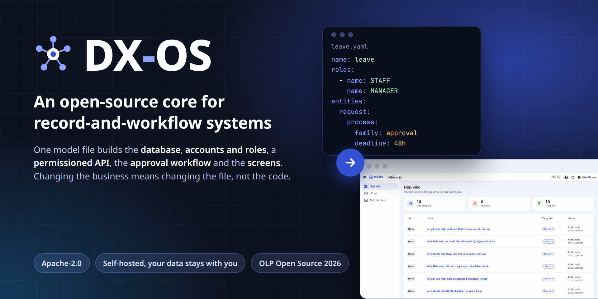
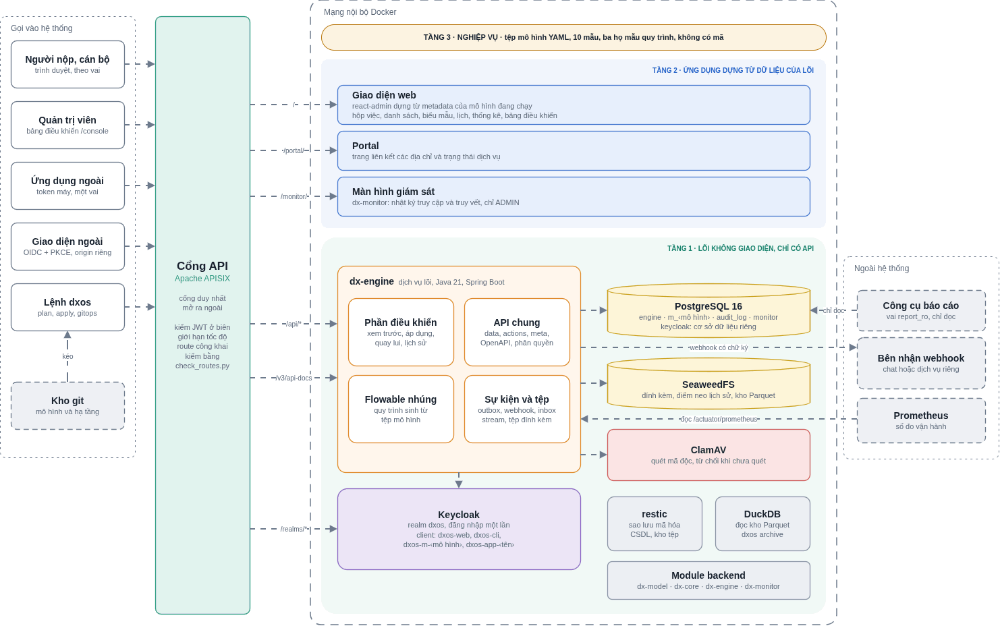

# DX-OS



🇻🇳 [Tiếng Việt](./README.md) | 🇬🇧 **English**

> **An open-source dynamic core for record-and-workflow systems.**
> Declare a business in one model file; DX-OS builds the database, the accounts and roles, a permissioned API, the approval workflow and the screens.
> Changing the business means changing the file, not the code.

[](./LICENSE)
[](https://github.com/HaUI-ImplSolution/DX-OS/releases)
[](https://github.com/HaUI-ImplSolution/DX-OS/actions/workflows/ci-platform.yml)
[](https://www.bestpractices.dev/projects/16682)

**[Try it](#try-it)** · **[Quick start](./docs/en/QUICKSTART_EN.md)** · **[Docs](https://haui-implsolution.github.io/DX-OS/en/)** · **[Features](./docs/en/FEATURES_EN.md)** · **[Changelog](./CHANGELOG.md)**

Entry of the **OLP Open Source Software 2026** contest, DX-OS track (VFOSSA), by team **HaUI-ImplSolution**, School of Information and Communication Technology, Hanoi University of Industry.

## Overview

Every school, department and small business has the same kind of process: one person sends a request, another reviews it, approves or returns it, and every step must leave a trace.
Each new business need usually means building login, permissions, file storage and the approval flow from scratch.

DX-OS builds that shared part once, as a headless core that is not tied to any business.
The person deploying it describes their business in one model file, and the core reads the file to build a working system.
For example, this is the whole file for a leave-request process:

```yaml
format: 1
name: leave
roles:
  - name: STAFF
  - name: MANAGER
    staff: true
entities:
  request:
    label: Đơn nghỉ phép
    fields:
      reason: {type: text, label: Lý do, required: true}
      from_date: {type: date, label: Từ ngày, required: true}
      days: {type: number, label: Số ngày, required: true, min: 1, max: 30}
    access: {STAFF: own, MANAGER: all}
    process: {family: approval, handler: MANAGER, deadline: 48h}
```

Applying this file makes the core build the data tables, two roles in Keycloak, a permissioned API, an approval workflow with a 48-hour deadline, and the list screen, the form and the inbox.
A staff member sees only their own requests, a manager sees all of them, and every step leaves history.
Changing the business means changing the file, not the code.

The whole system is assembled from open-source software under OSI-approved licenses, installs on your own machine, and the data stays there.

## Highlights

- **One file builds the whole system:** data tables, accounts, roles, workflow, screens and API documentation are all generated from the model file.
- **Change the business while it runs:** preview the impact and the risk level, keep the existing data, go back to the previous version.
- **A workflow that cannot be bypassed:** a status changes only through the workflow, a rejection needs a reason, nobody approves their own record, and an overdue record is reported and escalated.
- **Permissions down to the row:** each person sees only their own work, their unit's work, or work assigned to them.
- **History that cannot be edited quietly:** if anyone edits, deletes or inserts a row, one command points to that exact row.
- **Connect to other systems:** every change is reported outside with a signature, and each model has its own API documentation for outside applications.
- **A business assistant that runs on site:** an AI model trained by the team suggests how to fill in a record, with the evidence; the user confirms before anything is saved.
- **The everyday work is included:** Vietnamese PDF documents, importing records from a spreadsheet, archiving old records, virus scanning of attachments, encrypted backup.
- **Installs with two commands:** it runs on one machine with Docker, and the data never leaves that machine.

The full list is in [`docs/FEATURES_EN.md`](./docs/en/FEATURES_EN.md); each feature is matched with its test in the [evidence matrix](https://haui-implsolution.github.io/DX-OS/docs/evidence-matrix).

## How it works



The system has three tiers:

| Tier | Role |
|---|---|
| Core | A service with no interface: reads models, applies them, the common API, workflows, history, events |
| Applications | The web interface and the control panel built from the core's data, plus the link page, the monitoring screen and the business assistant |
| Models | The files that describe a business; adding a business is adding a file |

How a business enters the system:

1. **Declare.** Write or pick a model file: entities, fields, roles, permissions and the workflow.
2. **Apply.** Preview the plan, then apply it; the core builds the database, the roles in Keycloak, the API and the workflow, and records each step.
3. **Use.** People sign in and work in a web interface built from the same file; every change leaves history and is reported outside.

A record from the moment it is filed to its approval and printout:


The core is assembled from open-source software as it is, with no change to upstream code: APISIX is the API gateway, Keycloak handles sign-in, PostgreSQL keeps the data, SeaweedFS keeps attachments, Flowable runs the workflows and ClamAV scans for malware.
The version and license of each component are in [`DEPENDENCIES.txt`](./DEPENDENCIES.txt) and [`sbom/`](./sbom/README.md).
The detailed diagrams are in [`docs/en/ARCHITECTURE_EN.md`](./docs/en/ARCHITECTURE_EN.md); how to write a model file is in [`docs/MODEL_EN.md`](./docs/en/MODEL_EN.md); ten ready templates can be picked in the control panel.

## Quick start

You need a Linux machine (or WSL2 on Windows) with Docker and Compose v2; no source code is needed.

```bash
curl -fsSL https://github.com/HaUI-ImplSolution/DX-OS/releases/latest/download/dxos-install.sh | bash
dxos start
```

The installer downloads the latest release, checks its SHA-256 and installs it into `~/.dxos`.
On the first run `dxos start` pulls the images, waits for every service, creates the `admin` account with a temporary password printed on screen, and prints the addresses.
Sign in at `http://localhost:9080/console` as `admin`, change the password, pick a template on the Template library tab, preview the plan and apply it.

- **Connect your own application:** the [quick start](./docs/en/QUICKSTART_EN.md) has two paths, without code and with code, from a clean machine to a working process.
- **Only the API platform:** `dxos start --core`, see [Core-only mode](./docs/OPERATIONS.md#chế-độ-chỉ-lõi) (Vietnamese).
- **Build from source:** `deploy/make_env.sh`, then `cd deploy && docker compose up -d --build`, then `./dxos admin`; JDK 21 and Node 22 are also needed to build outside Docker.
- **Deploy to a server with a domain:** [`docs/DEPLOY.md`](./docs/DEPLOY.md) (Vietnamese).
- **Machine requirements, the `dxos` commands, backup and troubleshooting:** [`docs/OPERATIONS.md`](./docs/OPERATIONS.md) (Vietnamese).

## Try it

A public instance runs at <https://khuongdev.io.vn/> with the student one-stop model and sample records in several states.
Pick a role to sign in; the shared password and the 15-minute demo script are in [`docs/DEMO.md`](./docs/DEMO.md#tài-khoản-thử) (Vietnamese).

| To see | Sign in as |
|---|---|
| A student filing a record | `judge_student` |
| An officer handling the records of one office | `judge_officer` or `judge_officer2` |
| A supervisor reading every record, with statistics | `judge_supervisor` |

On a self-hosted install, `dxos demo` creates the same four accounts with 40 sample records.

## For judges

The shortest way to check DX-OS:

1. Open the running instance at <https://khuongdev.io.vn/> and sign in as described in [Try it](#try-it).
2. Follow the [15-minute demo script](./docs/DEMO.md) (Vietnamese), which also shows how to run the evidence for the four principles of the brief.
3. Install it yourself with the two commands in [Quick start](#quick-start).
4. Match each feature with its test in the [evidence matrix](https://haui-implsolution.github.io/DX-OS/docs/evidence-matrix), and the repository against the scoring scale in the [PoF audit](https://haui-implsolution.github.io/DX-OS/docs/pof-audit) (both Vietnamese).

### Against the brief

The OLP 2026 brief splits a system into tiers and names four spaces to reach.
DX-OS is, in Tier 1, a headless core, in Tier 2 a web interface and a control panel built on the core, and the student one-stop service and the other businesses are model files, which are the applications of Tier 3.

| Space | What DX-OS does | Status |
|---|---|---|
| H, shared digital environment | One sign-in; roles and units declared in the model; each person sees only their own work | Yes |
| P, guard rails and automatic flows | A status changes only through the workflow; a rejection needs a reason; deadlines, overdue records and escalation; work after approval runs through a queue and is retried | Yes |
| D, one source of truth | Data, history and queue in one database; tamper-evident history; every change reported outside by a signed webhook | Yes |
| I, artificial intelligence | A business assistant with a Vietnamese record classifier the team trained, running on CPU with no outside model; the user confirms before saving | Yes, one component |

The four technical principles of the brief (separating data by life cycle, converging IT and OT, data governance, Zero-Trust) and the detailed match of every point are in [`DANH_GIA.md`](./docs/dynamic-core/DANH_GIA.md) (Vietnamese); how to run each one is in [`docs/DEMO.md`](./docs/DEMO.md#8-bốn-nguyên-lý-của-đề-tùy-chọn) (Vietnamese).

## Known limits

- The AI part is one assistant that suggests a value for one field, and the user confirms before saving; it works for a few of the shipped templates, and a new business needs its own data and training; there is no question answering over internal knowledge.
- An install runs on one machine with Docker Compose; the core does not run as several replicas.
- Device readings enter the core through the common API; the core keeps no device state.
- There is no digital signature, secret vault, multi-tenancy across organizations or full-text search.
- Windows users run the Linux version in WSL2 with Docker Desktop; there is no version that runs directly on Windows.
- Some documents, such as the operations and testing guides, are in Vietnamese only.

The full list and the reasons are in [`BACKLOG.md`](./docs/dynamic-core/BACKLOG.md) (Vietnamese); where the project goes next is in [`ROADMAP.md`](./ROADMAP.md) (Vietnamese).

## Documentation

Docs site: <https://haui-implsolution.github.io/DX-OS/en/>, in English for the features, the quick start, the model file, the API, the architecture, monitoring, integrations, extension points, reporting, storage, sizing, the glossary and the guides by role; each of these has an English file with the suffix `_EN` in `docs/en/`; the other documents are in Vietnamese only, and the full table of contents by folder is in [`docs/README.md`](./docs/README.md).

| You need | See |
|---|---|
| From a clean machine to a working process, or connecting your own application | [`docs/QUICKSTART_EN.md`](./docs/en/QUICKSTART_EN.md) |
| Using the system by role | [submitters](https://haui-implsolution.github.io/DX-OS/en/docs/huong-dan/nguoi-nop), [handlers](https://haui-implsolution.github.io/DX-OS/en/docs/huong-dan/nguoi-xu-ly), [deployers](https://haui-implsolution.github.io/DX-OS/en/docs/huong-dan/nguoi-trien-khai) |
| Screenshots and videos | [the gallery page](https://haui-implsolution.github.io/DX-OS/en/docs/hinh-anh) |
| Writing a model file | [`docs/MODEL_EN.md`](./docs/en/MODEL_EN.md) |
| Calling the API, building extension services and webhooks | [`docs/API_EN.md`](./docs/en/API_EN.md), [`docs/EXTENSIONS_EN.md`](./docs/en/EXTENSIONS_EN.md); and the OpenAPI specification (`/v3/api-docs`) of the running backend |
| Deploy, the `dxos` commands, backup, troubleshooting, monitoring | [`docs/DEPLOY.md`](./docs/DEPLOY.md) (Vietnamese), [`docs/OPERATIONS.md`](./docs/OPERATIONS.md) (Vietnamese), [`docs/MONITORING_EN.md`](./docs/en/MONITORING_EN.md) |
| Architecture and the decisions made | [`docs/en/ARCHITECTURE_EN.md`](./docs/en/ARCHITECTURE_EN.md) |
| Testing | [`docs/TESTING.md`](./docs/TESTING.md) (Vietnamese) |
| Glossary | [`docs/GLOSSARY_EN.md`](./docs/en/GLOSSARY_EN.md) |
| Third-party components and licenses | [`DEPENDENCIES.txt`](./DEPENDENCIES.txt), [`NOTICE`](./NOTICE), [`sbom/`](./sbom/README.md) |

## Contributing

- **Report a bug:** [open a bug report](https://github.com/HaUI-ImplSolution/DX-OS/issues/new?template=bug_report.yml).
- **Suggest a feature:** [open a feature request](https://github.com/HaUI-ImplSolution/DX-OS/issues/new?template=feature_request.yml).
- **Send code:** read [`CONTRIBUTING.md`](./CONTRIBUTING.md), which also holds the structure of the repository, and follow [`CODE_OF_CONDUCT.md`](./CODE_OF_CONDUCT.md).
- **Security vulnerability:** do not post it in public, follow [`SECURITY.md`](./SECURITY.md).

## Team

| Name | GitHub |
|---|---|
| Phạm Minh Khương | [@KhuongSpring](https://github.com/KhuongSpring) |
| Nguyễn Đình Duy Khánh | [@nddKhanh](https://github.com/nddKhanh) |
| Trần Quang Tùng | [@tung51652-alt](https://github.com/tung51652-alt) |

## License

The source code, documents, screenshots, videos and diagrams are under the Apache License 2.0, see [`LICENSE`](./LICENSE).
Every license of the project and of the components it uses is approved by the OSI, except data (including the data of the record classifier, CC-BY-4.0), fonts, build tools and packages already inside third-party images; each exception is named with its reason in the section on licenses outside the OSI list of [`DEPENDENCIES.txt`](./DEPENDENCIES.txt).
ClamAV runs as a separate service and talks over the network, with no code linked, so it does not conflict with Apache-2.0.

References: [contest topic](https://vfossa.vn/tin-tuc/gioi-thieu-mo-hinh-dx-os-va-chu-de-cuoc-thi-phan-mem-nguon-mo-olp-2026-761.html) · [DX-OS textbook](https://opendigitransform.gitbook.io/dx-os)
