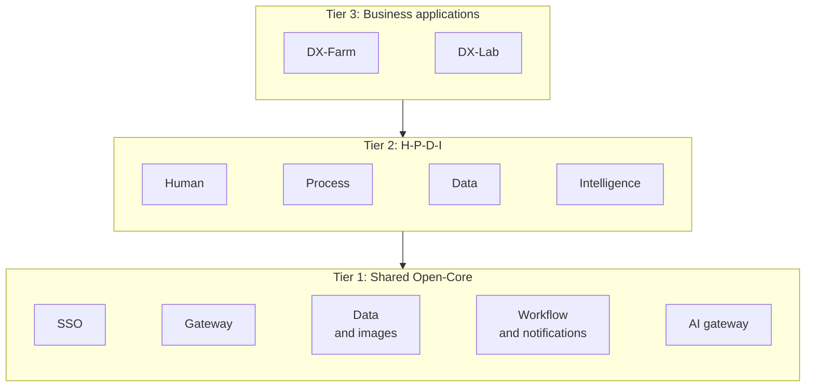

# DX-OS: DX-Farm and DX-Lab (Open Source Software 2026 Contest Entry)

[Tiếng Việt](./README.md) · **English**

[](./LICENSE)
[](./ai/LICENSE)

**Team:** HaUI-ImplSolution · **School:** School of Information and Communication Technology, Hanoi University of Industry

A shared open-source platform for digital transformation, built for the **OLP Open Source Software 2026** contest (DX-OS track, VFOSSA).
One shared core handles sign-in, data, workflows, notifications and AI; two business applications are built on top of it.

## 💡 Overview

| Application | Problem | Main flow |
|---|---|---|
| **DX-Farm** | Digital transformation for a rice-growing agricultural cooperative in the Mekong Delta | Farmers photograph and report plant disease, AI diagnoses it, engineers approve and advise treatment, spraying is recorded, and harvest is blocked until the waiting period ends |
| **DX-Lab** | An IT operations desk for a university faculty | Students report incidents, technicians resolve them on time, equipment loans and computer-lab bookings are approved, regulations Q&A, admins view statistics |

## ✨ Highlights

- **One core, many applications:** Farm and Lab share one core; adding an application needs no change to the core.
- **Business safety:** key rules are checked in the Backend and the database, not just in the UI.
- **Controlled AI:** AI only assists; drug and dose information comes from expert-approved data and the engineer makes the decision.
- **One-command run:** builds the whole system with demo data, with automated tests on a clean environment.
- **Transparent open source:** licenses and the list of software components are public, with automatic scanning for leaked passwords.

## 🧱 Three-tier architecture



| Tier | Components |
|---|---|
| 1. Open-Core (no end-user UI) | Core business logic, SSO, Gateway, database, image storage |
| 2. H-P-D-I | Web and mobile UIs on top of the core services, plus AI, reports and chat |
| 3. Applications | Farm and Lab |

| Space | Farm | Lab |
|---|---|---|
| **H** Human | Household accounts; roles farmer, engineer, admin | Class and department accounts; roles student, lecturer, technician, admin |
| **P** Process | Approval of parcels, seasons, diagnoses and spraying; harvest blocked until the waiting period ends | Support requests with deadlines, approved equipment loans, double-booking-proof room reservations |
| **D** Data | Database, image storage, summary reports, weather | Database, image storage, deadline and room-usage statistics |
| **I** Intelligence | Disease recognition from photos, document Q&A | Explainable classification suggestions, regulations Q&A |

Every application goes through a single Gateway that checks sign-in, and the Backend checks it again.
Full diagrams and request flows are in [`ARCHITECTURE.md`](./ARCHITECTURE.md).

## 🧩 Features

**DX-Farm:** households and parcels with locations, crop seasons, disease reports with image quality checks, AI diagnosis with engineer approval, spraying records, harvest blocked until the waiting period ends, reminders, notification inbox, per-parcel weather, document Q&A with citations, summary reports; a mobile app for farmers that works offline.

**DX-Lab:** support requests with deadlines and internal comments, type and priority suggestions, equipment loans with repair log, room booking without time conflicts, regulations Q&A with source and license, statistics.

Feature maturity and test coverage are in [`docs/TESTING.md`](./docs/TESTING.md); outstanding work is in [`docs/BACKLOG.md`](./docs/BACKLOG.md).

## 🧰 Technology and licenses

| Component | Technology | License |
|---|---|---|
| Backend | Java 21, Spring Boot, Flyway | Apache-2.0 |
| AI Service | Python, FastAPI, LangGraph, pgvector, Ollama (Qwen2.5-1.5B) | MIT, Apache-2.0 |
| CV | YOLOv8n (Ultralytics) and ONNX crop classifier | AGPL-3.0 |
| Web, Mobile | React, Vite, Expo | MIT |
| SSO, Gateway | Keycloak, Apache APISIX | Apache-2.0 |
| Data, BI | PostgreSQL, MinIO, Apache Superset | PostgreSQL License, AGPL-3.0, Apache-2.0 |
| Chat | Mattermost Team Edition (unmodified) | AGPL-3.0 |

Original code is Apache-2.0 ([`LICENSE`](./LICENSE)); `ai/` is AGPL-3.0 because it imports Ultralytics ([`ai/LICENSE`](./ai/LICENSE)).
Full dependency and license table: [`LICENSES.md`](./LICENSES.md); CycloneDX SBOMs: [`sbom/`](./sbom/README.md).

## 🚀 Install and run

### 💻 System requirements

| Item | Minimum | Notes |
|---|---|---|
| Software | Docker and Docker Compose v2, Git | No JDK, Node or Python needed to run (only `pillow` for the demo script) |
| RAM | 8 GB | 16 GB recommended when building and running the LLM together |
| CPU | 4 vCPU | No GPU needed |
| Disk | 40 GB free | AI image about 3 GB, Ollama about 9 GB plus the Qwen2.5 model |
| Ports | `9080`, `9081`, `9082`, `8065` | Change with the `*_HOST_PORT` variables |

### 📝 Steps

```bash
git clone https://github.com/HaUI-ImplSolution/DX-OS.git && cd DX-OS
cp deploy/.env.example deploy/.env      # fill in every empty variable
python3 -m pip install pillow           # for the demo data script
./deploy/start.sh                       # build, run the app in DXOS_APP, load demo data
```

The first build downloads and builds a lot (MinIO is built from Go source, about 2 minutes).
Switch applications with one command; the web app follows without a rebuild:

```bash
./deploy/start.sh farm                  # run Farm, load Farm demo data
./deploy/start.sh lab                   # switch to Lab, load Lab demo data (about 1 minute)
./deploy/start.sh farm --reset --yes    # wipe deploy/data and rebuild from scratch
docker compose down                     # stop, keep data in deploy/data (run inside deploy/)
```

Re-running `start.sh` does not create duplicate data.
Load demo data separately; see [`deploy/demo/README.md`](./deploy/demo/README.md) for details.

### 🔧 Configuration

All configuration lives in `deploy/.env` (template: [`deploy/.env.example`](./deploy/.env.example)); Compose stops and names any missing variable.

| Variable | Meaning |
|---|---|
| `DXOS_APP` | Application to run: `farm` (default) or `lab` |
| `POSTGRES_*`, `MINIO_*`, `KEYCLOAK_*`, `SUPERSET_*`, `MATTERMOST_*` | Per-service accounts and passwords, empty in the template, never committed |
| `BACKEND_TO_AI_API_KEY`, `AI_TO_BACKEND_API_KEY` | Service keys for each direction between Backend and AI |
| `GATEWAY_PUBLIC_URL`, `SUPERSET_PUBLIC_URL` | Public addresses of the gateway and Superset; change from `localhost` when running on a server |
| `MATTERMOST_WEBHOOK_URL_*` | Webhook for each chat channel; empty disables that channel's notifications |
| `OLLAMA_MODEL` | LLM model, default `qwen2.5:1.5b` |

Per-application settings: [`backend/app-farm/README.md`](./backend/app-farm/README.md) and [`backend/app-lab/README.md`](./backend/app-lab/README.md).

## 🌐 Try it

| Service | Address | Login |
|---|---|---|
| Web application | http://localhost:9080 | Keycloak SSO, accounts below |
| Portal (service status) | http://localhost:9080/portal/ | None |
| Swagger | http://localhost:9080/swagger-ui.html | Keycloak access token, click Authorize |
| Keycloak Admin | http://localhost:9080/admin | `KEYCLOAK_ADMIN_USERNAME` / `KEYCLOAK_ADMIN_PASSWORD` |
| BI (Superset) | http://localhost:9081 | Keycloak SSO; `admin1` for the admin area |
| Image storage admin (MinIO) | http://localhost:9082 | `MINIO_ACCESS_KEY` / `MINIO_SECRET_KEY` |
| Chat (Mattermost) | http://localhost:8065 | `MATTERMOST_ADMIN_USERNAME` / `MATTERMOST_ADMIN_PASSWORD` |

### 🔑 Demo accounts

`seed_demo.py` creates these accounts in the `dxos` realm for demo and judging only; change or delete the passwords before using real data.

| Application | Username | Password | Role |
|---|---|---|---|
| Farm | `farmer1` | `farmer123` | FARMER (mobile app only) |
| Farm | `engineer1` | `engineer123` | ENGINEER |
| Farm, Lab | `admin1` | `admin123` | ADMIN |
| Lab | `student1`, `student2` | `student123` | STUDENT |
| Lab | `lecturer1` | `lecturer123` | LECTURER |
| Lab | `tech1`, `tech2` | `tech123` | TECHNICIAN |

## 🧪 Testing

- Backend: `./mvnw verify` in `backend` (Docker required for Testcontainers); AI: `pytest` in `ai/`.
- Web and mobile: `npx tsc --noEmit`.
- End-to-end on a clean stack: `python3 deploy/demo/e2e.py [--app farm|lab]`; CI runs the `E2E` workflow for both applications.

Full testing guide: [`docs/TESTING.md`](./docs/TESTING.md).

## 🐛 Troubleshooting

| Symptom | Fix |
|---|---|
| Compose reports a missing variable | Fill in the named variable in `deploy/.env` |
| Web or API returns 401 after a rebuild | Sign out and sign in again (the browser kept the token from the previous build) |
| Web shows the old app after switching | Hard-reload and wait until `/api/v1/system/status` reports the right app |
| Q&A returns nothing | Check `docker compose logs rag-ingest`; the knowledge ingest job has not finished or failed |
| Out of disk space while building | `docker system df`, then prune unused images and cache |

Full table: [`docs/TESTING.md`](./docs/TESTING.md) section 8.

## 📁 Repository layout

| Folder | Contents |
|---|---|
| [`backend/`](./backend/README.md) | `dx-core-api`, `dx-core`, `app-farm`, `app-lab`, `dx-host` |
| [`frontend/`](./frontend/README.md) · [`mobile/`](./mobile/README.md) | React web (both applications) · Expo mobile for farmers |
| [`ai/`](./ai/README.md) | AI Service: CV, RAG, LangGraph |
| [`data/`](./data/README.md) | Structured data, RAG corpora, seed generation scripts |
| [`deploy/`](./deploy) | Docker Compose, gateway, `start.sh`, demo data and E2E |
| [`sso/`](./sso/README.md) · [`bi/`](./bi/README.md) · [`chat/`](./chat/README.md) · [`minio/`](./minio/README.md) · [`portal/`](./portal/README.md) | Keycloak, Superset, Mattermost, MinIO, portal |
| [`docs/`](./docs) | Backlog, testing, AI evaluation, submission pack, council Q&A, phase template (`_template/`), reference material |

Top-level documents: [`ARCHITECTURE.md`](./ARCHITECTURE.md) · [`CHANGELOG.md`](./CHANGELOG.md) · [`LICENSES.md`](./LICENSES.md).

## 🤝 Contributing

- **Report a bug:** [open a bug report](https://github.com/HaUI-ImplSolution/DX-OS/issues/new?template=bug_report.md).
- **Suggest a feature:** [open a feature request](https://github.com/HaUI-ImplSolution/DX-OS/issues/new?template=feature_request.md).
- **Submit code:** read [`CONTRIBUTING.md`](./CONTRIBUTING.md) and follow [`CODE_OF_CONDUCT.md`](./CODE_OF_CONDUCT.md).

## 📞 Contact

| Role | Name | Contact |
|---|---|---|
| Maintainer | KhuongSpring | pkhuong535@gmail.com |

## 📜 License

Apache License 2.0, see [`LICENSE`](./LICENSE); the `ai/` directory is AGPL-3.0, see [`ai/LICENSE`](./ai/LICENSE) and [`LICENSES.md`](./LICENSES.md).

References: [contest topic](https://vfossa.vn/tin-tuc/gioi-thieu-mo-hinh-dx-os-va-chu-de-cuoc-thi-phan-mem-nguon-mo-olp-2026-761.html) · [DX-OS textbook](https://opendigitransform.gitbook.io/dx-os)
