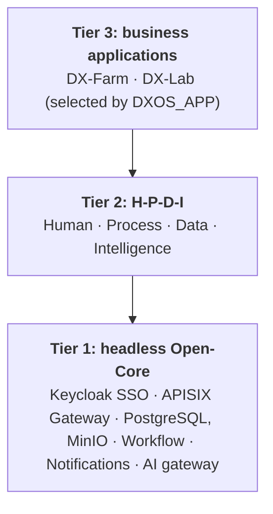

# DX-OS: DX-Farm and DX-Lab

[Tiếng Việt](./README.md) · **English**

A shared **Open-Core** platform for digital transformation, built for the **OLP Open Source Software 2026** contest (DX-OS track, VFOSSA).
A headless core provides identity and SSO, an API gateway, data, workflow, notifications and an AI gateway; two business applications plug into it through interfaces:

- **DX-Farm**: a digital operating system for a rice-growing agricultural cooperative in the Mekong Delta.
  Farmers report plant disease with photos, AI diagnoses it, the system looks up deterministic treatment rules, engineers approve, spraying is recorded and harvest is locked for the pre-harvest interval (PHI).
- **DX-Lab**: an IT operations desk for a university faculty.
  Students report incidents with suggestions, technicians resolve them within SLA, equipment loans and computer-lab bookings are approved, regulations Q&A, and admins view statistics.

One application runs per start, selected by the `DXOS_APP` variable (`farm` or `lab`); the core stays unchanged when you switch.

Module and reference documents linked below are written in Vietnamese.

## Three-tier architecture



| Tier | Components |
|---|---|
| 1. Open-Core (headless, no end-user UI) | Backend `dx-core`: `core.identity`, `core.workflow`, `core.notification`, `core.storage`, `core.ai`, `core.knowledge`, `core.security`; Keycloak (SSO), APISIX (gateway), PostgreSQL, MinIO |
| 2. H-P-D-I | Web (React) and mobile (Expo) UIs on top of the core services, plus the AI Service, BI and chat |
| 3. Applications | `backend/app-farm` and `backend/app-lab`, depending only on `dx-core-api`, so the compiler rejects any import of core internals |

| Space | Farm | Lab |
|---|---|---|
| **H** Human | Keycloak, household workspaces, roles FARMER, ENGINEER, ADMIN | Keycloak, class and department workspaces, roles STUDENT, LECTURER, TECHNICIAN, ADMIN |
| **P** Process | Approval of parcels, seasons, diagnoses and spraying; PHI harvest lock | Tickets with SLA, approved equipment loans, double-booking-proof room reservations |
| **D** Data | PostgreSQL, MinIO, 6 BI views, Superset, Open-Meteo weather | PostgreSQL, MinIO, 5 `vw_lab_*` views, SLA and room-usage statistics |
| **I** Intelligence | CV (YOLOv8n), RAG, LangGraph, Qwen2.5 | Explainable classification rules, regulations RAG |

Every client talks only to the APISIX gateway (port `9080`); the gateway validates the Keycloak JWT and the Backend validates it again.
Full diagrams, request flows and the interface catalog are in [`ARCHITECTURE.md`](./ARCHITECTURE.md).

## Features

**DX-Farm**: households and GPS-tagged parcels, crop seasons, disease reports with image quality checks, AI diagnosis with engineer approval, spraying records, PHI harvest lock, reminders, notification inbox, per-parcel weather, document Q&A with citations, BI dashboard; offline-first mobile app for farmers.

**DX-Lab**: support tickets with SLA and internal comments, rule-based type and priority suggestions, equipment loans with repair log, room booking with database-level conflict prevention, regulations Q&A with source and license, statistics.

Feature maturity and test coverage are in [`docs/TESTING.md`](./docs/TESTING.md); outstanding work is in [`docs/BACKLOG.md`](./docs/BACKLOG.md).

## Technology and licenses

| Component | Technology | License |
|---|---|---|
| Backend | Java 21, Spring Boot, Flyway | Apache-2.0 |
| AI Service | Python, FastAPI, LangGraph, pgvector, Ollama (Qwen2.5-1.5B) | MIT, Apache-2.0 |
| CV | YOLOv8n (Ultralytics) and ONNX crop classifier | AGPL-3.0 |
| Web, Mobile | React, Vite, Expo | MIT |
| SSO, Gateway | Keycloak, Apache APISIX | Apache-2.0 |
| Data, BI | PostgreSQL, MinIO, Apache Superset | PostgreSQL License, AGPL-3.0, Apache-2.0 |
| Chat | Mattermost Team Edition (unmodified) | AGPL-3.0 |

- Original code: Apache-2.0 ([`LICENSE`](./LICENSE)) with SPDX headers in Java and Python files; `ai/` is AGPL-3.0 because it imports Ultralytics ([`ai/LICENSE`](./ai/LICENSE)).
- Full dependency and license table: [`LICENSES.md`](./LICENSES.md); CycloneDX SBOMs: [`sbom/`](./sbom/README.md).

## Install and run

Requirements: Docker and Docker Compose.
The first build downloads and builds a lot: the AI image is about 3 GB, Ollama about 9 GB plus the Qwen2.5 model, and MinIO is built from Go source (about 2 minutes).

```bash
cp deploy/.env.example deploy/.env      # fill in every empty variable
python3 -m pip install pillow           # for the demo data script
./deploy/start.sh                       # build, run the app in DXOS_APP, load demo data
```

Switch applications with one command; the web app follows without a rebuild:

```bash
./deploy/start.sh farm                  # run Farm, load Farm demo data
./deploy/start.sh lab                   # switch to Lab, load Lab demo data (about 1 minute)
./deploy/start.sh farm --reset --yes    # wipe deploy/data and rebuild from scratch
docker compose down                     # stop, keep data in deploy/data
```

Re-running `start.sh` does not create duplicate data.
Load demo data separately with `python3 deploy/demo/seed_demo.py [--app farm|lab] [--images DIR]`; details in [`deploy/demo/README.md`](./deploy/demo/README.md).

### Configuration

All configuration lives in `deploy/.env` (template: [`deploy/.env.example`](./deploy/.env.example)); Compose stops and names any missing variable.

| Variable | Meaning |
|---|---|
| `DXOS_APP` | Application to run: `farm` (default) or `lab` |
| `POSTGRES_*`, `MINIO_*`, `KEYCLOAK_*`, `SUPERSET_*`, `MATTERMOST_*` | Per-service accounts and passwords, empty in the template, never committed |
| `BACKEND_TO_AI_API_KEY`, `AI_TO_BACKEND_API_KEY` | Service keys for each direction between Backend and AI |
| `MATTERMOST_WEBHOOK_URL_*` | Webhook for each chat channel; empty disables that channel's notifications |
| `OLLAMA_MODEL` | LLM model, default `qwen2.5:1.5b` |
| `*_HOST_PORT` | Ports published on the host (gateway `9080`, Superset `9081`, MinIO `9082`, Mattermost `8065`) |

Per-application settings: [`backend/app-farm/README.md`](./backend/app-farm/README.md) and [`backend/app-lab/README.md`](./backend/app-lab/README.md).

## Try it

| Service | Address | Login |
|---|---|---|
| Web application | http://localhost:9080 | Keycloak SSO, accounts below |
| Portal (service status) | http://localhost:9080/portal/ | None |
| Swagger | http://localhost:9080/swagger-ui.html | Keycloak access token, click Authorize |
| Keycloak Admin | http://localhost:9080/admin | `KEYCLOAK_ADMIN_USERNAME` / `KEYCLOAK_ADMIN_PASSWORD` |
| BI (Superset) | http://localhost:9081 | Keycloak SSO; `admin1` for the admin area |
| Image storage admin (MinIO) | http://localhost:9082 | `MINIO_ACCESS_KEY` / `MINIO_SECRET_KEY` |
| Chat (Mattermost) | http://localhost:8065 | `MATTERMOST_ADMIN_USERNAME` / `MATTERMOST_ADMIN_PASSWORD` |

### Demo accounts

`seed_demo.py` creates these accounts in the `dxos` realm for demo and judging only; change or delete the passwords before using real data.

| Application | Username | Password | Role |
|---|---|---|---|
| Farm | `farmer1` | `farmer123` | FARMER (mobile app only) |
| Farm | `engineer1` | `engineer123` | ENGINEER |
| Farm, Lab | `admin1` | `admin123` | ADMIN |
| Lab | `student1`, `student2` | `student123` | STUDENT |
| Lab | `lecturer1` | `lecturer123` | LECTURER |
| Lab | `tech1`, `tech2` | `tech123` | TECHNICIAN |

The 10-minute demo script is in [`docs/SUBMISSION.md`](./docs/SUBMISSION.md); the mobile app is in [`mobile/README.md`](./mobile/README.md).

## API

Interactive docs at `/swagger-ui.html` (OpenAPI), generated from code.
Every response is wrapped in `ApiResponse` (`success`, `message`, `data`, `timestamp`); errors add a stable `errorCode`.
Shared endpoint groups: `workflow-cases`, `approval-requests`, `workspaces`, `notifications`, `knowledge/ask`, `system/status`, `app`.
Farm adds `parcels`, `crop-seasons`, `disease-reports`, `households`; Lab adds `tickets`, `device-loans`, `devices`, `rooms`, `room-bookings`, `lab-stats/summary`.
An application loads only its own controllers: routes of the other application return 404.

## Testing

- Backend: `./mvnw verify` in `backend` (Docker required for Testcontainers); AI: `pytest` in `ai/`.
- Web and mobile: `npx tsc --noEmit`.
- End-to-end on a clean stack: `python3 deploy/demo/e2e.py [--app farm|lab]`; CI runs the `E2E` workflow for both applications.

Full testing guide: [`docs/TESTING.md`](./docs/TESTING.md).

## Repository layout

| Folder | Contents |
|---|---|
| [`backend/`](./backend/README.md) | `dx-core-api`, `dx-core`, `app-farm`, `app-lab`, `dx-host` |
| [`frontend/`](./frontend/README.md) · [`mobile/`](./mobile/README.md) | React web (both applications) · Expo mobile for farmers |
| [`ai/`](./ai/README.md) | AI Service: CV, RAG, LangGraph |
| [`data/`](./data/README.md) | Structured data, RAG corpora, seed generation scripts |
| [`deploy/`](./deploy) | Docker Compose, gateway, `start.sh`, demo data and E2E |
| [`sso/`](./sso/README.md) · [`bi/`](./bi/README.md) · [`chat/`](./chat/README.md) · [`minio/`](./minio/README.md) · [`portal/`](./portal/README.md) | Keycloak, Superset, Mattermost, MinIO, portal |
| [`docs/`](./docs) | Backlog, testing, submission pack, council Q&A, phase template (`_template/`), reference material |

## Documentation and contributing

[`ARCHITECTURE.md`](./ARCHITECTURE.md) · [`CHANGELOG.md`](./CHANGELOG.md) · [`CONTRIBUTING.md`](./CONTRIBUTING.md) (includes how to add a new application) · [`CODE_OF_CONDUCT.md`](./CODE_OF_CONDUCT.md) · [`LICENSES.md`](./LICENSES.md) · [`docs/`](./docs).

Report bugs and suggestions through GitHub Issues (bug report and feature request templates).
Official contest topic: https://vfossa.vn/tin-tuc/gioi-thieu-mo-hinh-dx-os-va-chu-de-cuoc-thi-phan-mem-nguon-mo-olp-2026-761.html · DX-OS textbook: https://opendigitransform.gitbook.io/dx-os
