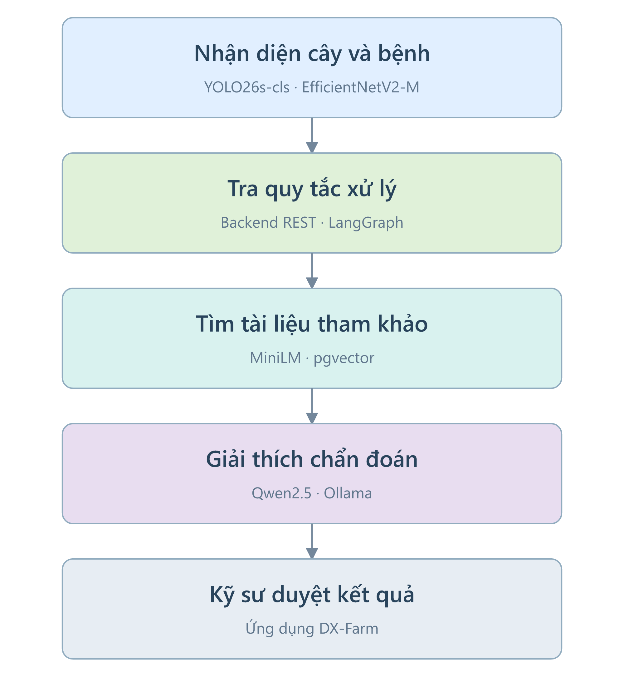
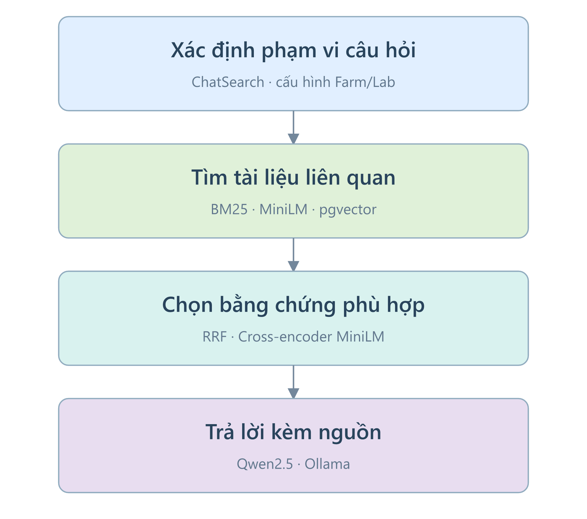
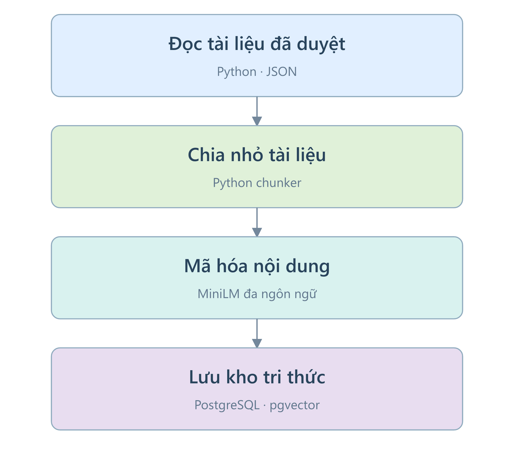
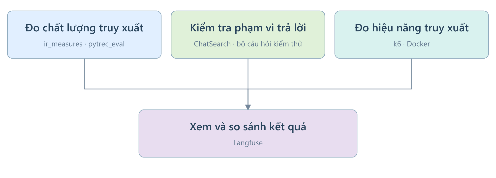

# AI Service (Python, FastAPI, LangGraph)

Dịch vụ suy luận của DX-OS: nhận diện bệnh lá lúa bằng CV cho Farm, hỏi đáp RAG theo namespace (`farm`, `lab`) cho cả hai ứng dụng.
AI là **stateless và advisory**: không sở hữu dữ liệu nghiệp vụ, không quản lý phê duyệt, không tự xác nhận áp dụng thuốc.
Backend là nguồn sự thật duy nhất; thuốc, liều, PHI luôn lấy từ structured facts của Backend, không từ RAG hay LLM.

## Luồng chẩn đoán



```text
Backend → POST /api/v1/diagnose
            ├─ CV nhận diện disease_code
            ├─ Backend REST trả structured facts (treatment rule, liều, PHI)
            ├─ pgvector trả RAG evidence
            ├─ LangGraph chọn rule và trả evidence
            └─ Qwen giải thích khi được yêu cầu → Backend kiểm tra rule version và lưu
```

| Thành phần | Vai trò | Tài liệu |
|---|---|---|
| Computer Vision | EfficientNetV2-M phân loại Healthy và 5 bệnh lá lúa, crop classifier kiểm ảnh là lúa | [`app/cv`](app/cv/README.md) |
| RAG | Tra cứu tài liệu trong PostgreSQL/pgvector, trả evidence kèm nguồn | [`app/rag`](app/rag/README.md) |
| LangGraph | Điều phối một lượt suy luận, không lưu trạng thái | [`app/graph`](app/graph/README.md) |

## Luồng chatbot



```text
Farm/Lab → KnowledgeGateway → AiGateway → AI search
  BM25 + cosine pgvector → RRF → multilingual MiniLM rerank
Backend gộp evidence, ánh xạ nguồn
Farm/Lab → AiGateway → Qwen → câu trả lời có cấu trúc và nguồn
```

Farm/Lab dùng chung bộ máy RAG trong AI Service, với namespace và policy ở `data/rag/chat_profiles.json`.
AiGateway giữ vai trò kết nối HTTP; thuốc, liều, PHI và phê duyệt vẫn do Backend quyết định.
Chẩn đoán và gợi ý ticket dùng endpoint retrieve legacy, không qua hybrid chatbot.
`app/rag/chat_search.py:outside_scope` là gate duy nhất của chatbot hybrid.
Backend không tự phân loại lại scope.

## API

| Method | Endpoint | Mô tả |
|---|---|---|
| `GET` | `/api/v1/disease/health` | Readiness của model bệnh và crop classifier (công khai) |
| `GET` | `/api/v1/disease/class-contract` | Contract 6 lớp CV và `disease_code` canonical (công khai) |
| `POST` | `/api/v1/disease/precheck` | Ảnh multipart: kiểm chất lượng và phân loại lúa, không chạy model bệnh |
| `POST` | `/api/v1/disease/predict` | Ảnh multipart: kết quả CV |
| `POST` | `/api/v1/disease/symptoms/suggest` | `symptom_text`, `top_k` 1–6: mã bệnh có score, evidence và source IDs |
| `POST` | `/api/v1/disease/knowledge/retrieve` | Truy vấn RAG theo câu hỏi, `namespace` (mặc định `farm`), `disease_code` và `document_type` tùy chọn |
| `POST` | `/api/v1/knowledge/search` | Chatbot hybrid; trả scope, evidence, ranking từng tầng và thời gian xử lý |
| `POST` | `/api/v1/knowledge/answer` | Tổng hợp câu trả lời từ evidence do Backend cung cấp, namespace `farm` hoặc `lab` |
| `POST` | `/api/v1/diagnose` | Contract nội bộ Backend → AI |

- Mọi endpoint trừ `health` và `class-contract` yêu cầu header `X-Service-Api-Key` khớp `AI_SERVICE_API_KEY`: thiếu hoặc sai key trả `401`, chưa cấu hình key trả `503` (fail-closed).
- Cổng AI không publish ra host, chỉ truy cập được trong mạng compose.
- Header `X-Request-Id` do Backend chuyển sang được echo lại ở response và ghi vào log, mỗi request một dòng `request_id=... status=... ms`.
  Request không có mã hợp lệ thì AI tự sinh mã mới.
- `diagnose` tải ảnh từ `image_url`, chạy CV, lấy structured facts, truy vấn RAG và trả recommendation; thiếu structured facts thì request thất bại, AI không đưa recommendation chỉ dựa trên RAG.
- Request có `request_id`, `crop_season_id`, `image_url`, `field_context`; response có `request_id`, `cv_result`, `rag_evidence`, `structured_context`, `recommendation`.
- Mỗi phần tử `rag_evidence` có `content`, `document_title`, `chunk_index` (vị trí đoạn trong tài liệu), `source_ids`, `similarity`; `recommendation` chỉ có `selected_rule_id` và `requires_engineer_approval`.
- `include_explanation=true` bổ sung `generated_explanation`, tách khỏi recommendation và evidence; không gửi flag thì giữ response hiện có.
- Phần sinh gồm `summary`, `steps`, `note`, `source_ids`, mode, reason và metadata model/prompt; kiểm schema, nguồn và nhất quán bệnh trước khi chấp nhận.
Chẩn đoán ẩn phần sinh không đạt; chatbot web dùng thông báo theo lý do, giữ nguồn ở mục tham khảo riêng.
- Thuốc, `dose_min`/`dose_max`, `dose_unit`, `phi_days`, `version` giữ nguyên từ structured facts.
- Contract được khóa bởi DTO `AiDiagnoseRequest`, `AiDiagnoseResponse` của `app-farm` và schema `app/api/schemas.py`; `scripts/check_diagnose_contract.py` kiểm tương thích hai phía.

## Dữ liệu và quyền

- Dữ liệu nghiệp vụ (báo cáo, chẩn đoán, thuốc, rule) ở database `dxos` của Backend; AI không có credential, chỉ gọi REST nội bộ chỉ đọc.
- `documents`, `document_chunks` và embedding ở database `dxos_ai_vector_db`: runtime dùng role `ai_vector_ro` (chỉ đọc), job `rag-ingest` dùng role `ai_vector_ingest`.
- Backend khởi tạo database vector, extension `vector`, hai bảng RAG và hai role; runtime không giữ credential ingest.

## Biến môi trường

Compose lấy từ [`deploy/.env.example`](../deploy/.env.example); chạy local thì export trong shell.

| Biến | Ý nghĩa |
|---|---|
| `DATABASE_URL` | Kết nối chỉ đọc tới `dxos_ai_vector_db` |
| `RAG_INGEST_DATABASE_URL` | Kết nối ghi, chỉ cấp cho job ingest |
| `BACKEND_BASE_URL` | Base URL Backend (local `http://localhost:8081`) |
| `BACKEND_SERVICE_API_KEY` | Key AI gửi khi gọi `/internal/v1/**` của Backend |
| `AI_SERVICE_API_KEY` | Key Backend phải gửi khi gọi AI |
| `BACKEND_TIMEOUT_SECONDS`, `BACKEND_MAX_ATTEMPTS`, `BACKEND_RETRY_BACKOFF_SECONDS` | Timeout, tổng số lần gọi Backend và khoảng nghỉ giữa các lần thử (mặc định 3 giây, 2 lần, 0,2 giây) |
| `LOG_LEVEL` | Mức log, mặc định `INFO`; Compose đặt qua `AI_LOG_LEVEL` |
| `OLLAMA_BASE_URL`, `OLLAMA_MODEL` | Qwen tổng hợp hỏi đáp web Farm/Lab và giải thích chẩn đoán Farm |
| `ANSWER_GENERATION_ENABLED` | `false` thì không gọi Qwen, câu trả lời chỉ gồm evidence nguyên văn (mặc định `true`); Compose đặt qua `AI_ANSWER_GENERATION` |
| `EMBEDDING_MODEL` | Embedding dùng chung cho ingest và retrieval |
| `CV_DEVICE` | `auto`, `cpu` hoặc `cuda` |
| `CV_WEIGHTS_PATH`, `CV_WEIGHTS_SHA256` | Checkpoint `ai/models/efficientnetv2m_rice_disease.pth` khi chạy local; trong image là `/opt/dxos/models/efficientnetv2m_rice_disease.pth`; SHA-256 bắt buộc khi nạp |
| `CV_CLASS_CONTRACT_PATH` | Class contract của CV (mặc định `data/structured/class_contract.json`) |
| `CROP_CLASSIFIER_PATH`, `CROP_CLASSIFIER_SHA256` | Artifact crop classifier (mặc định `ai/weights/crop_classifier.onnx`); SHA-256 bắt buộc khi nạp |
| `AI_CV_WEIGHTS_PATH`, `AI_CV_WEIGHTS_SHA256`, `AI_CROP_CLASSIFIER_PATH`, `AI_CROP_CLASSIFIER_SHA256` | Đường dẫn model bệnh trong image, checksum riêng, đường dẫn crop classifier phía host và checksum của nó |

## Chạy

```bash
# Local
cd ai && python -m venv .venv && source .venv/bin/activate
pip install --extra-index-url https://download.pytorch.org/whl/cpu -r requirements.txt
python -m scripts.assemble_cv_weights
export CV_WEIGHTS_SHA256=$(cat weights/dx-farm-efficientnetv2m/model.pth.part-* | sha256sum | cut -d' ' -f1)
export CROP_CLASSIFIER_SHA256=$(sha256sum weights/crop_classifier.onnx | cut -d' ' -f1)
uvicorn app.main:app --reload --port 8000

# Compose, từ thư mục deploy (BACKEND_TO_AI_API_KEY và AI_TO_BACKEND_API_KEY phải khác rỗng)
docker compose up -d --build postgres backend ai
```

- Checkout có ba phần model bệnh và `crop_classifier.onnx` trong `ai/weights/`; Docker build ghép model bệnh vào image, crop classifier vẫn mount read-only.
  Thiếu hoặc sai SHA-256 của một trong hai model thì AI từ chối khởi động; restart không tải trọng số bệnh.
  Giá trị `AI_CV_WEIGHTS_SHA256` trong `deploy/.env` là SHA-256 của ba phần nối đúng thứ tự; từ `ai/`, tính bằng `cat weights/dx-farm-efficientnetv2m/model.pth.part-* | sha256sum`, chỉ lưu giá trị vào env riêng.
  `AI_CROP_CLASSIFIER_SHA256` tính bằng `sha256sum weights/crop_classifier.onnx`; `deploy/demo/make_ci_env.py` tự điền cả hai giá trị khi sinh `deploy/.env`.
- Trên CPU x86 không có SSE4.1 (ví dụ CPU ảo "Common KVM processor"), AI tự tắt oneDNN và NNPACK của PyTorch để chạy được (`app/core/torch_cpu.py`).
- AI không dùng migration; Backend phải khởi tạo database vector trước khi gọi RAG.
- Stack Compose có `ollama` và `ollama-init` (tải `OLLAMA_MODEL` trước khi AI khởi động) và job `rag-ingest` chạy trước AI.
- Kiểm model: `docker compose exec ai python -c "import urllib.request; print(urllib.request.urlopen('http://localhost:8000/api/v1/disease/health').read().decode())"`.

### Ingest RAG



Corpus đã duyệt ở `data/rag/processed/disease_knowledge.json`, phần Farm chỉ được nạp từ `farm_knowledge.json` sau khi review hoàn tất, và `data/rag/lab/processed/lab_knowledge.json` (Lab), cùng registry nguồn:

```bash
export RAG_INGEST_DATABASE_URL=postgresql+psycopg://<ingest-user>:<password>@<host>:5432/dxos_ai_vector_db
python -m scripts.ingest_diseases --dry-run            # preview, không ghi
python -m scripts.ingest_diseases                      # corpus farm
python -m scripts.ingest_diseases --corpus lab         # corpus lab
```

Lệnh Farm nạp corpus bệnh và phần kiến thức tổng quát đã duyệt; Lab nạp corpus Lab.
Ingest thay đúng namespace + document_type, kể cả corpus đã thu hồi hết tài liệu, và chuẩn bị reranker trong cache Hugging Face hiện có; lần chạy sau dùng cache, request không tải model.
Thiếu cache reranker không chặn khởi động CV; search chatbot trả trạng thái `RERANK_UNAVAILABLE` cho đến khi model sẵn sàng.
Model embedding và reranker đã có trong cache được nạp lúc khởi động, nên lần search đầu không chờ nạp model.
Cấu hình chatbot mặc định nằm trong `app/core/config.py`; `CHAT_RETRIEVAL_STRATEGY`, `CHAT_RERANKER_MODEL`, `CHAT_CANDIDATE_COUNT`, `CHAT_COSINE_MIN_SCORE` và `CHAT_RERANK_MIN_SCORE` cho phép điều chỉnh khi đánh giá, không đổi cấu hình diagnosis.
Compose đặt `CHAT_CANDIDATE_COUNT` qua `AI_CHAT_CANDIDATE_COUNT`; CPU chậm thì giảm số này để rerank xong trong ngân sách 6 giây.
Đổi embedding model hoặc số chiều vector thì phải ingest lại toàn bộ corpus.

### Đánh giá truy xuất RAG



Chạy từ thư mục gốc repository, trên Linux x86_64 có Bash, Docker Engine và Docker Compose:

```bash
./ai/evaluate.sh quality
```

Lệnh tạo database đánh giá riêng, nạp tri thức, chấm bằng `ir_measures` và hiển thị kết quả trên Langfuse local.
Có thể chạy khi chưa bật Farm/Lab; không cần cài Python, k6 hoặc tạo tài khoản Langfuse thủ công.
Lần đầu cần mạng để tải image và model; các lần sau dùng cache.
Cần ít nhất 2.500 MiB RAM trống và 16 GiB đĩa trống (6 GiB nếu đã có cache), trên cả phân vùng state và Docker.

Bộ đề gồm 66 câu hỏi đáp và 6 câu tham khảo chẩn đoán, so sánh cosine, BM25, hybrid/RRF và hybrid + rerank.
Trong đó, 42 câu pilot đã được chủ dự án duyệt; 30 câu mở rộng còn dùng nhãn nháp.
Chatbot được chấm sau bước lọc truy xuất, trước khi Backend gộp đoạn; chẩn đoán dùng retriever hiện có.
Lệnh cũng chấm gate phạm vi của chatbot (`scripts/evaluate_scope.py`) trên 75 câu trong/ngoài phạm vi và 15 câu đúng chủ đề nhưng không có tài liệu; nhãn của hai bộ này còn là nháp.
Kết quả và ý nghĩa chỉ số ở [`docs/AI_EVALUATION.md`](../docs/AI_EVALUATION.md#7-đánh-giá-truy-xuất-rag).

Sau khi đo, AI và database đánh giá được dừng; terminal in link Langfuse, tài khoản local và thư mục kết quả.
Trong Experiments, bật **Expected Output**, **Output** và **score** để đối chiếu nhãn, đoạn truy xuất và điểm.
Langfuse phát lại kết quả đã lưu; thời gian trace không dùng làm thời gian truy xuất.

Nhấn Enter hoặc chờ 600 giây để tự dừng môi trường đánh giá; khi chạy không tương tác, lệnh kết thúc và dừng ngay sau khi publish.
Dữ liệu, cache và lịch sử được giữ để mở lại:

```bash
./ai/evaluate.sh view   # xem kết quả đã lưu
./ai/evaluate.sh down   # dọn phiên còn lại sau khi tắt máy hoặc tiến trình bị dừng đột ngột
```

Khi phiên đang chạy, dùng Enter hoặc Ctrl+C tại terminal đó để dừng.
Cấu hình mặc định ở [`evaluation/.env.example`](evaluation/.env.example).
State lưu tại `~/.local/share/dx-os-rag-evaluation-runner/`, đổi bằng `EVAL_STATE_DIR`.
Mỗi lần chạy có thư mục `runs/` riêng chứa cấu hình đo, bộ nhãn, `collect.json`, `run.trec`, `qrels.trec`, `score.json` và log.
Credential nằm ngoài repository; không chia sẻ `evaluation.env`.

Các lệnh `scripts/evaluate_rag.py collect/score/publish` vẫn dùng độc lập; `publish --dry-run` kiểm đầu ra trước khi gửi.
Kiểm công cụ bằng `./ai/evaluate.sh --self-check`.

### Thử tải HTTP retrieval

```bash
./ai/evaluate.sh performance
./ai/evaluate.sh all           # chấm truy xuất rồi đo tải
```

k6 gọi endpoint search của AI với cấu hình mặc định:

| Tham số | Giá trị |
|---|---|
| Phương pháp | Cosine và hybrid + rerank, chạy lần lượt cho Farm/Lab |
| Tải | 1, 2, 5 người dùng đồng thời; mỗi người đợi phản hồi rồi gửi tiếp |
| Thời lượng | 30 giây mỗi mức, lặp ba lần; tổng 36 lượt, làm nóng model trước đo |
| Timeout | HTTP 20 giây; chờ hàng đợi rerank tối đa 12 giây |
| Tài nguyên | AI 2 CPU/1.536 MiB, một worker, Torch hai thread; pgvector 1 CPU/256 MiB |

Phép đo chỉ gồm HTTP retrieval của AI; CV bị tắt, Backend/gateway và Qwen không nằm trong phép đo.
CPU/RAM được lấy mẫu bằng Docker.

Terminal in link báo cáo HTML và Langfuse; mỗi lượt lưu số liệu k6, tài nguyên và log trong `performance-*/`.
Langfuse hiển thị độ trễ, số yêu cầu mỗi giây, lỗi và CPU/RAM; chỉ khởi động sau khi đo xong và AI/database đánh giá đã dừng.
Giá trị p95 ở dòng `SUMMARY/AVG` là trung bình p95 của các lượt.

Môi trường tự dừng như lệnh `quality`; lượt lỗi vẫn giữ kết quả và trả mã lỗi.
Phương pháp và kết quả đo ở [`docs/AI_EVALUATION.md`](../docs/AI_EVALUATION.md#8-thử-tải-http-retrieval).

## Kiểm tra

Chạy từ `ai/`:

| Lệnh | Mục đích |
|---|---|
| `pip install -r requirements-dev.txt && python -m pytest tests` | Test CV, workflow, truy xuất và rerank của chatbot, phần sinh Qwen, `X-Request-Id`, xác thực service key (CI chạy cùng lệnh) |
| `python -m scripts.check_backend_client` | Client Backend: retry giới hạn, không retry khi 401, đọc khoảng liều |
| `python -m scripts.check_diagnose_contract` | Luồng `diagnose` đúng thứ tự CV, Backend, RAG; `recommendation` chỉ có rule được chọn và cờ duyệt, evidence có tên tài liệu |
| `python -m scripts.check_rag_access_boundary` | Việc ghi RAG nằm ngoài runtime FastAPI |
| `python -m unittest discover -s tests -p test_generated_answers.py` | Hợp đồng phần sinh, nguồn, dự phòng, service key và opt-in chẩn đoán |

## Giới hạn và giấy phép

- CV nhận diện Healthy và 5 bệnh lá lúa; accuracy 89,43% trên 1.466 ảnh theo báo cáo người huấn luyện, chưa phải accuracy toàn pipeline; kỹ sư chốt bệnh tại Backend.
- RAG chỉ tìm được kiến thức đã ingest; Ollama lỗi hoặc quá thời gian (30 giây với hỏi đáp, 20 giây với giải thích chẩn đoán) thì không hiển thị nội dung sinh, giữ evidence nguyên văn.
- CPU không có AVX chạy Qwen quá chậm cho các giới hạn trên (khoảng 2 token/giây khi đọc prompt), nên đặt `ANSWER_GENERATION_ENABLED=false`.
- Hỏi đáp Farm về một bệnh đã nêu tên vẫn có thể nhận nguyên nhân hoặc cách phòng không có trong nguồn ([`docs/BACKLOG.md`](../docs/BACKLOG.md)).
- `ai/` phân phối theo AGPL-3.0 ([`LICENSE`](./LICENSE)); Backend gọi AI qua HTTP nên không là tác phẩm phái sinh.
  Danh sách thành phần ở [`LICENSES.md`](../LICENSES.md).
