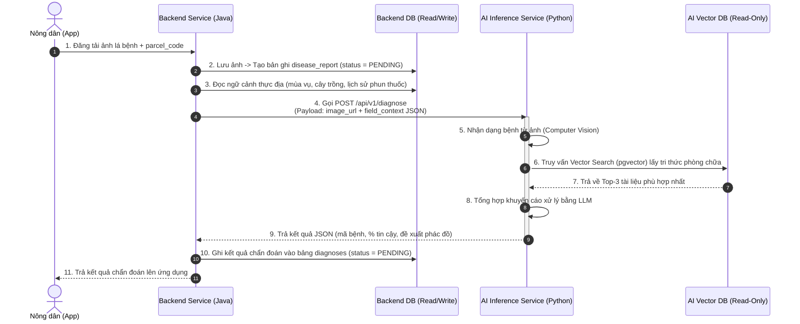

# Kế Hoạch Chi Tiết: Tách Database & Biến AI Thành Dịch Vụ Suy Luận Thuần Túy (Stateless Inference Service)

> **Dự án**: DX-Farm (Hệ thống Quản lý Nông nghiệp Thông minh)  
> **Tài liệu**: Kế hoạch Tái cấu trúc Kiến trúc Backend & AI  
> **Ngày cập nhật**: 15/09/2026  

---

## 🎯 Mục Tiêu Cốt Lõi

1. **Loại bỏ 100% tác vụ GHI (Write/CRUD)** dữ liệu nghiệp vụ nông nghiệp ở phía AI.
2. **Phân định rõ trách nhiệm (Database-per-Service)**:
   - **Backend DB**: Quản lý toàn bộ dữ liệu nghiệp vụ vận hành nông trại (Operational DB / RDBMS).
   - **AI DB**: Chỉ quản lý kho tri thức Vector RAG (PostgreSQL + pgvector).
3. **Biến AI Service thành Dịch vụ Suy luận Thuần túy (Stateless Inference Service)**:
   - AI nhận Request Payload -> Chẩn đoán hình ảnh (CV) + Tra cứu RAG -> Trả về kết quả JSON cho Backend.
   - AI **không kết nối trực tiếp** và **không lưu trữ** vào Database của Backend.

---

## 📊 1. Hiện Trạng DB & Sự Trùng Lặp Giữa AI và Backend

### 1.1 Danh sách bảng trong DB hiện tại

| Phân loại | Bảng thuộc Backend (Java/Spring) | Bảng thuộc AI (Python/FastAPI) |
| :--- | :--- | :--- |
| **Thực địa & Mùa vụ** | `parcels`, `crop_seasons` | `parcels`, `crop_seasons` |
| **Danh mục Nông nghiệp** | `diseases`, `pesticides`, `treatment_rules` | `diseases`, `pesticides`, `treatment_rules`, `disease_management_policies` |
| **Nghiệp vụ Chẩn đoán** | `disease_reports`, `diagnoses`, `treatment_applications` | `disease_reports`, `diagnoses`, `treatment_applications`, `workflow_cases` |
| **Tri thức Vector RAG** | *Không có* | `documents`, `document_chunks` |

### 1.2 Chi tiết 8 bảng đang bị TRÙNG LẶP hoàn toàn

Cả Backend và AI đều đang khai báo các bảng này trong DB của mình, gây ra xung đột kiểu dữ liệu (Backend dùng `Long`, AI dùng `UUID`) và rủi ro bất đồng bộ dữ liệu:

1. `parcels`: Quản lý thông tin thửa đất.
2. `crop_seasons`: Quản lý mùa vụ trồng trọt.
3. `diseases`: Danh mục các loại bệnh hại.
4. `pesticides`: Danh mục các loại thuốc bảo vệ thực vật.
5. `treatment_rules`: Quy tắc phác đồ điều trị (liều lượng min/max, ngày PHI).
6. `disease_reports`: Báo cáo phát hiện bệnh từ nông dân.
7. `diagnoses`: Kết quả chẩn đoán và đề xuất xử lý.
8. `treatment_applications`: Nhật ký ghi nhận phun thuốc thực tế.

---

## 🔄 2. Đối Chiếu Luồng Nghiệp Vụ & Loại Bỏ Phần Trùng Lặp

| Luồng Nghiệp Vụ | Phía Backend thực hiện | Phía AI thực hiện | Hướng xử lý |
| :--- | :--- | :--- | :--- |
| **Tạo báo cáo dịch bệnh** | Nhận ảnh từ App -> Ghi `disease_reports` | Nhận request -> Ghi `disease_reports` | ❌ **LOẠI BỎ KHỎI AI**. Chỉ Backend quản lý upload & tạo báo cáo. |
| **Lưu kết quả chẩn đoán** | Ghi `diagnoses` (kèm trạng thái duyệt `PENDING`/`APPROVED`) | Ghi `diagnoses` thẳng vào DB | ❌ **LOẠI BỎ KHỎI AI**. AI chỉ trả kết quả JSON, Backend tự lưu `diagnoses`. |
| **Ghi nhận phun thuốc** | Ghi `treatment_applications` + tính ngày khóa thu hoạch PHI | Ghi `treatment_applications` | ❌ **LOẠI BỎ KHỎI AI**. Chỉ Backend quản lý lịch sử phun thuốc. |
| **Đọc thông tin thực địa** | Truy vấn `parcels`, `crop_seasons` | Truy vấn `parcels`, `crop_seasons` | ❌ **LOẠI BỎ TRUY VẤN Ở AI**. Backend đọc DB và đóng gói gửi qua REST Payload. |
| **Tra cứu tri thức RAG** | *Không thực hiện* | Đọc `documents`, `document_chunks` | ✅ **GIỮ LẠI CHO AI**. Đây là nhiệm vụ cốt lõi của AI. |

---

## 🏛️ 3. Kiến Trúc Mới Sau Khi Tách Riêng 2 DB

### 3.1 Cấu trúc 2 Database độc lập

```
                      ┌─────────────────────────────────────────┐
                      │            HỆ THỐNG DX-FARM             │
                      └────────────────────┬────────────────────┘
                                           │
             ┌─────────────────────────────┴─────────────────────────────┐
             ▼                                                           ▼
┌──────────────────────────┐                               ┌──────────────────────────┐
│   BACKEND DATABASE       │                               │   AI VECTOR DATABASE     │
│   (dx_farm_db)           │                               │   (dx_farm_ai_vector_db) │
├──────────────────────────┤                               ├──────────────────────────┤
│ - parcels                │                               │ - documents              │
│ - crop_seasons           │                               │ - document_chunks        │
│ - diseases               │                               │   (với extension pgvector│
│ - pesticides             │                               │    lưu vector 384d)      │
│ - treatment_rules        │                               └──────────────────────────┘
│ - disease_reports        │                                            ▲
│ - diagnoses              │                                            │ Read-Only (RAG)
│ - treatment_applications │                                            │
└────────────▲─────────────┘                               ┌────────────┴─────────────┐
             │ Read/Write                                  │    AI INFERENCE SERVICE   │
             │                                             │    (Python FastAPI)      │
┌────────────┴─────────────┐         REST API (JSON)       │  - CV Model Inference    │
│     BACKEND SERVICE      ├──────────────────────────────►│  - RAG Vector Search     │
│    (Java Spring Boot)    │◄──────────────────────────────┤  - LLM Recommendation    │
└──────────────────────────┘                               │  - STATELESS (NO WRITES) │
                                                           └──────────────────────────┘
```

### 3.2 Bảng dữ liệu AI truy vấn sau khi loại bỏ trùng
Sau khi tách DB, **AI DB chỉ chứa duy nhất 2 bảng tri thức Vector**:
1. `documents`: Lưu tiêu đề, mã bệnh (`disease_code`), nguồn tài liệu.
2. `document_chunks`: Lưu nội dung chia nhỏ (`content`) và chuỗi Vector 384 chiều (`embedding`) để thực hiện **Cosine Distance Vector Search**.

---

## ⚙️ 4. Workflow Chi Tiết Của AI & Backend

### 4.1 Sơ đồ luồng xử lý (Sequence Diagram)



---

## 📑 5. Chuẩn Hóa API Contract (REST DTO)

### 5.1 Request: `POST /api/v1/diagnose` (Backend -> AI)
```json
{
  "request_id": "req_123456789",
  "crop_season_id": "101",
  "image_url": "https://storage.dxfarm.com/reports/leaf_01.jpg",
  "field_context": {
    "parcel_code": "P-01",
    "crop_name": "Lúa mùa",
    "growth_stage": "Trỗ bông",
    "recent_treatments": [
      {
        "pesticide_name": "Anvil 5SC",
        "applied_at": "2026-09-01T08:00:00Z",
        "harvest_locked_until": "2026-09-15T08:00:00Z"
      }
    ]
  }
}
```

### 5.2 Response: `200 OK` (AI -> Backend)
```json
{
  "request_id": "req_123456789",
  "cv_result": {
    "disease_code": "RICE_BLAST",
    "disease_name_vi": "Bệnh đạo ôn lúa",
    "confidence": 0.94,
    "model_version": "v1.2.0"
  },
  "rag_recommendations": {
    "summary": "Phát hiện vết bệnh đạo ôn lá mức độ nhẹ.",
    "treatment_proposal": "Khuyên dùng thuốc chứa hoạt chất Tricyclazole. Phun khi trời tạnh ráo.",
    "phi_days_suggested": 14,
    "references": ["DOC_RICE_BLAST_V1"]
  }
}
```

---

## 🚀 6. Lộ Trình Triển Khai (Implementation Roadmap)

### Phase 1: Tái cấu trúc phía AI (Python/FastAPI)
- [ ] Xóa 9 ORM Models dư thừa (`disease_report.py`, `diagnosis.py`, `treatment_application.py`, `parcel.py`, `crop_season.py`, `disease.py`, `pesticide.py`, `treatment_rule.py`, `workflow_case.py`).
- [ ] Xóa các file Repositories CRUD: `diagnosis_repository.py`, `treatment_repository.py`, `parcel_repository.py`.
- [ ] Cập nhật Service `app/services/diagnosis_service.py` để chỉ nhận `field_context` từ Payload và loại bỏ toàn bộ lệnh `db.add()`, `db.commit()`.
- [ ] Giữ lại duy nhất `rag/retriever.py` và `rag/ingestion_service.py`.

### Phase 2: Tái cấu trúc phía Backend (Java/Spring Boot)
- [ ] Thêm `AiDiagnosisClient` (sử dụng `WebClient` hoặc `RestTemplate`).
- [ ] Cập nhật `DiseaseReportService`: Tự khởi tạo và lưu `DiseaseReport` vào Backend DB.
- [ ] Gọi `AiDiagnosisClient.diagnose(...)` gửi Payload sang AI Service.
- [ ] Nhận kết quả JSON từ AI và tự khởi tạo `Diagnosis` lưu vào Backend DB.

### Phase 3: Khởi tạo Database & Deployment
- [ ] Khởi tạo DB riêng `dx_farm_ai_vector_db` chỉ chứa bảng `documents` và `document_chunks` (kèm pgvector extension).
- [ ] Cập nhật `deploy/docker-compose.yml` để tách biệt cấu hình biến môi trường kết nối DB của Backend và AI.

---

> 📌 **Kết Luận**: Kế hoạch này giúp chuyển đổi thành công AI Service thành **Dịch vụ suy luận phi trạng thái (Stateless Inference Service)**, giải quyết triệt me trùng lặp dữ liệu, đảm bảo tính bảo mật và tối ưu hiệu năng toàn hệ thống DX-Farm.
