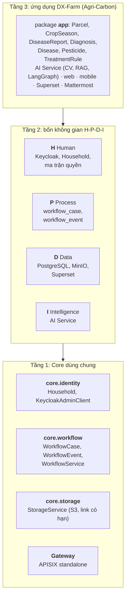
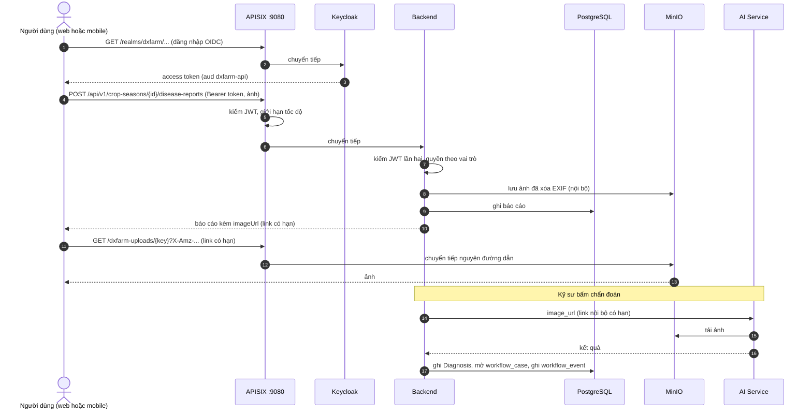

# Kiến trúc Open-Core 3 tầng

Tài liệu này mô tả ranh giới giữa phần lõi dùng chung (Core) và ứng dụng DX-Farm, kèm sơ đồ 3 tầng và sơ đồ luồng request.
Sơ đồ viết bằng Mermaid, GitHub hiển thị trực tiếp.

## 1. Sơ đồ 3 tầng

| Tầng | Thành phần | Nơi nằm trong repo |
|---|---|---|
| 1. Core | Identity | `backend/.../core/identity`, `sso/` (Keycloak) |
| 1. Core | Workflow | `backend/.../core/workflow`, bảng `workflow_case`, `workflow_event` |
| 1. Core | Storage | `backend/.../core/storage`, `minio/` |
| 1. Core | Gateway | `deploy/apisix/` |
| 2. H-P-D-I | Human, Process, Data, Intelligence | các thành phần Core ở trên cộng `ai/`, `bi/`, `chat/` |
| 3. Ứng dụng | DX-Farm | các package còn lại của `backend/` (`model`, `service`, `controller`, `repository`, `dto`), `frontend/`, `mobile/`, `ai/`, `data/` |

## 2. Ranh giới Core và ứng dụng

- Core không import gì từ nghiệp vụ nông nghiệp.
  `WorkflowService` nhận `caseType`, `entityType`, `entityId` dạng chuỗi và số, không biết `Diagnosis` là gì.
  `StorageService` nhận khóa object và byte, không biết đó là ảnh báo cáo.
- Ứng dụng gọi Core qua các điểm vào cố định:
  - `DiagnosisService` mở case `DIAGNOSIS_APPROVAL` và ghi bước duyệt qua `WorkflowService`.
  - `DiagnosisService` mở case `TREATMENT_CONFIRMATION` khi nông dân khai phun thuốc và ghi bước xác nhận của kỹ sư.
  - `FileStorageService` làm sạch ảnh rồi lưu qua `StorageService`.
  - `ParcelService` dùng `Household` của `core.identity`.
- Đổi ứng dụng (ví dụ làm ứng dụng thứ hai) chỉ thêm package ứng dụng mới.
  `core.identity`, `core.workflow`, `core.storage` và cấu hình `deploy/apisix/` giữ nguyên.
  Ứng dụng mới chọn `caseType` riêng, ví dụ `PARCEL_APPROVAL`, và dùng lại bảng `workflow_case`, `workflow_event` và API `/api/v1/workflow-cases`.
- Ranh giới là quy ước package trong một module Maven, không phải ràng buộc lúc biên dịch.

## 3. Sơ đồ luồng request

- Mọi client chỉ biết một địa chỉ: gateway.
- Cổng của backend, Keycloak, AI, MinIO, Superset và portal không publish ra host.
  Gateway có hai listener: `9080` cho web, API, Keycloak, ảnh và portal (`/portal/`), `9081` riêng cho Superset (bản 3.1 không chạy được dưới đường dẫn con), `9082` riêng cho console MinIO.
- Backend kiểm lại JWT độc lập với gateway.
  Gateway sai cấu hình thì backend vẫn tự bảo vệ.
- AI Service không có route ở gateway, chỉ backend gọi được qua mạng nội bộ của compose.
