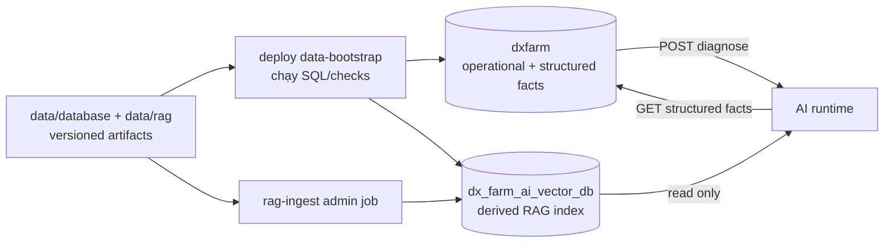

# Kế hoạch hợp nhất quản trị Data/Database và nguồn sự thật

> **Trạng thái:** Đề xuất để review — chưa triển khai
>
> **Ngày khảo sát:** 22/09/2026
>
> **Phạm vi:** `ai/`, `backend/DX-Farm/`, `deploy/` và các artifact dữ liệu/database mà hai service dùng. Không thay đổi API ownership: Backend và AI vẫn truy cập dữ liệu bằng các client/configuration tại thư mục hiện hữu của chúng.

## 1. Quyết định kiến trúc cần chốt

Tạo một thư mục gốc duy nhất là `data/` để quản trị **artifact dữ liệu, database schema/migration, seed, RAG corpus và dữ liệu runtime**. Đây là nơi duy nhất để tìm, review, version và vận hành dữ liệu; không phải một database dùng chung để Backend và AI cùng ghi.

"Một nguồn sự thật" phải được hiểu theo quyền sở hữu dữ liệu:

| Domain | Nguồn sự thật duy nhất | AI được làm gì |
|---|---|---|
| Nghiệp vụ nông trại, trạng thái duyệt, thuốc, liều, PHI | Backend DB `dxfarm` qua Backend service | Chỉ đọc facts tối thiểu qua `GET /internal/v1/diagnosis-context`; không có DB credential |
| RAG corpus đã duyệt và provenance | Artifact versioned tại `data/rag/` | Job ingest đọc để tạo index |
| Vector index `documents`/`document_chunks` | Dữ liệu **dẫn xuất** tái tạo từ corpus + manifest | Runtime chỉ đọc với `ai_vector_ro`; job riêng ghi với `ai_vector_ingest` |
| Ảnh báo bệnh do người dùng tải lên | `data/runtime/uploads/` | Nhận ảnh thông qua URL nội bộ Backend, không truy cập volume upload trực tiếp |

Vì vậy không đưa bảng nghiệp vụ vào AI DB, không cấp AI quyền DB `dxfarm`, và không coi RAG là nguồn quyết định thuốc/liều/PHI. Điều đó giữ nguyên ranh giới stateless/advisory đã chốt trong `ai/README.md` và tránh tái tạo tình trạng AI/Backend ghi cùng một facts.

## 2. Hiện trạng đã xác nhận

### 2.1 Những phần đã đúng

- Backend đang sở hữu các entity nghiệp vụ và structured facts. AI lấy rule/lịch sử qua internal API read-only; `InternalAiContextService` tra `Disease`, `TreatmentRule`, `TreatmentApplication` trong Backend DB.
- AI runtime chỉ cấu hình `DATABASE_URL` tới `dx_farm_ai_vector_db`; role `ai_vector_ro` chỉ có `SELECT`. Job `rag-ingest` dùng role ghi riêng.
- `disease_code` là khoá canonical đi qua CV, Backend và RAG, thay vì nối bằng tên bệnh.

### 2.2 Điểm phân mảnh/rủi ro

| Phát hiện | Vị trí hiện tại | Rủi ro |
|---|---|---|
| Seed 38 disease, pesticide và 8 treatment rule nằm trong source Backend | `backend/DX-Farm/src/main/resources/data.sql` | Dữ liệu domain bị lẫn với mã Java; không có catalog/version/migration độc lập để review, audit hoặc rollback. `ON CONFLICT DO NOTHING` cũng không cập nhật bản seed cũ khi facts đã được hiệu chỉnh. |
| Schema/role của AI Vector DB được tạo bằng Java `CommandLineRunner` | `.../config/AiVectorDatabaseSeeder.java` | Backend code đang sở hữu DDL của một database khác; schema thiếu lifecycle migration, checksum và executor độc lập. |
| Hibernate dùng `ddl-auto: update` | `backend/.../resources/application.yaml` | Schema nghiệp vụ có thể đổi ngầm khi application khởi động; khó biết chính xác database đang ở version nào. |
| Corpus RAG được kỳ vọng tại đường dẫn local | `ai/.local/data` qua `AI_DATA_DIR` | Đây là đường dẫn riêng của AI và ngoài Git. Trong checkout đang khảo sát, `ai/.local/` không tồn tại, nên compose không thể tái lập ingest mặc định. |
| Runtime data phân tán dưới compose | `deploy/data/postgres`, `deploy/data/uploads`, cùng các volume/bind mount service khác | Đường dẫn vận hành, artifact đầu vào, data database và upload không có catalog/retention/backup chung. |
| Vector schema có model Python và DDL Java tách nhau | `ai/app/db/models/*` và `AiVectorDatabaseSeeder` | Hai định nghĩa phải luôn đồng bộ bằng thao tác thủ công. |
| Tài liệu cũ ghi một số trạng thái lịch sử | `development/docs/legacy_docs/*` | Tài liệu decoupling vẫn hữu ích cho lịch sử, nhưng không nên là kế hoạch thực thi data mới; đặc biệt contract cũ có `dose_amount` trong khi code hiện dùng `dose_min`/`dose_max`. |

`backend/DX-Farm/target/classes/data.sql` chỉ là output build; không được coi là nguồn data thứ hai.

## 3. Cấu trúc mục tiêu

```text
data/
├── README.md                         # catalog, owner, cách bootstrap/backup/restore
├── database/
│   ├── backend/
│   │   ├── migrations/               # DDL versioned duy nhất cho dxfarm
│   │   ├── seeds/
│   │   │   ├── reference/            # disease, pesticide, treatment rule đã review
│   │   │   └── demo/                 # chỉ dữ liệu demo, không trộn production/reference
│   │   └── checks/                   # SQL kiểm tra integrity và canonical disease_code
│   └── ai-vector/
│       ├── migrations/               # database, extension vector, tables/index/roles/grants
│       └── checks/                   # quyền runtime, dimensions, document/chunk integrity
├── rag/
│   ├── sources/                      # tài liệu gốc đã được chấp thuận hoặc manifest tham chiếu artifact store
│   ├── registry/                     # source registry và metadata/provenance
│   ├── processed/                    # disease_knowledge.json đã review
│   └── manifests/                    # corpus version, SHA-256, embedding model, chunking policy
└── runtime/                          # Git-ignored: PostgreSQL volumes, uploads, Superset/Mattermost runtime
    ├── postgres/
    ├── uploads/
    ├── superset/
    └── mattermost/
```

`data/database/**`, `data/rag/**` và fixture nhỏ phải version-controlled khi dữ liệu/pháp lý cho phép. `data/runtime/**`, secret, model weight, dữ liệu nông hộ thật và artifact lớn không được commit; chúng phải có manifest/checksum, nơi lưu được phê duyệt và hướng dẫn restore trong `data/README.md`.

Không đưa các thứ sau vào `data/`: application code, client DB/API, secret thực, model weight cache, package build output, hoặc logic truy cập. Chúng vẫn nằm tại `backend/`, `ai/` và `deploy/` như hiện nay.

## 4. Luồng mục tiêu sau khi triển khai



- `data-bootstrap` là executor vận hành ở `deploy/`, không phải service nghiệp vụ. Nó áp dụng migration theo thứ tự, ghi migration history/checksum và chạy checks trước khi Backend/AI phụ thuộc vào database.
- Backend vẫn là process duy nhất ghi facts nghiệp vụ qua repository/service của nó. AI không mount `data/runtime/uploads` và không truy cập `dxfarm` trực tiếp.
- RAG ingest chỉ nhận corpus có manifest hợp lệ. Nó thay index atomically như hiện tại, sau đó ghi metadata ingest (corpus version, hash, embedding model, thời gian, số document/chunk) để có thể biết index nào đang phục vụ runtime.
- Compose chỉ mount thư mục `data/` vào mục đích tối thiểu: corpus read-only vào ingest job; runtime volume vào service sở hữu; không mount cả `data/` writable vào AI runtime.

## 5. Lộ trình triển khai đề xuất

### Phase 0 — Chốt governance và kiểm kê (không phá dữ liệu)

1. Lead chấp thuận `data/` là control plane dữ liệu và chỉ định Data Owner/Reviewer cho `reference` seed và `rag` corpus.
2. Export snapshot/checksum của hai DB đang chạy trước bất cứ di chuyển nào; lập inventory row count, schema, roles, corpus version, embedding model và storage path.
3. Phân loại từng file/data thành `reference`, `demo`, `derived`, `runtime`, hoặc `secret`; xác định license/provenance của mọi artifact RAG.
4. Chốt policy cập nhật seed: reference facts phải có version/source/reviewer/effective date; dữ liệu demo không được tự động ghi đè facts đã review.

**Gate:** team ký owner cho 4 domain ở mục 1, đọc được backup và chấp thuận chính sách Git/artifact store.

### Phase 1 — Tạo data repository layout và baseline có kiểm soát

1. Tạo skeleton `data/`, `data/README.md` và catalog metadata; chỉ đưa vào Git artifact được phép chia sẻ.
2. Chuyển nội dung seed có kiểm chứng từ `backend/.../data.sql` vào `data/database/backend/seeds/reference/` và tách seed demo nếu có.
3. Baseline schema `dxfarm` thành migration versioned. Sau khi baseline đã được thử trên database sạch, đổi Backend từ `ddl-auto: update` sang `validate`; schema mới chỉ đến từ migration.
4. Chuyển DDL tạo `dx_farm_ai_vector_db`, extension, tables, index, role/grant từ `AiVectorDatabaseSeeder` thành migration SQL trong `data/database/ai-vector/migrations/`.
5. Đặt migration history/checksum cho **mỗi database**; migration một chiều, immutable sau khi đã release. Sửa sai bằng migration mới, không sửa file đã áp dụng.

**Gate:** database sạch dựng được chỉ từ `data/database/**`; chạy lại bootstrap không đổi schema/seed ngoài quy tắc idempotent đã khai báo; Backend chỉ validate schema.

### Phase 2 — Chuẩn hoá RAG thành data product tái tạo được

1. Di chuyển `ai/.local/data` target sang `data/rag/` và đổi cấu hình `AI_DATA_DIR`/compose sang path mới. Không copy nguồn mù quáng: validate đủ `disease_knowledge.json`, source registry, source IDs, 38 `disease_code` canonical và checksum trước khi commit/publish.
2. Bổ sung corpus manifest: `corpus_version`, `generated_at`, SHA-256 từng file, source registry version, embedding model/dimension, chunk policy, reviewer và trạng thái approved.
3. RAG ingest đọc path/configuration tại `ai/` như hiện nay nhưng fail-fast khi manifest, checksum, embedding dimension hay canonical codes sai. Nó lưu metadata ingest ở AI Vector DB (migration riêng) để runtime/audit biết index hiện hành.
4. Thay hard-code corpus version `stage7-rich-v1` bằng version manifest. Không để corpus version chỉ tồn tại trong Python source.

**Gate:** cùng corpus + manifest cho cùng document/chunk count và metadata; corpus thiếu hoặc bị sửa phải bị chặn trước khi ghi vector DB; runtime chỉ đọc được index đã ghi nhận manifest hợp lệ.

### Phase 3 — Đổi deployment path, quyền và lifecycle

1. Compose dùng `data/runtime/postgres`, `data/runtime/uploads` và runtime path tương ứng thay `deploy/data/**`; `.gitignore` chỉ ignore runtime, không ignore toàn bộ `data/` source artifacts.
2. Thêm one-shot `data-bootstrap` trong `deploy/` chạy migrations/checks trước `backend`, `rag-ingest` và `ai`; có lock để không hai deploy apply migration song song.
3. Giữ `ai_vector_ro` chỉ `CONNECT/USAGE/SELECT` trên AI Vector DB; giữ `ai_vector_ingest` quyền tối thiểu để ingest; explicit revoke CONNECT từ `dxfarm` cho cả hai. Không truyền ingest credential vào AI runtime.
4. Đưa secrets/password vào secret management hoặc `.env` local bị ignore; tuyệt đối không đưa vào `data/` hoặc seed SQL.
5. Viết runbook backup/restore, retention uploads, restore drill và rollback deployment. Rollback schema chỉ bằng migration forward hoặc restore snapshot đã kiểm chứng, không dùng `DROP/TRUNCATE` tự động.

**Gate:** `docker compose up` trên máy sạch dùng artifact có kiểm chứng; AI runtime bị từ chối nếu thử kết nối `dxfarm`/ghi vector; restore rehearsal khôi phục đúng counts/checksum.

### Phase 4 — Cắt chuyển và dọn path cũ

1. Chạy song song ở môi trường staging: snapshot trước migration, bootstrap data mới, ingest RAG và so sánh count/checksum.
2. Chỉ khi checks đạt mới đổi default path. Giữ `ai/.local/data` và `deploy/data` ở chế độ read-only/legacy trong một cửa sổ rollback đã công bố; không tạo hai đường ghi song song.
3. Sau cửa sổ rollback, archive hoặc xoá path cũ theo retention đã chốt, cập nhật README/changelog và đánh dấu legacy docs là lịch sử.

**Gate:** chỉ còn một đường ghi/phát hành cho mỗi seed/corpus/runtime class; searches trong repo không còn reference runtime tới path cũ ngoài migration notes.

## 6. File/thành phần dự kiến thay đổi ở lượt triển khai sau review

| Nhóm | Thay đổi dự kiến | Không thay đổi |
|---|---|---|
| `data/` mới | Thêm migrations, seeds, corpus registry/manifest, catalog và runbook | Không chứa application code/secret/runtime data được commit |
| `backend/.../resources/data.sql` | Ngừng là nơi sở hữu reference seed; thay bằng executor trỏ tới `data/database/backend/seeds` | Backend repository, business ownership, internal read-only API vẫn ở `backend/` |
| `AiVectorDatabaseSeeder.java` | Bỏ responsibility DDL/role khi SQL bootstrap đã thay thế | Backend vẫn không cấp AI quyền DB nghiệp vụ |
| `application.yaml` | Chuyển JPA sang validate sau baseline; giữ endpoint/config truy cập ở Backend | Contract REST Backend ↔ AI không đổi ở phase data |
| `ai/app/rag/*` | Đọc corpus/manifest từ `data/rag`, ghi metadata ingest và kiểm tra version | AI runtime vẫn stateless, read-only Vector DB |
| `deploy/docker-compose.yml`, `.env.example`, `.gitignore` | Mount paths mới, thêm bootstrap/order/dependency và ignore `data/runtime` | Không mount writable data store vào AI runtime |
| docs/checks | Cập nhật README, contract/source-of-truth, database/RAG validation và runbook | Không di chuyển logic access sang `data/` |

## 7. Kiểm tra bắt buộc trước khi merge từng phase

- Schema checks: FK, unique canonical `disease_code`, treatment rule range (`dose_min <= dose_max`), grants và migration checksum.
- Seed checks: count/identity/version/source của reference facts; seed run lại không tạo duplicate và không lặng lẽ giữ bản facts lỗi thời.
- RAG checks: source registry hợp lệ, manifest hash, 38 code mapping, embedding dimension 384 (hoặc migration/model version có chủ đích), count document/chunk và provenance query.
- Boundary checks: AI credential không `CONNECT` được `dxfarm`; AI runtime không có ingest credential; Backend mới là bên persist diagnosis/application.
- Restore checks: restore snapshot riêng cho `dxfarm` và AI Vector DB, ingest lại index từ cùng corpus, so sánh metadata/count.
- Data bootstrap checks: dựng database sạch từ migrations/seeds, ingest corpus hợp lệ và đối chiếu counts/checksum sau mỗi lần phát hành data.

## 8. Rủi ro và cách giảm thiểu

| Rủi ro | Giảm thiểu |
|---|---|
| Move path làm Compose không còn corpus | Fail-fast manifest check, preflight `--dry-run`, staging run và giữ legacy path read-only trong rollback window |
| Seed mới sửa dữ liệu production ngoài ý muốn | Phân tách `reference`/`demo`, migration review, effective date/version và backup trước apply |
| Vector index không khớp corpus/model | Manifest checksum + embedding model/dimension + metadata ingest; tái ingest thay vì reuse index không rõ nguồn |
| Central `data/` bị hiểu thành shared writable DB | Enforce database-per-owner, grants tối thiểu và chỉ giao tiếp Backend–AI qua HTTP |
| Migration/seed vừa do application vừa do bootstrap chạy | Chọn duy nhất bootstrap executor trước khi chuyển `ddl-auto` sang `validate`; loại bỏ ownership cũ sau cutover |
| Data thật/secret bị commit | `.gitignore` hẹp cho `data/runtime`, pre-commit/CI secret scan, artifact store/access control và catalog chỉ chứa metadata |

## 9. Các quyết định cần team review trước khi bắt đầu code

1. Chấp thuận `data/` tại repo root, hay cần một repository/artifact store riêng cho corpus lớn/sensitive?
2. Công cụ/executor migration tối thiểu: PostgreSQL `psql` one-shot trong Compose hay migration runner đã chuẩn hoá của team? Quyết định này phải bảo đảm không thêm migration logic thứ hai.
3. Reference treatment facts có được commit Git không; nếu không, catalog cần trỏ tới artifact repository nào và ai được quyền publish?
4. Retention/backup cho `data/runtime/uploads` và PostgreSQL là bao lâu; dữ liệu demo có được xoá trong restore drill không?
5. Ai phê duyệt corpus/source registry và ai phê duyệt treatment policy/rule version? Hai luồng review này không nên gộp làm một.

## 10. Kết luận

Kế hoạch không thay thế kiến trúc hai database hiện có. Nó làm rõ ownership và đưa tất cả **data definition + data artifact + runtime location** về một catalog/folder có kiểm soát, đồng thời giữ Backend là nguồn thật cho nghiệp vụ và giữ AI Vector DB là index dẫn xuất chỉ đọc ở runtime.

Tài liệu này là kế hoạch review. Trong lượt khảo sát này không sửa code, configuration, database, corpus, Docker volume hay dữ liệu runtime.
