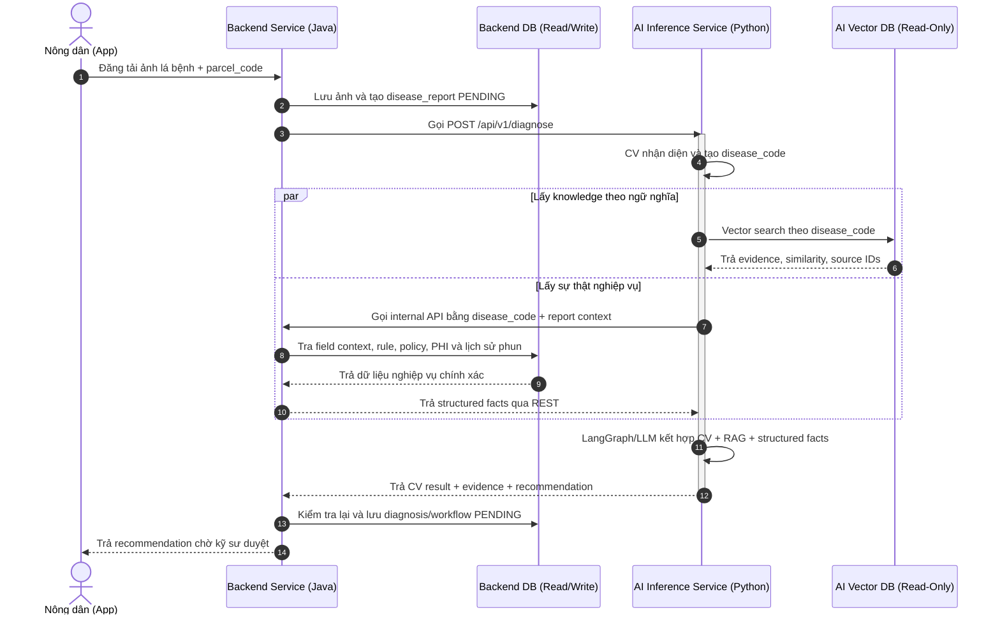

# Kế Hoạch Chi Tiết: Tách Database & Biến AI Thành Dịch Vụ Suy Luận Thuần Túy (Stateless Inference Service)

> **Dự án**: DX-Farm (Hệ thống Quản lý Nông nghiệp Thông minh)
> **Tài liệu**: Kế hoạch Tái cấu trúc Kiến trúc Backend & AI
> **Ngày cập nhật**: 15/09/2026
> **Checklist triển khai**: [`ai_backend_decoupling_checklist.md`](./ai_backend_decoupling_checklist.md) — phân rã kế hoạch này thành các mục nhỏ có thể giao việc, cùng danh sách tài liệu cần cập nhật sau mỗi mục.

---

## 🎯 Mục Tiêu Cốt Lõi

1. **Loại bỏ 100% tác vụ GHI (Write/CRUD)** dữ liệu nghiệp vụ nông nghiệp ở phía AI.
2. **Phân định rõ trách nhiệm (Database-per-Service)**:
   - **Backend DB**: Quản lý toàn bộ dữ liệu nghiệp vụ vận hành nông trại (Operational DB / RDBMS).
   - **AI DB**: Chỉ quản lý kho tri thức Vector RAG (PostgreSQL + pgvector).
3. **Biến AI Service thành Dịch vụ Suy luận Thuần túy (Stateless Inference Service)**:
   - AI nhận Request Payload -> Chẩn đoán hình ảnh (CV) + Tra cứu RAG -> Trả về kết quả JSON cho Backend.
   - AI **không kết nối trực tiếp** và **không lưu trữ** vào Database của Backend.
   - AI chỉ được đọc dữ liệu từ Backend qua REST GET; Backend không expose bất kỳ endpoint ghi (POST/PUT/DELETE) nào cho AI gọi.
   - AI không được cấp bất kỳ DB credential nào trỏ vào Backend DB, kể cả quyền chỉ đọc (read-only) ở tầng DB. Quyền đọc-only ở tầng DB chỉ áp dụng cho AI Vector DB của chính AI.
   - Sau khi CV trả `disease_code`, AI lấy RAG evidence từ pgvector và gọi Backend API để lấy dữ liệu nghiệp vụ chính xác, sau đó LangGraph/LLM tổng hợp recommendation trả về Backend.

---

## 📊 1. Hiện Trạng DB & Sự Trùng Lặp Giữa AI và Backend

### 1.1 Danh sách bảng trong DB hiện tại

| Phân loại | Bảng thuộc Backend (Java/Spring) | Bảng thuộc AI (Python/FastAPI) |
| :--- | :--- | :--- |
| **Thực địa & Mùa vụ** | `parcels`, `crop_seasons` | `parcels`, `crop_seasons` |
| **Danh mục Nông nghiệp** | `diseases`, `pesticides`, `treatment_rules` | `diseases`, `pesticides`, `treatment_rules`, `disease_management_policies` |
| **Nghiệp vụ Chẩn đoán** | `disease_reports`, `diagnoses`, `treatment_applications` | `disease_reports`, `diagnoses`, `treatment_applications`, `workflow_cases` |
| **Tri thức Vector RAG** | *Không có* | `documents`, `document_chunks` |

### 1.2 Chi tiết 8 bảng đang bị TRÙNG LẶP hoàn toàn

Cả Backend và AI đều đang khai báo các bảng này trong DB của mình.
Kiểu dữ liệu xung đột (Backend dùng `Long`, AI dùng `UUID`) và có rủi ro bất đồng bộ dữ liệu.

1. `parcels`: Quản lý thông tin thửa đất.
2. `crop_seasons`: Quản lý mùa vụ trồng trọt.
3. `diseases`: Danh mục các loại bệnh hại.
4. `pesticides`: Danh mục các loại thuốc bảo vệ thực vật.
5. `treatment_rules`: Quy tắc phác đồ điều trị (liều lượng min/max, ngày PHI).
6. `disease_reports`: Báo cáo phát hiện bệnh từ nông dân.
7. `diagnoses`: Kết quả chẩn đoán và đề xuất xử lý.
8. `treatment_applications`: Nhật ký ghi nhận phun thuốc thực tế.

### 1.3 Hai state machine phê duyệt song song

`workflow_cases` không chỉ là một bảng trùng lặp — nó là backing store cho một state machine phê duyệt riêng ở phía AI, song song với state machine đã có ở Backend.

AI hiện expose bộ endpoint quản lý vòng đời phê duyệt (`ai/app/api/router.py`, dùng `WorkflowRunner`/`WorkflowTransitions`, có `WorkflowConflictError` riêng):
- `POST /disease/workflow/run`
- `GET  /disease/workflow/{case_id}`
- `POST /disease/workflow/{case_id}/approve`
- `POST /disease/workflow/{case_id}/reject`
- `POST /disease/workflow/{case_id}/applied`

Backend có bộ tương đương đang chạy (`DiagnosisController.java`, `@PreAuthorize("hasAnyRole('ENGINEER','ADMIN')")`):
- `POST /api/v1/disease-reports/{reportId}/diagnosis`
- `POST /api/v1/disease-reports/{reportId}/diagnosis/approve`
- `POST /api/v1/disease-reports/{reportId}/diagnosis/reject`
- `POST /api/v1/disease-reports/{reportId}/diagnosis/apply`

Endpoint `POST /disease/reports/{report_id}/diagnose` ở AI (`router.py`, hàm `diagnose_report`) ghi thẳng vào `disease_reports`/`diagnoses` ở AI DB.
Endpoint này bị thay thế hoàn toàn bởi contract `/api/v1/diagnose` stateless ở mục 5.

`DiagnosisController` là nơi duy nhất quản lý vòng đời phê duyệt sau khi tách DB.
Router `/disease/workflow/*` và `WorkflowRunner`/`WorkflowTransitions` bị xóa khỏi AI — xem Phase 1 ở mục 6.

---

## 🔄 2. Đối Chiếu Luồng Nghiệp Vụ & Loại Bỏ Phần Trùng Lặp

| Luồng Nghiệp Vụ | Phía Backend thực hiện | Phía AI thực hiện | Hướng xử lý |
| :--- | :--- | :--- | :--- |
| **Tạo báo cáo dịch bệnh** | Nhận ảnh từ App -> Ghi `disease_reports` | Nhận request -> Ghi `disease_reports` | ❌ **LOẠI BỎ KHỎI AI**. Chỉ Backend quản lý upload & tạo báo cáo. |
| **Lưu kết quả chẩn đoán** | Ghi `diagnoses` (kèm trạng thái duyệt `PENDING`/`APPROVED`) | Ghi `diagnoses` thẳng vào DB | ❌ **LOẠI BỎ KHỎI AI**. AI chỉ trả kết quả JSON, Backend tự lưu `diagnoses`. |
| **Ghi nhận phun thuốc** | Ghi `treatment_applications` + tính ngày khóa thu hoạch PHI | Ghi `treatment_applications` | ❌ **LOẠI BỎ KHỎI AI**. Chỉ Backend quản lý lịch sử phun thuốc. |
| **Đọc thông tin thực địa** | Truy vấn `parcels`, `crop_seasons` | Truy vấn `parcels`, `crop_seasons` | ❌ **LOẠI BỎ TRUY VẤN Ở AI**. Backend đọc DB và đóng gói gửi qua REST Payload. |
| **Tra cứu dữ liệu quyết định** | Cung cấp REST API read-only trả disease, treatment rule, policy, PHI và lịch sử phun | Gọi Backend API bằng `disease_code` rồi đưa structured facts vào LangGraph/LLM | ✅ **BACKEND LÀ NGUỒN SỰ THẬT**. AI được tổng hợp lời khuyên nhưng không tự tạo dữ liệu nghiệp vụ. |
| **Tra cứu tri thức RAG** | *Không thực hiện* | Đọc `documents`, `document_chunks` | ✅ **GIỮ LẠI CHO AI**. Đây là nhiệm vụ cốt lõi của AI. |

---

## 🏛️ 3. Kiến Trúc Mới Sau Khi Tách Riêng 2 DB

### 3.1 Cấu trúc 2 Database độc lập

```
                      ┌─────────────────────────────────────────┐
                      │            HỆ THỐNG DX-FARM             │
                      └────────────────────┬────────────────────┘
                                           │
             ┌─────────────────────────────┴─────────────────────────────┐
             ▼                                                           ▼
┌──────────────────────────┐                               ┌──────────────────────────┐
│   BACKEND DATABASE       │                               │   AI VECTOR DATABASE     │
│   (dx_farm_db)           │                               │   (dx_farm_ai_vector_db) │
├──────────────────────────┤                               ├──────────────────────────┤
│ - parcels                │                               │ - documents              │
│ - crop_seasons           │                               │ - document_chunks        │
│ - diseases               │                               │   (với extension pgvector│
│ - pesticides             │                               │    lưu vector 384d)      │
│ - treatment_rules        │                               └──────────────────────────┘
│ - management policies    │                                            ▲
│ - disease_reports        │                                            ▲
│ - diagnoses              │                                            │ Read-Only (RAG)
│ - treatment_applications │                                            │
└────────────▲─────────────┘                               ┌────────────┴─────────────┐
             │ Read/Write                                  │    AI INFERENCE SERVICE   │
             │                                             │    (Python FastAPI)      │
┌────────────┴─────────────┐         REST API (JSON)       │  - CV Model Inference    │
│     BACKEND SERVICE      ├──────────────────────────────►│  - RAG Vector Search     │
│    (Java Spring Boot)    │◄──────────────────────────────┤  - LLM Recommendation    │
└──────────────────────────┘                               │  - STATELESS (NO WRITES) │
                                                           └──────────────────────────┘
```

### 3.2 Bảng dữ liệu AI truy vấn sau khi loại bỏ trùng

Sau khi tách DB, **AI DB chỉ chứa duy nhất 2 bảng tri thức Vector**:
1. `documents`: Lưu tiêu đề, mã bệnh (`disease_code`), nguồn tài liệu.
2. `document_chunks`: Lưu nội dung chia nhỏ (`content`) và chuỗi Vector 384 chiều (`embedding`) để thực hiện **Cosine Distance Vector Search**.

`disease_code` là contract chung giữa hai database.
Giá trị AI trả về phải khớp chính xác với `Backend.diseases.code` và `documents.disease_code`.
Không dùng tên bệnh hoặc fuzzy matching để nối dữ liệu giữa hai hệ.

---

## ⚙️ 4. Workflow Chi Tiết Của AI & Backend

### 4.1 Sơ đồ luồng xử lý (Sequence Diagram)



### 4.2 Ranh giới dữ liệu

Sau khi CV có `disease_code`, AI dùng đồng thời hai nguồn context:

```text
AI Vector DB (pgvector)
  → semantic evidence và nguồn tài liệu

Backend Internal API
  → field context, treatment rules, policy, liều lượng, PHI và lịch sử phun
  → nguồn sự thật nghiệp vụ

LangGraph/LLM
  → kết hợp CV + semantic evidence + structured facts
  → tạo recommendation trả về Backend
```

AI gọi Backend bằng `disease_code` canonical, không nối dữ liệu bằng tên bệnh.
AI được đề xuất dựa trên rule Backend cung cấp nhưng không được tự tạo hoặc sửa thuốc, liều lượng và PHI.
Backend kiểm tra lại, lưu kết quả và sở hữu toàn bộ trạng thái phê duyệt/APPLIED.

### 4.3 Xác thực service-to-service cho Internal API

Cả hai chiều gọi (Backend → AI ở `/api/v1/diagnose`, AI → Backend ở bước lấy structured facts) dùng service token — client-credentials OAuth2 qua Keycloak, hoặc API key nội bộ.
Internal API chỉ nghe trên network nội bộ của Docker Compose, không map port ra ngoài.
`request_id` được log xuyên suốt cả hai chiều gọi để trace một luồng chẩn đoán qua cả hai service.
Internal API phía Backend dành cho AI chỉ gồm các endpoint GET (field context, treatment rule, policy, PHI, lịch sử phun); service role của AI không được gán quyền gọi bất kỳ endpoint POST/PUT/DELETE nào của Backend.

### 4.4 Timeout & chịu lỗi cho vòng gọi hai chiều

Backend gọi AI, và AI gọi ngược lại Backend trong lúc request đó còn đang mở (nhánh `par` ở mục 4.1).
Timeout của AI khi gọi Backend internal API ngắn hơn timeout của Backend khi gọi AI, để Backend không timeout trước khi AI kịp trả lỗi.
Circuit breaker áp dụng ở cả hai chiều: Resilience4j ở Backend, `httpx` timeout + retry giới hạn ở AI.
Khi nhánh "Lấy sự thật nghiệp vụ" trong `par` block thất bại, AI trả lỗi ngay thay vì trả `recommendation` chỉ dựa trên RAG evidence — recommendation thiếu structured facts vi phạm nguyên tắc "Backend là nguồn sự thật" ở mục 2.

### 4.5 Kiểm tra version khi Backend lưu lại kết quả

Mỗi rule trong `structured_context.rules[]` (mục 5.2) có field `version`.
Khi lưu `diagnoses` từ `recommendation.selected_rule_id`, Backend so khớp lại `version` này với `treatment_rules.version` hiện tại.
Nếu rule đã bị cập nhật trong lúc AI xử lý, Backend từ chối và lấy lại rule mới thay vì lưu recommendation dựa trên rule cũ.

---

## 📑 5. Chuẩn Hóa API Contract (REST DTO)

### 5.1 Request: `POST /api/v1/diagnose` (Backend -> AI)
```json
{
  "request_id": "req_123456789",
  "crop_season_id": "101",
  "image_url": "https://storage.dxfarm.com/reports/leaf_01.jpg",
  "field_context": {
    "parcel_code": "P-01",
    "crop_name": "Lúa mùa",
    "growth_stage": "Trỗ bông",
    "recent_treatments": [
      {
        "pesticide_name": "Anvil 5SC",
        "applied_at": "2026-09-01T08:00:00Z",
        "harvest_locked_until": "2026-09-15T08:00:00Z"
      }
    ]
  }
}
```

### 5.2 Response: `200 OK` (AI -> Backend)
```json
{
  "request_id": "req_123456789",
  "cv_result": {
    "disease_code": "<CANONICAL_DISEASE_CODE>",
    "disease_name": "Tên bệnh theo class contract CV",
    "confidence": 0.94,
    "model_name": "EfficientNet-B4",
    "model_version": "v1.2.0"
  },
  "rag_evidence": [
    {
      "content": "Đoạn kiến thức đã ingest.",
      "source_ids": ["DOC_DISEASE_GUIDE_V1"],
      "similarity": 0.87
    }
  ],
  "structured_context": {
    "path": "treatment",
    "rules": [
      {
        "rule_id": "rule-123",
        "pesticide": "Tên thuốc từ Backend",
        "dose_min": 1.0,
        "dose_max": 1.5,
        "dose_unit": "lít/ha",
        "phi_days": 14,
        "version": "1.0"
      }
    ]
  },
  "recommendation": {
    "selected_rule_id": "rule-123",
    "summary": "Lời khuyên được tổng hợp từ structured facts và RAG evidence.",
    "requires_engineer_approval": true
  }
}
```

Thuốc, khoảng liều và PHI trong recommendation phải giữ nguyên từ `structured_context` do Backend cung cấp.
AI chỉ lựa chọn và diễn giải lời khuyên có căn cứ; Backend kiểm tra lại trước khi lưu recommendation ở trạng thái `PENDING`.

`dose_min`/`dose_max` ở trên khớp với model `treatment_rules` hiện tại của AI (`ai/app/db/models/treatment_rule.py`), nhưng Backend (`model/TreatmentRule.java`) chỉ có một cột `doseAmount` duy nhất, không có khoảng min/max.
Trước khi triển khai Phase 2, cần chốt: thêm `doseMin`/`doseMax` vào `TreatmentRule` của Backend, hoặc đổi contract API sang `dose_amount` đơn để khớp schema Backend hiện tại.

---

## 🚀 6. Lộ Trình Triển Khai (Implementation Roadmap)

### Phase 1: Tái cấu trúc phía AI (Python/FastAPI)
- [x] Xóa 10 ORM Models nghiệp vụ dư thừa (`disease_report.py`, `diagnosis.py`, `treatment_application.py`, `parcel.py`, `crop_season.py`, `disease.py`, `pesticide.py`, `treatment_rule.py`, `disease_management_policy.py`, `workflow_case.py`).
- [x] Xóa repository/service CRUD nghiệp vụ và toàn bộ lệnh `db.add()`, `db.commit()` trong AI runtime.
- [x] Xóa router `/disease/workflow/*` (`run`, `{case_id}` GET, `approve`, `reject`, `applied`) cùng `WorkflowRunner`/`WorkflowTransitions` — rà soát mọi client (frontend, app, script nội bộ) đang gọi các endpoint này và chuyển sang gọi Backend trước khi xóa.
- [ ] Xóa endpoint `POST /disease/reports/{report_id}/diagnose` (ghi thẳng DB qua `diagnose_report`) — thay bằng inference contract mới.
- [ ] Thêm Backend REST client read-only để lấy field context, treatment rule, policy, PHI và lịch sử phun sau khi CV có `disease_code`.
- [ ] Đổi endpoint AI thành inference contract: nhận ảnh/request context, kết hợp CV + RAG + structured facts và trả recommendation về Backend.
- [ ] Giữ `rag/retriever.py` và `rag/ingestion_service.py`; runtime chỉ đọc AI Vector DB, còn ingest là job quản trị có quyền ghi riêng.
- [ ] Áp dụng timeout + retry giới hạn (`httpx`) khi gọi Backend internal API, theo mục 4.4.

### Phase 2: Tái cấu trúc phía Backend (Java/Spring Boot)
- [ ] Thêm `AiDiagnosisClient` (sử dụng `WebClient` hoặc `RestTemplate`), có timeout/circuit breaker theo mục 4.4.
- [ ] Cập nhật `DiseaseReportService`: Tự khởi tạo và lưu `DiseaseReport` vào Backend DB.
- [ ] Cung cấp internal API read-only để AI lấy structured facts bằng `disease_code` và context của báo cáo; bảo vệ bằng service token/network nội bộ theo mục 4.3.
- [ ] Gọi `AiDiagnosisClient.diagnose(...)` gửi Payload sang AI Service.
- [ ] Nhận CV, evidence và recommendation từ AI; đối chiếu lại `version` của rule (mục 4.5), kiểm tra rule/liều/PHI rồi lưu `Diagnosis`/workflow `PENDING`.
- [ ] Xác nhận `DiagnosisController` (`create`/`approve`/`reject`/`apply`) là nơi duy nhất quản lý vòng đời phê duyệt.

### Phase 3: Khởi tạo Database & Deployment
- [ ] Khởi tạo DB riêng `dx_farm_ai_vector_db` chỉ chứa bảng `documents` và `document_chunks` (kèm pgvector extension).
- [ ] Cập nhật `deploy/docker-compose.yml` để tách biệt cấu hình biến môi trường kết nối DB của Backend và AI, theo cùng pattern DB/user riêng mà `keycloak`/`superset_ro` đang dùng trên cùng Postgres instance.
- [ ] Dùng user chỉ-đọc cho AI runtime trên Vector DB và user/job riêng cho ingest.
- [ ] Quyết định số phận dữ liệu cũ trong AI DB (`disease_reports`, `diagnoses`, `treatment_applications`, `workflow_cases`): bỏ nếu là dữ liệu demo/test, migrate/backfill sang Backend DB trước khi cắt kết nối nếu là dữ liệu thật.

---

> 📌 **Kết Luận**: Kế hoạch này giúp chuyển đổi thành công AI Service thành **Dịch vụ suy luận phi trạng thái (Stateless Inference Service)**, giải quyết triệt để trùng lặp dữ liệu, đảm bảo tính bảo mật và tối ưu hiệu năng toàn hệ thống DX-Farm.
