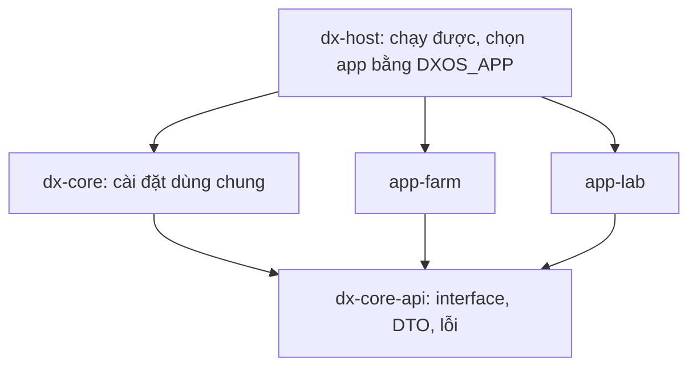

# Refactor: DX-OS Open-Core dùng chung cho nhiều ứng dụng

Thư mục này chứa kế hoạch tách Open-Core thành phần lõi chạy được, và đưa các ứng dụng nghiệp vụ (DX-Farm, DX-Lab) vào qua interface.
Mỗi phase là một folder, sinh từ [`../_template/`](../_template/).
Đề thi tham chiếu: [`../De_thi_PMNM_HaUI_2026_BAN_CHINH_THUC.pdf`](../De_thi_PMNM_HaUI_2026_BAN_CHINH_THUC.pdf) (mục 3, 4.1, 12, 13, 15).

## Mục tiêu

- Một ứng dụng core chạy được, chứa mọi dịch vụ dùng chung: định danh và phân quyền, workspace, workflow, lưu trữ, thông báo, cổng AI/tri thức, đăng ký dữ liệu BI.
- Ứng dụng nghiệp vụ chỉ phụ thuộc `dx-core-api` (interface và DTO), cài các interface theo cách riêng và không định nghĩa lại core.
- Mỗi lần khởi động chạy một app; đổi biến môi trường `DXOS_APP` rồi restart backend là chuyển sang app khác, core giữ nguyên.
- Hai app chứng minh: `app-farm` (nông nghiệp, đã có) và `app-lab` (vận hành CNTT cho khoa, mới, làm đủ sâu để dùng thật).
- Tổng ước lượng khoảng 26 ngày làm việc (hạn nộp không ràng buộc chặt).

## Kiến trúc đích

- Compiler chặn app import ruột core, vì app chỉ có `dx-core-api` trên classpath.
- Core không import app; entity của core không lộ ra app (app nhận `CaseView`, `WorkspaceView`).
- Danh sách file theo module ở [`MODULE_MAP.md`](./MODULE_MAP.md); danh sách interface ở [`SPI_CATALOG.md`](./SPI_CATALOG.md).
- Cách dựng, chạy và kiểm thử sau khi xong các phase ở [`RUNBOOK_KIEM_THU.md`](./RUNBOOK_KIEM_THU.md).

## Nguyên tắc

1. Phần dùng chung đặt thẳng trong `dx-core`; chỉ tách thành interface khi Farm và Lab thật sự khác nhau.
2. App không biết app khác; core không biết app nào đang chạy.
3. Mỗi phase giữ hệ thống chạy được; phase C1 không đổi hành vi nhìn từ client.
4. Farm không đổi hành vi: hợp đồng `/api/v1/...`, trạng thái, thông báo và luật nghiệp vụ giữ nguyên; mọi phase chạm Farm phải so với baseline ở C0.
5. Không ghi nhãn phase hay milestone vào code, `@Operation` hay comment.

## Quyết định

| # | Quyết định | Trạng thái |
|---|---|---|
| RD1 | Kiến trúc host + plugin: core chạy được, app cắm vào qua interface, app chỉ phụ thuộc `dx-core-api` | Đã chốt |
| RD2 | Chuyển app bằng `DXOS_APP`, mỗi lần khởi động một app, đổi biến rồi restart backend | Đã chốt |
| RD3 | `Household` đổi thành `Workspace`, thêm `WorkspaceMember` (nhiều-nhiều) | Đã chốt |
| RD4 | Tên realm, client và audience Keycloak đổi sang tên trung tính `dxos` | Đã chốt |
| RD5 | App Lab làm web trước, mobile để sau; CV chỉ của Farm; AI của Lab gồm RAG, phân loại và gợi ý bằng luật | Đã chốt |
| RD6 | Không viết test tự động riêng cho việc "cắm app" ở đợt này | Đã chốt |
| RD7 | Giấy phép AGPL cho `ai/` xử lý sau đợt refactor | Đã chốt |
| RD8 | Package `HaUI.ImplSolution.dxos.*`; artifact `dx-os-parent`, `dx-core-api`, `dx-core`, `app-farm`, `app-lab`, `dx-host`; bố cục `backend/` đa module | Đã chốt |
| RD9 | Giữ schema `public`, tách Flyway theo location và bảng lịch sử riêng | Đã chốt |
| RD10 | Workflow cấu hình được trạng thái qua `CaseTypeDefinition` thay cho enum cố định | Đã chốt |
| RD11 | Lab dùng được thật nhưng giữ phạm vi vừa phải: ticket có SLA và trao đổi, tài sản và mượn trả, đặt phòng máy chống xung đột, tri thức và hỏi đáp, thống kê. Các mục nâng cao (ticket tương tự, cảnh báo bất thường, leo thang, tự đóng, dashboard Superset của Lab) ở backlog | Đã chốt |
| RD13 | Farm giữ nguyên hợp đồng API (kể cả `/api/v1/households`), trạng thái, thông báo và hành vi; thay đổi nhìn từ ngoài chỉ là tên realm và client (C3) và việc dựng lại DB | Đã chốt |
| RD12 | Đường dẫn API giữ `/api/v1/...`, không thêm tiền tố theo app | Đã chốt |

## Chỉ mục phase

| Phase | Tên | Ước lượng | Phụ thuộc | Trạng thái |
|---|---|---|---|---|
| [C0](./phase-c0-chot-thiet-ke-nen/00_OVERVIEW.md) | Chốt thiết kế và nền | 1 ngày | Không | Hoàn tất |
| [C1](./phase-c1-tach-module-giu-hanh-vi/00_OVERVIEW.md) | Tách Maven đa module, giữ nguyên hành vi | 4-5 ngày | C0 | Draft |
| [C2](./phase-c2-tong-quat-hoa-core-spi/00_OVERVIEW.md) | Tổng quát hóa core và các interface | 5-6 ngày | C1 | Draft |
| [C3](./phase-c3-ten-trung-tinh-realm/00_OVERVIEW.md) | Tên trung tính cho realm và client | 2 ngày | C1 | Draft |
| [C4](./phase-c4-app-lab-backend/00_OVERVIEW.md) | App Lab: backend | 6-7 ngày | C2 | Draft |
| [C5](./phase-c5-web-shell-lab-ui/00_OVERVIEW.md) | Web: vỏ chọn app và giao diện Lab | 4-5 ngày | C2, C4 | Draft |
| [C6](./phase-c6-switch-deploy-ci-demo/00_OVERVIEW.md) | Chuyển app, triển khai, CI, dữ liệu demo | 3 ngày | C3, C4, C5 | Draft |
| [C7](./phase-c7-tai-lieu-ho-so/00_OVERVIEW.md) | Tài liệu và hồ sơ nộp | 2 ngày | C6 | Draft |

Thứ tự: C0 → C1 → C2 → C4 → C5 → C6 → C7.
C3 làm sau C1, song song với C2 hoặc C4; riêng WPC3-02 (vai và tài khoản mẫu) cần `RoleProvider` của C2.

## Quy ước

- Mã phase `C{n}`; work package `WPC{n}-{xx}`; dòng checklist `WPC{n}-{xx}-{lớp}-{nn}`; test case `TC{n}-{xx}`; rủi ro `R{n}`, trade-off `TO{n}` trong từng phase.
- Dòng BE và DATA ghi module trong ngoặc vuông: `[core-api]`, `[core]`, `[farm]`, `[lab]`, `[host]`.
- Kiểm chứng mặc định là `./mvnw compile` cho toàn bộ module, `npx tsc --noEmit` và đọc diff.
- Chạy test, dựng stack hoặc gọi thử endpoint chỉ khi người dùng yêu cầu rõ; không thêm file test mới nếu không được yêu cầu.
- Mỗi phase một nhánh cắt từ `Khuong/main`; không tự commit hay push.
- Chỉ ghi trạng thái cuối trong README và CHANGELOG của repo, không kể diễn biến trước sau.
- Viết ngắn, tiếng Việt, mỗi câu một dòng; comment trong code bằng tiếng Anh.
