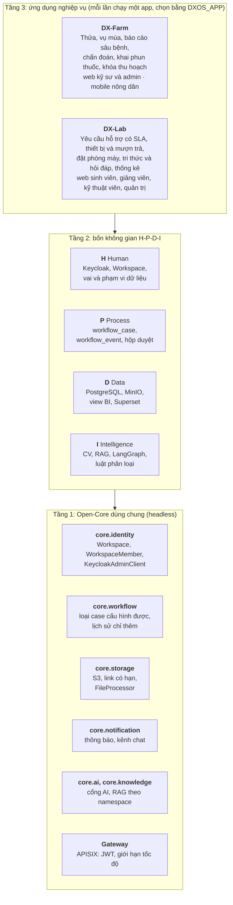
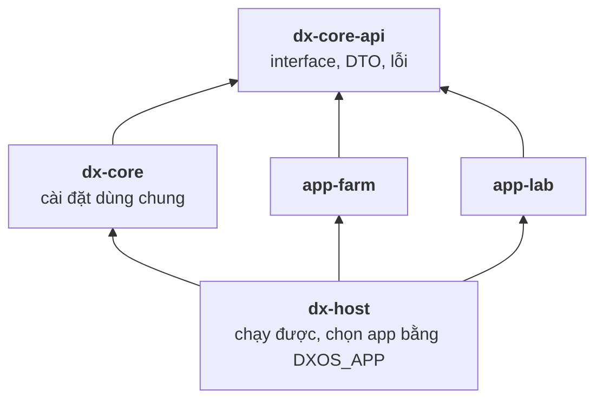
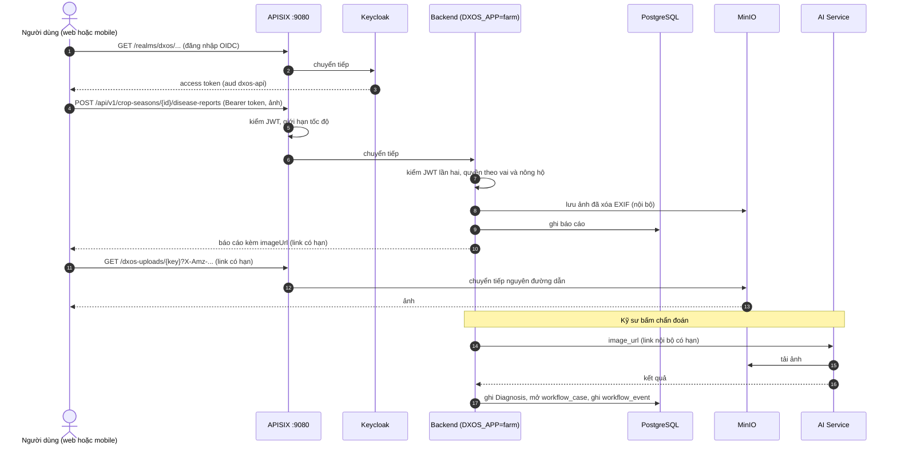
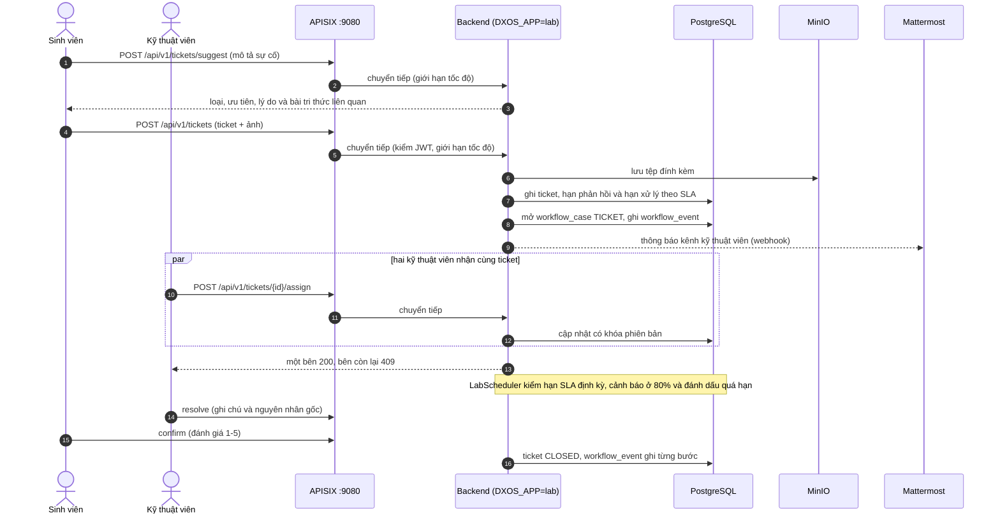

# Kiến trúc Open-Core 3 tầng

Tài liệu này mô tả ranh giới giữa phần lõi dùng chung (Core) và hai ứng dụng chạy trên nó: DX-Farm (nông nghiệp) và DX-Lab (vận hành CNTT của khoa).
Sơ đồ viết bằng Mermaid, GitHub hiển thị trực tiếp.
Danh sách interface ở [`SPI_CATALOG.md`](../refactor_docs/SPI_CATALOG.md); danh sách file theo module ở [`MODULE_MAP.md`](../refactor_docs/MODULE_MAP.md).

## 1. Sơ đồ 3 tầng

| Tầng | Thành phần | Nơi nằm trong repo |
|---|---|---|
| 1. Core | Identity, SSO | `backend/dx-core/.../core/identity`, `sso/` (Keycloak) |
| 1. Core | Workflow | `backend/dx-core/.../core/workflow`, bảng `workflow_case`, `workflow_event` |
| 1. Core | Storage | `backend/dx-core/.../core/storage`, `minio/` |
| 1. Core | Notification | `backend/dx-core/.../core/notification`, bảng `notifications` |
| 1. Core | Cổng AI, tri thức | `backend/dx-core/.../core/ai`, `.../core/knowledge` |
| 1. Core | Bảo mật, trạng thái hệ thống | `backend/dx-core/.../core/security`, `.../core/status` |
| 1. Core | API Gateway | `deploy/apisix/common.yaml` |
| 2. H-P-D-I | Human, Process, Data, Intelligence | các thành phần Core ở trên cộng `ai/`, `bi/`, `chat/` |
| 3. Ứng dụng | DX-Farm | `backend/app-farm`, `frontend/src/apps/farm`, `mobile/`, `data/` |
| 3. Ứng dụng | DX-Lab | `backend/app-lab`, `frontend/src/apps/lab`, `data/rag/lab/` |

## 2. Module và ranh giới biên dịch

- Backend gồm năm module Maven.
  `dx-core-api` giữ interface, DTO và lỗi; `dx-core` cài đặt các dịch vụ dùng chung; `app-farm` và `app-lab` là hai ứng dụng; `dx-host` ghép chúng và là fat jar duy nhất được đóng gói.
- Mỗi ứng dụng chỉ có `dx-core-api` trên classpath.
  Compiler từ chối mọi import từ ứng dụng vào ruột `dx-core`, và `dx-core` không import ứng dụng nào.
- Core không biết ứng dụng nào đang chạy:
  - `WorkflowService` nhận `caseType`, `entityType`, `entityId` dạng chuỗi và số; trạng thái, bước chuyển và vai do app khai báo bằng `CaseTypeDefinition`.
  - `StorageService` nhận khóa object và byte; việc làm sạch tệp do app cài `FileProcessor`.
  - Vai, endpoint công khai, loại workspace, loại thông báo, kênh chat, view BI, nguồn tri thức và chỉ báo sức khỏe do app khai báo qua interface; core chỉ gom các bean đó lúc khởi động.
- Entity của core không lộ ra ứng dụng: app nhận `CaseView` và `WorkspaceView`, và lưu id dạng số thay cho quan hệ JPA xuyên module.
- Ứng dụng gọi core qua facade của `dx-core-api`: `WorkflowOperations`, `ApprovalInbox`, `WorkspaceDirectory`, `NotificationPublisher`, `ObjectStorage`, `FileStore`, `UserContext`, `KnowledgeGateway`, `AiGateway`.
- Đổi ứng dụng chỉ thêm module ứng dụng mới; `dx-core-api`, `dx-core` và `deploy/apisix/common.yaml` giữ nguyên.
  Cách thêm ở [`CONTRIBUTING.md`](../../../CONTRIBUTING.md) mục "Thêm một ứng dụng mới".

### Cách ứng dụng cắm vào

| Việc | Cơ chế | Farm | Lab |
|---|---|---|---|
| Khai báo app | `AppModule` (id, tên, menu, loại workspace) | `FarmAppModule` | `LabAppModule` |
| Vai | `RoleProvider`, core tạo vai thiếu trong Keycloak lúc khởi động | FARMER, ENGINEER, ADMIN | STUDENT, LECTURER, TECHNICIAN, ADMIN |
| Quy trình | `CaseTypeDefinition`, `WorkflowDecisionHandler` | 5 loại: duyệt thửa, sửa thửa, duyệt vụ mùa, duyệt chẩn đoán, xác nhận khai phun | `TICKET`, `DEVICE_LOAN`, `ROOM_BOOKING` |
| Hộp duyệt | `CaseSummaryProvider` | 5 provider | 3 provider |
| Thông báo và chat | `NotificationTypeDefinition`, `NotificationChannel` | kênh `ADMIN`, `ENGINEER` | kênh `ADMIN`, `TECHNICIAN` |
| Dữ liệu BI | `BiDatasetProvider` (view `vw_*`) | 6 view đã duyệt | 5 view `vw_lab_*` |
| Tri thức | `KnowledgeNamespace` | `farm` | `lab` |
| Schema | Flyway location riêng, bảng lịch sử riêng | `db/migration/farm` | `db/migration/lab` |

## 3. Chọn ứng dụng lúc chạy

- `DXOS_APP` (`farm` hoặc `lab`) chọn app; giá trị khác làm backend dừng trước khi tạo bean (`AppSelectionCheck`).
- Mỗi app nạp bằng một cấu hình tự động có điều kiện `dxos.app=<app>`: chỉ app đang chạy có entity, bảng, controller và lịch chạy.
- Lớp ngoài backend đổi theo cùng biến:
  - Gateway: `apisix-config` ghép `common.yaml` với `apps/<app>.yaml`.
  - Superset: kết nối và dataset của app.
  - Tri thức: job `rag-ingest` nạp corpus của app vào namespace riêng.
  - Web: một image, đọc `GET /api/v1/app` rồi nạp module giao diện của app.
- `deploy/start.sh <app>` đổi app bằng một lệnh; bảng của app trước nằm lại trong database, không dùng tới.

## 4. Sơ đồ luồng request: Farm

## 5. Sơ đồ luồng request: Lab

## 6. Nguyên tắc vận hành

- Mọi client chỉ biết một địa chỉ: gateway.
  Cổng của backend, Keycloak, AI, MinIO và portal không publish ra host.
  Gateway có ba listener: `9080` cho web, API, Keycloak, ảnh và portal (`/portal/`), `9081` riêng cho Superset (bản 3.1 không chạy được dưới đường dẫn con), `9082` riêng cho console MinIO.
- Gateway chỉ có route và giới hạn tốc độ của app đang chạy.
- Backend kiểm lại JWT độc lập với gateway.
  Gateway sai cấu hình thì backend vẫn tự bảo vệ.
- AI Service không có route ở gateway, chỉ backend gọi được qua mạng nội bộ của compose.
- `GET /api/v1/system/status` (công khai) trả app đang chạy và trạng thái từng dịch vụ; portal đọc từ đây.

## 7. Đối chiếu với yêu cầu của đề

| Yêu cầu (đề mục 3 và 4.1) | Chứng minh |
|---|---|
| Tầng 1 headless, không có giao diện người dùng cuối | `dx-core` chỉ có API; giao diện nằm ở `frontend/` và `mobile/` (tầng 2 và 3) |
| Identity/SSO | Keycloak, realm `dxos`, `core.identity`, vai do app khai báo |
| API Gateway | APISIX: JWT, giới hạn tốc độ, một cửa cho mọi client |
| Dữ liệu cấu trúc và phi cấu trúc | PostgreSQL (nghiệp vụ, pgvector), MinIO (ảnh, tệp đính kèm) |
| Workflow | `core.workflow`: loại case cấu hình được, lịch sử chỉ thêm, hộp duyệt |
| Ít nhất một ứng dụng ở tầng 3 | Hai ứng dụng: DX-Farm và DX-Lab, cùng một Core không đổi |
