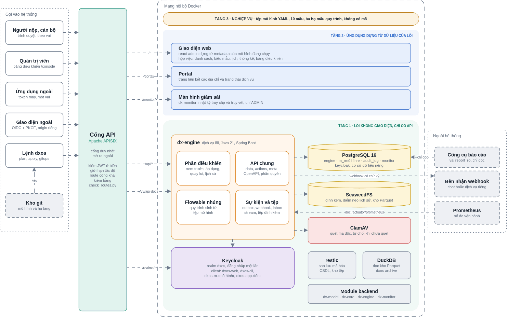

# DX-OS

Lõi dynamic nguồn mở cho hệ thống hồ sơ có quy trình.
Đổi nghiệp vụ là đổi tệp, không đổi mã.

OLP Phần mềm nguồn mở 2026, khối thi DX-OS.
Đội HaUI-ImplSolution, Trường Công nghệ Thông tin và Truyền thông, Đại học Công nghiệp Hà Nội.

<!--
Bài 15 phút ngày 10/12, bốn phần: giải pháp và công nghệ (slide 2 đến 5), tính năng và bài toán minh họa (6 đến 8), kết quả và demo (9 đến 13), định hướng (14 đến 15).
Kịch bản demo từng bước ở docs/DEMO.md; slide này chỉ là phần nói.
-->

---

## 1. Vấn đề

- Trường học và đơn vị nhỏ có quy trình giống nhau: một người gửi, một người xem xét, duyệt hoặc trả lại, mọi bước để lại dấu vết.
- Mỗi nghiệp vụ mới lại dựng lại đăng nhập, phân quyền, lưu tệp và luồng duyệt.
- Hệ thống nguyên khối thì gắn đơn vị với một nhà cung cấp.

**DX-OS làm phần dùng chung đó một lần.**
Nghiệp vụ nằm trong một tệp mô hình.

<!--
Nói rõ đây là giả thuyết: đội chưa nói chuyện với khách hàng nào (issue #231).
-->

---

## 2. Giải pháp: một lõi không giao diện

- Người triển khai khai báo hồ sơ cần gì, ai xem, ai duyệt, hạn bao lâu.
- Lõi đọc tệp rồi dựng cơ sở dữ liệu, tài khoản và vai, API có quyền theo dòng, quy trình và giao diện.

---

## 3. Ba tầng

| Tầng | Vai trò |
|---|---|
| 1. Lõi | Dịch vụ chỉ có API: đọc mô hình, áp dụng, quy trình, lịch sử, sự kiện |
| 2. Ứng dụng | Giao diện web và bảng điều khiển dựng từ metadata, portal, màn hình giám sát |
| 3. Mô hình | Tệp mô tả nghiệp vụ; thêm nghiệp vụ là thêm một tệp |

`dxos start --core` chạy riêng Tầng 1, không kèm giao diện nào.

---

## 4. Bốn dịch vụ bắt buộc, đều là phần mềm nguồn mở nguyên bản

| Dịch vụ của đề | Thành phần | Giấy phép |
|---|---|---|
| Định danh, SSO | Keycloak | Apache-2.0 |
| Cổng API | Apache APISIX | Apache-2.0 |
| Dữ liệu có cấu trúc | PostgreSQL | PostgreSQL |
| Dữ liệu phi cấu trúc | SeaweedFS, ClamAV | Apache-2.0, GPL-2.0 |
| Luồng công việc | Flowable nhúng | Apache-2.0 |

Image chính thức, phiên bản ghim, không sửa mã thượng nguồn.
Mã của đội theo Apache-2.0, `reuse lint` kiểm ở mỗi pull request.

---

## 5. Vì sao tự dựng lõi mà không dùng nền tảng có sẵn

- Chọn công cụ nguồn mở để lắp, không viết lại định danh, cổng, kho dữ liệu hay động cơ quy trình.
- Phần của đội là chỗ chưa có sẵn: biến một tệp mô hình thành hệ thống chạy được, và đổi tệp đó an toàn khi đã có dữ liệu.
- Lý do không lấy Supabase, Strapi, Directus làm nền: [trang thành phần](https://haui-implsolution.github.io/DX-OS/docs/dependencies).

---

## 6. Tính năng nền tảng

- **Khai báo:** trường, ràng buộc, vai, quyền, quy trình và mẫu in giấy tờ trong một tệp.
- **Quyền đến từng dòng:** mỗi vai chỉ thấy và sửa phần của mình, của đơn vị mình hoặc được giao.
- **Quy trình không lách được:** trạng thái chỉ đổi qua quy trình, không ai tự duyệt hồ sơ của mình.
- **Dấu vết chống sửa:** lịch sử nối chuỗi hash, một lệnh chỉ ra đúng dòng bị đổi.
- **Đổi nghiệp vụ khi có dữ liệu:** xem kế hoạch và mức rủi ro, đổi tên giữ nguyên dòng, từ chối khi dữ liệu vi phạm.
- **Kết nối và lưu trữ:** webhook có chữ ký, API riêng cho mỗi mô hình, hồ sơ đã đóng ghi ra Parquet.

---

## 7. Mười mẫu có sẵn, ba họ quy trình

Một cửa sinh viên, hỗ trợ kỹ thuật, sự cố thiết bị, đặt phòng, cấp quyền dịch vụ CNTT, mượn thiết bị, ghi chú, sổ tài sản, đặt lịch khám, đổi trả hàng.

- Phê duyệt, công việc cần xử lý, đặt chỗ theo khung giờ có kiểm sức chứa.
- Mô hình mới thuộc họ khác chạy được mà không sửa mã lõi.

Bài toán minh họa: **một cửa sinh viên** của trường, có bốn tài khoản thử và 40 hồ sơ mẫu từ `dxos demo`.

---

## 8. Ứng dụng của người ngoài

Cửa hàng điện máy không liên quan đến dự án thêm hai quy trình (đổi trả, bảo hành) bằng hai tệp mô hình.

- Ứng dụng không có mã quy trình, phân quyền hay lịch sử.
- Phần tích hợp: một mẫu dùng nguyên, một tệp mở rộng mẫu, vài biến môi trường, 109 dòng mã.
- Tài khoản máy của ứng dụng không tự duyệt được phiếu của mình (403).

`examples/appliance-store`

---

## 9. Kết quả: đo được

| Chỉ số | Kết quả |
|---|---|
| Luồng ticket: mã riêng phải viết | Lab 347 dòng Java, Core 28 dòng YAML, giảm 91,93% (đếm theo số dòng, không phải giờ công) |
| Bản phát hành | Mười bản `v1.0.0` đến `v2.1.0`, mỗi bản có `.tar.gz`, `.sha256`, SBOM |
| Kiểm tự động | Tám mục "thế nào là đạt" chạy bằng `check_demo.py`; CI `Platform`, `Compliance` |
| Cài | Hai lệnh trên máy sạch, một lệnh tạo tài khoản và hồ sơ thử |

---

## 10. Demo 1: quy trình không lách được

1. `judge_student` tạo hồ sơ, đính kèm PDF; tệp `.html` bị từ chối.
2. `judge_officer` thấy việc mới trong hộp việc không cần tải lại trang.
3. Yêu cầu bổ sung, sinh viên nộp lại, cán bộ duyệt; lịch sử ghi đủ ai, lúc nào, vì sao.
4. `judge_officer2` không thấy hồ sơ của đơn vị khác.
5. Gọi thẳng API để đổi trạng thái: bị chặn.

<!-- Sự cố: hộp việc không tự cập nhật thì tải lại và nói tiếp; tệp lỗi thì bỏ bước tệp. -->

---

## 11. Demo 2: đổi nghiệp vụ khi hệ thống đang chạy

1. `/console`, mở mô hình `onestop` đang có dữ liệu.
2. Thêm một trường, xem kế hoạch: mức An toàn, áp dụng, không build lại.
3. Đổi tên trường bằng `renamed_from`: số dòng giữ nguyên.
4. Đặt `required: true` cho trường mà hồ sơ cũ để trống: kế hoạch bị từ chối, nêu số dòng vi phạm, hệ thống vẫn chạy bản cũ.
5. Nạp mẫu đặt phòng: chạy được ngay, có chế độ lịch.

<!-- Lỗi chỉ đúng dòng và cột là điểm nhấn; đọc cho hội đồng rồi sửa. -->

---

## 12. Demo 3: vận hành và dữ liệu

- **Thống kê:** theo trạng thái, đơn vị, thời gian xử lý, tỷ lệ đúng hạn.
- **Lịch sử chống sửa:** `dxos history verify` báo chuỗi nguyên vẹn.
- **Lưu trữ dài hạn:** `dxos archive` ghi hồ sơ đã đóng ra Parquet kèm manifest, `dxos archive check` kiểm lại.

<!-- Lần chạy archive đầu cần mạng để tải extension DuckDB; không có mạng thì bỏ bước này. -->

---

## 13. Bốn nguyên lý của đề, mỗi nguyên lý một lệnh

| Nguyên lý | Bằng chứng |
|---|---|
| (i) Vòng đời dữ liệu | `dxos archive` ghi hồ sơ đã đóng ra Parquet, `dxos archive query` đọc bằng DuckDB |
| (ii) IT và OT | `examples/itot-simulator`: chỉ số vượt ngưỡng, qua HTTP hoặc qua cầu nối MQTT, thành hồ sơ sự cố |
| (iii) Phả hệ và chất lượng | Tab Danh mục dữ liệu ở `/console`, `dxos history verify` |
| (iv) Zero-Trust, GitOps | Tệp EICAR bị chặn, `dxos gitops status`, `dxos reconcile` dựng lại container |

Từng bước ở mục 8 của `docs/DEMO.md`.

<!-- Chỉ mở khi hội đồng hỏi về bốn nguyên lý; nói thẳng: bộ mô phỏng gọi HTTP, chưa có bản sao số. -->

---

## 14. Chưa có, và nói thẳng

- AI là trợ lý tùy chọn đề xuất giá trị một trường, người dùng xác nhận trước khi lưu; không có hỏi đáp trên tri thức nội bộ.
- Một bản cài là Compose một máy; chưa chạy nhiều bản sao của lõi.
- Chưa có chữ ký số, đa thuê giữa các tổ chức, tìm kiếm toàn văn.
- Chưa nói chuyện với khách hàng thật.

Danh sách đầy đủ ở `docs/dynamic-core/BACKLOG.md`.

---

## 15. Định hướng

- Thêm họ quy trình và lĩnh vực chạy bằng tham số, giữ lõi không biết lĩnh vực nào.
- Mở rộng phần AI khi có mô hình đạt định nghĩa Open Source AI của OSI.
- Thử với đơn vị thật để kiểm các giả thuyết về nhu cầu.

**Đổi nghiệp vụ là đổi tệp, không đổi mã.**

Mã nguồn, tài liệu và bản dùng thử: <https://github.com/HaUI-ImplSolution/DX-OS>
