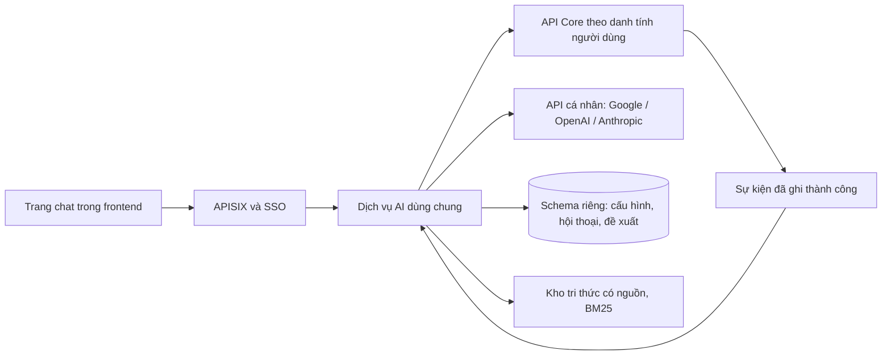

# Trợ lý AI trên web

Bộ tài liệu thiết kế cho [issue #210](https://github.com/HaUI-ImplSolution/DX-OS/issues/210), chờ tech lead review trước khi triển khai.
Đây là mục tiêu dự kiến, chưa phải mô tả tính năng đã có hay bằng chứng nghiệm thu.

| Tài liệu | Nội dung |
|---|---|
| [Overview](./00_OVERVIEW.md) | Mục tiêu, phạm vi và kiến trúc |
| [Plan](./01_PLAN.md) | Hợp đồng, thứ tự triển khai và cách kiểm |
| [Checklist](./02_CHECKLIST.md) | Điều kiện hoàn thành và cổng review |
| [Tradeoffs và risks](./03_TRADEOFFS_RISKS.md) | Đánh đổi, rủi ro và quyết định cần review |

## 1. Quy tắc áp dụng

Tuân thủ quy tắc làm việc do người dùng cung cấp, `CONTRIBUTING.md` và cấu hình build/CI của nhánh hiện tại.
Quyết định mới nhất của người dùng cho phép viết bốn tài liệu này trong `docs/ai-assistant/`, ngang hàng với `docs/dynamic-core/`.
Chỉ lập kế hoạch trong lượt này; chưa sửa code, dependency, tài liệu định hướng hoặc nội dung issue trên GitHub.
Không stage, commit, push, tạo PR, merge, đóng issue, gửi bình luận hoặc phân công subagent khi chưa có quyền tương ứng.
Mọi bước triển khai phải giữ Core độc lập nghiệp vụ, ưu tiên cơ chế có sẵn và chỉ thêm thành phần thực sự cần.
Không thêm test file hoặc framework nếu chưa được cho phép; mặc định backend kiểm compile và diff, test source thì test-compile.
Các ca chức năng trong plan là tiêu chí cần kiểm khi bước kiểm tích hợp được duyệt, không phải quyền chạy stack hoặc gọi API trả phí ngay trong lượt viết tài liệu.
Chỉ đánh dấu đạt khi có bằng chứng đúng phiên bản mã được kiểm; giữ nghiệm thu của tech lead và người dùng riêng với kết quả kỹ thuật.

## 2. Mục tiêu đã thống nhất

Người dùng hỏi đáp và xử lý công việc qua một trang chat trong DX-OS.
Mỗi tài khoản tự cấu hình API Google Gemini, OpenAI hoặc Anthropic và chọn model phù hợp.
DX-OS giữ mã tích hợp nguồn mở; không tải trọng số, không vận hành LLM local và không yêu cầu GPU.
Giao diện theo cách bố trí của Gemini, dùng thành phần và chủ đề sẵn có của DX-OS.
Truy xuất bắt đầu nhẹ bằng bộ lọc Core và BM25 cho kho tài liệu, chưa dùng model embedding hoặc reranker riêng.
Kho tri thức kiểm chứng dùng nội dung giả lập do đội tự viết, ghi rõ tính chất minh họa và quyền sử dụng.

### Ranh giới nguồn mở

Giấy phép mã tích hợp và độ mở của model là hai khái niệm riêng.
Các API Gemini, OpenAI và Anthropic do người dùng cung cấp không được mô tả là model đạt [Open Source AI Definition của OSI](https://opensource.org/ai/open-source-ai-definition).
Tính năng AI cần một API được cấu hình và có quyền sử dụng; khi không có API, các chức năng nghiệp vụ của DX-OS vẫn chạy.
Chi phí, điều khoản dịch vụ và việc dữ liệu đi tới nhà cung cấp thuộc lựa chọn API của người dùng.
Người dùng đã đồng ý thay đổi mục tiêu ban đầu của #210 theo hướng này; tech lead cần review sự thay đổi và nội dung định hướng liên quan trước khi tích hợp.
Tiêu đề, mô tả issue và tài liệu định hướng hiện vẫn có thể ghi mục tiêu OSAID cũ; bộ tài liệu này không tự sửa các nguồn đó.

## 3. Phạm vi chức năng

| Nhóm | Hành vi dự kiến |
|---|---|
| Kết nối | Tạo, chọn, thay và xóa cấu hình API cá nhân; kiểm kết nối khi người dùng yêu cầu |
| Hội thoại | Tạo hội thoại, xem lịch sử, đổi tên, xóa; mỗi hội thoại gắn với một tài khoản và một mô hình nghiệp vụ |
| Tra cứu | Đọc metadata, hộp việc, danh sách theo bộ lọc, chi tiết, lịch sử, thống kê và người nhận hợp lệ |
| Hỏi đáp tri thức | Tìm đoạn tài liệu thuộc mô hình đang chọn, trả lời có trích dẫn và báo thiếu bằng chứng |
| Đề xuất từ hội thoại | Giao việc, trả việc về nhóm và hành động chuyển trạng thái theo metadata; xác nhận bằng nút trên web |
| Đề xuất theo sự kiện | Khi được cấu hình, sự kiện hồ sơ tạo đề xuất giá trị một trường; người có quyền xem và xác nhận trước khi áp dụng |

Đề xuất theo sự kiện được giữ trong bản thiết kế để không mặc nhiên bỏ phần tác tử của #210 ban đầu.
Ranh giới cấu hình và danh tính chạy nền của phần này cần tech lead chốt tại cổng review đầu tiên của plan.

Không đưa bot, kênh nhắn tin ngoài, shell, trình duyệt tự động, SQL tùy ý, quản trị ghi, tạo/xóa hồ sơ tùy ý hoặc ghi tự động vào phạm vi.
Không xây chỉ mục toàn văn cho hồ sơ và tệp nghiệp vụ; tra cứu hồ sơ dùng API và quyền hiện có.
Không thêm OCR, kho vector, nền tảng agent hoặc mô hình học máy để phục vụ bản đầu.

## 4. Kiến trúc đề xuất

Một tiến trình AI dùng chung phục vụ nhiều tài khoản; không tạo container hoặc runtime cho mỗi người.
Đề xuất dùng dịch vụ TypeScript riêng ở `ai/`, theo phiên bản Node của nhánh hiện tại, tách khỏi bốn module backend.
Frontend dùng React, Material UI, chủ đề, đăng nhập và cơ chế dịch hiện có.
Dịch vụ AI gọi API Core, không đọc hoặc ghi trực tiếp bảng nghiệp vụ và không dùng Keycloak Admin.
PostgreSQL hiện có giữ schema AI riêng với người dùng DB riêng; không thêm máy chủ database.
Các thư viện máy chủ, JWT và PostgreSQL là ứng viên cần kiểm giấy phép đúng phiên bản trước khi thêm manifest.
Không mặc định cần SDK của cả ba nhà cung cấp nếu HTTP client sẵn có đáp ứng được hợp đồng.

## 5. Trải nghiệm sử dụng

Người dùng mở trợ lý, chọn mô hình nghiệp vụ rồi tạo hội thoại.
Nếu chưa có cấu hình API, trang hiển thị cách cấu hình thay vì gọi model hoặc chặn phần nghiệp vụ.
Thanh bên giữ hội thoại của mô hình hiện tại; thanh trên chọn cấu hình API và mở cài đặt.
Vùng chính dành cho tin nhắn; ô nhập nhiều dòng ở dưới có gửi, dừng nhận câu trả lời và trạng thái đang xử lý.
Câu trả lời hiển thị nguồn tài liệu, liên kết hồ sơ và thẻ đề xuất ngay trong hội thoại.
Thẻ xác nhận nêu hồ sơ, thao tác, người nhận hoặc giá trị cũ/mới, ảnh hưởng và thời hạn.
Đổi mô hình nghiệp vụ mở hội thoại riêng, không mang ngữ cảnh mô hình cũ sang model API.
Mobile thu gọn thanh bên; hỗ trợ bàn phím, trạng thái rỗng/lỗi, sáng/tối và giảm chuyển động.

## 6. Điều kiện hoàn thành

Ba provider có cùng chức năng trong phạm vi model được chọn và được kiểm bằng API thật trước khi công bố hỗ trợ đầy đủ.
Hai tài khoản dùng đồng thời không đọc được cấu hình, hội thoại, tài liệu riêng hoặc đề xuất của nhau.
Công cụ hoạt động trên ba họ `approval`, `work_item`, `reservation` mà không thêm tên nghiệp vụ vào mã dùng chung.
Thao tác ghi chỉ xảy ra sau xác nhận hợp lệ; Core kiểm quyền, phiên bản và luật nghiệp vụ trong giao dịch.
Khi AI lỗi hoặc chưa cấu hình, Core và giao diện nghiệp vụ vẫn dùng được.
Không gọi #210 hoàn thành khi phần đã giữ trong phạm vi chưa được kiểm hoặc chưa có quyết định thay đổi phạm vi.
Các bước, ca kiểm và giới hạn cụ thể ở [plan](./01_PLAN.md) và [checklist](./02_CHECKLIST.md).
