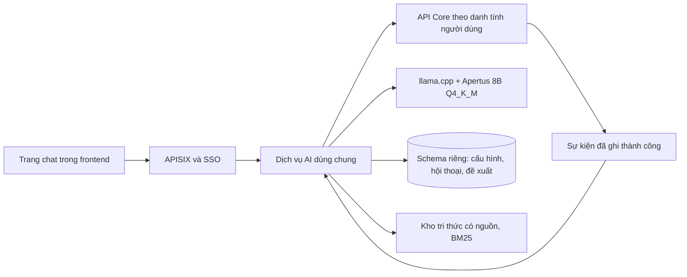

# Trợ lý AI trên web

Bộ tài liệu thiết kế cho [issue #210](https://github.com/HaUI-ImplSolution/DX-OS/issues/210), chờ tech lead review trước khi triển khai.
Đây là mục tiêu dự kiến, chưa phải mô tả tính năng đã có hay bằng chứng nghiệm thu.

| Tài liệu | Nội dung |
|---|---|
| [Overview](./00_OVERVIEW.md) | Mục tiêu, phạm vi và kiến trúc |
| [Plan](./01_PLAN.md) | Hợp đồng, thứ tự triển khai và cách kiểm |
| [Checklist](./02_CHECKLIST.md) | Điều kiện hoàn thành và cổng review |
| [Tradeoffs và risks](./03_TRADEOFFS_RISKS.md) | Đánh đổi, rủi ro và quyết định cần review |

## 1. Quy tắc áp dụng

Tuân thủ quy tắc làm việc do người dùng cung cấp, `CONTRIBUTING.md` và cấu hình build/CI của nhánh hiện tại.
Quyết định mới nhất của người dùng cho phép viết bốn tài liệu này trong `docs/ai-assistant/`, ngang hàng với `docs/dynamic-core/`.
Chỉ lập kế hoạch trong lượt này; chưa sửa code, dependency, tài liệu định hướng hoặc nội dung issue trên GitHub.
Không stage, commit, push, tạo PR, merge, đóng issue, gửi bình luận hoặc phân công subagent khi chưa có quyền tương ứng.
Mọi bước triển khai phải giữ Core độc lập nghiệp vụ, ưu tiên cơ chế có sẵn và chỉ thêm thành phần thực sự cần.
Không thêm test file hoặc framework nếu chưa được cho phép; mặc định backend kiểm compile và diff, test source thì test-compile.
Các ca chức năng trong plan là tiêu chí cần kiểm khi bước kiểm tích hợp được duyệt, không phải quyền tải/chạy model hoặc khởi động stack ngay trong lượt viết tài liệu.
Chỉ đánh dấu đạt khi có bằng chứng đúng phiên bản mã được kiểm; giữ nghiệm thu của tech lead và người dùng riêng với kết quả kỹ thuật.

## 2. Mục tiêu đã thống nhất

Người dùng hỏi đáp và xử lý công việc qua một trang chat trong DX-OS.
Kế hoạch dùng LLM self-host do người triển khai vận hành trong hạ tầng DX-OS.
Model khởi đầu là Apertus 8B Instruct lượng tử hóa chạy qua `llama.cpp`; khảo sát Q4_K_M trước và Q5_K_M đối chứng khi cần.
Mã tích hợp, runtime và model phải được kiểm theo chính sách nguồn mở; chưa coi cấu hình này đã được triển khai hoặc nghiệm thu.
Giao diện theo cách bố trí của Gemini, dùng thành phần và chủ đề sẵn có của DX-OS.
Truy xuất bắt đầu nhẹ bằng bộ lọc Core và BM25 cho kho tài liệu, chưa dùng model embedding hoặc reranker riêng.
Kho tri thức kiểm chứng dùng nội dung giả lập do đội tự viết, ghi rõ tính chất minh họa và quyền sử dụng.

### Ranh giới nguồn mở

Giấy phép mã tích hợp và độ mở của model là hai khái niệm riêng.
Mục tiêu là pipeline self-host đáp ứng [Open Source AI Definition của OSI](https://opensource.org/ai/open-source-ai-definition).
Cần kiểm riêng giấy phép, trọng số, mã và thông tin dữ liệu huấn luyện/hậu huấn luyện của đúng phiên bản cùng nguồn gốc bản lượng tử hóa trước khi kết luận đạt OSAID.
Tính năng AI cần backend suy luận đã được người triển khai bật và kiểm; khi backend chưa khả dụng, nghiệp vụ DX-OS vẫn chạy.
Dữ liệu hội thoại và bằng chứng được xử lý trong hạ tầng self-host; kiểm luồng mạng để chứng minh nội dung không bị gửi ra dịch vụ suy luận bên ngoài.
Tech lead review hồ sơ nguồn mở và kết quả đo trước khi tích hợp; việc chạy nội bộ chưa đủ chứng minh đạt OSAID.

## 3. Phạm vi chức năng

| Nhóm | Hành vi dự kiến |
|---|---|
| Suy luận | Backend self-host do người triển khai cấu hình; người dùng xem trạng thái khả dụng và dùng model đã được phép |
| Hội thoại | Tạo hội thoại, xem lịch sử, đổi tên, xóa; mỗi hội thoại gắn với một tài khoản và một mô hình nghiệp vụ |
| Tra cứu | Đọc metadata, hộp việc, danh sách theo bộ lọc, chi tiết, lịch sử, thống kê và người nhận hợp lệ |
| Hỏi đáp tri thức | Tìm đoạn tài liệu thuộc mô hình đang chọn, trả lời có trích dẫn và báo thiếu bằng chứng |
| Đề xuất từ hội thoại | Giao việc, trả việc về nhóm và hành động chuyển trạng thái theo metadata; xác nhận bằng nút trên web |
| Đề xuất theo sự kiện | Khi được cấu hình, sự kiện hồ sơ tạo đề xuất giá trị một trường; người có quyền xem và xác nhận trước khi áp dụng |

Đề xuất theo sự kiện được giữ trong bản thiết kế để không mặc nhiên bỏ phần tác tử của #210 ban đầu.
Ranh giới cấu hình và danh tính chạy nền của phần này cần tech lead chốt tại cổng review đầu tiên của plan.

Không đưa bot, kênh nhắn tin ngoài, shell, trình duyệt tự động, SQL tùy ý, quản trị ghi, tạo/xóa hồ sơ tùy ý hoặc ghi tự động vào phạm vi.
Không xây chỉ mục toàn văn cho hồ sơ và tệp nghiệp vụ; tra cứu hồ sơ dùng API và quyền hiện có.
Không thêm OCR, kho vector hoặc nền tảng agent vào bản đầu.
Embedding/reranker riêng chỉ là ứng viên nâng cấp sau khi đo BM25; không mặc định cài mọi thành phần được khảo sát.

## 4. Kiến trúc đề xuất

Một tiến trình AI dùng chung phục vụ nhiều tài khoản; không tạo container hoặc runtime cho mỗi người.
Ưu tiên khảo sát Haystack để dùng lại pipeline truy xuất; nếu chọn, dịch vụ `ai/` dùng Python và các component cần thiết, tách khỏi bốn module backend.
So sánh với phương án TypeScript tối thiểu trước khi chốt stack; không duy trì hai dịch vụ điều phối chỉ để ghép thư viện.
Frontend dùng React, Material UI, chủ đề, đăng nhập và cơ chế dịch hiện có.
Dịch vụ AI gọi API Core, không đọc hoặc ghi trực tiếp bảng nghiệp vụ và không dùng Keycloak Admin.
PostgreSQL hiện có giữ schema AI riêng với người dùng DB riêng; không thêm máy chủ database.
Các thư viện máy chủ, JWT và PostgreSQL là ứng viên cần kiểm giấy phép đúng phiên bản trước khi thêm manifest.
`llama.cpp` chạy thành tiến trình suy luận dùng chung, không giữ khóa Core hoặc tự kiểm quyền thay dịch vụ AI.
Khảo sát bắt đầu bằng Q4_K_M, ngữ cảnh 4.096 token và một lượt xử lý tại một thời điểm; Q5_K_M dùng đối chứng khi cần.
Lấy kết quả đo chất lượng tiếng Việt, gọi công cụ, RAM/CPU và ảnh hưởng tới Core để chốt cấu hình self-host đủ điều kiện phát hành.
Chi tiết thư viện có sẵn, đánh đổi lượng tử hóa và cổng quyết định ở [plan](./01_PLAN.md).

## 5. Trải nghiệm sử dụng

Người dùng mở trợ lý, chọn mô hình nghiệp vụ rồi tạo hội thoại.
Nếu backend suy luận chưa khả dụng, trang hiển thị trạng thái và hướng xử lý cho người triển khai thay vì chặn phần nghiệp vụ.
Thanh bên giữ hội thoại của mô hình hiện tại; thanh trên hiển thị model self-host đang dùng và mở cài đặt hội thoại.
Vùng chính dành cho tin nhắn; ô nhập nhiều dòng ở dưới có gửi, dừng nhận câu trả lời và trạng thái đang xử lý.
Câu trả lời hiển thị nguồn tài liệu, liên kết hồ sơ và thẻ đề xuất ngay trong hội thoại.
Thẻ xác nhận nêu hồ sơ, thao tác, người nhận hoặc giá trị cũ/mới, ảnh hưởng và thời hạn.
Đổi mô hình nghiệp vụ mở hội thoại riêng, không mang ngữ cảnh mô hình cũ sang model suy luận.
Mobile thu gọn thanh bên; hỗ trợ bàn phím, trạng thái rỗng/lỗi, sáng/tối và giảm chuyển động.

## 6. Điều kiện hoàn thành

Backend self-host chạy đúng GGUF/runtime trên máy đích và có kết quả kiểm nguồn mở, tiếng Việt, nguồn trích, công cụ và xác nhận.
Chưa đạt chất lượng hoặc ngân sách vận hành thì tiếp tục xử lý phần còn thiếu, không công bố đã hoàn thành #210.
Hai tài khoản dùng đồng thời không đọc được cấu hình, hội thoại, tài liệu riêng hoặc đề xuất của nhau.
Công cụ hoạt động trên ba họ `approval`, `work_item`, `reservation` mà không thêm tên nghiệp vụ vào mã dùng chung.
Thao tác ghi chỉ xảy ra sau xác nhận hợp lệ; Core kiểm quyền, phiên bản và luật nghiệp vụ trong giao dịch.
Khi AI lỗi hoặc chưa cấu hình, Core và giao diện nghiệp vụ vẫn dùng được.
Không gọi #210 hoàn thành khi phần đã giữ trong phạm vi chưa được kiểm hoặc chưa có quyết định thay đổi phạm vi.
Các bước, ca kiểm và giới hạn cụ thể ở [plan](./01_PLAN.md) và [checklist](./02_CHECKLIST.md).
