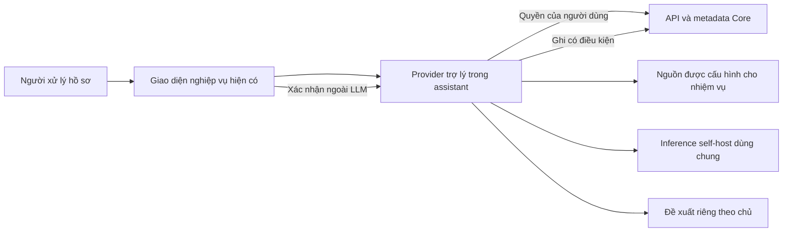

# Trợ lý nghiệp vụ động

Sản phẩm trợ lý nghiệp vụ động có dịch vụ, API, cấu hình và vòng đời triển khai riêng, kết nối Dynamic Core qua API và metadata.
Khả năng đầu tiên là đọc hồ sơ cùng nguồn được cấu hình, đề xuất giá trị cho một trường và chờ người dùng xác nhận.
Giao diện hồ sơ là điểm tích hợp đầu tiên để sử dụng sản phẩm.

| Mục | Phạm vi kế hoạch |
|---|---|
| Mục tiêu | Hỗ trợ người dùng xử lý hồ sơ trên giao diện nghiệp vụ, dùng được với nhiều mô hình |
| Năng lực đầu tiên | Đề xuất giá trị cho một trường từ hồ sơ và nguồn được cấu hình, có người xác nhận |
| Tính động | Tên thực thể, trường đầu vào/đầu ra, lựa chọn, hướng dẫn và nguồn lấy từ mô hình; không viết nhánh mã theo ngành |
| Cách làm nhẹ | Một hồ sơ, một nhiệm vụ, một lượt suy luận; hệ thống chuẩn bị ngữ cảnh, LLM không tự tìm công cụ |
| Triển khai | Dịch vụ trợ lý độc lập trong `assistant/`, tích hợp Core theo vai trò provider và dùng một inference self-host chung |
| Giao diện | Tích hợp đầu tiên trên màn hồ sơ hiện có, gọi API của sản phẩm trợ lý |
| Trạng thái | Đã triển khai local; đang kiểm tích hợp và chờ người dùng nghiệm thu |

## 1. Trải nghiệm đích

Người dùng mở hồ sơ, chọn một nhiệm vụ AI được mô hình khai báo và xem tên trường cùng giá trị đề xuất.
Trường đầu vào choice/unit có thể được đối chiếu với giá trị theo nguồn để hiển thị lưu ý; nguồn tham khảo mặc định thu gọn.
Lưu ý không tự đổi trường khác ngoài trường được xác nhận.
Người dùng có thể sửa nội dung, xác nhận hoặc hủy.
Chỉ kết quả ghi thành công từ Core mới được hiển thị là đã lưu.
AI không tự duyệt hồ sơ, chuyển trạng thái, giao việc hoặc sửa YAML.

Cùng cơ chế đề xuất trường có thể soạn nội dung cần bổ sung cho hồ sơ sinh viên, phân loại yêu cầu mua sắm hoặc phân loại sự cố.
Các ví dụ dùng dữ liệu và hướng dẫn giả lập có giấy phép rõ ràng, không đại diện quy chế thật.
Dữ liệu demo và bộ khảo sát nằm ngoài Git; bản cài nạp danh mục nguồn riêng, không mở rộng allowlist giấy phép của repository.
Một mô hình không khai báo AI vẫn hoạt động bình thường.
Đổi domain trong phạm vi trường và quy trình mà Core hỗ trợ chỉ thay cấu hình cùng nguồn; năng lực mới vượt hợp đồng này vẫn cần phần mở rộng.

## 2. Kiến trúc và ranh giới

Core vẫn là dịch vụ headless với bốn module và giữ quyền, dữ liệu, giao dịch cùng quy trình.
Mở rộng schema mô hình chỉ thêm hợp đồng AI trung tính; logic suy luận và nguồn tri thức nằm ngoài Java Core.
LLM chỉ nhận dữ liệu đã được phép đọc, hướng dẫn nhiệm vụ và nguồn tương ứng; không nhận token, quyền xác nhận hoặc kết nối DB.
Danh sách đầu vào/đầu ra của nhiệm vụ giới hạn dữ liệu sử dụng, không tạo cơ chế phân quyền theo trường mới.

## 3. Phạm vi sản phẩm

Provider quản lý liên kết SSO, ngữ cảnh, đề xuất và xác nhận; inference chạy tại máy chủ do người vận hành cấu hình.
Giao diện hồ sơ dùng metadata và nhiệm vụ trong YAML, không có nhánh mã riêng theo ngành.
Core giữ quyền, dữ liệu, quy trình và giao dịch.
Hỏi đáp tổng quát, sinh YAML, truy xuất vector và đề xuất tự tạo theo sự kiện chưa thuộc bản này.
Cách triển khai ở [plan](./01_PLAN.md); cấu hình đầy đủ ở [`deploy/.env.example`](../../deploy/.env.example).

## 4. Đối chiếu yêu cầu

[Đề PMNM 2026](https://vfossa.vn/tin-tuc/de-thi-phan-mem-nguon-mo-olp-2026-798.html) yêu cầu nền tảng headless và ứng dụng minh họa, với Identity/SSO, API Gateway, dữ liệu và workflow ở lõi.
Trợ lý là một năng lực I dùng dữ liệu D từ quy trình P và danh tính H; không thay các yêu cầu nền tảng hoặc tự chứng minh toàn bài thi đã đạt.
[Dynamic Core](../dynamic-core/README.md#3-tác-tử-ai-có-người-duyệt) định hướng AI là provider ngoài lõi, có căn cứ và người duyệt.
Phạm vi là đề xuất giá trị một trường có người duyệt, đáp ứng chữ I của đề; đề không nêu số thành phần của nhóm I phải làm.
Hỏi đáp sinh câu trả lời, tác tử tự khởi tạo đề xuất theo sự kiện và embedding/reranker không nằm trong phạm vi, ghi ở mục 4 của [BACKLOG](../dynamic-core/BACKLOG.md).
Phạm vi trợ lý được theo dõi tại [#210](https://github.com/HaUI-ImplSolution/DX-OS/issues/210).

## 5. Điều kiện chấp nhận

- Hai domain dùng cùng provider và UI, đổi trường/lựa chọn bằng YAML không cần sửa hoặc build lại mã nghiệp vụ.
- Không có giá trị ngoài schema, nguồn giả, đọc chéo chủ hoặc ghi trước xác nhận.
- Xác nhận kiểm lại quyền, phiên bản hồ sơ, phiên bản mô hình và cấu hình nhiệm vụ trước khi ghi.
- Model tắt hoặc lỗi không cản thao tác nghiệp vụ thông thường.
- Chất lượng tiếng Việt, tài nguyên và giấy phép được kiểm trên luồng nghiệp vụ hiện hành.

Mã/runtime phải có giấy phép OSI; model và dữ liệu còn phải đạt cam kết nguồn mở chặt hơn trong Dynamic Core.
Model mặc định là [Apertus-8B-Instruct-2509](../../assistant/README.md#inference-và-nguồn-tri-thức), bản local GGUF Q4; hồ sơ artifact và dữ liệu vẫn cần kiểm theo cam kết OSAID.
Chi tiết ở [plan](./01_PLAN.md), [checklist](./02_CHECKLIST.md), [test plan](./03_TEST_PLAN.md) và [đánh đổi/rủi ro](./04_TRADEOFFS_RISKS.md).
