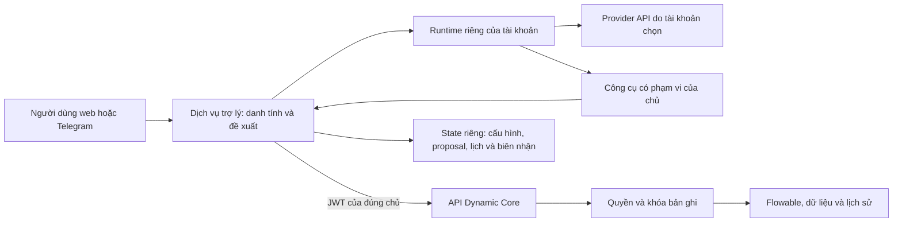

# Trợ lý hồ sơ đa người dùng

| Mục | Giá trị |
|---|---|
| Trạng thái | Đã triển khai và kiểm khởi động chung; nghiệm thu còn mở theo checklist |
| Mức độ | Quan trọng |
| Nhóm ưu tiên | Hoàn thiện tích hợp vào cách chạy hiện có của Core |
| Nhánh | `Khuong/assistant-platform-plan`, tách từ `origin/Khuong/main` đã cập nhật |
| Module chính | Dịch vụ mở rộng `assistant/`, frontend, hạ tầng tùy chọn; điều kiện ghi và metadata trong `dx-engine` |
| Phụ trách | Nhóm phát triển; chủ dự án duyệt phạm vi trước triển khai |
| Quy mô đầu tiên | 2 tài khoản hoạt động đồng thời, mỗi tài khoản có trợ lý riêng; thử tải 3 tài khoản theo BACKLOG |

## 1. Tham chiếu

| Nguồn | Nội dung áp dụng |
|---|---|
| Quyết định của người dùng | Tích hợp theo kiến trúc hiện tại, đa nhà cung cấp API, nhiều tài khoản; đọc tự động, mọi thao tác ghi cần xác nhận |
| `docs/dynamic-core/README.md`, mục Miền phục vụ, Kiến trúc và Điểm mở rộng | Quy trình chung cho bản ghi có vòng đời; phần mở rộng gọi Core qua API, không mang nghiệp vụ ngành vào kernel |
| `ARCHITECTURE.md`, `backend/README.md`, `docs/API.md` | Bốn module, JDBC, Flowable, API và ranh giới định danh hiện hành |
| `catalog/ProcessDiagramService.java` và Console hiện tại | Dùng lại sơ đồ quy trình từ YAML, không dựng trình phân tích hoặc sơ đồ riêng cho AI |
| `docs/dynamic-core/BACKLOG.md` | Không mở lại quyền theo trường, ủy quyền, nhiều backend hoặc duyệt nhiều cấp |
| `website/docs/templates/` | Năm tài liệu tổng quan, kế hoạch, checklist, kiểm thử và rủi ro |
| `WORKING_GUIDE.md`, memory/rules trong bộ hướng dẫn ngày 03/11/2026 | Spec → Swagger → Code, comment ngắn, mỗi câu Markdown một dòng, không tự commit/push |
| `claude-export-delta-20261105-chieu.tar.gz`: bốn memory mới và chỉ mục | Dependency mở cả build/test, test tối thiểu, xử lý trọn backlog và không mở lại ý tưởng đã loại |
| `CONTRIBUTING.md`, `DEPENDENCIES.txt`, `sbom/README.md` hiện hành | Convention thực tế, API/lỗi/dịch, dependency và hồ sơ giấy phép của nhánh cha |
| AI `AGENTS.md`, skill Spring Boot, code-quality, logging-patterns, verification-before-completion trong bản lưu | Tái sử dụng, kiểm quyền ở ranh giới, giao dịch và bằng chứng kiểm chứng; mã hiện tại được ưu tiên hơn ví dụ kiến trúc cũ |

Nguồn tham khảo công nghệ: [bảo mật OpenClaw](https://docs.openclaw.ai/gateway/security), [multi-user](https://docs.openclaw.ai/concepts/multi-user), [provider](https://docs.openclaw.ai/concepts/model-providers), [custom provider](https://docs.openclaw.ai/gateway/config-tools/custom-providers), [Fastify](https://fastify.dev/docs/latest/Reference/Validation-and-Serialization/), [SQLite của Node](https://nodejs.org/docs/latest-v24.x/api/sqlite.html).
Các tài liệu này là căn cứ thiết kế; API cụ thể phải đối chiếu bản runtime được khóa ở WPAS-01.

## 2. Lý do

Core đã có API hồ sơ, giao việc, quy trình, thống kê và quản trị.
Trợ lý cần biến yêu cầu ngôn ngữ tự nhiên thành đề xuất rõ ràng và thao tác qua các API đó, giúp người dùng làm việc ngay trên Telegram.
Giá trị nằm ở rút ngắn quy trình tìm hồ sơ, chọn người xử lý, xác nhận và kiểm kết quả, không nằm ở thay thế luật nghiệp vụ bằng LLM.

Bản tích hợp đã kiểm Gemini/Telegram, đọc hồ sơ và thao tác có xác nhận.
Hai trợ lý Gemini/Telegram đã được kiểm đồng thời; provider thứ hai và thử tải ba trợ lý hoãn tại BACKLOG.

## 3. Tổng quan sửa đổi

Một dịch vụ trợ lý độc lập quản lý tài khoản, cấu hình provider, đề xuất và thông báo.
Mỗi tài khoản liên kết Keycloak, API key và Telegram bot riêng; runtime OpenClaw được cách ly theo tài khoản.
Công cụ được sinh từ metadata và danh mục thao tác được phép, còn Core kiểm quyền, trạng thái và giao dịch.
Giao diện dùng lại react-admin/MUI và auth hiện có.
Trợ lý được triển khai cùng DX-OS; người dùng tùy chọn sử dụng bằng cấu hình API và kích hoạt tài khoản.
Không yêu cầu chạy Compose riêng hoặc lệnh bật hạ tầng trợ lý trước khi sử dụng.
Chưa cấu hình API thì Core vẫn hoạt động, không khởi chạy gateway OpenClaw hoặc gọi nhà cung cấp thay người dùng.

| Khu vực | Có đổi | Phạm vi |
|---|---|---|
| `dx-model` | Không | Giữ định dạng YAML, họ quy trình và mẫu hiện có |
| `dx-core` | Không | Dùng lại xác thực, audit, lỗi và envelope; không đưa SDK LLM vào thư viện lõi |
| `dx-engine` | Có, giới hạn | Điều kiện phiên bản cho action/assign; metadata phiên bản và tóm tắt tác động sau quyết định |
| `dx-monitor` | Không | Chỉ dẫn người dùng tới màn hình có sẵn, không làm đường điều khiển vận hành mới |
| `assistant/` | Có | Dịch vụ tùy chọn và plugin OpenClaw, đa người dùng/provider, kho state và thực thi đề xuất |
| Frontend | Có | Cấu hình trợ lý cá nhân, hướng dẫn, đề xuất, lịch sử thao tác và trạng thái |
| Migration nghiệp vụ | Không | Không đổi schema `m_*`, Flyway Core hoặc Flowable |
| State trợ lý | Có | SQLite riêng và dữ liệu runtime riêng, không truy vấn trực tiếp DB nghiệp vụ |
| Deploy/CI/docs | Có, theo WPI-01–04 | Khởi động chung, giữ cách cài và kiểm của cha; sửa docs đúng nhóm hiện có |

## 4. Phạm vi và kiến trúc

Miền của trợ lý là hỗ trợ quản lý hồ sơ có vòng đời trên Dynamic Core, dùng được ở nhiều ngành.
Không có tên thực thể, vai hoặc nhóm quyền của một nghiệp vụ trong mã dùng chung.
Lõi điều phối trợ lý nằm trong `assistant/`, không phải đưa LLM vào module Java `dx-core`.
Không thêm đường SQL, Keycloak Admin hoặc HTTP tùy ý cho LLM.

Trong phạm vi: đọc/tổng hợp có nguồn, giao và trả việc, hành động của ba họ mẫu hiện có, thông báo/nhắc hạn và hỗ trợ quản trị có giới hạn.
Ngoài phạm vi: Farm/Lab, CV, RAG/vector DB, huấn luyện hoặc chạy LLM local, MCP, agent teams, kênh ngoài Telegram, sinh/áp dụng YAML tự động, thao tác ghi tự hành và tác vụ hàng loạt.
Không mở quyền theo trường, duyệt nhiều cấp, cơ chế ủy quyền hay mở rộng kernel quy trình.
Không khôi phục các ý tưởng đã loại như nhập CSV, model pack kèm dữ liệu, tìm toàn văn, migration phiên bản process hoặc đăng ký nhận thông báo trong Core.
Tùy chọn nhận tin cá nhân của trợ lý chỉ điều khiển polling/ledger bên dịch vụ mở rộng, không bổ sung subscription API hoặc bảng nghiệp vụ vào Core.
Lưu và khôi phục không gian hội thoại theo mô hình được hoãn sang [backlog của trợ lý](./04_TRADEOFFS_RISKS.md#backlog-không-gian-hội-thoại-theo-mô-hình); việc kiểm quyền và tách dữ liệu giữa các mô hình vẫn bắt buộc trong đợt này.

### Ranh giới nhiều người dùng

Không dùng một gateway OpenClaw chung rồi coi khác session ID là đã cách ly dữ liệu.
Mỗi chủ có gateway, workspace, kênh, credential và volume riêng; runtime token bị buộc với chủ ở dịch vụ trợ lý.
Runtime chạy trong container không đặc quyền, không có Docker socket, không có mount repository hoặc volume của người khác.
Người vận hành cấp 2–3 runtime qua lệnh triển khai; giao diện chỉ kích hoạt/dừng runtime đã cấp, không nhận lệnh Docker hay đường dẫn host.
Một bot không được gắn cho hai chủ; kiểm bằng bot ID đã xác minh từ Telegram.

Nghiệm thu đợt này với 2 runtime đồng thời; thử tải 3 runtime được hoãn theo quyết định của chủ dự án; không phải một nền tảng đa tenant quy mô lớn.
Giới hạn CPU/RAM của dịch vụ và từng runtime nằm trong `deploy/.env.example`.
Số đo hai tài khoản nằm trong kế hoạch kiểm thử; chưa nghiệm thu ba gateway hoạt động đồng thời.
Người vận hành chọn số runtime theo tài nguyên máy; hệ thống không tự kiểm RAM khả dụng trước khi cấp slot.
Không dùng chung runtime để thay cho slot còn thiếu.

## 5. Danh mục tính năng

| Vai trò/năng lực | Làm trong đợt này | Ranh giới |
|---|---|---|
| Người có quyền đọc | Hộp việc, tìm theo bộ lọc Core, hồ sơ, lịch sử, thống kê và tóm tắt | Chỉ dữ liệu API trả theo JWT của người hỏi; không gọi là tìm toàn văn |
| Điều phối/người xử lý | Tìm người giao được, đề xuất giao/đổi người/trả việc về nhóm | Dùng `/handlers`, không đoán tài khoản hoặc yêu cầu nhập UUID |
| Người xử lý/người tạo | Hành động trong metadata của `work_item`, `approval`, `reservation` | Mọi lần ghi có xác nhận; actor, note, trạng thái, booking và phiên bản vẫn do Core kiểm |
| Thông báo tự động | Việc mới, được giao, cần bổ sung, nhắc hạn và bản tổng kết theo lịch | Đọc tự động; thẻ cố định không gọi LLM; không xây lại auto-close hoặc outbox Core |
| Gợi ý điều phối | Gợi ý từ danh sách hợp lệ và số liệu khối lượng việc nhìn thấy được | Không tự giao; không tuyên bố người ít việc nhất tổ chức khi thiếu dữ liệu |
| ADMIN | Tóm tắt mô hình/run bị giữ, outbox lỗi, audit và giải thích kế hoạch thay đổi do người dùng cung cấp | Dùng API ADMIN hiện có; dữ liệu lỗi/payload được rút gọn và che thông tin nhạy cảm |
| ADMIN can thiệp hệ thống | Dẫn tới màn hình quản trị và giải thích tác động | Không có tool apply/rollback/resume/abandon, cấp vai, reset mật khẩu, archive, SQL hoặc retry outbox trong đợt này |

`ADMIN` của nền tảng không tự có quyền đọc/xử lý mọi hồ sơ.
Người đó vẫn cần vai và phạm vi của mô hình khi dùng công cụ nghiệp vụ.
Hành động có tác động thêm/bớt thành viên nhóm phải hiển thị tác động và xác nhận trên web; không kết luận quyền đã được cấp khi Core mới đưa tác vụ vào outbox.

## 6. Kết quả đầu ra mong đợi

- Hai tài khoản có cấu hình, hội thoại, thông báo và proposal riêng; gọi chéo hoặc bấm thẻ của người khác bị từ chối.
- Cấu hình adapter Gemini, OpenAI và Anthropic có sẵn của OpenClaw; endpoint OpenAI-compatible tạm khóa đến khi kiểm transport đầy đủ.
- Không quảng cáo một provider/model đã sẵn sàng chỉ vì lấy được danh sách model; phải kiểm tool calling và luồng xác nhận thật.
- Giao việc rồi người được giao nhận/xử lý, người tạo xác nhận hoặc yêu cầu mở lại; trạng thái và người thực hiện khớp lịch sử Core.
- Thử trên ba họ mẫu và ít nhất ba mô hình thuộc các lĩnh vực khác nhau mà không sửa mã lõi theo mô hình.
- Bản cài dùng `dxos start`; mã nguồn dùng `deploy/make_env.sh` rồi `docker compose up -d --build` trong `deploy/`, không cần Compose hoặc lệnh chuẩn bị trợ lý riêng.
- Chưa có API/bot vẫn mở Core và trang cấu hình; chỉ gateway của tài khoản đủ cấu hình và được kích hoạt mới chạy.
- Dừng hoặc lỗi trợ lý không làm thay đổi dữ liệu và quyền nghiệp vụ Core.
- Các giới hạn, số đo 2 người và provider chưa được thử thật được ghi rõ, chỉ kết luận theo bằng chứng của bản tích hợp.

## 7. Thứ tự

WPAS-01 → WPAS-02; WPAS-03 và WPAS-04 sau hợp đồng; WPAS-05 → WPAS-06 → WPAS-07 → WPAS-08.
Chi tiết ở [kế hoạch](./01_PLAN.md), [checklist](./02_CHECKLIST.md), [kiểm thử](./03_TEST_PLAN.md), [rủi ro](./04_TRADEOFFS_RISKS.md).

## 8. Giá trị và cam kết nguồn mở

Chứng minh được chuỗi công việc: yêu cầu mới → trợ lý giúp hiểu/chọn thao tác → người xác nhận → Core thực hiện và ghi lịch sử.
Khả năng đa ngành được chứng minh bằng đổi mô hình và phân quyền, không bằng câu trả lời tự giới thiệu của LLM.
Mã tự viết theo Apache-2.0; runtime và mọi dependency phải qua chính sách giấy phép hiện tại.
API thương mại là lựa chọn bên ngoài do người dùng cấp, không được mô tả là mô hình Open Source AI hoặc đáp ứng mục AI hoàn toàn mở của backlog.
Yêu cầu mới dùng API không làm thay đổi cam kết hoặc bộ cài Core mặc định.

## 9. Quyết định và điểm cần chốt khi review

| Mục | Trạng thái |
|---|---|
| Nhiều tài khoản, trợ lý riêng; nghiệm thu 2 đồng thời, hoãn thử tải 3 vào BACKLOG | Người dùng đã chốt |
| Đọc tự động, mọi thao tác ghi phải xác nhận | Người dùng đã chốt |
| Tập trung Dynamic Core hiện tại, không hồi sinh Farm/Lab | Người dùng đã chốt |
| API key và bot riêng mỗi người | Đã chốt; không dùng key của ADMIN thay cho người khác |
| Tách runtime và provision từ công cụ triển khai | Đã triển khai; kiểm hai runtime tại TAS-06/TAS-39 |
| Dịch vụ Node/TypeScript, Fastify, SQLite riêng | Đã triển khai; không thêm module Maven hoặc DB server |
| Tác động nhạy cảm xác nhận trên web, quản trị hệ thống chỉ đọc/handoff | Đã triển khai; kiểm tại TAS-27/TAS-41 |

## 10. Tài liệu khi triển khai

Cập nhật README Việt/Anh và trang tài liệu bằng kết quả cuối, `docs/API.md`, `ARCHITECTURE.md`, hướng dẫn vận hành/tích hợp, tài liệu riêng của trợ lý và Swagger tương ứng.
Cập nhật giấy phép thành phần trong `DEPENDENCIES.txt`, ghi công trong `NOTICE`, danh mục đầy đủ trong SBOM và danh mục thành phần của CI.
Không đánh dấu đã hoàn thành mục Open Source AI trong backlog chỉ vì tích hợp được API.
Không sửa `docs/dynamic-core/README.md` định hướng nếu chưa có quyết định riêng của chủ dự án.

## 11. Xử lý review PR #199

Phạm vi đợt này là khắc phục nhận xét của PR, không bổ sung tính năng trợ lý hoặc thay hướng Dynamic Core.
Kế hoạch xử lý nằm ở WPRV-01–WPRV-06 trong [kế hoạch](./01_PLAN.md#xử-lý-review-pr-199).

| Ranh giới | Quyết định |
|---|---|
| Core | Hoãn tối ưu đọc phiên bản; làm rõ metadata tác động và định dạng helper do PR thêm; giữ khóa, transaction, trường `require`, `handlers` và `handlerActions` của cha |
| Trợ lý | Kiểm cách ly chủ/runtime và bảo vệ endpoint provider; không thêm provider hoặc kênh mới |
| Deploy | Bỏ sao chép lệnh gateway; mô tả đúng backup và kiểm phục hồi; Core off/on giữ lệnh khởi động hiện có |
| License/CI | Ngoại lệ theo đúng gói; không mở rộng danh sách giấy phép chung hoặc làm yếu check của cha |
| Tài liệu | Đồng bộ các tài liệu liên quan trực tiếp; không sửa định hướng `docs/dynamic-core/README.md`, không đụng Farm/Lab |
| Dữ liệu | Không migration Core, không sửa YAML nghiệp vụ, không đưa dữ liệu thật hoặc khóa vào Git |

Trợ lý dùng API mô hình do từng người dùng cấu hình; đây là dịch vụ bên ngoài, không phải mô hình nguồn mở do dự án phân phối.
Hai gói dữ liệu định danh SPDX được khai theo giấy phép gốc trong hồ sơ dependency.
Trạng thái từng ca bảo mật và hồi quy nằm trong [kế hoạch kiểm thử](./03_TEST_PLAN.md).
Chỉ đề nghị merge sau khi các rào chắn bảo mật và hồi quy đạt; giới hạn còn lại phải có quyết định chấp nhận rõ ràng.

## 12. Quyết định xử lý review bổ sung

Hạ tầng trợ lý đi cùng cách khởi động DX-OS; cấu hình và kích hoạt sử dụng thuộc từng tài khoản.
Trạng thái kiểm chứng và các tiêu chí chưa đạt nằm trong [kế hoạch kiểm thử](./03_TEST_PLAN.md).
Gemini, OpenAI và Anthropic dùng endpoint cố định; chỉ Gemini có bằng chứng hội thoại thật, chưa nghiệm thu cả ba provider.

| Nội dung | Quyết định | Trạng thái |
|---|---|---|
| Trợ lý chưa cấu hình | Menu cấu hình có sẵn; chưa có API thì không khởi chạy gateway cá nhân hoặc gọi model | Cần kiểm lại theo TDI-02–05 |
| Lỗi HTTP | JSON sai trả 400, nội dung quá giới hạn trả 413; lỗi nội bộ trả 500 với thông báo chung | Đạt qua gateway và test hiện có |
| Mạng control | Dùng mạng API và ingress riêng; không nối control vào mạng DB | Đạt kiểm TCP/DNS |
| Kết nối Internet của runtime | Giữ Gemini/OpenAI/Anthropic, tắt endpoint tùy chỉnh; chưa có allowlist toàn container | Chưa hoàn tất; theo dõi trong BACKLOG |
| Origin | Chỉ nhận đúng địa chỉ công khai đã cấu hình | Giữ kiểm chống CSRF; không mở nhiều origin |
| Backup | Key và token nằm cùng kho restic; người giải mã có thể đọc bí mật hoặc giả danh runtime | Quản lý khóa/token riêng và thu hồi credential còn trong BACKLOG |
| Schema và PATCH | Bỏ trường ngoài schema, lấy danh tính từ JWT; PATCH cấu hình API cần đủ trường | Hợp đồng hiện có, đã kiểm |
| Liên kết Core | Chưa liên kết trả 409; phiên xác thực sai hoặc hết hạn trả 401 | Đã kiểm 409/401 |
| Phiên bản metadata | Đọc trực tiếp từ database, giữ kiểm phiên bản trong giao dịch | Tối ưu truy vấn còn trong BACKLOG |

Các mục chưa đạt vẫn là công việc cần hoàn thiện; trạng thái tích hợp không thay thế nghiệm thu bảo mật và vận hành.

## 13. Điều chỉnh khởi động chung và docs

Yêu cầu hiện hành: tùy chọn sử dụng trợ lý theo tài khoản, không tùy chọn một stack triển khai riêng.
Phạm vi WPI-01–04 là các review mới về NOTICE, TESTING, API, OPERATIONS và Compose.
Không đổi nghiệp vụ, provider, công cụ, cơ chế xác nhận hoặc quyền trong bốn module Core.

| Phần | Quyết định |
|---|---|
| Khởi động | Control, bootstrap và pool supervisor nằm trong Compose chính; không cần file `-f` hoặc profile riêng để có trợ lý |
| Chưa cấu hình | Chỉ control/supervisor chờ cấu hình; không chạy gateway OpenClaw, probe hoặc heartbeat LLM |
| Theo tài khoản | Giữ SSO, API key và bot riêng, probe có đồng ý, pairing và thao tác kích hoạt trên giao diện |
| Pool | Khai báo ba supervisor cách ly trong Compose chính, giới hạn cấp phát mặc định hai slot; slot dự phòng không tự chạy gateway; không giảm binding cũ |
| Bí mật | Bootstrap idempotent trước control/runtime; cấu hình mỗi runtime chỉ nằm trong thư mục của runtime đó |
| SSO | Tạo hoặc đồng bộ client PKCE bằng bootstrap tự động có quyền riêng; control/runtime không nhận Keycloak admin credential |
| Giá trị env | Mặc định ở env.example, được bộ cài/make_env nạp tự động; không đưa key người dùng vào env và không thêm fallback Compose |
| Docs | Ghép vào phần hiện có của cha; hướng dẫn kích hoạt trong README trợ lý, không viết lại tài liệu tổng |

Chỉ sửa các file trong bảng phạm vi WPI; không dọn checkout cũ hoặc thay đổi toàn bộ quy trình deploy.
Giới hạn egress, bảo vệ khóa backup, provider thứ hai và tải ba gateway vẫn theo BACKLOG; không tính các mục đó đã xong nhờ đổi Compose.
Nghiệm thu mới dùng TDI-01–18; kết quả TAS/TRV trước đây không thay kiểm cách khởi động mới.
