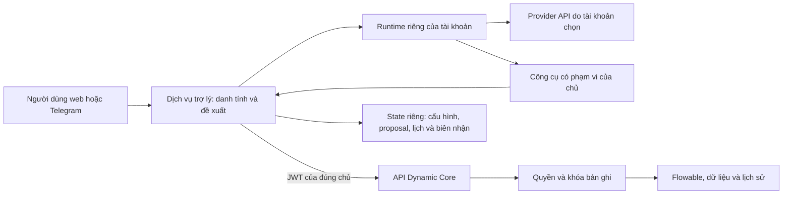

# Trợ lý hồ sơ đa người dùng

| Mục | Giá trị |
|---|---|
| Trạng thái | Đã xử lý review PR #199 trong phạm vi chốt; hồi quy local đạt, chưa nghiệm thu toàn bộ trợ lý |
| Mức độ | Quan trọng |
| Nhóm ưu tiên | Tích hợp tùy chọn sau khi nền Core ổn định |
| Nhánh | `Khuong/assistant-platform-plan`, tách từ `origin/Khuong/main` đã cập nhật |
| Module chính | Dịch vụ mở rộng `assistant/`, frontend, hạ tầng tùy chọn; điều kiện ghi và metadata trong `dx-engine` |
| Phụ trách | Nhóm phát triển; chủ dự án duyệt phạm vi trước triển khai |
| Quy mô đầu tiên | 2–3 tài khoản hoạt động đồng thời, mỗi tài khoản có trợ lý riêng |

## 1. Tham chiếu

| Nguồn | Nội dung áp dụng |
|---|---|
| Quyết định của người dùng | Tích hợp theo kiến trúc hiện tại, đa nhà cung cấp API, nhiều tài khoản; đọc tự động, mọi thao tác ghi cần xác nhận |
| `docs/dynamic-core/README.md`, mục Miền phục vụ, Kiến trúc và Điểm mở rộng | Quy trình chung cho bản ghi có vòng đời; phần mở rộng gọi Core qua API, không mang nghiệp vụ ngành vào kernel |
| `ARCHITECTURE.md`, `backend/README.md`, `docs/API.md` | Bốn module, JDBC, Flowable, API và ranh giới định danh hiện hành |
| `catalog/ProcessDiagramService.java` và Console hiện tại | Dùng lại sơ đồ quy trình từ YAML, không dựng trình phân tích hoặc sơ đồ riêng cho AI |
| `docs/dynamic-core/BACKLOG.md` | Không mở lại quyền theo trường, ủy quyền, nhiều backend hoặc duyệt nhiều cấp |
| `website/docs/templates/` | Năm tài liệu tổng quan, kế hoạch, checklist, kiểm thử và rủi ro |
| `WORKING_GUIDE.md`, memory/rules trong bộ hướng dẫn ngày 03/11/2026 | Spec → Swagger → Code, comment ngắn, mỗi câu Markdown một dòng, không tự commit/push |
| `claude-export-delta-20261105-chieu.tar.gz`: bốn memory mới và chỉ mục | Dependency mở cả build/test, test tối thiểu, xử lý trọn backlog và không mở lại ý tưởng đã loại |
| `CONTRIBUTING.md`, `DEPENDENCIES.txt`, `sbom/README.md` hiện hành | Convention thực tế, API/lỗi/dịch, dependency và hồ sơ giấy phép của nhánh cha |
| AI `AGENTS.md`, skill Spring Boot, code-quality, logging-patterns, verification-before-completion trong bản lưu | Tái sử dụng, kiểm quyền ở ranh giới, giao dịch và bằng chứng kiểm chứng; mã hiện tại được ưu tiên hơn ví dụ kiến trúc cũ |

Nguồn tham khảo công nghệ: [bảo mật OpenClaw](https://docs.openclaw.ai/gateway/security), [multi-user](https://docs.openclaw.ai/concepts/multi-user), [provider](https://docs.openclaw.ai/concepts/model-providers), [custom provider](https://docs.openclaw.ai/gateway/config-tools/custom-providers), [Fastify](https://fastify.dev/docs/latest/Reference/Validation-and-Serialization/), [SQLite của Node](https://nodejs.org/docs/latest-v24.x/api/sqlite.html).
Các tài liệu này là căn cứ thiết kế; API cụ thể phải đối chiếu bản runtime được khóa ở WPAS-01.

## 2. Lý do

Core đã có API hồ sơ, giao việc, quy trình, thống kê và quản trị.
Trợ lý cần biến yêu cầu ngôn ngữ tự nhiên thành đề xuất rõ ràng và thao tác qua các API đó, giúp người dùng làm việc ngay trên Telegram.
Giá trị nằm ở rút ngắn quy trình tìm hồ sơ, chọn người xử lý, xác nhận và kiểm kết quả, không nằm ở thay thế luật nghiệp vụ bằng LLM.

PoC đã chứng minh kết nối Gemini, Telegram, đọc hộp việc, nhận xử lý và thông báo chủ động.
PoC vẫn là một chủ, một bot, state tệp và bộ công cụ hẹp; không đưa nguyên cấu trúc đó thành dịch vụ nhiều người dùng.
Toàn bộ diff PoC hiện có được giữ riêng để review, không trộn vào kế hoạch hoặc nhánh cha.

## 3. Tổng quan sửa đổi

Một dịch vụ trợ lý độc lập quản lý tài khoản, cấu hình provider, đề xuất và thông báo.
Mỗi tài khoản liên kết Keycloak, API key và Telegram bot riêng; runtime OpenClaw được cách ly theo tài khoản.
Công cụ được sinh từ metadata và danh mục thao tác được phép, còn Core kiểm quyền, trạng thái và giao dịch.
Giao diện dùng lại react-admin/MUI và auth hiện có.
AI là tùy chọn: Core vẫn khởi động và hoạt động khi không cài hoặc tắt trợ lý.

| Khu vực | Có đổi | Phạm vi |
|---|---|---|
| `dx-model` | Không | Giữ định dạng YAML, họ quy trình và mẫu hiện có |
| `dx-core` | Không | Dùng lại xác thực, audit, lỗi và envelope; không đưa SDK LLM vào thư viện lõi |
| `dx-engine` | Có, giới hạn | Điều kiện phiên bản cho action/assign; metadata phiên bản và tóm tắt tác động sau quyết định |
| `dx-monitor` | Không | Chỉ dẫn người dùng tới màn hình có sẵn, không làm đường điều khiển vận hành mới |
| `assistant/` | Có | Dịch vụ tùy chọn và plugin OpenClaw, đa người dùng/provider, kho state và thực thi đề xuất |
| Frontend | Có | Cấu hình trợ lý cá nhân, hướng dẫn, đề xuất, lịch sử thao tác và trạng thái |
| Migration nghiệp vụ | Không | Không đổi schema `m_*`, Flyway Core hoặc Flowable |
| State trợ lý | Có | SQLite riêng và dữ liệu runtime riêng, không truy vấn trực tiếp DB nghiệp vụ |
| Deploy/CI/docs | Có, theo WPAS-07 | Đóng gói tùy chọn theo bộ cài, giấy phép và check hiện hành |

## 4. Phạm vi và kiến trúc

Miền của trợ lý là hỗ trợ quản lý hồ sơ có vòng đời trên Dynamic Core, dùng được ở nhiều ngành.
Không có tên thực thể, vai hoặc nhóm quyền của một nghiệp vụ trong mã dùng chung.
Lõi điều phối trợ lý nằm trong `assistant/`, không phải đưa LLM vào module Java `dx-core`.
Không thêm đường SQL, Keycloak Admin hoặc HTTP tùy ý cho LLM.

Trong phạm vi: đọc/tổng hợp có nguồn, giao và trả việc, hành động của ba họ mẫu hiện có, thông báo/nhắc hạn và hỗ trợ quản trị có giới hạn.
Ngoài phạm vi: Farm/Lab, CV, RAG/vector DB, huấn luyện hoặc chạy LLM local, MCP, agent teams, kênh ngoài Telegram, sinh/áp dụng YAML tự động, thao tác ghi tự hành và tác vụ hàng loạt.
Không mở quyền theo trường, duyệt nhiều cấp, cơ chế ủy quyền hay mở rộng kernel quy trình.
Không khôi phục các ý tưởng đã loại như nhập CSV, model pack kèm dữ liệu, tìm toàn văn, migration phiên bản process hoặc đăng ký nhận thông báo trong Core.
Tùy chọn nhận tin cá nhân của trợ lý chỉ điều khiển polling/ledger bên dịch vụ mở rộng, không bổ sung subscription API hoặc bảng nghiệp vụ vào Core.
Lưu và khôi phục không gian hội thoại theo mô hình được hoãn sang [backlog của trợ lý](./04_TRADEOFFS_RISKS.md#backlog-không-gian-hội-thoại-theo-mô-hình); việc kiểm quyền và tách dữ liệu giữa các mô hình vẫn bắt buộc trong đợt này.

### Ranh giới nhiều người dùng

Không dùng một gateway OpenClaw chung rồi coi khác session ID là đã cách ly dữ liệu.
Mỗi chủ có gateway, workspace, kênh, credential và volume riêng; runtime token bị buộc với chủ ở dịch vụ trợ lý.
Runtime chạy trong container không đặc quyền, không có Docker socket, không có mount repository hoặc volume của người khác.
Người vận hành cấp 2–3 runtime qua lệnh triển khai; giao diện chỉ kích hoạt/dừng runtime đã cấp, không nhận lệnh Docker hay đường dẫn host.
Một bot không được gắn cho hai chủ; kiểm bằng bot ID đã xác minh từ Telegram.

Mục tiêu là 2–3 runtime đồng thời, không phải một nền tảng đa tenant quy mô lớn.
PoC đo xấp xỉ 0,9 GB bộ nhớ/runtime, lúc khởi động đã quan sát RSS khoảng 1,4 GB; đây là đầu vào dự trù, không phải số đo của thiết kế mới.
Phải đo lại trước khi chốt giới hạn RAM/CPU; thiếu bộ nhớ thì chặn cấp thêm runtime và báo rõ, không âm thầm ghép chung người dùng.

## 5. Danh mục tính năng

| Vai trò/năng lực | Làm trong đợt này | Ranh giới |
|---|---|---|
| Người có quyền đọc | Hộp việc, tìm theo bộ lọc Core, hồ sơ, lịch sử, thống kê và tóm tắt | Chỉ dữ liệu API trả theo JWT của người hỏi; không gọi là tìm toàn văn |
| Điều phối/người xử lý | Tìm người giao được, đề xuất giao/đổi người/trả việc về nhóm | Dùng `/handlers`, không đoán tài khoản hoặc yêu cầu nhập UUID |
| Người xử lý/người tạo | Hành động trong metadata của `work_item`, `approval`, `reservation` | Mọi lần ghi có xác nhận; actor, note, trạng thái, booking và phiên bản vẫn do Core kiểm |
| Thông báo tự động | Việc mới, được giao, cần bổ sung, nhắc hạn và bản tổng kết theo lịch | Đọc tự động; thẻ cố định không gọi LLM; không xây lại auto-close hoặc outbox Core |
| Gợi ý điều phối | Gợi ý từ danh sách hợp lệ và số liệu khối lượng việc nhìn thấy được | Không tự giao; không tuyên bố người ít việc nhất tổ chức khi thiếu dữ liệu |
| ADMIN | Tóm tắt mô hình/run bị giữ, outbox lỗi, audit và giải thích kế hoạch thay đổi do người dùng cung cấp | Dùng API ADMIN hiện có; dữ liệu lỗi/payload được rút gọn và che thông tin nhạy cảm |
| ADMIN can thiệp hệ thống | Dẫn tới màn hình quản trị và giải thích tác động | Không có tool apply/rollback/resume/abandon, cấp vai, reset mật khẩu, archive, SQL hoặc retry outbox trong đợt này |

`ADMIN` của nền tảng không tự có quyền đọc/xử lý mọi hồ sơ.
Người đó vẫn cần vai và phạm vi của mô hình khi dùng công cụ nghiệp vụ.
Hành động có tác động thêm/bớt thành viên nhóm phải hiển thị tác động và xác nhận trên web; không kết luận quyền đã được cấp khi Core mới đưa tác vụ vào outbox.

## 6. Kết quả đầu ra mong đợi

- Ba tài khoản có cấu hình, hội thoại, thông báo và proposal riêng; gọi chéo hoặc bấm thẻ của người khác bị từ chối.
- Cấu hình adapter Gemini, OpenAI và Anthropic có sẵn của OpenClaw; endpoint OpenAI-compatible tạm khóa đến khi kiểm transport đầy đủ.
- Không quảng cáo một provider/model đã sẵn sàng chỉ vì lấy được danh sách model; phải kiểm tool calling và luồng xác nhận thật.
- Giao việc rồi người được giao nhận/xử lý, người tạo xác nhận hoặc yêu cầu mở lại; trạng thái và người thực hiện khớp lịch sử Core.
- Thử trên ba họ mẫu và ít nhất ba mô hình thuộc các lĩnh vực khác nhau mà không sửa mã lõi theo mô hình.
- Core chạy từ clone sạch theo lệnh hiện tại khi không bật trợ lý; bật/tắt hoặc provider lỗi không làm hỏng nghiệp vụ.
- Các giới hạn, số đo 2–3 người và provider chưa được thử thật được ghi rõ, không dùng kết quả PoC làm bằng chứng cho bản tích hợp.

## 7. Thứ tự

WPAS-01 → WPAS-02; WPAS-03 và WPAS-04 sau hợp đồng; WPAS-05 → WPAS-06 → WPAS-07 → WPAS-08.
Chi tiết ở [kế hoạch](./01_PLAN.md), [checklist](./02_CHECKLIST.md), [kiểm thử](./03_TEST_PLAN.md), [rủi ro](./04_TRADEOFFS_RISKS.md).

## 8. Giá trị và cam kết nguồn mở

Chứng minh được chuỗi công việc: yêu cầu mới → trợ lý giúp hiểu/chọn thao tác → người xác nhận → Core thực hiện và ghi lịch sử.
Khả năng đa ngành được chứng minh bằng đổi mô hình và phân quyền, không bằng câu trả lời tự giới thiệu của LLM.
Mã tự viết theo Apache-2.0; runtime và mọi dependency phải qua chính sách giấy phép hiện tại.
API thương mại là lựa chọn bên ngoài do người dùng cấp, không được mô tả là mô hình Open Source AI hoặc đáp ứng mục AI hoàn toàn mở của backlog.
Yêu cầu mới dùng API không làm thay đổi cam kết hoặc bộ cài Core mặc định.

## 9. Quyết định và điểm cần chốt khi review

| Mục | Trạng thái |
|---|---|
| Nhiều tài khoản, trợ lý riêng; đầu tiên 2–3 đồng thời | Người dùng đã chốt |
| Đọc tự động, mọi thao tác ghi phải xác nhận | Người dùng đã chốt |
| Tập trung Dynamic Core hiện tại, không hồi sinh Farm/Lab | Người dùng đã chốt |
| API key và bot riêng mỗi người | Đề xuất để giữ ranh giới rõ; không dùng key của ADMIN thay cho người khác |
| Tách runtime và provision từ công cụ triển khai | Đề xuất; đo tài nguyên và xác minh giới hạn SDK trước code chức năng |
| Dịch vụ Node/TypeScript, Fastify, SQLite riêng | Đề xuất để tận dụng runtime OpenClaw; không thêm module Maven hoặc DB server |
| Tác động nhạy cảm xác nhận trên web, quản trị hệ thống chỉ đọc/handoff | Đề xuất an toàn cho đợt tích hợp đầu |

## 10. Tài liệu khi triển khai

Cập nhật README Việt/Anh và trang tài liệu bằng kết quả cuối, `docs/API.md`, `ARCHITECTURE.md`, hướng dẫn vận hành/tích hợp, tài liệu riêng của trợ lý và Swagger tương ứng.
Cập nhật `DEPENDENCIES.txt`, `NOTICE`, SBOM và danh mục thành phần; không đưa `COPYRIGHT.txt` cũ từ PoC trở lại.
Không đánh dấu đã hoàn thành mục Open Source AI trong backlog chỉ vì tích hợp được API.
Không sửa `docs/dynamic-core/README.md` định hướng nếu chưa có quyết định riêng của chủ dự án.

## 10. Xử lý review PR #199

Căn cứ: [review của KhuongSpring](https://github.com/HaUI-ImplSolution/DX-OS/pull/199#issuecomment-6730959635) và bản nhánh đã nhận quy trình tự khai báo của `Khuong/main`.
Phạm vi đợt này là khắc phục nhận xét của PR, không bổ sung tính năng trợ lý hoặc thay hướng Dynamic Core.
Kế hoạch xử lý nằm ở WPRV-01–WPRV-06 trong [kế hoạch](./01_PLAN.md#xử-lý-review-pr-199).

| Ranh giới | Quyết định |
|---|---|
| Core | Hoãn tối ưu đọc phiên bản; làm rõ metadata tác động và định dạng helper do PR thêm; giữ khóa, transaction, trường `require`, `handlers` và `handlerActions` của cha |
| Trợ lý | Kiểm cách ly chủ/runtime và bảo vệ endpoint provider; không thêm provider hoặc kênh mới |
| Deploy | Bỏ sao chép lệnh gateway; mô tả đúng backup và kiểm phục hồi; Core off/on giữ lệnh khởi động hiện có |
| License/CI | Ngoại lệ theo đúng gói; không mở rộng danh sách giấy phép chung hoặc làm yếu check của cha |
| Tài liệu | Đồng bộ các tài liệu liên quan trực tiếp; không sửa định hướng `docs/dynamic-core/README.md`, không đụng Farm/Lab |
| Dữ liệu | Không migration Core, không sửa YAML nghiệp vụ, không đưa dữ liệu/khóa demo vào Git |

Người dùng đã chốt dùng API ngoài cho bản thử nghiệm và duyệt ngoại lệ hai gói dữ liệu SPDX.
Hai quyết định này không thay yêu cầu Open Source AI của mục tiêu dài hạn; phần chưa đáp ứng phải còn trong BACKLOG.
Đợt lập kế hoạch không đồng nghĩa các ca bảo mật đã chạy hoặc các mục review đã được giải quyết.
Chỉ đề nghị merge sau khi các rào chắn bảo mật và hồi quy đạt; giới hạn còn lại phải có quyết định chấp nhận rõ ràng.

## 11. Quyết định xử lý review bổ sung

Căn cứ: [kết quả kiểm thử của reviewer](https://github.com/HaUI-ImplSolution/DX-OS/pull/199#pullrequestreview-5821221565).
Đang thực hiện theo phạm vi đã được người dùng chốt; chưa commit/push hoặc resolve nhận xét.
Người dùng đã chốt tách mạng control, hoãn cache và chấp nhận giới hạn egress/backup cho bản thử có kiểm soát.
Giữ ba provider native Gemini, OpenAI và Anthropic; adapter có cấu hình không đồng nghĩa đã nghiệm thu model thật của cả ba.

| Nội dung | Đề xuất | Trạng thái |
|---|---|---|
| Route còn sau off, request lặp theo focus | Sửa ngay, kiểm response và monitor thật | Đạt gateway/monitor và browser local |
| JSON sai/body lớn trả 500 | Sửa ánh xạ lỗi HTTP trong dịch vụ trợ lý, không lộ payload | Đạt 400/413 qua gateway; 500 được che nội dung trong test |
| Control kết nối được mạng DB Core | Tách mạng API và ingress tùy chọn; giữ quyền/API hiện có | Đã tách, kiểm TCP/DNS thực tế đạt |
| Runtime Internet tự do | Giữ công cụ giới hạn và khóa compatible; egress proxy/allowlist toàn mạng thành việc riêng trước dùng thật | Chấp nhận cho bản thử; BACKLOG trước dùng thật |
| Origin đúng một địa chỉ công khai | Giữ chính sách chống CSRF, ghi rõ địa chỉ bắt buộc và lỗi dễ hiểu | Đã ghi tài liệu và thông báo; không mở multi-origin |
| Backup có cả key và capability | Ghi rõ khả năng giải mã và giả danh runtime của người giữ backup; custody/rotation riêng để sau | Chấp nhận cho bản thử; BACKLOG custody/rotation |
| Schema bỏ trường lạ; PATCH cần đủ key | Giữ hành vi an toàn hiện có, mô tả đúng và giữ tương thích API | Đã kiểm và ghi hợp đồng full-profile |
| ERR_CORE_LINK dùng 401 | Chưa liên kết dùng 409; token thiếu/hết hạn vẫn 401 | Đã sửa và kiểm 409/401 |
| Phiên bản model: 54 query nhưng khoảng 9 ms | Hoãn tối ưu cache để giảm thay đổi Core; hoàn lại riêng diff cache do đợt này thêm | Đã hoàn lại riêng diff cache local, giữ precondition gốc |

Kết quả reviewer thuộc bản PR trước diff local, không thay bằng chứng trên bản sửa.
Bằng chứng của bản sửa được ghi trong test plan; lượt dùng lại dữ liệu cũ hoặc bị dừng không tính đạt.

Các mục Origin/schema/PATCH giữ hành vi hiện có và sửa mô tả; không mở nhiều origin hoặc PATCH từng trường trong đợt này.
Không còn quyết định sản phẩm chặn việc tiếp tục; key/provider thật hoặc lỗi vượt phạm vi phát sinh sẽ báo riêng.
