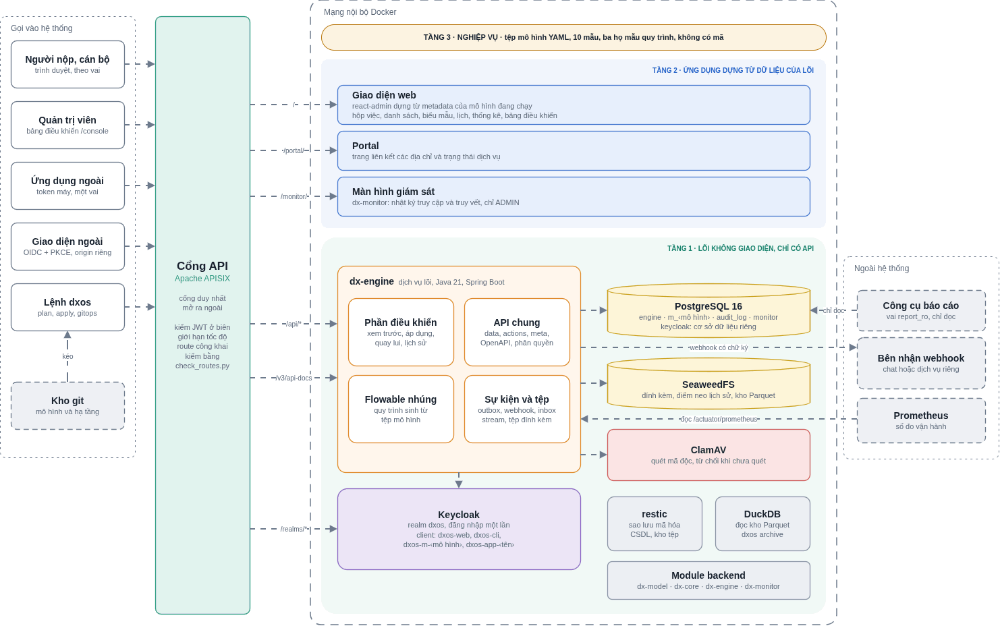
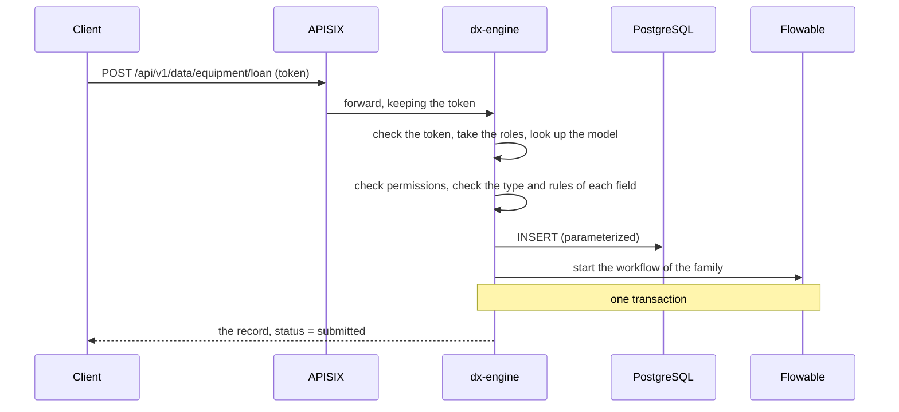

# Architecture

The core takes a model file and serves the business that the file declares.
The design direction and the full scope are in [`docs/dynamic-core/README.md`](https://github.com/HaUI-ImplSolution/DX-OS/blob/main/docs/dynamic-core/README.md) (Vietnamese); this document describes what already runs.

## 1. Three tiers

- **Tier 1, the core:** no page is written by the team; everything goes through the API.
- **Tier 2:** the interface that reads the metadata of the core, plus the portal, the monitoring screen, the business assistant and the `dxos` command.
- **Tier 3:** only model files, with no code.
- The text that users read is decided by the frontend: the backend returns an English message with an `errorCode`, and the frontend translates it by `frontend/src/shell/backendMessages.ts`.

## 2. Backend modules

| Module | Role |
|---|---|
| `dx-model` | The format of the model file: reads YAML, checks, and reports errors by line and column; it does not depend on Spring |
| `dx-core` | The shared library: security, audit, storage and file scanning, the state of the system, the Keycloak client |
| `dx-engine` | The runnable service, including the control part, the common API and the embedded Flowable |
| `dx-monitor` | The monitoring service that runs on its own and does not depend on any module above |

`dx-model` depends on no module; `dx-core` does not depend on `dx-engine`; the core code holds no entity, role or flow name of any particular field.

## 3. Identity and tokens

Keycloak keeps the accounts, the passwords and the roles; the realm `dxos` is imported once from [`sso/realm-dxos.json`](https://github.com/HaUI-ImplSolution/DX-OS/blob/main/sso/realm-dxos.json).

| Client | Used for |
|---|---|
| `dxos-web` | Users signing in to the web application |
| `dxos-monitor` | Signing in to the monitoring screen |
| `dxos-cli` | The commands `dxos plan`, `dxos apply` and `dxos gitops`; the service account holds the role `ADMIN` |
| `dxos-backend-admin` | The service account of the backend that calls the Admin API: creating clients, roles, groups and managing users |
| `dxos-assistant` | The business assistant links with the account of each person through PKCE; the assistant calls the Core with the session of that very person and has no service account of its own |
| `dxos-m-<model>` | Only to hold the roles of a model; nobody signs in with it |
| `dxos-app-<name>` | An outside application that calls the API with a machine token; its service account holds exactly one role of one model |

- The platform role `ADMIN` is in `realm_access`, the roles of a model in `resource_access.dxos-m-<model>.roles`, and the unit in the claim `groups`.
- APISIX checks the token at the edge; the backend checks the signature, the expiry and the audience `dxos-api` again.
- Roles and units are read from the signed token, so a change of role or unit takes effect after at most about 5 minutes (a token lives for 300 seconds).
- The Admin API of Keycloak 26.8 accepts only a token whose audience is its own, so `dxos-backend-admin` carries the scope `kc-admin-api`; see [`sso/README.md`](https://github.com/HaUI-ImplSolution/DX-OS/blob/main/sso/README.md) (Vietnamese).
- Projects (`engine.project`, `engine.model_project`, `engine.client_project`) group models and outside applications for administration; tokens and the permission to read and write data know nothing about projects, so a project is not an isolation boundary.
- Members (`engine.project_member`, level `MEMBER` or `ADMIN`) divide the administration of users: the backend reads the scope of the caller from the database on every request (`UserScope`), so a project administrator sees and assigns only the roles of the models in their own project, and a change of level takes effect at once, without waiting for the token to expire.

## 4. Applying a model

A model goes through a single path, from an empty system or from the running version.

### Preview

`POST /api/v1/models/plan` changes no table or record and only returns:

- The changes by three levels `SAFE`, `MIGRATION`, `LOSS`; changing the type of a field and changing the workflow family are refused.
- The rows that violate a new rule: tightening or adding `min`, `max`, `pattern` or a list of choices is `MIGRATION` with the row count and is refused until the data is fixed; loosening or removing is `SAFE`.
  Changing `required_when`, `ui:` or `documents:` is `SAFE` and is not blocked while records are still being handled.
- The number of records being handled in the affected workflows, and the pgschema statements that will run.
- For each new action that requires an added field with `require`: `CHANGE_ACTIONS` names the action and the field (together with a change of label, role or `needs_note`), and `impacts` counts the records in the source status that still lack the field; the level stays `SAFE`, and the action refuses those records until the field is filled in.

### Apply

`POST /api/v1/models/apply?base=N&accept=<level>` (ADMIN) runs when `base` is exactly the running version, the risk level does not exceed `accept` and there are no violating rows.
Each step is written to `engine.apply_step`:

1. `RENAME_FIELD`: rename the column by `renamed_from`, together with the constraints and indexes that carry the field name.
2. `CHANGE_SCHEMA`: pgschema brings the schema `m_<model name>` to the target state, including tables, system columns, `CHECK` constraints, indexes and the read permission of `report_ro`.
3. `DROP_FILES`: delete the rows and the attachment objects of an entity that was removed from the model.
4. `ENSURE_CLIENT`, `ENSURE_ROLE`, `ENSURE_UNIT`: the client `dxos-m-<model>`, the roles of the model under that client, and the units as Keycloak groups.
5. `SAVE_VERSION`: save the content and the hash; from here the version is in effect.

The guarantees:

- Data protection lives in the core: if the pgschema plan has an operation that drops a table or a column that the comparison with the model does not have, the apply stops.
- There is no shared transaction between PostgreSQL, Keycloak, Flowable and SeaweedFS.
  Each step is safe to run again, so an interrupted apply is applied again to continue.
- An unchanged file is still compared with the real tables and Keycloak: what was lost becomes a `REPAIR_*` change (action `repair`), run by the same steps and not raising the version; an extra table or column is refused.
  This check runs only when you preview the plan or apply, not at backend startup.
- `POST /api/v1/models/{model}/rollback` goes through this very path with the content of the previous version and is recorded as a new version.
- The core refuses the platform role `ADMIN`, a change of handler, deadline, authority to decide, completion action or booking while the entity still has records being handled, and deleting an entity that still has records running a workflow.

### Holding a model and an interrupted apply

- Each model has its own Postgres lock for an apply, so different models apply in parallel.
- The model is held from the first step until the registry has loaded the new version: users cannot enter yet and `GET /api/v1/models` reports `held`.
- A failing step stops the apply and the model stays held, even after the backend restarts, because the state is derived from `engine.apply_run`, where the file, the renames and the confirmed level are stored.
- `POST /api/v1/models/{model}/resume` finishes the interrupted run without needing the file.
- `POST /api/v1/models/{model}/abandon` brings the tables back to the running version; the columns and tables that the interrupted run added are deleted together with their data.
- At startup and after each apply, the registry reads the latest version of each model with the current checks.
  A version that violates a rule that was tightened, when dropping the violating part is still safe, runs with that part dropped and `GET /api/v1/models` records `warnings`; when it cannot be dropped, the model is left out of operation, recorded as `leftOut` with `problems`, the data requests of it return 409 and the metric `dxos_models_left_out` counts it.

### Roles and units

- The roles of each model live in their own client, so two models that use the same role name do not collide.
- A role removed from the model file stays in the client with whoever holds it but gives no permission, because permission follows only the roles that the model currently declares; declaring it again makes the plan ask for confirmation, and deleting a role or client for good is done by hand in Keycloak.
- A unit is an organization structure, so every model uses the same Keycloak group by name; a unit gives only the scope of rows, and what a person may do is decided by the roles of each model.

### The model file at startup

`ModelBootstrap` applies the files in `ENGINE_MODEL_FILE` (names separated by commas, looked for in `ENGINE_MODEL_DIR`) when the backend starts, on a separate thread that waits for Keycloak once, one file after another, with the actor `bootstrap`.
Only a file that was never applied, has a safe plan and has no interrupted run is applied; a faulty file does not block the files after it.

## 5. A request through the common API

- **Names and queries:** table and column names come only from the checked model, values always go through parameters; a field name or operator that is not in the model is refused (400).
- **Permissions:** the scopes of the roles the caller holds are combined: `all` and `read` touch every row, `own` touches the rows the caller created, `unit` touches the rows of the caller's unit, `assigned` touches the rows assigned to the caller.
  A child entity (`owner_via`) applies these scopes to the parent record, across several levels, and cannot be attached to a parent record out of reach (403).
- **Rules:** required, unique, choice, `min`, `max` and `pattern` are both checked by the API to report an error per field and are constraints in the database.
  `required_when` is checked only in the API, on the record after the new values are merged into the existing record.
- **Record code:** a `code` field takes its number from `engine.record_counter` in the transaction that creates the record, so two records never share a code and a failed record does not waste a number; an apply fills in codes for existing records when a new `code` field is added.
- **Resending:** creating a record and actions accept the header `Idempotency-Key`, written to `engine.idempotency` in the same transaction as the work; two requests with the same key running at the same time do the work only once, and the key is kept for 24 hours.
- **API documentation:** `GET /api/v1/meta/models/{model}/openapi` generates the OpenAPI of the running model at call time, so it always matches the model file; people with a role of the model can read it.

## 6. Workflow and status

The status of a record changes only through the workflow.

- Flowable runs embedded, sharing the data source and the Spring transaction; its tables live in the schema `engine`.
- The workflow families (`approval`, `work_item`, `reservation`) declare statuses and actions; an entity may override each one, or declare its own `states` and `actions` with no family.
  The workflow is generated from the declaration at apply time; the core does not load hand-written BPMN files.
- The rules common to every family: the roles and permissions of the person acting, the creator does not decide on their own record, a reason when rejecting or returning, a withdrawal keeps the record.
- The `reservation` family checks on create and edit: the time slot is valid and the number of runs at the same time does not exceed the capacity; the resource row is locked until the end of the transaction.
- The common API refuses every request that carries a `status` column (403).
  `POST .../{id}/actions/{action}` checks who may act and the first status, completes the task, and then the next step of the workflow writes the new status.
- A record that has been assigned can have the handler's actions performed only by the assignee.
- An action may carry `when`, comparing a field with a value on the locked record; when it is not met it is refused 409 with `data.reason` `CONDITION_NOT_MET`, and an empty value does not meet it.
- An action in the wrong status is refused (409); an error after a workflow step makes the whole record, the workflow and the history row go back as they were.
- The deadline is stored in the column `handle_by` while the record waits for a handler; `overdue` is computed when it is read.
- `GET /api/v1/models/{model}/data-catalog` (ADMIN) describes the data of a running model: fields, roles with access, row counts, links between entities, where data comes in and goes out.

## 7. Events and actions after a decision

- The table `engine.outbox` receives messages in the transaction of the change; `OutboxDispatcher` delivers them after the transaction ends, retrying with growing waits, one message per key.
  An ADMIN views messages by status and retries a message that has not been sent; a sent message is deleted after 30 days.
- The completion actions of the `after:` block go through the outbox; for now there are `add_to_group` and `remove_from_group` of Keycloak.
- An overdue record writes one history row for each deadline, and a `due_soon` row before the deadline by an interval `ENGINE_DUE_SOON_BEFORE`.
  Each `escalate` level that falls due writes an `escalated` row and sends a webhook, and changes neither the status nor who holds the record.
- An action that declares `check: <target name>` asks that target before the status changes, inside the transaction that holds the record lock; when the target refuses, or does not answer according to `on_error`, the record stays as it is and a `check_denied` or `check_unavailable` row is written.
- When the model has a webhook target (the key `webhook` or `DXOS_WEBHOOK_URL`), each history row also gets a `record.event` message in the outbox in the same transaction, sent with a signature and delivered in order within one record.
  Applying a model and changing accounts go through the topic `admin.event`; a receiver that missed messages pulls them again with `GET /api/v1/events`.
  The message structure, the signature, retries and the target of kind `chat` are in [Integrating with outside systems](./INTEGRATIONS_EN.md).

## 8. Attachments and print templates

- A field of kind `file` attaches files: the bytes in SeaweedFS, the metadata in `engine.attachment`, scanned by ClamAV, permissions following those of the record, and the extensions and the number of files per record set by configuration.
- When a file or a record is removed, the object in the store is deleted through the message `file.delete` after a delay, so that a backup always has the files of every row in the dump.
- The `documents` block of an entity holds structured print templates, checked when the model is read: a blank may only be a field of the entity or a column of the record.
  Printing a record goes through the read permission of the record, writes `audit_log` and returns a PDF laid out with Apache PDFBox and the embedded Noto Sans font; a template has no conditions, loops or expressions, so there is nothing to execute.

## 9. User administration and logs

- Account management (ADMIN) goes through the Admin API of Keycloak with the service account `dxos-backend-admin`; Keycloak still keeps the accounts, the passwords and the roles.
- Only a role and a unit that a running model declares can be assigned (404 for anything else); the platform role `ADMIN` has no path through this API, and an ADMIN cannot lock themselves (409).
- A temporary password is generated by the system, returned once and must be changed at the first sign-in; it is not written to a log or to audit.
- Each successful account change, and each apply, rollback, resume or abandon of a model, writes an `audit_log` record with the actor taken from the token; a failed audit write leaves only a log line and the change still succeeds.
  `GET /api/v1/audit-logs` can be filtered by object (`targetType`, `targetId`).
- A change made directly in the Keycloak Admin Console does not go through here; the administration events of Keycloak (kept 90 days) are the place to look.
- The write actions and how to look them up are in [`docs/MONITORING.md`](./MONITORING_EN.md).

## 10. Integrity and recovery

- **Tamper-evident history:** the `engine.record_event` rows are chained into a hash chain in which a new row hashes only the action, the object, the status, the time and the id of the actor, while the name, the note and the detail are outside the chain; every hour the backend writes an anchor into the object store, outside Postgres.
  `dxos history verify` or `GET /api/v1/history/verify` (ADMIN) recomputes the chain and compares it with the anchors.
  The chain detects and does not prevent an edit; a webhook receiver that keeps the `hash` of the messages it received has one more anchor outside the server (`examples/history-witness`).
- **Data lake:** `dxos archive` exports records that reached a final status, and their history, to Parquet with a `manifest.json` recording the row counts and the sha256, into a folder or (`--store`) into a separate bucket of SeaweedFS.
  `dxos archive schedule install` sets a daily schedule for records closed longer than `ARCHIVE_AFTER_DAYS`.
- **Self-healing:** every long-running service has `restart: unless-stopped`; `dxos reconcile` brings the stack back to what is declared and runs every minute from a systemd user timer.
- **GitOps:** `dxos gitops` pulls, on a cycle, the infrastructure (`deploy/`, the entry configuration, the image tags) from a DX-OS repository and the model files from a repository of the deployer, verifies the signature of the commit if switched on, and then reports drift, waits for approval or applies on its own.
  Upgrading the infrastructure goes through `install.sh --upgrade` and `update.sh`.
- **Backup:** `deploy/backup.sh` takes an encrypted backup of Postgres and the file store; `verify` loads the dump into a temporary Postgres and checks that every attachment is there.
- How to do each task is in [`docs/OPERATIONS.md`](../OPERATIONS.md) and [`docs/INTEGRATIONS.md`](./INTEGRATIONS_EN.md).

## 11. Data

| Schema | Content |
|---|---|
| `engine` | The model versions, the apply history, the history rows of records, the tables of Flowable |
| `m_<model>` | The business tables generated from the model |
| `public` (table `audit_log`) | The access log and the administration operations |
| `monitor` | The data of the monitoring screen |
| `keycloak` (a separate database) | Accounts, roles, sessions |

Flowable sets the `search_path` of the connection it uses to `engine` and does not give it back, so a query on a table outside `engine` always names the schema.

- **Writing and reading:** the core service is the only write connection to the business data.
  The role `report_ro` is read-only, sees every row of every business table and applies none of the `own`, `unit`, `assigned` permissions of the viewer, so it is given only to the operator's reporting tool; how to connect is in [`docs/REPORTING.md`](./REPORTING_EN.md).
- **Figures by permission:** the APIs below use the same rows and filters as the list, so row-level permissions apply; a reporting tool that needs row-level permissions uses them instead of `report_ro`.
  - `GET /api/v1/data/{model}/{entity}/stats`: overview figures.
  - `.../report`: group by a field and compute count, sum, average, minimum and maximum over a numeric field; the field names and the computations are checked against the model so no part of the request becomes SQL.
  - `.../quality` (ADMIN, accepts only counts): how completely fields are filled, missing by condition, a re-check of constraints, freshness.
- **Lineage:** `GET /api/v1/models/{model}/data-lineage` is built from the model file and gives, for each field: where the value comes in, the rules that read it and where it goes out.
  The core keeps the entered value as it is, so the lineage has no transformation step.

## 12. Deployment

- Compose runs the core (`postgres`, `keycloak`, `seaweedfs`, `backend`, `apisix`) and Tier 2 (`frontend`, `portal`, `monitor`, `assistant-control`); `clamav` runs with the profile `av`, which is in the default configuration.
- `dxos start --core` runs only the core: no Tier 2, the assistant included, and the gateway has no route for it.
  The Keycloak Admin Console is not opened to the gateway by default.
- The gateway checks the token for every API route; the routes that do not check a token are in a public list checked by `e2e/api/check_routes.py`.
- `dxos start <file>...` brings model files in through `deploy/model/` and prints the result of `ModelBootstrap` for each file.
- The service [`assistant/`](https://github.com/HaUI-ImplSolution/DX-OS/blob/main/assistant/README.md) (Vietnamese) suggests the value of a field, reading and writing through the Core API with the sign-in session of the user.
  Its model is a Vietnamese record classifier that the team trained ([`tools/classifier/`](https://github.com/HaUI-ImplSolution/DX-OS/blob/main/tools/classifier/README.md), Vietnamese), running inside the process on the CPU with the weights packaged in the image.
  It has its own SQLite and does not access the business database.
  It runs on an internal network with no route to the Internet.
  The Core checks the permissions together with `modelVersion` and `version` in the write transaction.
- Operation details are in [`docs/OPERATIONS.md`](../OPERATIONS.md), logs and audit in [`docs/MONITORING.md`](./MONITORING_EN.md), webhooks and tamper-evident history in [`docs/INTEGRATIONS.md`](./INTEGRATIONS_EN.md).

## 13. Match with the requirements of the brief

| The brief requires | How it is met |
|---|---|
| Identity and SSO | Keycloak; roles generated from the model, user administration in the control panel |
| API gateway | APISIX checks tokens, limits rates, routes |
| Structured data | PostgreSQL; the schema and constraints generated from the model |
| Unstructured data | SeaweedFS and ClamAV scanning, attached to the `file` field |
| Workflow engine | Embedded Flowable; the families `approval`, `work_item`, `reservation` |
| A core with no interface | `dx-engine` serves only the API; the interface belongs to Tier 2 |

| The technical principle of the brief | How it is met |
|---|---|
| Separate by data life cycle, push history down to a data lake | `dxos archive --store` writes closed records to Parquet with a manifest and hashes, on a daily schedule (section 10) |
| Converge administrative (IT) and operational (OT) data | A device simulator creates incident records through the API (`examples/itot-simulator`), with the same workflow, permissions and history as administrative records |
| Data governance, lineage and provenance | The model file is the data catalog; the catalog, the quality figures and the lineage of each field are read from it (section 11); tamper-evident record history |
| Zero-Trust, GitOps, malware quarantine, self-healing | The token is checked at the gateway and the backend; ClamAV refuses a file that could not be scanned; `dxos gitops` pulls the infrastructure and models from git; `dxos reconcile` and `restart: unless-stopped` |

## 14. Decisions made

Each decision is recorded in a template: context, options, decision, consequence.
The reasons for choosing each tool are on the [components page](https://haui-implsolution.github.io/DX-OS/docs/dependencies) (Vietnamese); this section records only the decisions about structure.

### QĐ-1: The common API reads the model at run time

- **Context:** the core must serve many businesses without knowing in advance which entities there are, and change the model while the system runs.
- **Options:** generate code for each entity; use a platform that builds a backend from existing tables (Supabase, Strapi, Directus); one common API that reads the model at run time.
- **Decision:** the common API reads the running model and only then builds the query.
- **Consequence:** there is no generated code to maintain, and changing an entity needs only a change of the model; in return, the defence against SQL injection, row-level permissions and performance live in code that the team wrote (section 5).

### QĐ-2: One PostgreSQL for data, history, queue and workflow

- **Context:** writing a record, changing the status and writing the event must succeed or fail together.
- **Options:** a separate store for each component; one database for all.
- **Decision:** one PostgreSQL, one schema per model, with Flowable sharing it (section 11); Keycloak keeps its own database.
- **Consequence:** one transaction covers all three jobs; in return, PostgreSQL is a single point of failure, and a backup must take both the data and the file store (section 10).

### QĐ-3: Embedded Flowable, BPMN generated from a declaration

- **Context:** the deployer needs an approval workflow without writing BPMN, and the workflow must not go around the rules of the core.
- **Options:** a drag-and-drop BPMN designer; loading hand-written BPMN files; families with parameters, or declared `states` and `actions`.
- **Decision:** Flowable runs embedded in `dx-engine`; the core generates BPMN from a family or from a declaration (section 6).
- **Consequence:** every workflow is under the same set of invariant rules; in return, a hand-written BPMN cannot be loaded and there is no drag-and-drop designer.

### QĐ-4: Apply a model by an ordered plan, with no shared transaction

- **Context:** one model change touches PostgreSQL, Keycloak, Flowable and SeaweedFS, and the four do not share a transaction.
- **Options:** a distributed transaction; changing each component by hand; previewing one plan and then running it step by step.
- **Decision:** preview, then apply step by step, written to `engine.apply_step`, each step safe to run again (section 4).
- **Consequence:** when an apply stops halfway, the core holds the model and the administrator chooses to continue or abandon; the core does not retry on its own and does not roll back on its own.

### QĐ-5: The event axis is an outbox table, with no message broker

- **Context:** outside systems need to know a record changed, and sending must not break or block the change.
- **Options:** a message broker; calling the outside system inside the transaction; writing the event to a table in the same transaction and sending afterwards.
- **Decision:** the table `engine.outbox` in PostgreSQL, a signed webhook sent, a retry when the receiver fails, and an API to pull events by `eventId` (section 7).
- **Consequence:** no event is lost when the receiver fails; in return, delivery is at least once, so the receiver must de-duplicate by `eventId`.

### QĐ-6: Roles per model, units shared

- **Context:** two models may use the same role name, while a unit is the shared organization structure of the whole system.
- **Options:** roles and units shared by the whole system; both per model; roles per model and units shared.
- **Decision:** the roles of each model live in the client `dxos-m-<model>`; a unit is a Keycloak group by name, giving only the scope of rows (sections 3 and 4).
- **Consequence:** two models that use the same role name do not collide; a change of role or unit takes effect after at most about 5 minutes because it is read from the signed token.

### QĐ-7: Tamper-evident history by a hash chain and an anchor outside the database

- **Context:** the history of a record must show when it has been edited, even by someone with permissions on the database.
- **Options:** block all edit permissions; chain the rows into a hash chain; a hash chain plus anchors kept elsewhere.
- **Decision:** the `engine.record_event` rows are chained into a hash chain, and every hour the core writes an anchor into the object store, outside PostgreSQL (section 10).
- **Consequence:** the chain detects and does not prevent an edit; a webhook receiver that keeps the `hash` of the messages it received has one more anchor outside the server.
- A version 2 row does not commit to the name, the note and the detail, so those fields can be edited or deleted with the chain intact and the edit of them is not detected; a version 1 row that was already released keeps the full commitment.

### QĐ-8: Open-source components used as they are, OSI licenses

- **Context:** the brief demands an open-source product, and the core must not depend on one vendor.
- **Options:** rewrite the components; edit or patch upstream code; use them as they are and configure them.
- **Decision:** official images pinned by tag and digest, no change to upstream code, every license in the OSI list and checked by a machine on every pull request.
- **Consequence:** replacing a component means changing a configuration or an address; in return, what the project needs and upstream does not have must be written in the glue layer.

### QĐ-9: An on-site classifier for a one-field suggestion

- **Context:** the assistant needs to suggest one label within the set of values the business allows and to give evidence from the record so the officer can check.
- **Options:** keyword matching, running a general language model through an inference service, or training a small classifier for each task.
- **Decision:** run a self-trained logistic regression classifier inside the Node.js assistant in Tier 2.
  The Core API still decides the permissions and the version at the time of writing.
- **Consequence:** the weights are small, can be reproduced from the data that is described, and are compared with keyword matching at the same coverage.
  A new business needs its own labels, data and validation.
  Weak suggestions are refused by a threshold, and the decision to save belongs to the person with authority.
  [The design and the measured results](../AI.md) (Vietnamese)
