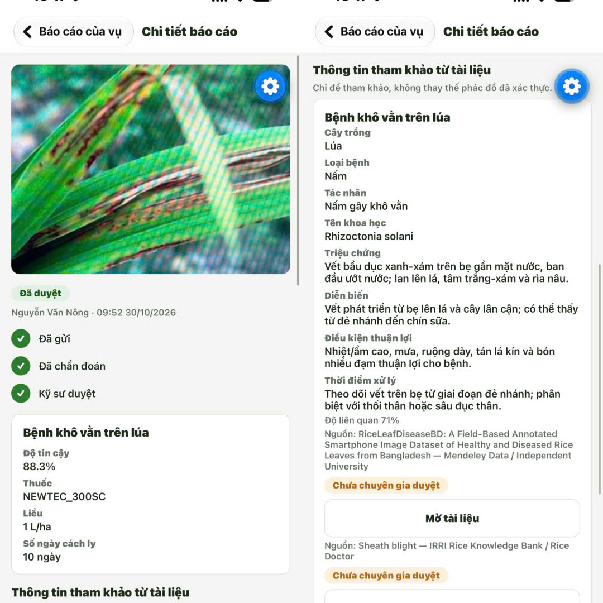

# Mobile (Expo)

Ứng dụng React Native dành cho nông dân (chỉ role `FARMER`): chụp ảnh sâu bệnh ngay tại ruộng và gửi báo cáo về Backend; ENGINEER và ADMIN dùng web vì việc duyệt cần xem ảnh, kết quả CV, khuyến nghị và PHI cùng lúc.
Một codebase TypeScript cho Android và iOS, dependency đều MIT hoặc Apache-2.0 ([`COPYRIGHT.txt`](../COPYRIGHT.txt)); build APK bằng EAS, không cần Android Studio.
Kiến trúc ở [`ARCHITECTURE.md`](../ARCHITECTURE.md); việc chưa làm theo dõi ở [trang docs](https://haui-implsolution.github.io/DX-OS-docs/).

**Luồng:** đăng nhập → chọn thửa → chọn vụ → xem và gửi báo cáo → theo dõi kết quả kỹ sư duyệt → khai phun thuốc → khai báo thu hoạch.
Chẩn đoán AI do kỹ sư kích hoạt trên web; nông dân thấy "Chờ chẩn đoán" sau khi gửi.



## Cách hoạt động

- **Điều hướng:** `expo-router` theo cấu trúc file trong `app/`, dạng stack, route guard `Stack.Protected` ở `app/_layout.tsx`.
- **Xác thực:** Authorization Code + PKCE với client public `farm-mobile` (`expo-auth-session`), endpoint dựng từ `EXPO_PUBLIC_KEYCLOAK_URL`.
  Token ở `expo-secure-store`, tự refresh; refresh bị từ chối hoặc Backend trả `401` thì xóa phiên.
  Role đọc từ `realm_access.roles`, tài khoản không có `FARMER` bị đăng xuất; đăng xuất gọi logout Keycloak để kết thúc phiên SSO.
- **API:** `src/api/client.ts` bọc `fetch` với `Authorization`, timeout 30 giây, `ApiError` (lỗi mạng có `status` `0`); response theo `ApiResponse<T>`.
- **Chụp và gửi ảnh:** camera hệ thống (`expo-image-picker`), thu nhỏ cạnh dài 1280px, JPEG 0.7 (`expo-image-manipulator`), gửi multipart part `image` qua `XMLHttpRequest` để có tiến trình.
  App kiểm mỗi chiều từ 160px và tối đa 10 MiB; Backend kiểm độ sáng, độ nét, phân loại lúa lúc precheck và lúc nộp, ảnh không đạt phải chụp lại.
- **Hàng đợi offline:** mất mạng hoặc lỗi kết nối thì ảnh, thửa và vụ mới vào hàng đợi (`async-storage`), mỗi mục một UUID làm `Idempotency-Key` nên gửi lại không tạo trùng.
  Tự gửi khi `NetInfo` báo có mạng và khi app trở lại foreground, thử lại với backoff 5 giây đến 5 phút, tối đa 8 lần; lỗi `4xx` khác `408`, `409`, `429` đánh dấu "Lỗi" và không thử lại.
  Hàng đợi tách theo tài khoản; danh sách "Chờ gửi" và nút xóa ở màn Hồ sơ.
- **Tạo thửa:** lấy vị trí bằng `expo-location`, hiện sai số; sai số quá ngưỡng của Backend (lấy từ `GET /api/v1/app`, dùng 30 m khi chưa tải được) hoặc vị trí giả lập thì khóa nút gửi (Backend kiểm lại).
  Thửa gửi đi ở trạng thái chờ duyệt; bị từ chối thì sửa và gửi lại; thửa đã duyệt có "Đề nghị chỉnh sửa thửa".
- **Tạo vụ:** chỉ với thửa đã duyệt; chọn giống từ danh mục, ngày bắt đầu và loại vụ; ngày thu hoạch gợi ý do Backend tính, chọn ngoài khoảng gợi ý phải nêu lý do.
- **Thời tiết:** thẻ ở màn thửa đã duyệt có vị trí, hiện thời tiết hiện tại và dự báo 3 ngày; mất mạng thì chỉ thẻ này báo lỗi.
- **Hỏi đáp tài liệu:** màn `/knowledge` hỏi kho tài liệu về bệnh và canh tác lúa, mỗi tài liệu một thẻ dạng danh sách trường kèm nguồn và giấy phép; câu ngoài phạm vi hoặc không có tài liệu phù hợp thì hiện gợi ý hỏi cụ thể hơn; cần mạng.
- **Giải thích và tài liệu chẩn đoán:** chi tiết báo cáo đã duyệt hiển thị lời giải thích Qwen được chấp nhận và khối "Thông tin tham khảo từ tài liệu", mỗi tài liệu một thẻ; thuốc và liều vẫn lấy từ phác đồ đã xác thực; phần Qwen dự phòng được ẩn.
- **Hộp thông báo:** `GET /api/v1/notifications` (30 mỗi trang, cuộn tới cuối thì tải trang kế), hỏi số chưa đọc khi mở app, khi foreground, khi quay lại màn Thửa và khi kéo làm mới; không có push.
- **Thu hoạch:** đọc `harvest-readiness`, thu hoạch trước ngày dự kiến phải xác nhận kèm lý do, vụ còn cách ly thì khóa gửi; có màn đổi ngày dự kiến kèm lý do.
- **Khai phun:** ở chi tiết báo cáo đã duyệt, nông dân nhập liều và ngày phun, chờ kỹ sư xác nhận (trong lúc chờ chưa thu hoạch được); bị từ chối thì khai lại.
- **Ảnh báo cáo** tải từ `imageUrl` (link có hạn của kho ảnh, qua gateway).
- **HTTP cleartext** được phép ở mọi profile EAS trừ `production` (`app.config.ts`) để gọi Backend qua IP LAN.
  Địa chỉ HTTPS công khai dùng được ở mọi profile.

Trạng thái hiển thị (`NEEDS_RETAKE` của báo cáo được ưu tiên, còn lại theo `diagnosis`):

| `diagnosis`              | Chip                        | Nông dân thấy                                                                           |
| -------------------------- | --------------------------- | ------------------------------------------------------------------------------------------ |
| `null`                   | Chờ chẩn đoán           | Ảnh và thời điểm gửi                                                                 |
| `PENDING`                | Chờ kỹ sư duyệt         | Chỉ trạng thái                                                                          |
| `APPROVED`               | Đã duyệt                 | Bệnh, khuyến nghị, thuốc, liều, số ngày cách ly (banner cách ly khi `isolated`) |
| `REJECTED`               | Khuyến nghị bị từ chối | Lý do                                                                                     |
| báo cáo `NEEDS_RETAKE` | Cần chụp lại             | Lý do và nút chụp ảnh thay thế                                                       |

## Phạm vi dữ liệu

- Backend chỉ trả cho `FARMER` thửa của nông hộ đã gắn với tài khoản (claim `sub`); chưa gắn hộ thì danh sách rỗng và không tạo được thửa.
  Admin tạo hộ kèm tài khoản bằng `POST /api/v1/households` hoặc gắn tài khoản bằng `PATCH /api/v1/households/{code}/account`.
  Dữ liệu của hộ khác trả `404`.
- Token `FARMER` chỉ được chấp nhận khi `azp` là `farm-mobile`, và `aud` phải chứa `dxos-api`; token không đạt bị `403` hoặc `401` và phải đăng nhập lại.
- Nội dung chẩn đoán chỉ có khi diagnosis `APPROVED`; `PENDING` chỉ trả trạng thái, `REJECTED` trả thêm lý do.
- Gửi báo cáo nhận header tùy chọn `Idempotency-Key` (UUID): key đã dùng trả báo cáo cũ, sai định dạng `400`, thuộc vụ hoặc người khác `409`.

## Cấu trúc

| Đường dẫn                                       | Nội dung                                                                                                                                                                                                                                   |
| --------------------------------------------------- | ------------------------------------------------------------------------------------------------------------------------------------------------------------------------------------------------------------------------------------------- |
| `app/`                                            | Màn hình: `index` (Thửa), `parcels/[code]`, `parcels/new`, `seasons/new`, `seasons/[id]`, `seasons/harvest`, `seasons/reschedule`, `notifications`, `knowledge`, `capture`, `reports/[id]`, `login`, `profile` |
| `src/api/`                                        | `client.ts` (`request`, `upload`, `ApiError`), `endpoints.ts`                                                                                                                                                                     |
| `src/auth/`                                       | PKCE (`AuthProvider`), lưu token (`session`), refresh (`tokens`), claim (`claims`)                                                                                                                                                 |
| `src/offline/`                                    | Hàng đợi: lưu trữ (`queue`) và gửi lại (`QueueProvider`)                                                                                                                                                                        |
| `src/components/`, `src/hooks/`, `src/theme/` | Thành phần UI, `useAsync`, `useParcelIsolation`, màu, cỡ chữ, khoảng cách                                                                                                                                                        |
| `src/*.ts`                                        | `config` (biến môi trường), `types`, `format`, `image`, `reportStatus`                                                                                                                                                        |

## Cấu hình và chạy

`mobile/.env` (không commit, mẫu [`.env.example`](./.env.example)); thiếu biến thì app báo lỗi lúc khởi động.
Biến `EXPO_PUBLIC_*` nhúng vào bundle lúc build, đổi Keycloak URL hoặc client id thì phải build và cài lại.

| Biến                              | Gateway trong mạng LAN                  | Máy chủ công khai (Cloudflare Tunnel) |
| ---------------------------------- | ---------------------------------------- | ---------------------------------------- |
| `EXPO_PUBLIC_API_BASE_URL`       | `http://192.168.1.10:9080`             | `https://khuongdev.io.vn`              |
| `EXPO_PUBLIC_KEYCLOAK_URL`       | `http://192.168.1.10:9080/realms/dxos` | `https://khuongdev.io.vn/realms/dxos`  |
| `EXPO_PUBLIC_KEYCLOAK_CLIENT_ID` | `farm-mobile`                          | `farm-mobile`                          |

Địa chỉ công khai đi qua cổng 443 nên không có số cổng, và phải khớp `GATEWAY_PUBLIC_URL` của máy chủ (Keycloak trả `issuer` theo địa chỉ đó).

Chạy trên điện thoại thật với gateway trong mạng LAN (cùng mạng WiFi với máy dev):

```bash
hostname -I | awk '{print $1}'              # IP LAN, thay vào mobile/.env
cd deploy && docker compose up -d --build   # Backend, Keycloak; điện thoại phải tới được cổng 9080
cd ../mobile && cp .env.example .env        # sửa IP trong .env
npm install && npm start -- -c              # -c xóa cache Metro để nạp lại biến; Metro cổng 8083
```

Với máy chủ công khai chỉ cần `.env` như cột bên phải rồi `npm install && npm start -- -c`.
Quét QR bằng Expo Go (cần hỗ trợ SDK 57, nếu không dùng development build).
Tài khoản `farmer1` / `farmer123`; `engineer1`, `admin1` bị đăng xuất kèm thông báo.
Keycloak chỉ import realm lần đầu: volume Postgres cũ chưa có client `farm-mobile` thì xem [`sso/README.md`](../sso/README.md).

## Đóng gói APK

EAS build trên đám mây, profile `preview` trong [`eas.json`](./eas.json) xuất `.apk`.

1. Profile `preview` đặt ba biến `EXPO_PUBLIC_*` trỏ `https://khuongdev.io.vn` (nhúng vào APK lúc build, `.env` không lên EAS).
   Build cho Backend khác thì sửa ba giá trị này.
2. Lần đầu: `npx eas-cli login` rồi `npx eas-cli init` (ghi `projectId` vào `app.json`).
3. `npx eas-cli build --platform android --profile preview` (thêm `--local` để build trên máy, cần JDK và Android SDK).
4. Mở link hoặc QR EAS in ra trên điện thoại để cài; đăng nhập bằng `farmer1`.

Đổi địa chỉ Backend thì phải sửa `eas.json` và build lại.
Bản chạy thật dùng profile `production` riêng.
Tăng phiên bản bằng `version` trong `app.json` (thêm `android.versionCode` khi cần cài đè).

Kiểm mã: `npx tsc --noEmit` và `npx expo export --platform android`.

## Sự cố thường gặp

| Triệu chứng                                                    | Nguyên nhân                                                                                                                                                                |
| ---------------------------------------------------------------- | ---------------------------------------------------------------------------------------------------------------------------------------------------------------------------- |
| "Không đăng nhập được" hoặc redirect URI không hợp lệ | Realm chưa có client `farm-mobile` (volume cũ)                                                                                                                          |
| Trang đăng nhập không tải, hoặc quay về `localhost`     | `EXPO_PUBLIC_KEYCLOAK_URL` là `localhost`, sai IP hoặc khác `GATEWAY_PUBLIC_URL` của máy chủ; sửa rồi `npm start -- -c`                                      |
| "Không kết nối được"                                       | Điện thoại không tới được Backend: sai địa chỉ, khác WiFi hoặc firewall chặn `9080` (gateway LAN); địa chỉ công khai thì kiểm tra không có số cổng |
| Danh sách thửa trống                                          | Tài khoản chưa gắn nông hộ                                                                                                                                             |
| Ảnh báo cáo không hiện                                      | Link hết hạn hoặc gateway trong `imageUrl` không truy cập được từ điện thoại; tải lại báo cáo                                                              |
| Ảnh ở "Chờ gửi" mãi                                         | Chưa có mạng tới Backend hoặc đang chờ khoảng thử lại; đưa app về foreground                                                                                    |
| Ảnh ở "Lỗi"                                                   | Backend từ chối (sai định dạng, quá lớn, vụ không còn thuộc tài khoản); đọc thông báo, xóa và chụp lại                                                  |
| Đổi `.env` mà không có tác dụng                         | Chạy lại `npm start -- -c`                                                                                                                                               |

## Thiết kế giao diện

Mỗi màn hình có đúng một hành động chính, màu `primary`, đặt ở nửa dưới màn hình; font hệ thống, cỡ chữ nội dung tối thiểu 16sp, lưới 4dp, lề 16dp, bo góc 12dp, vùng chạm tối thiểu 48×48dp.

| Token                             | Giá trị                               | Dùng cho                            |
| --------------------------------- | --------------------------------------- | ------------------------------------ |
| `bg` / `surface` / `border` | `#f4f6f3` / `#ffffff` / `#dfe4dc` | Nền, thẻ, viền                    |
| `text` / `textMuted`          | `#1f2a1c` / `#667066`               | Chữ chính, chữ phụ               |
| `primary` / `primaryDark`     | `#2e7d32` / `#1b5e20`               | Nút chính, chip thành công       |
| `warning`                       | `#b26a00`                             | Chờ kỹ sư duyệt, banner cách ly |
| `danger`                        | `#b3261e`                             | Cần chụp lại, lỗi                |

- Tương phản chữ và nền tối thiểu 4.5:1 để đọc được dưới nắng; chip luôn kèm chữ.
- Thao tác phá hủy (đăng xuất, xóa mục chờ gửi) có xác nhận; thông báo lỗi nêu việc cần làm tiếp theo.
- Dùng "số ngày cách ly" thay cho `PHI`; tải bằng khung xương thay cho spinner toàn màn hình.

## Còn thiếu

Push notification; chi tiết theo dõi ở [trang docs](https://haui-implsolution.github.io/DX-OS-docs/).
